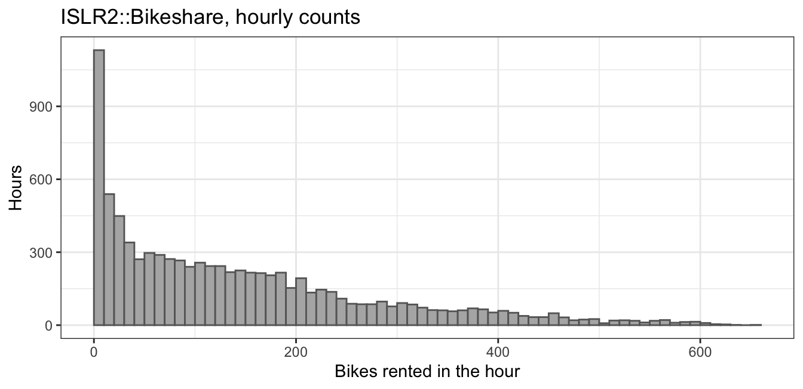
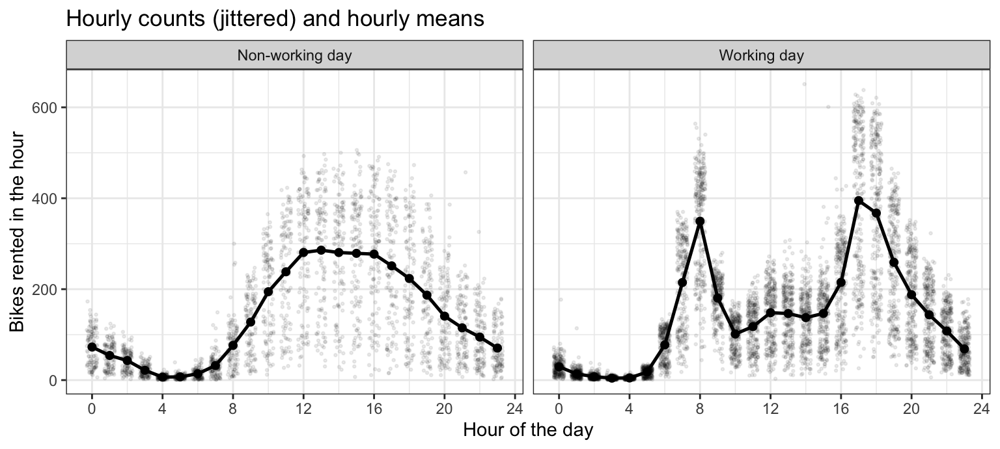
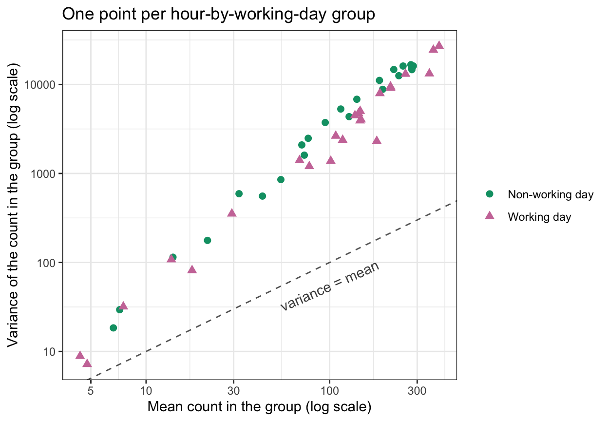
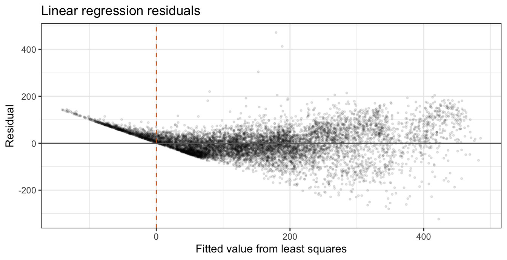
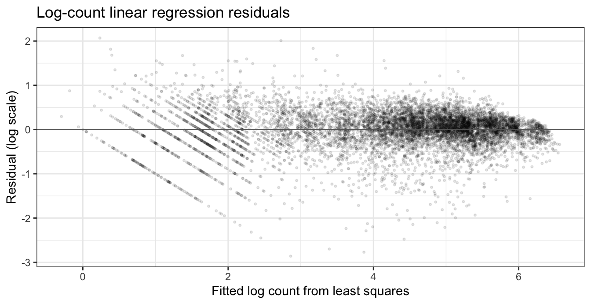
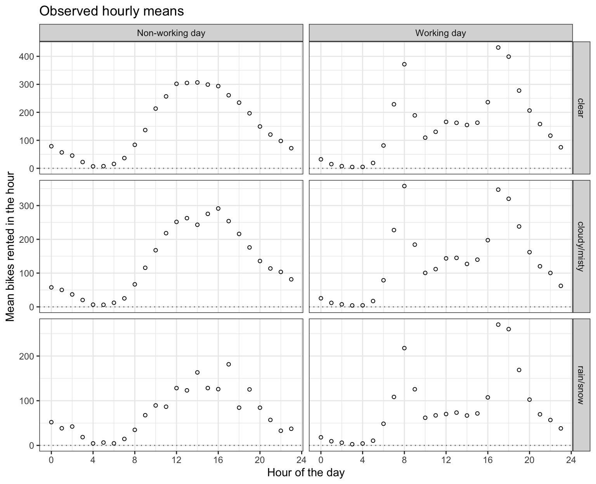
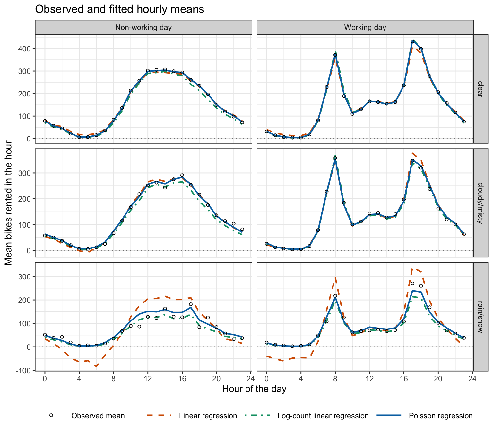
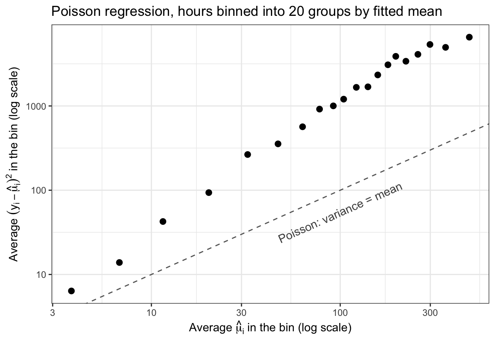

## Today

<!-- derived-from: 04-classification/70-generalized-linear-models.qmd @ cc6686a -->

- Count response
- Poisson distribution
- Log-count regression
- Generalized linear models
- Poisson regression
- Maximum likelihood
- Rate ratios
- Inference
- Overdispersion

::: notes
Distilled from the chapter's six learning objectives, each compressed to a noun phrase: three components and special cases; linear regression's failure and log-count regression; the score equations; coefficient interpretation and Wald inference; the drop-in-deviance test; Pearson residuals and overdispersion. The title slide carries the chapter title.

Timing: one 50-minute period. Optional slides, in the order they would go if time is short: Fitting, Conclusion. If time is still short, drop in this order: Observed hourly means, Variance function, Interaction test (keep the equations on Drop-in-deviance test).
:::

# Count Response

## Bike rentals

`ISLR2::Bikeshare`: 8,645 hours of one year in Washington, D.C.

- Response variable: `bikers`, the number of bikes rented in the hour
- Explanatory variables:
  - `hr`: hour of the day, 0 to 23
  - `workingday`: working day or not
  - `mnth`: month
  - `temp`: temperature, rescaled to $[0, 1]$
  - `weathersit`: weather

::: notes
A count is a nonnegative integer, its mean must be positive and its spread typically grows with its mean, unlike the quantitative response of the regression lectures and the binary one of the logistic regression lectures. The question is how the hourly count depends on time of day, working day, month, temperature and weather. casual and registered are pieces of the response and no model uses them. 115 hours of the year have no record (365 days of 24 hours, against 8,645 records).
:::

## Hourly counts

::: {.panel-tabset}

### Distribution



### Hourly profile



### Mean and variance



:::

::: notes
Distribution: counts from 1 to 651, median 109, mean 143.8, strongly right-skewed. Hourly profile: working days peak twice, at hour 8 and hour 17, the commute; non-working days rise to a midday plateau; the two profiles differ in shape, not just in level, and the spread is larger where the mean is higher. Mean and variance: one point per hour-by-working-day group (48 of them) at its mean and variance on log scales; the variance climbs with the mean, on a line of slope 1.75 on these axes, and all 48 points lie above the dashed line where the variance equals the mean; month, temperature and weather vary within each group, so part of each group's variance is variation they could explain.

The third tab is the same image as the chapter's figure that opens the Generalized Linear Models section; say so aloud when the deck reaches that section.
:::

## Poisson distribution

$$P(Y = y) = \frac{\mu^{y} e^{-\mu}}{y!}, \qquad y = 0, 1, 2, \ldots$$

$\mu > 0$ — mean

::: {.fragment}
$$E[Y] = Var[Y] = \mu$$
:::

::: notes
The dashed line of the previous slide is the variance of the standard model for a count. The chapter writes mu for the Poisson mean (the symbol the GLMs below use for a mean) where ISLR2 writes lambda.
:::

## Poisson distribution, slider

```{=html}
<script type="ojs-define">
{"contents":[{"name":"poisson_pmf","value":{"mu":[1,1,1,1,1,1,1,1.5,1.5,1.5,1.5,1.5,1.5,1.5,1.5,2,2,2,2,2,2,2,2,2,2.5,2.5,2.5,2.5,2.5,2.5,2.5,2.5,2.5,2.5,3,3,3,3,3,3,3,3,3,3,3,3.5,3.5,3.5,3.5,3.5,3.5,3.5,3.5,3.5,3.5,3.5,3.5,4,4,4,4,4,4,4,4,4,4,4,4,4,4.5,4.5,4.5,4.5,4.5,4.5,4.5,4.5,4.5,4.5,4.5,4.5,4.5,4.5,5,5,5,5,5,5,5,5,5,5,5,5,5,5,5.5,5.5,5.5,5.5,5.5,5.5,5.5,5.5,5.5,5.5,5.5,5.5,5.5,5.5,5.5,6,6,6,6,6,6,6,6,6,6,6,6,6,6,6,6,6.5,6.5,6.5,6.5,6.5,6.5,6.5,6.5,6.5,6.5,6.5,6.5,6.5,6.5,6.5,6.5,6.5,7,7,7,7,7,7,7,7,7,7,7,7,7,7,7,7,7,7,7.5,7.5,7.5,7.5,7.5,7.5,7.5,7.5,7.5,7.5,7.5,7.5,7.5,7.5,7.5,7.5,7.5,7.5,8,8,8,8,8,8,8,8,8,8,8,8,8,8,8,8,8,8,8.5,8.5,8.5,8.5,8.5,8.5,8.5,8.5,8.5,8.5,8.5,8.5,8.5,8.5,8.5,8.5,8.5,8.5,8.5,9,9,9,9,9,9,9,9,9,9,9,9,9,9,9,9,9,9,9,9,9.5,9.5,9.5,9.5,9.5,9.5,9.5,9.5,9.5,9.5,9.5,9.5,9.5,9.5,9.5,9.5,9.5,9.5,9.5,9.5,10,10,10,10,10,10,10,10,10,10,10,10,10,10,10,10,10,10,10,10,10.5,10.5,10.5,10.5,10.5,10.5,10.5,10.5,10.5,10.5,10.5,10.5,10.5,10.5,10.5,10.5,10.5,10.5,10.5,10.5,10.5,11,11,11,11,11,11,11,11,11,11,11,11,11,11,11,11,11,11,11,11,11,11,11.5,11.5,11.5,11.5,11.5,11.5,11.5,11.5,11.5,11.5,11.5,11.5,11.5,11.5,11.5,11.5,11.5,11.5,11.5,11.5,11.5,11.5,12,12,12,12,12,12,12,12,12,12,12,12,12,12,12,12,12,12,12,12,12,12,12.5,12.5,12.5,12.5,12.5,12.5,12.5,12.5,12.5,12.5,12.5,12.5,12.5,12.5,12.5,12.5,12.5,12.5,12.5,12.5,12.5,12.5,12.5,13,13,13,13,13,13,13,13,13,13,13,13,13,13,13,13,13,13,13,13,13,13,13,13,13.5,13.5,13.5,13.5,13.5,13.5,13.5,13.5,13.5,13.5,13.5,13.5,13.5,13.5,13.5,13.5,13.5,13.5,13.5,13.5,13.5,13.5,13.5,13.5,14,14,14,14,14,14,14,14,14,14,14,14,14,14,14,14,14,14,14,14,14,14,14,14,14.5,14.5,14.5,14.5,14.5,14.5,14.5,14.5,14.5,14.5,14.5,14.5,14.5,14.5,14.5,14.5,14.5,14.5,14.5,14.5,14.5,14.5,14.5,14.5,14.5,15,15,15,15,15,15,15,15,15,15,15,15,15,15,15,15,15,15,15,15,15,15,15,15,15,15.5,15.5,15.5,15.5,15.5,15.5,15.5,15.5,15.5,15.5,15.5,15.5,15.5,15.5,15.5,15.5,15.5,15.5,15.5,15.5,15.5,15.5,15.5,15.5,15.5,16,16,16,16,16,16,16,16,16,16,16,16,16,16,16,16,16,16,16,16,16,16,16,16,16,16,16.5,16.5,16.5,16.5,16.5,16.5,16.5,16.5,16.5,16.5,16.5,16.5,16.5,16.5,16.5,16.5,16.5,16.5,16.5,16.5,16.5,16.5,16.5,16.5,16.5,16.5,17,17,17,17,17,17,17,17,17,17,17,17,17,17,17,17,17,17,17,17,17,17,17,17,17,17,17.5,17.5,17.5,17.5,17.5,17.5,17.5,17.5,17.5,17.5,17.5,17.5,17.5,17.5,17.5,17.5,17.5,17.5,17.5,17.5,17.5,17.5,17.5,17.5,17.5,17.5,17.5,18,18,18,18,18,18,18,18,18,18,18,18,18,18,18,18,18,18,18,18,18,18,18,18,18,18,18,18.5,18.5,18.5,18.5,18.5,18.5,18.5,18.5,18.5,18.5,18.5,18.5,18.5,18.5,18.5,18.5,18.5,18.5,18.5,18.5,18.5,18.5,18.5,18.5,18.5,18.5,18.5,18.5,19,19,19,19,19,19,19,19,19,19,19,19,19,19,19,19,19,19,19,19,19,19,19,19,19,19,19,19,19.5,19.5,19.5,19.5,19.5,19.5,19.5,19.5,19.5,19.5,19.5,19.5,19.5,19.5,19.5,19.5,19.5,19.5,19.5,19.5,19.5,19.5,19.5,19.5,19.5,19.5,19.5,19.5,20,20,20,20,20,20,20,20,20,20,20,20,20,20,20,20,20,20,20,20,20,20,20,20,20,20,20,20,20,20.5,20.5,20.5,20.5,20.5,20.5,20.5,20.5,20.5,20.5,20.5,20.5,20.5,20.5,20.5,20.5,20.5,20.5,20.5,20.5,20.5,20.5,20.5,20.5,20.5,20.5,20.5,20.5,20.5,21,21,21,21,21,21,21,21,21,21,21,21,21,21,21,21,21,21,21,21,21,21,21,21,21,21,21,21,21,21.5,21.5,21.5,21.5,21.5,21.5,21.5,21.5,21.5,21.5,21.5,21.5,21.5,21.5,21.5,21.5,21.5,21.5,21.5,21.5,21.5,21.5,21.5,21.5,21.5,21.5,21.5,21.5,21.5,21.5,22,22,22,22,22,22,22,22,22,22,22,22,22,22,22,22,22,22,22,22,22,22,22,22,22,22,22,22,22,22,22.5,22.5,22.5,22.5,22.5,22.5,22.5,22.5,22.5,22.5,22.5,22.5,22.5,22.5,22.5,22.5,22.5,22.5,22.5,22.5,22.5,22.5,22.5,22.5,22.5,22.5,22.5,22.5,22.5,22.5,23,23,23,23,23,23,23,23,23,23,23,23,23,23,23,23,23,23,23,23,23,23,23,23,23,23,23,23,23,23,23,23.5,23.5,23.5,23.5,23.5,23.5,23.5,23.5,23.5,23.5,23.5,23.5,23.5,23.5,23.5,23.5,23.5,23.5,23.5,23.5,23.5,23.5,23.5,23.5,23.5,23.5,23.5,23.5,23.5,23.5,23.5,24,24,24,24,24,24,24,24,24,24,24,24,24,24,24,24,24,24,24,24,24,24,24,24,24,24,24,24,24,24,24,24.5,24.5,24.5,24.5,24.5,24.5,24.5,24.5,24.5,24.5,24.5,24.5,24.5,24.5,24.5,24.5,24.5,24.5,24.5,24.5,24.5,24.5,24.5,24.5,24.5,24.5,24.5,24.5,24.5,24.5,24.5,25,25,25,25,25,25,25,25,25,25,25,25,25,25,25,25,25,25,25,25,25,25,25,25,25,25,25,25,25,25,25,25,25.5,25.5,25.5,25.5,25.5,25.5,25.5,25.5,25.5,25.5,25.5,25.5,25.5,25.5,25.5,25.5,25.5,25.5,25.5,25.5,25.5,25.5,25.5,25.5,25.5,25.5,25.5,25.5,25.5,25.5,25.5,25.5,26,26,26,26,26,26,26,26,26,26,26,26,26,26,26,26,26,26,26,26,26,26,26,26,26,26,26,26,26,26,26,26,26.5,26.5,26.5,26.5,26.5,26.5,26.5,26.5,26.5,26.5,26.5,26.5,26.5,26.5,26.5,26.5,26.5,26.5,26.5,26.5,26.5,26.5,26.5,26.5,26.5,26.5,26.5,26.5,26.5,26.5,26.5,26.5,27,27,27,27,27,27,27,27,27,27,27,27,27,27,27,27,27,27,27,27,27,27,27,27,27,27,27,27,27,27,27,27,27,27.5,27.5,27.5,27.5,27.5,27.5,27.5,27.5,27.5,27.5,27.5,27.5,27.5,27.5,27.5,27.5,27.5,27.5,27.5,27.5,27.5,27.5,27.5,27.5,27.5,27.5,27.5,27.5,27.5,27.5,27.5,27.5,27.5,28,28,28,28,28,28,28,28,28,28,28,28,28,28,28,28,28,28,28,28,28,28,28,28,28,28,28,28,28,28,28,28,28,28.5,28.5,28.5,28.5,28.5,28.5,28.5,28.5,28.5,28.5,28.5,28.5,28.5,28.5,28.5,28.5,28.5,28.5,28.5,28.5,28.5,28.5,28.5,28.5,28.5,28.5,28.5,28.5,28.5,28.5,28.5,28.5,28.5,28.5,29,29,29,29,29,29,29,29,29,29,29,29,29,29,29,29,29,29,29,29,29,29,29,29,29,29,29,29,29,29,29,29,29,29,29.5,29.5,29.5,29.5,29.5,29.5,29.5,29.5,29.5,29.5,29.5,29.5,29.5,29.5,29.5,29.5,29.5,29.5,29.5,29.5,29.5,29.5,29.5,29.5,29.5,29.5,29.5,29.5,29.5,29.5,29.5,29.5,29.5,29.5,30,30,30,30,30,30,30,30,30,30,30,30,30,30,30,30,30,30,30,30,30,30,30,30,30,30,30,30,30,30,30,30,30,30,30,30.5,30.5,30.5,30.5,30.5,30.5,30.5,30.5,30.5,30.5,30.5,30.5,30.5,30.5,30.5,30.5,30.5,30.5,30.5,30.5,30.5,30.5,30.5,30.5,30.5,30.5,30.5,30.5,30.5,30.5,30.5,30.5,30.5,30.5,30.5,31,31,31,31,31,31,31,31,31,31,31,31,31,31,31,31,31,31,31,31,31,31,31,31,31,31,31,31,31,31,31,31,31,31,31,31.5,31.5,31.5,31.5,31.5,31.5,31.5,31.5,31.5,31.5,31.5,31.5,31.5,31.5,31.5,31.5,31.5,31.5,31.5,31.5,31.5,31.5,31.5,31.5,31.5,31.5,31.5,31.5,31.5,31.5,31.5,31.5,31.5,31.5,31.5,32,32,32,32,32,32,32,32,32,32,32,32,32,32,32,32,32,32,32,32,32,32,32,32,32,32,32,32,32,32,32,32,32,32,32,32.5,32.5,32.5,32.5,32.5,32.5,32.5,32.5,32.5,32.5,32.5,32.5,32.5,32.5,32.5,32.5,32.5,32.5,32.5,32.5,32.5,32.5,32.5,32.5,32.5,32.5,32.5,32.5,32.5,32.5,32.5,32.5,32.5,32.5,32.5,32.5,33,33,33,33,33,33,33,33,33,33,33,33,33,33,33,33,33,33,33,33,33,33,33,33,33,33,33,33,33,33,33,33,33,33,33,33,33.5,33.5,33.5,33.5,33.5,33.5,33.5,33.5,33.5,33.5,33.5,33.5,33.5,33.5,33.5,33.5,33.5,33.5,33.5,33.5,33.5,33.5,33.5,33.5,33.5,33.5,33.5,33.5,33.5,33.5,33.5,33.5,33.5,33.5,33.5,33.5,34,34,34,34,34,34,34,34,34,34,34,34,34,34,34,34,34,34,34,34,34,34,34,34,34,34,34,34,34,34,34,34,34,34,34,34,34,34.5,34.5,34.5,34.5,34.5,34.5,34.5,34.5,34.5,34.5,34.5,34.5,34.5,34.5,34.5,34.5,34.5,34.5,34.5,34.5,34.5,34.5,34.5,34.5,34.5,34.5,34.5,34.5,34.5,34.5,34.5,34.5,34.5,34.5,34.5,34.5,35,35,35,35,35,35,35,35,35,35,35,35,35,35,35,35,35,35,35,35,35,35,35,35,35,35,35,35,35,35,35,35,35,35,35,35,35,35.5,35.5,35.5,35.5,35.5,35.5,35.5,35.5,35.5,35.5,35.5,35.5,35.5,35.5,35.5,35.5,35.5,35.5,35.5,35.5,35.5,35.5,35.5,35.5,35.5,35.5,35.5,35.5,35.5,35.5,35.5,35.5,35.5,35.5,35.5,35.5,35.5,36,36,36,36,36,36,36,36,36,36,36,36,36,36,36,36,36,36,36,36,36,36,36,36,36,36,36,36,36,36,36,36,36,36,36,36,36,36.5,36.5,36.5,36.5,36.5,36.5,36.5,36.5,36.5,36.5,36.5,36.5,36.5,36.5,36.5,36.5,36.5,36.5,36.5,36.5,36.5,36.5,36.5,36.5,36.5,36.5,36.5,36.5,36.5,36.5,36.5,36.5,36.5,36.5,36.5,36.5,36.5,36.5,37,37,37,37,37,37,37,37,37,37,37,37,37,37,37,37,37,37,37,37,37,37,37,37,37,37,37,37,37,37,37,37,37,37,37,37,37,37,37.5,37.5,37.5,37.5,37.5,37.5,37.5,37.5,37.5,37.5,37.5,37.5,37.5,37.5,37.5,37.5,37.5,37.5,37.5,37.5,37.5,37.5,37.5,37.5,37.5,37.5,37.5,37.5,37.5,37.5,37.5,37.5,37.5,37.5,37.5,37.5,37.5,37.5,38,38,38,38,38,38,38,38,38,38,38,38,38,38,38,38,38,38,38,38,38,38,38,38,38,38,38,38,38,38,38,38,38,38,38,38,38,38,38,38.5,38.5,38.5,38.5,38.5,38.5,38.5,38.5,38.5,38.5,38.5,38.5,38.5,38.5,38.5,38.5,38.5,38.5,38.5,38.5,38.5,38.5,38.5,38.5,38.5,38.5,38.5,38.5,38.5,38.5,38.5,38.5,38.5,38.5,38.5,38.5,38.5,38.5,39,39,39,39,39,39,39,39,39,39,39,39,39,39,39,39,39,39,39,39,39,39,39,39,39,39,39,39,39,39,39,39,39,39,39,39,39,39,39,39.5,39.5,39.5,39.5,39.5,39.5,39.5,39.5,39.5,39.5,39.5,39.5,39.5,39.5,39.5,39.5,39.5,39.5,39.5,39.5,39.5,39.5,39.5,39.5,39.5,39.5,39.5,39.5,39.5,39.5,39.5,39.5,39.5,39.5,39.5,39.5,39.5,39.5,39.5,40,40,40,40,40,40,40,40,40,40,40,40,40,40,40,40,40,40,40,40,40,40,40,40,40,40,40,40,40,40,40,40,40,40,40,40,40,40,40],"y":[0,1,2,3,4,5,6,0,1,2,3,4,5,6,7,0,1,2,3,4,5,6,7,8,0,1,2,3,4,5,6,7,8,9,0,1,2,3,4,5,6,7,8,9,10,0,1,2,3,4,5,6,7,8,9,10,11,0,1,2,3,4,5,6,7,8,9,10,11,12,0,1,2,3,4,5,6,7,8,9,10,11,12,13,0,1,2,3,4,5,6,7,8,9,10,11,12,13,0,1,2,3,4,5,6,7,8,9,10,11,12,13,14,0,1,2,3,4,5,6,7,8,9,10,11,12,13,14,15,0,1,2,3,4,5,6,7,8,9,10,11,12,13,14,15,16,0,1,2,3,4,5,6,7,8,9,10,11,12,13,14,15,16,17,0,1,2,3,4,5,6,7,8,9,10,11,12,13,14,15,16,17,1,2,3,4,5,6,7,8,9,10,11,12,13,14,15,16,17,18,1,2,3,4,5,6,7,8,9,10,11,12,13,14,15,16,17,18,19,1,2,3,4,5,6,7,8,9,10,11,12,13,14,15,16,17,18,19,20,1,2,3,4,5,6,7,8,9,10,11,12,13,14,15,16,17,18,19,20,2,3,4,5,6,7,8,9,10,11,12,13,14,15,16,17,18,19,20,21,2,3,4,5,6,7,8,9,10,11,12,13,14,15,16,17,18,19,20,21,22,2,3,4,5,6,7,8,9,10,11,12,13,14,15,16,17,18,19,20,21,22,23,2,3,4,5,6,7,8,9,10,11,12,13,14,15,16,17,18,19,20,21,22,23,3,4,5,6,7,8,9,10,11,12,13,14,15,16,17,18,19,20,21,22,23,24,3,4,5,6,7,8,9,10,11,12,13,14,15,16,17,18,19,20,21,22,23,24,25,3,4,5,6,7,8,9,10,11,12,13,14,15,16,17,18,19,20,21,22,23,24,25,26,3,4,5,6,7,8,9,10,11,12,13,14,15,16,17,18,19,20,21,22,23,24,25,26,4,5,6,7,8,9,10,11,12,13,14,15,16,17,18,19,20,21,22,23,24,25,26,27,4,5,6,7,8,9,10,11,12,13,14,15,16,17,18,19,20,21,22,23,24,25,26,27,28,4,5,6,7,8,9,10,11,12,13,14,15,16,17,18,19,20,21,22,23,24,25,26,27,28,5,6,7,8,9,10,11,12,13,14,15,16,17,18,19,20,21,22,23,24,25,26,27,28,29,5,6,7,8,9,10,11,12,13,14,15,16,17,18,19,20,21,22,23,24,25,26,27,28,29,30,5,6,7,8,9,10,11,12,13,14,15,16,17,18,19,20,21,22,23,24,25,26,27,28,29,30,6,7,8,9,10,11,12,13,14,15,16,17,18,19,20,21,22,23,24,25,26,27,28,29,30,31,6,7,8,9,10,11,12,13,14,15,16,17,18,19,20,21,22,23,24,25,26,27,28,29,30,31,32,6,7,8,9,10,11,12,13,14,15,16,17,18,19,20,21,22,23,24,25,26,27,28,29,30,31,32,6,7,8,9,10,11,12,13,14,15,16,17,18,19,20,21,22,23,24,25,26,27,28,29,30,31,32,33,7,8,9,10,11,12,13,14,15,16,17,18,19,20,21,22,23,24,25,26,27,28,29,30,31,32,33,34,7,8,9,10,11,12,13,14,15,16,17,18,19,20,21,22,23,24,25,26,27,28,29,30,31,32,33,34,7,8,9,10,11,12,13,14,15,16,17,18,19,20,21,22,23,24,25,26,27,28,29,30,31,32,33,34,35,8,9,10,11,12,13,14,15,16,17,18,19,20,21,22,23,24,25,26,27,28,29,30,31,32,33,34,35,36,8,9,10,11,12,13,14,15,16,17,18,19,20,21,22,23,24,25,26,27,28,29,30,31,32,33,34,35,36,8,9,10,11,12,13,14,15,16,17,18,19,20,21,22,23,24,25,26,27,28,29,30,31,32,33,34,35,36,37,9,10,11,12,13,14,15,16,17,18,19,20,21,22,23,24,25,26,27,28,29,30,31,32,33,34,35,36,37,38,9,10,11,12,13,14,15,16,17,18,19,20,21,22,23,24,25,26,27,28,29,30,31,32,33,34,35,36,37,38,9,10,11,12,13,14,15,16,17,18,19,20,21,22,23,24,25,26,27,28,29,30,31,32,33,34,35,36,37,38,39,10,11,12,13,14,15,16,17,18,19,20,21,22,23,24,25,26,27,28,29,30,31,32,33,34,35,36,37,38,39,40,10,11,12,13,14,15,16,17,18,19,20,21,22,23,24,25,26,27,28,29,30,31,32,33,34,35,36,37,38,39,40,11,12,13,14,15,16,17,18,19,20,21,22,23,24,25,26,27,28,29,30,31,32,33,34,35,36,37,38,39,40,41,11,12,13,14,15,16,17,18,19,20,21,22,23,24,25,26,27,28,29,30,31,32,33,34,35,36,37,38,39,40,41,42,11,12,13,14,15,16,17,18,19,20,21,22,23,24,25,26,27,28,29,30,31,32,33,34,35,36,37,38,39,40,41,42,12,13,14,15,16,17,18,19,20,21,22,23,24,25,26,27,28,29,30,31,32,33,34,35,36,37,38,39,40,41,42,43,12,13,14,15,16,17,18,19,20,21,22,23,24,25,26,27,28,29,30,31,32,33,34,35,36,37,38,39,40,41,42,43,12,13,14,15,16,17,18,19,20,21,22,23,24,25,26,27,28,29,30,31,32,33,34,35,36,37,38,39,40,41,42,43,44,13,14,15,16,17,18,19,20,21,22,23,24,25,26,27,28,29,30,31,32,33,34,35,36,37,38,39,40,41,42,43,44,45,13,14,15,16,17,18,19,20,21,22,23,24,25,26,27,28,29,30,31,32,33,34,35,36,37,38,39,40,41,42,43,44,45,13,14,15,16,17,18,19,20,21,22,23,24,25,26,27,28,29,30,31,32,33,34,35,36,37,38,39,40,41,42,43,44,45,46,14,15,16,17,18,19,20,21,22,23,24,25,26,27,28,29,30,31,32,33,34,35,36,37,38,39,40,41,42,43,44,45,46,47,14,15,16,17,18,19,20,21,22,23,24,25,26,27,28,29,30,31,32,33,34,35,36,37,38,39,40,41,42,43,44,45,46,47,14,15,16,17,18,19,20,21,22,23,24,25,26,27,28,29,30,31,32,33,34,35,36,37,38,39,40,41,42,43,44,45,46,47,48,15,16,17,18,19,20,21,22,23,24,25,26,27,28,29,30,31,32,33,34,35,36,37,38,39,40,41,42,43,44,45,46,47,48,49,15,16,17,18,19,20,21,22,23,24,25,26,27,28,29,30,31,32,33,34,35,36,37,38,39,40,41,42,43,44,45,46,47,48,49,16,17,18,19,20,21,22,23,24,25,26,27,28,29,30,31,32,33,34,35,36,37,38,39,40,41,42,43,44,45,46,47,48,49,50,16,17,18,19,20,21,22,23,24,25,26,27,28,29,30,31,32,33,34,35,36,37,38,39,40,41,42,43,44,45,46,47,48,49,50,16,17,18,19,20,21,22,23,24,25,26,27,28,29,30,31,32,33,34,35,36,37,38,39,40,41,42,43,44,45,46,47,48,49,50,51,17,18,19,20,21,22,23,24,25,26,27,28,29,30,31,32,33,34,35,36,37,38,39,40,41,42,43,44,45,46,47,48,49,50,51,52,17,18,19,20,21,22,23,24,25,26,27,28,29,30,31,32,33,34,35,36,37,38,39,40,41,42,43,44,45,46,47,48,49,50,51,52,17,18,19,20,21,22,23,24,25,26,27,28,29,30,31,32,33,34,35,36,37,38,39,40,41,42,43,44,45,46,47,48,49,50,51,52,53,18,19,20,21,22,23,24,25,26,27,28,29,30,31,32,33,34,35,36,37,38,39,40,41,42,43,44,45,46,47,48,49,50,51,52,53,18,19,20,21,22,23,24,25,26,27,28,29,30,31,32,33,34,35,36,37,38,39,40,41,42,43,44,45,46,47,48,49,50,51,52,53,54,19,20,21,22,23,24,25,26,27,28,29,30,31,32,33,34,35,36,37,38,39,40,41,42,43,44,45,46,47,48,49,50,51,52,53,54,55,19,20,21,22,23,24,25,26,27,28,29,30,31,32,33,34,35,36,37,38,39,40,41,42,43,44,45,46,47,48,49,50,51,52,53,54,55,19,20,21,22,23,24,25,26,27,28,29,30,31,32,33,34,35,36,37,38,39,40,41,42,43,44,45,46,47,48,49,50,51,52,53,54,55,56,20,21,22,23,24,25,26,27,28,29,30,31,32,33,34,35,36,37,38,39,40,41,42,43,44,45,46,47,48,49,50,51,52,53,54,55,56,57,20,21,22,23,24,25,26,27,28,29,30,31,32,33,34,35,36,37,38,39,40,41,42,43,44,45,46,47,48,49,50,51,52,53,54,55,56,57,20,21,22,23,24,25,26,27,28,29,30,31,32,33,34,35,36,37,38,39,40,41,42,43,44,45,46,47,48,49,50,51,52,53,54,55,56,57,58,21,22,23,24,25,26,27,28,29,30,31,32,33,34,35,36,37,38,39,40,41,42,43,44,45,46,47,48,49,50,51,52,53,54,55,56,57,58,21,22,23,24,25,26,27,28,29,30,31,32,33,34,35,36,37,38,39,40,41,42,43,44,45,46,47,48,49,50,51,52,53,54,55,56,57,58,59,22,23,24,25,26,27,28,29,30,31,32,33,34,35,36,37,38,39,40,41,42,43,44,45,46,47,48,49,50,51,52,53,54,55,56,57,58,59,60,22,23,24,25,26,27,28,29,30,31,32,33,34,35,36,37,38,39,40,41,42,43,44,45,46,47,48,49,50,51,52,53,54,55,56,57,58,59,60],"prob":[0.367879441171442,0.367879441171442,0.183939720585721,0.0613132401952404,0.0153283100488101,0.00306566200976202,0.00051094366829367,0.22313016014843,0.334695240222645,0.251021430166984,0.125510715083492,0.0470665181563094,0.0141199554468928,0.00352998886172321,0.000756426184654973,0.135335283236613,0.270670566473225,0.270670566473225,0.180447044315484,0.0902235221577418,0.0360894088630967,0.0120298029543656,0.00343708655839016,0.000859271639597541,0.0820849986238988,0.205212496559747,0.256515620699684,0.213763017249736,0.133601885781085,0.0668009428905426,0.0278337262043928,0.00994061650156885,0.00310644265674026,0.000862900737983407,0.0497870683678639,0.149361205103592,0.224041807655388,0.224041807655388,0.168031355741541,0.100818813444924,0.0504094067224622,0.0216040314524838,0.00810151179468143,0.00270050393156048,0.000810151179468143,0.0301973834223185,0.105690841978115,0.184958973461701,0.215785469038651,0.18881228540882,0.132168599786174,0.077098349875268,0.038549174937634,0.0168652640352149,0.00655871379147245,0.00229554982701536,0.000730402217686705,0.0183156388887342,0.0732625555549367,0.146525111109873,0.195366814813165,0.195366814813165,0.156293451850532,0.104195634567021,0.0595403626097264,0.0297701813048632,0.0132311916910503,0.00529247667642012,0.00192453697324368,0.00064151232441456,0.0111089965382423,0.0499904844220904,0.112478589949703,0.168717884924555,0.189807620540124,0.170826858486112,0.128120143864584,0.0823629496272326,0.0463291591653183,0.0231645795826592,0.0104240608121966,0.00426438851408043,0.00159914569278016,0.00055355043211621,0.00673794699908547,0.0336897349954273,0.0842243374885683,0.140373895814281,0.175467369767851,0.175467369767851,0.146222808139876,0.104444862957054,0.0652780393481587,0.0362655774156437,0.0181327887078219,0.00824217668537358,0.00343424028557232,0.00132086164829705,0.00408677143846407,0.0224772429115524,0.061812418006769,0.113322766345743,0.155818803725397,0.171400684097937,0.157117293756442,0.123449302237204,0.084871395288078,0.0518658526760476,0.0285262189718262,0.0142631094859131,0.00653725851437684,0.00276576321762097,0.00108654983549395,0.00247875217666636,0.0148725130599982,0.0446175391799945,0.0892350783599889,0.133852617539983,0.16062314104798,0.16062314104798,0.137676978041126,0.103257733530844,0.0688384890205629,0.0413030934123377,0.0225289600430933,0.0112644800215467,0.00519899077917538,0.00222813890536088,0.000891255562144351,0.00150343919297757,0.00977235475435422,0.0317601529516512,0.0688136647285776,0.111822205183939,0.14536886673912,0.15748293896738,0.146234157612567,0.118815253060211,0.0858110160990413,0.0557771604643768,0.0329592311834954,0.01785291689106,0.00892645844553001,0.00414442713542464,0.00179591842535068,0.000729591860298714,0.000911881965554516,0.00638317375888161,0.0223411081560856,0.0521292523641998,0.0912261916373497,0.12771666829229,0.149002779674338,0.149002779674338,0.130377432215046,0.101404669500591,0.0709832686504137,0.0451711709593542,0.02634984972629,0.0141883806218484,0.00709419031092422,0.00331062214509797,0.00144839718848036,0.000596398842315443,0.000553084370147834,0.00414813277610875,0.0155554979104078,0.0388887447760196,0.0729163964550367,0.109374594682555,0.136718243353194,0.146483832164136,0.137328592653878,0.114440493878231,0.0858303704086735,0.0585207070968229,0.0365754419355143,0.0211012165012582,0.0113042231256741,0.00565211156283703,0.00264942729507986,0.00116886498312347,0.00268370102322009,0.0107348040928804,0.028626144247681,0.057252288495362,0.0916036615925792,0.122138215456772,0.139586531950597,0.139586531950597,0.124076917289419,0.0992615338315356,0.072190206422935,0.0481268042819567,0.0296164949427426,0.0169237113958529,0.00902597941112154,0.00451298970556077,0.00212375986144036,0.000943893271751272,0.00172948113659048,0.00735029483050952,0.0208258353531103,0.0442549001253594,0.075233330213111,0.106580551135241,0.129419240664221,0.137507943205734,0.129868613027638,0.110388321073492,0.0853000662840623,0.0604208802845441,0.0395059601860481,0.0239857615415292,0.0135919315401999,0.00722071363073119,0.00361035681536559,0.00170489071836709,0.00076271426874317,0.00111068823678012,0.00499809706551052,0.0149942911965316,0.033737155192196,0.0607268793459528,0.0910903190189293,0.117116124452909,0.131755640009523,0.131755640009523,0.11858007600857,0.0970200621888303,0.0727650466416228,0.0503758015211234,0.0323844438350079,0.0194306663010048,0.0109297497943152,0.00578633812640215,0.00289316906320108,0.00137044850362156,0.000616701826629703,0.000711092383933156,0.00337768882368249,0.0106960146083279,0.0254030346947787,0.0482657659200796,0.076420796040126,0.103713937483028,0.123160300761096,0.130002539692268,0.123502412707654,0.106661174611156,0.0844400965671653,0.0617062244144669,0.041872080852674,0.0265189845400269,0.015745647070641,0.00879903806888759,0.00464393675857956,0.00232196837928978,0.00110293498016265,0.00226999648812424,0.00756665496041414,0.0189166374010354,0.0378332748020707,0.0630554580034512,0.090079225719216,0.11259903214902,0.125110035721133,0.125110035721133,0.113736396110121,0.0947803300917677,0.0729079462244367,0.0520771044460262,0.0347180696306841,0.0216987935191776,0.0127639961877515,0.00709110899319529,0.00373216262799752,0.00186608131399876,0.000888610149523219,0.00151794677040481,0.00531281369641684,0.0139461359530942,0.0292868855014978,0.0512520496276212,0.0768780744414318,0.100902472704379,0.117719551488442,0.123605529062865,0.117987095923644,0.103238708933188,0.0833851110614211,0.0625388332960658,0.0437771833072461,0.0287287765453803,0.0177442443368525,0.0103508091964973,0.00572018402964324,0.0030030966155627,0.00150154830778135,0.000716648055986554,0.00101045289780986,0.00370499395863616,0.0101887333862494,0.0224152134497488,0.0410945579912061,0.0645771625576096,0.0887935985167132,0.108525509298205,0.119378060228025,0.119378060228025,0.109429888542357,0.0925945210743018,0.0727528379869514,0.0533520811904311,0.0366795558184214,0.0237338302354491,0.0145040073661078,0.00839705689616767,0.00461838129289222,0.00241915210580068,0.00120957605290034,0.000578492894865381,0.000669852439209456,0.00256776768363625,0.00738233209045421,0.0169793638080447,0.0325437806320856,0.0534647824669978,0.0768556247963094,0.0982044094619509,0.112935070881244,0.118068483194027,0.113148963060943,0.100093313476988,0.0822195074989544,0.0630349557491983,0.0453063744447363,0.0306484297714393,0.019580941242864,0.0118516223312071,0.00681468284044411,0.00373185012690987,0.00195073983906652,0.000975369919533261,0.00176953315775852,0.00530859947327557,0.0127406387358614,0.0254812774717228,0.0436821899515247,0.0655232849272871,0.0873643799030494,0.104837255883659,0.114367915509447,0.114367915509447,0.105570383547181,0.0904889001832984,0.0723911201466387,0.054293340109979,0.0383247106658675,0.0255498071105784,0.0161367202803653,0.00968203216821917,0.00553258981041095,0.00301777626022416,0.00157449196185608,0.000787245980928041,0.00121310324611936,0.003790947644123,0.00947736911030749,0.0197445189798073,0.0352580696067987,0.055090733760623,0.0765149080008653,0.0956436350010816,0.108685948864865,0.113214530067568,0.108860125064969,0.0971965402365798,0.0809971168638165,0.0632789975498566,0.0465286746690122,0.0323115796312585,0.0212576181784595,0.0132860113615372,0.0079083400961531,0.00449337505463244,0.00244205166012633,0.0012719019063158,0.000635950953157898,0.000827657284522896,0.00268988617469941,0.00699370405421847,0.0151530254508067,0.0281413329800696,0.045729666092613,0.0660539621337744,0.0858701507739067,0.101482905460072,0.109939814248411,0.109939814248411,0.102086970373524,0.0884753743237211,0.0718862416380234,0.0549718318408414,0.0397018785517188,0.0271644432195971,0.0176568880927381,0.0109304545335998,0.0064589049516726,0.00365068540746712,0.00197745459571136,0.00102827638976991,0.000514138194884953,0.000562178910360374,0.00189735382246626,0.0051228553206589,0.0115264244714825,0.0222295329092877,0.0375123367844231,0.0562685051766346,0.0759624819884567,0.0932266824403787,0.104880017745426,0.108913864581789,0.105024083703868,0.0945216753334808,0.0797526635626244,0.0633329975350253,0.047499748151269,0.033749821054849,0.0227811292120231,0.0146450116363005,0.0089867116859117,0.00527480903303513,0.00296708008108226,0.00160222324378442,0.000831923607349603,0.00133100030304511,0.00372680084852631,0.00869586864656139,0.0173917372931228,0.0304355402629649,0.0473441737423898,0.0662818432393457,0.0843587095773491,0.0984184945069073,0.105989147930516,0.105989147930516,0.0989232047351478,0.0865578041432544,0.0712828975297389,0.0554422536342413,0.0408521868883884,0.0285965308218719,0.0190643538812479,0.0121318615607941,0.0073846113848312,0.00430768997448487,0.00241230638571153,0.00129893420769082,0.000673521441024871,0.0009289466643976,0.00269394532675304,0.00651036787298651,0.0134857620226149,0.0244429436659896,0.0393802981285387,0.0571014322863811,0.0752700698320479,0.0909513343803912,0.10144571911659,0.105068780513611,0.101566487829824,0.0920446295957782,0.0785086546552226,0.0632430829167071,0.0482644580153817,0.0349917320611517,0.0241609578517476,0.0159242676750155,0.0100392122299011,0.00606535738889856,0.00351790728556116,0.00196190983233219,0.00105361824328951,0.000545623733132067,0.000645262707308539,0.00193578812192562,0.00483947030481404,0.0103702935103158,0.0194443003318421,0.0324071672197369,0.0486107508296053,0.0662873874949163,0.0828592343686455,0.0956068088868986,0.102435866664534,0.102435866664534,0.0960336249980008,0.0847355514688242,0.0706129595573535,0.0557470733347528,0.0418103050010646,0.029864503572189,0.0203621615264925,0.013279670560756,0.00829979410047249,0.00497987646028349,0.00287300565016355,0.00159611425009086,0.000855061205405819,0.00138328852824033,0.00357349536462085,0.00791273973594616,0.0153309332383957,0.0264032739105704,0.040925074561384,0.0576671505183139,0.0744867360861554,0.0888111084104161,0.0983265843115321,0.101604137121917,0.0984290078368566,0.0897440953806634,0.0772796376889046,0.063043914956738,0.0488590340914719,0.0360626204008483,0.0254077552824159,0.0171226176903237,0.0110583572583341,0.00685618150016713,0.00408733897125348,0.00234643533534922,0.00129891956063975,0.000694250109997106,0.000983347361386849,0.00262225963036493,0.00599373629797698,0.011987472595954,0.0213110623928071,0.0340976998284913,0.0495966542959873,0.0661288723946497,0.0813893814087997,0.0930164358957711,0.0992175316221558,0.0992175316221558,0.0933812062326172,0.0830055166512153,0.0698993824431287,0.055919505954503,0.0426053378700975,0.0309857002691618,0.0215552697524604,0.0143701798349736,0.0091969150943831,0.00565964005808191,0.00335386077515965,0.0019164918715198,0.0010573748256661,0.000563933240355251,0.000695631954674458,0.00191298787535476,0.00450918570619336,0.00930019551902381,0.0170503584515437,0.028133091445047,0.0421996371675706,0.0580245011054095,0.0736464821722505,0.0867976397030095,0.0954774036733105,0.0984610725381015,0.095565158639922,0.0876013954199285,0.0760748960225695,0.0627617892186198,0.0493128343860584,0.0369846257895438,0.0265324489359771,0.0182410586434843,0.0120390987046996,0.00764019725490552,0.00466900943355337,0.00275138055905824,0.00156544066291245,0.000860992364601845,0.00138788933809555,0.00337058839251776,0.00716250033410025,0.0135291672977449,0.0229995844061663,0.0355448122640753,0.05035515070744,0.0658490432328061,0.0799595524969788,0.0906208261632427,0.0962846277984453,0.0962846277984453,0.0909354818096428,0.0813633258296804,0.0691588269552283,0.0559857170589944,0.0432616904546775,0.0319760320751964,0.0226496893865974,0.0154017887828863,0.010070400358041,0.00634062244765546,0.00384966362893367,0.00225669936868525,0.00127879630892164,0.000701275395215095,0.00100171081432469,0.00250427703581173,0.00547810601583816,0.0106518728085742,0.0186407774150049,0.0296557822511441,0.0432480157829185,0.0582184827846979,0.0727731034808724,0.0849019540610178,0.0928615122542383,0.0955927332028923,0.092937379502812,0.0856002179631163,0.0749001907177267,0.0624168255981056,0.0496497476348568,0.0377769818960867,0.0275457159658965,0.0192820011761276,0.0129782700223936,0.00841184168118101,0.00525740105073813,0.00317256959958335,0.00185066559975696,0.00104473058050796,0.00057133703621529,0.000719452059156429,0.00185001958068796,0.00416254405654791,0.00832508811309582,0.0149851586035725,0.0245211686240277,0.0367817529360415,0.0509285809883652,0.0654796041278981,0.0785755249534777,0.0883974655726625,0.0935973164887014,0.0935973164887014,0.0886711419366645,0.079804027742998,0.0684034523511412,0.0559664610145701,0.0437998390548809,0.0328498792911607,0.0236519130896357,0.0163744013697478,0.0109162675798319,0.00701760058703477,0.00435575208850434,0.0026134512531026,0.00151748782438216,0.000853586901214963,0.000514339595258813,0.001359326073184,0.00314344154423801,0.00646151872982258,0.0119538096501718,0.0201041344116525,0.030993873884631,0.0441066666819748,0.0582838095440382,0.0718833651043138,0.0831151409018628,0.0904488298049683,0.0929612972995507,0.0905149473706152,0.0837263263178191,0.0737589065180787,0.0620245350265662,0.0498892999126728,0.038456335349352,0.0284576881585204,0.0202487396512549,0.0138741364277117,0.0091668401397381,0.0058478118132812,0.00360615061819007,0.0021520576269844,0.00124415831560036,0.000697482692078987,0.000993686784699294,0.00236000611366082,0.00498223512883952,0.00946624674479508,0.0163507898319188,0.0258887505672047,0.0378374046751454,0.0513507634876973,0.0650443004177499,0.077240106746078,0.0863271781279695,0.0911231324684123,0.0911231324684123,0.0865669758449917,0.0783225019549925,0.0676421607793117,0.0558783067307357,0.0442369928284991,0.0336201145496593,0.024568545247828,0.0172889762855086,0.0117318053365951,0.00768635522052783,0.00486802497300096,0.00298362820925865,0.00177152924924732,0.00101997138593028,0.000569984009784567,0.000722885221097097,0.00176203272642417,0.00381773757391904,0.00744458826914213,0.0131972246589338,0.0214454900707674,0.0321682351061511,0.0448057560407104,0.0582474828529236,0.0709891197270006,0.0814286961574419,0.0882144208372287,0.0905358529645242,0.0882724566404111,0.081967281166096,0.0726528173972215,0.061596953880253,0.0500475250277055,0.0390370695216103,0.0292778021412077,0.0211450793242056,0.0147260373865003,0.00990199065643987,0.00643629392668592,0.00404863650227017,0.00246713786857089,0.00145785419506461,0.000836122258934117,0.000523467586651062,0.00130866896662766,0.00290815325917257,0.00581630651834514,0.0105751027606275,0.0176251712677125,0.0271156481041731,0.0387366401488188,0.0516488535317584,0.0645610669146979,0.0759541963702329,0.084393551522481,0.0888353173920852,0.0888353173920852,0.0846050641829383,0.0769136947117621,0.0668814736624018,0.0557345613853348,0.0445876491082679,0.0342981916217445,0.0254060678679589,0.0181471913342564,0.0125153043684527,0.00834353624563511,0.00538292661008717,0.00336432913130448,0.00203898735230574,0.00119940432488573,0.000685373899934704,0.000967104682372024,0.00220284955429183,0.00451584158629825,0.00841588659264675,0.0143771395957715,0.0226716432087166,0.0331977632699065,0.0453702764688722,0.0581306667257425,0.0700987451692778,0.0798346819983441,0.0861374200508449,0.0882908555521161,0.0861886923246847,0.0803121905752744,0.0715826046431794,0.0611434747993824,0.0501376493354936,0.0395316081299084,0.0300147395060416,0.0219750771383518,0.0155341062529729,0.0106149726061981,0.00701957865893747,0.00449691757838182,0.00279353970778264,0.00168434011792777,0.000986542069071979,0.000561780900443766,0.000711294932195427,0.00165968817512266,0.00348534516775759,0.00665384077480995,0.0116442213559174,0.018809896036482,0.0282148440547229,0.0395007816766121,0.0518447759505534,0.0640435467624483,0.0747174712228564,0.0825824681936834,0.0867115916033675,0.0867115916033675,0.0827701556213963,0.0755727507847531,0.066126156936659,0.0555459718267935,0.0448640541677948,0.0348942643527293,0.026170698264547,0.0189511952950168,0.0132658367065117,0.00898653454312085,0.00589741329392306,0.00375289936886013,0.00231796725723714,0.00139078035434228,0.000811288540032998,0.000520781795959147,0.00124408984590241,0.00267479316869017,0.00522800482971261,0.00936684198656843,0.0154913155931709,0.023790234660941,0.0340993363473487,0.0458209832167499,0.0579500670094189,0.0692181355945837,0.0783257850149237,0.084200218891043,0.0862049860074964,0.0842457817800533,0.0787514916639628,0.0705482112823001,0.0606714617027781,0.0501706317926819,0.0399506882793578,0.030676421357364,0.0227428641097699,0.0162990526120017,0.0113041816502593,0.00759499704626795,0.00494825565135639,0.0031290440148283,0.00192212703768024,0.00114793698083681,0.000667044461837607,0.000928031019216713,0.00204166824227677,0.00408333648455354,0.00748611688834815,0.0126688131956661,0.019908135021761,0.0291985980319162,0.0401480722938847,0.0519563288509097,0.0635021797066673,0.0735288396603517,0.0808817236263868,0.0847332342752624,0.0847332342752624,0.0810491806111206,0.0742950822268605,0.0653796723596373,0.0553212612273854,0.045076583222314,0.035417315388961,0.0268683082261083,0.0197034260324795,0.013983076539179,0.00961336512068554,0.00640891008045703,0.00414694181676631,0.0026066491419674,0.00159295225342452,0.000947160799333498,0.000548356252245709,0.000689054839528677,0.00155037338893952,0.00317121829555812,0.00594603430417147,0.0102912132187583,0.0165394498158616,0.0248091747237924,0.034887901955333,0.0461751643526466,0.0577189554408083,0.0683513946009572,0.0768953189260768,0.0823878417065108,0.0842602926543861,0.0824285471618994,0.0772767629642807,0.0695490866678527,0.060186709616411,0.0501555913470091,0.0403036001895609,0.0312700346298317,0.0234525259723738,0.0170219946573681,0.0119685899934619,0.0081604022682695,0.00540026620694305,0.00347159970446339,0.00216974981528962,0.00131944245524369,0.000781248822183762,0.000509347768139683,0.00117149986672127,0.00244949972132629,0.0046948744658754,0.00830631636270262,0.0136460911672972,0.0209240064565223,0.0300782592812508,0.0406941154981629,0.0519980364698748,0.0629449915161642,0.0723867402435889,0.079280715504883,0.0828843843914686,0.0828843843914686,0.0794308683751574,0.0730763989051448,0.064644506723782,0.0550675427647032,0.0452340529852919,0.0358752834021281,0.0275043839416315,0.0204064784083072,0.0146671563559708,0.0102225635208282,0.00691526355820728,0.00454431605253621,0.0029033130335648,0.00180476215599974,0.00109235604178932,0.000644209973362931,0.000881039267444798,0.00188222025317752,0.00368601466247265,0.00666318035139286,0.0111846241612666,0.017522577852651,0.0257362862210812,0.035576630952671,0.0464472681882094,0.0574479369696274,0.0675013259393122,0.0755371980749446,0.0806874615800544,0.0824415368317947,0.0807240048144657,0.0758805645255977,0.0685843563981364,0.0596937916798595,0.0501001465884535,0.040598394649264,0.0318020758085902,0.0241080252097377,0.0177043310134011,0.0126076296610584,0.00871409697161388,0.00585089368094075,0.00381933337505854,0.00242579281929394,0.00150016134877388,0.000903943376825289,0.000531066733884857,0.000659601779393956,0.00143913115504136,0.00287826231008272,0.00531371503399886,0.00910922577256948,0.0145747612361112,0.0218621418541667,0.030864200264706,0.041152267019608,0.0519818109721364,0.0623781731665637,0.0712893407617871,0.0777701899219496,0.0811515025272517,0.0811515025272517,0.0779054424261616,0.0719127160856877,0.063922414298389,0.0547906408271906,0.045343978615606,0.0362751828924848,0.0280840125619237,0.0210630094214428,0.0153185523065039,0.0108130957457674,0.00741469422566909,0.00494312948377939,0.0032063542597488,0.0020250658482624,0.00124619436816148,0.000747716620896885,0.00109510661756274,0.00223584267752392,0.00421370350764123,0.00737398113837216,0.0120441691926745,0.0184426340762829,0.0265790902864077,0.0361770951120549,0.046649412118176,0.0571455298447656,0.0666697848188932,0.0742458967301311,0.0790880204299223,0.0807356875222123,0.0791209737717681,0.0745563022080122,0.0676529408924555,0.0591963232808986,0.0500106869097247,0.0408420609762752,0.0322784030296368,0.0247131523195657,0.0183476433887685,0.0132210959713185,0.00925476717992291,0.00629838321966976,0.00417055105086241,0.00268890791437182,0.00168918574107973,0.00103462626641134,0.000618252281148237,0.000829511344327948,0.00172814863401656,0.00332336275772415,0.00593457635307884,0.00989096058846474,0.0154546259194762,0.0227273910580532,0.0315658209139627,0.0415339748867931,0.0519174686084913,0.061806510248204,0.0702346707365954,0.0763420334093428,0.0795229514680654,0.0795229514680654,0.0764643764116014,0.0708003485292606,0.0632145969011255,0.0544953421561427,0.0454127851301189,0.036623213814612,0.0286118857926656,0.0216756710550497,0.0159379934228307,0.0113842810163076,0.00790575070576918,0.00534172344984404,0.00351429174331845,0.00225275111751183,0.00140796944844489,0.000858517956368836,0.000511022593076688,0.00062557153376283,0.00132933950924601,0.00260755057582872,0.00474946712025945,0.00807409410444107,0.012868087478953,0.0193021312184294,0.027344685892775,0.0366994468560928,0.0467917947415183,0.0568186079004151,0.065857931884572,0.0730164027415907,0.0775799279129401,0.0791315264711989,0.0776097663467528,0.0732981126608221,0.0667536383161059,0.058697164726231,0.0498925900172964,0.0410406788851954,0.0327042909866401,0.0252714975805855,0.0189536231854391,0.0138090683208199,0.00978142339391412,0.00674125125796784,0.00452373439679421,0.00295782633636545,0.00188561428943297,0.00117276010684246,0.000712032922011492,0.00101785679930867,0.00203571359861734,0.00378061096886077,0.006553059012692,0.0106487208956245,0.0162862790168375,0.023524625246543,0.0321915924426378,0.0418490701754291,0.0518131345029123,0.0612337044125327,0.0692207093359065,0.0749891017805654,0.077988665851788,0.077988665851788,0.0751001967461662,0.0697358969785829,0.0625218386704536,0.0541855935143932,0.045445981657233,0.0369248600965018,0.0290923140154257,0.0222470636588549,0.0165263901465779,0.011935726216973,0.0083872670713864,0.00573865641726438,0.00382577094484292,0.0024867511141479,0.00157696412116696,0.000976215884531927,0.000590270069716979,0.000775907147863169,0.00158165687833646,0.0029938505197083,0.00528913591815133,0.00876013136443814,0.0136554988916242,0.02010392892378,0.0280396903410616,0.0371525897019066,0.0468830298619298,0.0564727405155063,0.0650664184200399,0.071844170338794,0.0761548205591216,0.0776193363391048,0.076181941221714,0.0721007657991221,0.0658851825405771,0.0581985779108431,0.0497503972463659,0.0411995477196468,0.0330844852900194,0.0257864370642798,0.0195240166343833,0.0143718455780877,0.0102933488599817,0.00717825644182936,0.00487753322329431,0.00323136576043248,0.00208856567442587,0.00131778548505442,0.000812123612882374,0.000588948329710452,0.00122320037709094,0.00235902929867538,0.00424625273761569,0.00716555149472648,0.011380581785742,0.0170708726786131,0.0242586085432923,0.0327491215334446,0.042106013400143,0.0516755619001755,0.0606626161436843,0.0682454431616448,0.0737050786145764,0.0765398893305216,0.0765398893305216,0.0738063218544316,0.068716230692057,0.0618446076228513,0.0538646582521608,0.0454483054002607,0.0371849771456678,0.0295292465568539,0.0227797044867158,0.0170847783650369,0.0124672706988107,0.00885832391757602,0.00613268578909109,0.00413956290763649,0.00272605362210208,0.00175246304277991,0.00110038377104785,0.00067523549587027,0.000941773467771508,0.00184991216883689,0.00339150564286763,0.00582915032367874,0.00942950787653914,0.014406192589157,0.0208510682211483,0.0286702188040789,0.0375443341481986,0.0469304176852483,0.0561124559280142,0.0642955224175163,0.0707250746592679,0.0748053674280718,0.0761906520100732,0.0748301046527504,0.0709595819982978,0.0650462834984397,0.0577023482647449,0.0495879555400151,0.0413232962833459,0.0334232543468239,0.0262611284153617,0.020060584206179,0.0149098936667547,0.0107900546272567,0.00760837185255279,0.00523075564863004,0.00350843366676405,0.00229718871038123,0.00146913231477869,0.000918207696736682,0.000561126925783528,0.000721985703260489,0.00144397140652098,0.00269541329217249,0.00471697326130186,0.00776913243037954,0.0120853171139237,0.0178099410099929,0.02493391741399,0.0332452232186533,0.0423121022782861,0.0515103853822613,0.0600954496126382,0.0673069035661547,0.0724843576866282,0.0751689635268737,0.0751689635268737,0.0725769303018091,0.0677384682816885,0.0611831326415251,0.0535352410613344,0.0454238409005262,0.0374078689769039,0.0299262951815231,0.0232760073634069,0.0176142758425782,0.0129789400945313,0.00931821340120195,0.00652274938084137,0.00445456055276971,0.00296970703517981,0.0019337627205822,0.00123057627673413,0.000765691905523457,0.000551201168386088,0.00112208809278596,0.00213196737629333,0.0037975668890225,0.00636650919630243,0.0100803062274788,0.0151204593412183,0.021546654561236,0.029241888333106,0.0378815371587964,0.046940165609813,0.0557414466616529,0.0635452491942843,0.0696553693091193,0.0735251120485149,0.0748380604779526,0.0735477490904017,0.0698703616358816,0.0642356550523428,0.0572098802809928,0.0494085329699483,0.0414159761659861,0.0337244377351601,0.0266985132070018,0.0205650709837716,0.0154238032378287,0.0112712408276441,0.00803075908969639,0.00558235692820359,0.00378802791556672,0.00251066966496864,0.00162622921480923,0.00102994516937918,0.000638118202767536,0.000868207720216957,0.00167853492575278,0.00304234455292692,0.00518988188440475,0.00836147636931876,0.0127622534058023,0.0185052674384134,0.0255548931292375,0.0336859954885404,0.0424736464855509,0.0513223228367073,0.0595338944905805,0.0664031900087244,0.0713219448241855,0.0738691571393349,0.0738691571393349,0.0714068519013571,0.0667999582303018,0.060537462146211,0.0531995879466703,0.0453761191309835,0.0375973558513863,0.0302867588802834,0.0237382704737357,0.0181160485194298,0.0134709078734222,0.00976640820823109,0.00690794726923662,0.0047697731144729,0.00321682372836545,0.00212017927551359,0.00136633775533098,0.00086138684575214,0.000531494011208767,0.000668979262618068,0.0013156592164822,0.00242574668038906,0.00420938394538101,0.00689871257715221,0.0107111590013679,0.0157989595270177,0.0221937764784296,0.0297598366415306,0.0381702252576153,0.0469175685458188,0.0553627308840662,0.0628154061953828,0.0686316475097701,0.0723083429120792,0.0735550384795289,0.0723291211715367,0.0688293249858172,0.0634520339713002,0.056722272792526,0.049214913158221,0.0414811410905006,0.0339914906158269,0.0271013235991052,0.0210391854256212,0.015914255642457,0.0117367635363121,0.00844474449563916,0.00593142768146084,0.00406923526983941,0.00272823728318779,0.00178851110786755,0.00114697994961071,0.000719912947096085,0.00051339869086182,0.00102679738172364,0.00192524509073183,0.00339749133658557,0.00566248556097596,0.00894076667522519,0.0134111500128378,0.0191587857326254,0.0261256169081256,0.0340768916192942,0.0425961145241178,0.0511153374289413,0.0589792354949323,0.0655324838832581,0.0702133755892051,0.0726345264715915,0.0726345264715915,0.0702914772305724,0.0658982599036616,0.0599075090033288,0.052859566767643,0.0453082000865512,0.0377568334054593,0.0306136487071292,0.0241686700319441,0.018591284639957,0.0139434634799677,0.0102025342536349,0.00728752446688209,0.00508431939549913,0.00346658140602214,0.00231105427068142,0.00150720930696615,0.000962048493808179,0.000601280308630112,0.000798024603416773,0.00152123440026322,0.00272927348282519,0.00462460229034269,0.00742370367660274,0.0113211481068192,0.0164426198694279,0.022795450273525,0.0302287492757614,0.0384157022046134,0.0468671566896284,0.0549787799628333,0.0621056588469043,0.067650806958235,0.0711499866284885,0.0723358197389634,0.0711691129689801,0.0678330607985591,0.062694192556244,0.0562403786166307,0.0490094727944925,0.0415219144508894,0.0342275240743818,0.0274720916912802,0.021484584527796,0.0163819957024445,0.0121866065591355,0.0088497976203246,0.00627718203302094,0.0043512284547077,0.00294916595263522,0.00195542525120378,0.00126894617365352,0.000806309547842341,0.00050188655528962,0.000617727388621385,0.00119684681545393,0.00218248536935717,0.00375872480278179,0.0061326562571703,0.00950561719861396,0.0140321015789063,0.0197725067702771,0.0266499004295039,0.0344227880547759,0.0426842571879221,0.0508927681855994,0.0584324375464289,0.0646930558549749,0.0691546459139387,0.0714598007777367,0.0714598007777366,0.0692266820034324,0.0650311255183759,0.0592930850314604,0.0525167324564363,0.0452227418374868,0.0378893242422187,0.03090971188181,0.0245692581624644,0.0190411750759099,0.014396986033005,0.0106263468338847,0.00766085469419592,0.00539742035272894,0.00371822290965772,0.00250575891737803,0.00165273460507912,0.0010673910991136,0.000675288246377992,0.000937719801398129,0.00173753963200242,0.00304069435600423,0.0050411511691649,0.00793981309143472,0.0119097196371521,0.0170525531168314,0.0233545836165299,0.0306528909966956,0.0386226426558364,0.0467928170638018,0.0545916199077688,0.0614155723962398,0.0667100182924674,0.0700455192070908,0.0711752856459149,0.0700631718076974,0.0668784821800748,0.0619609467256575,0.0557648520530918,0.0487942455464553,0.0415410468841444,0.0344353414960671,0.0278131604391311,0.0219028638458157,0.0168278100278828,0.0126208575209121,0.00924551190485422,0.00661894602279336,0.00463326221595536,0.00317277738701291,0.00212643590831716,0.00139547356483314,0.000897090148821302,0.00056516679375742,0.000731739734429724,0.00137739244127948,0.00244869767338574,0.00412412239728125,0.00659859583565,0.0100550031781333,0.0146254591681939,0.0203484649296611,0.0271312865728815,0.0347280468132883,0.0427422114625087,0.0506574358074177,0.0578942123513346,0.0638832688014726,0.0681421533882375,0.0703402873685032,0.0703402873685032,0.0682087635088515,0.0641964833024485,0.0586939275908101,0.0521723800807201,0.0451220584481903,0.0379975229037392,0.0311774546902476,0.0249419637521981,0.0194668985383009,0.0148319226958483,0.0110377099131895,0.00802742539141051,0.00570839138944747,0.00397105487961563,0.00270369693931277,0.00180246462620851,0.00117711975589127,0.000753356643770416,0.000568778956362376,0.00108737153422219,0.00196330971456784,0.00335829293281341,0.0054572260158218,0.00844570692924802,0.0124766125091164,0.0176299959367949,0.0238739528310764,0.0310361386803994,0.0387951733504992,0.0466978938478231,0.0542029125019376,0.0607446433211369,0.0658066969312317,0.0689908919440332,0.0700688746306587,0.0690072250150427,0.0659627886173202,0.0612511608589402,0.0552961868865432,0.0485709749679096,0.0415409654330806,0.0346174711942338,0.028126695345315,0.0222955511883594,0.0172525098481353,0.0130396876759162,0.00963158748789264,0.00695614651903357,0.00491466873627372,0.00339844114742332,0.00230102786023454,0.00152619194811474,0.000992024766274584,0.00063217264517498,0.000854969377715165,0.00156744385914447,0.00272240249219829,0.00449196411212717,0.00705880074762842,0.0105882011214426,0.0151917668264177,0.0208886793863243,0.0275730567899481,0.0349965720795495,0.0427735880972272,0.0504117288288749,0.0573650707363059,0.0631015778099365,0.0671726473460614,0.0692717925756258,0.0692717925756258,0.0672343869116368,0.0633924219452576,0.0581097201164861,0.0518275882120011,0.045008168710422,0.0380838350626648,0.0314191639266985,0.0252885953556353,0.0198696106365706,0.0152487709536472,0.0114365782152354,0.00838682402450597,0.00601663462627602,0.00422444558866189,0.00290430634220505,0.00195596141413809,0.00129093453333114,0.000835310580390739,0.000530100945247969,0.000669619451345252,0.00124623620111477,0.00219731119670237,0.00368049625447646,0.00587126783452198,0.00894033965711301,0.013021799065795,0.0181762611960056,0.0243561900026475,0.0313820140418727,0.0389369433482495,0.0465852715059413,0.0538140205327253,0.06009232292821,0.0649384780030656,0.0679824691594593,0.0690125065709662,0.067997616768452,0.0650834331926612,0.0605637503320598,0.0548347469222703,0.0483411584709488,0.0415238156096612,0.0347761955730912,0.0284146963828916,0.0226641030673064,0.0176569175059248,0.0134433349192836,0.0100078159954667,0.00728830077930727,0.00519485268312327,0.00362557426842978,0.00247870893862036,0.00166073498887564,0.00109087494367322,0.000702775204097168,0.000522469195595087,0.000986886258346276,0.00176600698861965,0.00300221188065341,0.00486072399724838,0.00751202799574749,0.0111047370371919,0.0157317108026886,0.0213951266916565,0.0279782425967815,0.035231861047799,0.0427815455580416,0.0501576741025316,0.0568453639828691,0.0623465282392758,0.0662431862542305,0.0682505555346617,0.0682505555346617,0.0663005396622428,0.0626171763476738,0.0575401079951597,0.051483254521985,0.0448828372755767,0.0381504116842402,0.0316369267625406,0.0256108454744376,0.0202504359565321,0.0156480641482293,0.0118229818008844,0.00873872567891455,0.00632163134219351,0.0044778222007204,0.00310706030254069,0.00211280100572767,0.00140853400381844,0.000920964540958213,0.00059080744136942,0.000778472123448601,0.00141354148731457,0.00243835906561762,0.00400587560780038,0.0062819412940506,0.0094229119410759,0.0135454359152966,0.0186927015631093,0.0248037770741258,0.0316937151502719,0.0390511847387279,0.0464574439133142,0.0534260605003113,0.0594580350729271,0.0641031940629996,0.0670169756113177,0.0680025193703077,0.0670310548078747,0.0642380941908799,0.0598976824212259,0.0543807906192709,0.048106084009355,0.0414914974580687,0.0349135771293505,0.0286790097848236,0.0230099031994515,0.0180418559177517,0.013832089536943,0.0103740671527073,0.0076150067397532,0.00547328609419761,0.00385364020917995,0.00265901174433417,0.00179874323881429,0.00119339695652102,0.000776833867924059,0.000611754132029096,0.00112691550636939,0.00197210213614643,0.00328683689357738,0.00522905869432765,0.0079572632304986,0.0116043422111438,0.0162460790956013,0.0218697218594633,0.0283496394474524,0.0354370493093155,0.0427688526146912,0.0498969947171397,0.0563353166161255,0.0616167525488872,0.0653511011882137,0.0672731923996318,0.0672731923996318,0.0654044926107531,0.0618691146317935,0.056984710845073,0.0511401251173732,0.0447476094777015,0.0381991788224281,0.0318326490186901,0.0259102957128873,0.0206104624988876,0.016030359721357,0.0121970128314673,0.00908288189577353,0.0066229347156682,0.00473066765404871,0.0033114673578341,0.00227257563772928,0.0015296182177024,0.00101012523810536,0.000654710802475696,0.00089493188023666,0.00158850408742007,0.00268532833825774,0.0043331434549159,0.00668811272389193,0.00989283340409015,0.014047823433808,0.019180681996161,0.0252190448468042,0.0319741461450553,0.0391407651086022,0.0463165720451793,0.0530399454065763,0.0588411894354206,0.0632988553017403,0.06609145185917,0.0670356154571582,0.0661045652424754,0.063424650435348,0.0592519760646015,0.0539344910331629,0.047866860791932,0.0414456965393558,0.0350314815987412,0.0289213394594259,0.0233342625184004,0.0184081404311826,0.0142062822892822,0.0107302770482876,0.00793593406696271,0.00574950325259543,0.00408214730934276,0.00284149469571898,0.00193986657111584,0.00129934459008703,0.000854198758297952,0.000551346471265042,0.000708029812905575,0.00127445366323003,0.00218477770839435,0.00357509079555438,0.00559579428869382,0.00839369143304073,0.0120869156635787,0.0167357293803397,0.0223143058404529,0.028689821794868,0.0356149511936292,0.0427379414323551,0.0496311577924124,0.0558350525164639,0.060910966381597,0.0644939644040439,0.0663366491013023,0.0663366491013023,0.064543766693159,0.0611467263408874,0.056443132006973,0.0507988188062757,0.0446038409030714,0.038231863631204,0.0320080718772871,0.0261884224450531,0.0209507379560425,0.0163962297047289,0.01255881424192,0.00941911068144,0.00692016294962938,0.00498251732373316,0.00351707105204693,0.0024348953437248,0.00165389117686968,0.00110259411791312,0.000721697968088586,0.00055811181183759,0.0010185540566036,0.00177034395552531,0.00293716156257608,0.0046611476971316,0.00708882878938764,0.010349690032506,0.0145293725456334,0.0196415591820599,0.0256041753623281,0.0322259448525854,0.0392082329039789,0.0461645322901687,0.0526564196434737,0.0582411914238421,0.0625236319697128,0.0652032161969862,0.0661088164219444,0.065215454037864,0.0626411597995273,0.0586257008380191,0.0534959520146925,0.0476244450862506,0.0413879106106702,0.0351315985416154,0.0291432578811128,0.023638420281347,0.0187565726145471,0.0145662744772547,0.0110764378837457,0.00825081597462692,0.00602309566147765,0.0043106468949791,0.00302574253205264,0.00208376608339474,0.00140847151933163,0.000934712917374628,0.000609232526503106,0.000810987264139673,0.0014288823225318,0.00240312026971258,0.00386588912953763,0.00595991240803718,0.00882067036389503,0.0125524924409275,0.0172015637153451,0.0227306377667061,0.0290011585299353,0.0357680955202536,0.042690952717722,0.0493614140798661,0.0553446157865165,0.060227964238268,0.0636695621947404,0.0654381611445943,0.0654381611445943,0.0637161042723682,0.0604486117455801,0.0559149658646616,0.050459847243719,0.0444527225718477,0.0382500170967061,0.0321647871040483,0.0264466027299953,0.0212722674132571,0.0167462530700109,0.0129085700748001,0.00974728760750209,0.00721299282955155,0.00523295558222367,0.00372344916427454,0.00259938903921053,0.0017810628601998,0.00119816956049805,0.000791647745329069,0.000513876606617115,0.000643365348652934,0.0011488666940231,0.00195829550117573,0.00319287309974304,0.00498886421834851,0.00748329632752276,0.010793215857004,0.0149905775791722,0.0200766664006771,0.0259612065525996,0.0324515081907495,0.0392558566823583,0.0460029570496387,0.0522760875564076,0.0576574495107436,0.061775838761511,0.0643498320432407,0.0652194243681493,0.0643612740475158,0.0618858404303036,0.0580179754034097,0.0530652214055576,0.0473796619692479,0.0413194726475999,0.0352154596428408,0.029346216369034,0.0239235459530169,0.0190879356008113,0.0149124496881338,0.0114125890470412,0.00855944178528091,0.00629370719505949,0.00453873115028329,0.00321136637991742,0.00223011554160932,0.00152053332382454,0.00101821427934679,0.000669877815359728,0.000508577336653454,0.000920282799658631,0.00158957938122854,0.0026262615863776,0.00415824751176453,0.00632053621788208,0.0092377067799815,0.0130012169496036,0.0176445087173192,0.0231203907330389,0.0292858282618493,0.0358987572242023,0.0426297742037403,0.0490888309012767,0.0548639874778975,0.059566614976003,0.0628758713635587,0.0645752192382495,0.0645752192382495,0.0629194443859867,0.0597734721666873,0.0553998034715639,0.0501236317123673,0.0442953024434874,0.0382550339284664,0.0323042508729272,0.0266861202863311,0.0215760121463954,0.0170810096158963,0.0132464972531441,0.0100673379123895,0.00750115373864317,0.00548161234747001,0.00393021262648793,0.00276570518160262,0.00191085085274363,0.00129664879293318,0.000864432528622117,0.000566352346338628,0.000734503474958528,0.00128538108117742,0.00215161615762308,0.00345155091952035,0.00531538841606134,0.00787086361609084,0.011223268489611,0.0154319941732151,0.0204873026092684,0.0262920383485611,0.0326530153683743,0.0392856591150753,0.0458332689675878,0.0518994369191803,0.0570893806110983,0.0610539209313135,0.0635290798879884,0.064364988833883,0.063539796669346,0.0611570542942455,0.0574279656177671,0.0526423018162865,0.0471332237192333,0.0412415707543291,0.0352844549787038,0.0295315547104369,0.0241907416245068,0.0194029906779898,0.0152452069612777,0.0117388093601839,0.00886165020327605,0.00656102947742554,0.00476603084680912,0.00339800347411391,0.00237860243187973,0.00163528917191732,0.00110453742313713,0.000733184323978961,0.00058415492384843,0.00103554736500404,0.00175592814065902,0.0028533832285709,0.00445127783657061,0.00667691675485591,0.00964443531256965,0.0134333206139363,0.0180655001359833,0.0234851501767783,0.0295458340933662,0.0360089853012901,0.0425560735378883,0.0488143196464013,0.0543930990345614,0.0589258572874415,0.0621110387624384,0.0637455397825026,0.0637455397825026,0.06215190128794,0.0591201012251137,0.0548972368518912,0.0497905171447386,0.0441325038328365,0.0382481699884583,0.0324277962945624,0.0269081713933603,0.0218628892571053,0.0174010751230021,0.0135728385959417,0.0103792295145436,0.00778442213590773,0.00572815968491323,0.00413700421688178,0.00293351208106163,0.0020429816278822,0.00139782953486677,0.000939919859651794,0.000621302958074915,0.0008312611355949,0.00142760064591298,0.00234959272973178,0.00371235651297621,0.00563992624086771,0.00825100320423239,0.011639808091685,0.0158542213662606,0.0208747247989097,0.0265984396631269,0.0328324489591723,0.0392994464814335,0.0456567098828419,0.0515268582963501,0.0565364139640508,0.0603564419345948,0.062738933063592,0.063543278359279,0.0627489873797881,0.0604532927195519,0.0568548824386262,0.0522271594494357,0.0468857454148343,0.0411552654196879,0.0353398474799494,0.0297005101161277,0.0244410447830634,0.019702474876143,0.0155649551521529,0.012055210362942,0.00915732325646554,0.00682479752132809,0.00499221300171221,0.00358531661032059,0.00252892868049399,0.0017525032084125,0.00119351511607403,0.000799048255676681,0.000526040101653815,0.000664926957738265,0.00115639470911003,0.00192732451518338,0.0030837192242934,0.00474418342198985,0.00702841988442941,0.0100405998348992,0.0138491032205506,0.0184654709607341,0.0238264141428827,0.0297830176786033,0.0361006274892162,0.0424713264579014,0.0485386588090301,0.0539318431211446,0.0583046952661023,0.0613733634380024,0.0629470394235922,0.0629470394235922,0.0614117457791143,0.0584873769324899,0.0544068622627813,0.0494607838752557,0.0439651412224495,0.0382305575847387,0.0325366447529691,0.0271138706274743,0.0221337719407953,0.0177070175526362,0.0138878569040284,0.0106829668492526,0.00806261649000199,0.00597230851111259,0.00434349709899097,0.00310249792785069,0.00217719152831628,0.00150151139883881,0.00101797382972123,0.000678649219814152]}}]}
</script>
```

```{ojs}
//| label: poisson-slider
//| echo: false
viewof mu = Inputs.range([1, 40], {value: 1, step: 0.5, label: "Mean μ", width: 640})
```

```{ojs}
//| label: poisson-slider-plot
//| echo: false
{
  const pmf = transpose(poisson_pmf).filter(d => Math.abs(d.mu - mu) < 1e-9);
  const sd = Math.sqrt(mu);
  const xmax = Math.max(10, Math.ceil(mu + 4 * sd));
  const ymax = 1.15 * Math.max(...pmf.map(d => d.prob));
  const plot = Plot.plot({
    width: 900, height: 340, style: {fontSize: "16px"},
    x: {domain: [-0.5, xmax + 0.5], label: "Count y"},
    y: {domain: [0, ymax], label: "P(Y = y)"},
    marks: [
      Plot.rect([{x1: mu - sd, x2: mu + sd}],
                {x1: "x1", x2: "x2", y1: 0, y2: ymax,
                 fill: "#0072B2", fillOpacity: 0.12}),
      Plot.ruleX(pmf.filter(d => d.y <= xmax),
                 {x: "y", y1: 0, y2: "prob", strokeWidth: 2}),
      Plot.dot(pmf.filter(d => d.y <= xmax),
               {x: "y", y: "prob", r: 2.5, fill: "black"}),
      Plot.ruleX([mu], {stroke: "#0072B2", strokeDasharray: "6,4",
                        strokeWidth: 2})
    ]
  });
  return html`<p style="text-align: center"><b>mean = variance = ${mu.toFixed(1)}</b>,
    standard deviation = ${sd.toFixed(2)}, P(Y = 0) = ${Math.exp(-mu).toFixed(3)}</p>
    <div style="display: flex; justify-content: center">${plot}</div>`;
}
```

- Mean $\mu$ from 1 to 40
- Band: one standard deviation, $\sqrt{\mu}$

::: notes
Work the slider live. At a mean near 1 most of the probability sits at 0, 1 and 2 and the distribution is strongly right-skewed; as mu grows it moves right, becomes nearly symmetric and widens, its standard deviation sqrt(mu) growing with the mean. Both axes rescale, so read the spread and heights from the axis labels. The busiest bike group has mean 395, so the Poisson standard deviation is 19.9, against an observed standard deviation of 164.4 (variance 27,031): the gap the mean-variance plot showed for every group.

The figure needs an internet connection. While the slider has focus reveal.js ignores the arrow keys, so click an empty part of the slide to go on.
:::

## Linear regression fails

- 895 of 8,645 hours have a negative fitted mean
- Residuals fan out to the right

{height=500}

::: notes
The linear regression uses the 61 features of bike_formula (hour dummies, working day, their products, month dummies, temperature in degrees Celsius, weather dummies). Three failures. Negative fitted means: 895 hours, 10.4%, the smallest at -140.9 bikers, and a mean count cannot be negative. Variance growing with the mean: residual standard deviation 37.6 where the fitted value is below 50 and 90.5 where it is above 300, while every lm() test and interval assumes one common variance. Additive effects: a winter month, a cold hour or rain shifts every hour by the same number of riders, which at night is enough to push the fit below zero (460 of the 895 negative fitted values are in clear weather, and the median temperature of all 895 is 3.3 degrees Celsius against 15.5 for all hours).
:::

## Log-count linear regression

$$\log Y_i \mid x_i \stackrel{ind}{\sim} N\left(x_i\gamma, \sigma^2\right)$$

{height=440}

::: notes
The regression lectures' remedy for a positive response whose spread grows with its mean is least squares on log Y_i with the same features; gamma and sigma squared are this model's coefficients and error variance. It needs every y_i > 0, and no hour has zero bikers, so log y_i is defined for all 8,645 hours. Its smallest back-transformed fitted value is 0.75 bikers, so no fitted value is negative, and the residuals no longer fan out to the right: they narrow as the mean grows (standard deviation 0.55 below 50 and 0.23 above 300 on the log scale), so one common sigma squared still does not describe the data.

Exponentiating a fitted value gives e to the x_i gamma-hat, which estimates e to the E[log Y_i | x_i] and not the mean count: by Jensen's inequality it is at most the mean, and it is the median of Y_i given x_i under the normal model. Averaged within each of the 48 hour-by-working-day combinations the back-transformed fits fall below the observed mean in 45, with a median ratio of 0.93. If the contrast needs more time this is where to spend it; the Jensen derivation is in the chapter.
:::

# Generalized Linear Models

::: notes
The chapter's section opens with the mean-variance plot repeated; the deck does not repeat the image, since the third tab of Hourly counts already showed it. Say "the same plot, variance far above constant" aloud.
:::

## Three components

$$Y_i \mid x_i \stackrel{ind}{\sim} \text{a distribution with mean } \mu_i, \qquad g(\mu_i) = \eta_i, \qquad \eta_i = x_i\beta$$

::: {.fragment}
- $\mu_i = E[Y_i \mid x_i]$ — mean of the response
- $\eta_i$ — linear predictor
- $g$ — link function, strictly monotone
:::

::: notes
The Problems in Logistic Regression lecture wrote linear and logistic regression as one distributional statement each; both have the same three parts, a distribution, a linear predictor and a link, and a GLM keeps them while letting each vary. The distribution of Y_i given x_i is the random component; dummy variables, polynomials, step functions and interactions enter the linear predictor exactly as they did before. The link connects the two, mu_i = g^-1(eta_i), and g^-1 carries the real line onto the values a mean can take, (0, 1) for a probability and (0, infinity) for a count, so every beta gives a valid mean. This mu_i is the mean of observation i, unrelated to the class means mu_k of the discriminant analysis lectures; ISLR2 writes eta for the link itself, these notes write g. For the bike counts the linear regression is the GLM with a normal random component and the identity link, which does nothing to keep x_i beta-hat positive, so 895 fitted means fell below zero.
:::

## Special cases

|Model               |Response       |Distribution of $Y_i$     |Link $g(\mu_i)$                             |Mean $\mu_i$                             |Variance           |`glm()` family |
|:-------------------|:--------------|:-------------------------|:-------------------------------------------|:----------------------------------------|:------------------|:--------------|
|Linear regression   |Quantitative   |$N(\mu_i, \sigma^2)$      |identity, $\mu_i$                           |$\eta_i$                                 |$\sigma^2$         |`gaussian`     |
|Logistic regression |Binary ($0/1$) |$\text{Bernoulli}(\mu_i)$ |logit, $\log\left[\mu_i/(1 - \mu_i)\right]$ |$e^{\eta_i}/\left(1 + e^{\eta_i}\right)$ |$\mu_i(1 - \mu_i)$ |`binomial`     |
|Poisson regression  |Count          |$\text{Poisson}(\mu_i)$   |log, $\log \mu_i$                           |$e^{\eta_i}$                             |$\mu_i$            |`poisson`      |

::: notes
For each model the table gives the response type, the distribution of Y_i, the link, the mean as a function of eta_i, the variance and the glm() family that fits it (family = gaussian gives the same estimates as lm()). In logistic regression the mean mu_i = P(Y_i = 1 | x_i) is the probability the earlier lectures wrote p(x_i), so the credit card default lectures are this table's logistic regression row.
:::

## Variance function

$$Var[Y_i \mid x_i] = \phi\, V(\mu_i)$$

- $V$ — variance function
- $\phi$ — dispersion parameter

::: {.fragment}
| Distribution | $V(\mu)$     | $\phi$     |
|:-------------|:------------:|:----------:|
| Normal       | $1$          | $\sigma^2$ |
| Bernoulli    | $\mu(1 - \mu)$ | $1$        |
| Poisson      | $\mu$        | $1$        |
:::

::: notes
Third to drop if time is short (the table on Special cases already has a Variance column). Each distribution fixes how the variance depends on the mean; linear regression's constant variance is the special case V(mu) = 1, the assumption the fanning residuals contradicted; the other two models require the variance to change with the mean, as the bike counts' variance did. The Bernoulli and the Poisson have no variance parameter separate from the mean, so phi = 1, which is the assumption the overdispersion slides test.
:::

## Transforming the mean

::: {style="font-size: 0.75em"}
$$\text{log-count linear regression: } E[\log Y_i \mid x_i] = x_i\gamma, \qquad \text{Poisson regression: } \log E[Y_i \mid x_i] = x_i\beta$$
:::

::: {.fragment}
A GLM transforms the mean, not the response

A log link never takes $\log y_i$: a count of 0 is fine
:::

::: notes
Both models put the linear predictor on a log scale, of different quantities. The log-count model takes the logarithm of y_i, so it fails for a count of zero (bikers has none, but counts in general can); the log link takes the logarithm of the mean, never of y_i.
:::

# Poisson Regression

## Observed hourly means

Rain scales the profile: 0.54 times clear at 3 a.m., 0.63 times at 5 p.m.

{height=520}

::: notes
Second to drop if time is short. Each weather row repeats the hourly profile of the clear row at a lower level; on working days the rain/snow mean is 0.54 times the clear mean at 3 a.m. and 0.63 times at 5 p.m., while the differences are 2.2 and 161.1 riders, so rain is a multiplicative effect, not a constant number of riders at every hour.
:::

## Log-linear model

::: {style="font-size: 0.8em"}
$$Y_i \mid x_i \stackrel{ind}{\sim} \text{Poisson}(\mu_i), \qquad \log \mu_i = x_i\beta = \beta_0 + \beta_1 x_{i1} + \cdots + \beta_p x_{ip}$$
:::

Poisson random component, log link

::: {.fragment}
::: {style="font-size: 0.85em"}
$$\mu_i = e^{x_i\beta} = e^{\beta_0} \times e^{\beta_1 x_{i1}} \times \cdots \times e^{\beta_p x_{ip}}$$
:::

Features add on the log scale, multiply on the scale of the mean
:::

::: notes
Poisson regression is the GLM with a Poisson random component and a log link; the mean is positive for every beta and every row x_i. A weather dummy multiplies every hour's mean by the same factor e to the beta_j, the scaling of the rain/snow row in the previous figure.
:::

## Maximum likelihood estimation

::: {style="font-size: 0.75em"}
$$\ell(\beta) = \sum_{i=1}^n \left[y_i \log \mu_i - \mu_i - \log(y_i!)\right] = \sum_{i=1}^n \left[y_i\, x_i\beta - e^{x_i\beta} - \log(y_i!)\right]$$
:::

::: {.fragment}
$$\sum_{i=1}^n x_{ij}\left(y_i - \mu_i\right) = 0, \qquad j = 0, 1, \ldots, p$$
:::

::: {.fragment}
- Same form as the logistic regression score equations
- No closed form: $\mu_i = e^{x_i\beta}$ is nonlinear in $\beta$
:::

::: {.fragment}
Solved by iteratively reweighted least squares
:::

::: notes
The lecture's derivation, the slowest slide after the Hourly counts tabset. The log-likelihood is the sum of the logs of the Poisson mass functions of independent observations; log(y_i!) does not involve beta and so does not affect the maximizer. Differentiate with respect to beta_j using the derivative of e to the x_i beta, x_ij times e to the x_i beta, and set to zero, with x_i0 = 1. They have exactly the form of the logistic regression score equations with mu_i in place of p(x_i); at the solution the residuals y_i - mu_i-hat, where mu_i-hat = e to the x_i beta-hat is the fitted mean, sum to zero and are orthogonal to every feature. Because mu_i is nonlinear in beta the equations in general have no closed-form solution: with only the hour-by-working-day dummies the solution is the cell means, but with a quantitative feature such as temperature it has none. glm() solves them with the algorithm it used for logistic regression, each iteration a weighted least squares problem with weights recomputed from the current estimate.
:::

## Fitting

```r
bike_formula <- bikers ~ hr * working + mnth + temp_c + weather
bike_glm <- glm(bike_formula, data = bike, family = poisson)
printCoefmat(summary(bike_glm)$coefficients[
  c("(Intercept)", "workingYes", "temp_c", "weathercloudy/misty",
    "weatherrain/snow"), ])
```

::: {.fragment}
::: {style="font-size: 0.8em"}
```
                       Estimate  Std. Error  z value  Pr(>|z|)    
(Intercept)          3.36291632  0.01208439  278.286 < 2.2e-16 ***
workingYes          -0.91915334  0.01608340  -57.149 < 2.2e-16 ***
temp_c               0.01605829  0.00024332   65.998 < 2.2e-16 ***
weathercloudy/misty -0.06709450  0.00218683  -30.681 < 2.2e-16 ***
weatherrain/snow    -0.58063152  0.00406292 -142.910 < 2.2e-16 ***
---
Signif. codes:  0 '***' 0.001 '**' 0.01 '*' 0.05 '.' 0.1 ' ' 1
```
:::
:::

::: notes
Optional: the score equations on Maximum likelihood estimation already state the consequence. Same formula as lm(), with family = poisson for the Poisson random component and the log link; the model has 62 coefficients and glm() reports convergence after 4 iterations. The intercept's score equation makes the fitted means sum to the observed counts, 1,243,103 each; a dummy variable's equation makes the fitted means average to the observed mean where that dummy is 1, so both models reproduce the observed mean of each of the 48 hour-by-working-day combinations (largest gap 6.9 x 10^-8 bikers). The printout is five of the 62 rows of summary(bike_glm)$coefficients: the estimate, standard error, Wald z statistic and p-value of the intercept and the working day, temperature and weather coefficients; the rate ratios slide interprets them.
:::

## Fitted means

{height=540}

::: notes
Pooled over weather, linear and Poisson regression agree, since both reproduce each hour-by-working-day mean; they differ only in how they split each combination across the weather rows. In the rain/snow row linear regression subtracts its constant weather coefficient from every hour and its lines fall as low as -83.7 bikers, where the observed means never fall below 2.6; the Poisson lines scale the profile down instead and follow the points closely, overnight included. The log-count lines also scale the profile and stay positive (smallest overnight 2.1 bikers in the rain/snow row) but lie below the observed mean at 122 of the 144 points, against 68 for the Poisson lines, and total 1,202,378 bikers against the 1,243,103 observed: consistent with a fit that estimates e to the E[log Y_i | x_i] rather than the mean count.
:::

## Coefficient interpretation

$e^{\beta_0}$ — mean count when every feature is zero

::: {.fragment}
$$\log \mu(x_j + 1) - \log \mu(x_j) = \beta_j, \qquad \frac{\mu(x_j + 1)}{\mu(x_j)} = e^{\beta_j}$$
:::

::: {.fragment}
$e^{\beta_j}$ — rate ratio: factor multiplying the mean count per one-unit increase in feature $j$, other features fixed
:::

::: notes
The intercept is read first. Write mu(x) for the mean count at a row of feature values x = (1, x_1, ..., x_p); at x = (1, 0, ..., 0), log mu(x) = beta_0, so e to the beta_0 is the mean count at the reference levels of the dummy variables. Increasing feature j by one unit with every other feature fixed, every term of the linear predictor except the jth cancels. e to the beta_j is the odds ratio of logistic regression with the mean count in place of the odds; e to the beta_j = 1 means no association; c units multiply the mean by e to the c beta_j; for a dummy variable e to the beta_j is the mean at the indicated level divided by the mean at the reference level; with an interaction x_j x_l the rate ratio for x_j depends on x_l.
:::

## Rate ratios

|Coefficient                | Estimate | $e^{\widehat\beta_j}$ |
|:--------------------------|:--------:|:-----------------:|
|Intercept                  |  3.3629  |      28.8733      |
|Working day (at hour 0)    | -0.9192  |      0.3989       |
|Temperature (per degree C) |  0.0161  |      1.0162       |
|Cloudy/misty vs. clear     | -0.0671  |      0.9351       |
|Rain/snow vs. clear        | -0.5806  |      0.5595       |

::: {.fragment}
Intercept: 28.9 bikers at hour 0, non-working day, January, clear, 0 °C (linear regression: −10.9)
:::

::: {.fragment}
Rain/snow: ×0.560, a 44% reduction at every hour
:::

::: {.fragment}
5 °C: ×1.084, an increase of 8.4%
:::

::: notes
The intercept is read first: e to the beta_0-hat = 28.9 is a realistic winter night, unlike the linear regression's -10.9 bikers for the same conditions. Because hour and working day interact, the working-day coefficient compares the two kinds of day at the reference hour only: at midnight a working day's estimated mean is 0.40 times a non-working day's, and at 8 a.m. the ratio adds the hr8:workingYes coefficient to the exponent, e to the (-0.919 + 2.442) = 4.59. Each additional degree Celsius multiplies the mean by 1.0162, holding hour, working day, month and weather fixed; rain or snow multiplies the mean by 0.560 relative to clear weather, the scaling in the rain/snow row of the fitted-means figure, and cloudy or misty weather by 0.935. The Fitting slide printed the same estimates on the log scale.
:::

## Inference

::: {style="font-size: 0.8em"}
$$z = \frac{\widehat\beta_j - \beta_j^0}{\text{SE}\left(\widehat\beta_j\right)}$$

$\approx N(0, 1)$ under $H_0: \beta_j = \beta_j^0$
:::

::: {.fragment}
::: {style="font-size: 0.8em"}
$$\widehat\beta_j \pm z_{1-\alpha/2}\,\text{SE}\left(\widehat\beta_j\right)$$

Exponentiate the endpoints: interval for the rate ratio $e^{\beta_j}$
:::
:::

::: {.fragment}
::: {style="font-size: 0.7em"}
- $|z|$ from 30.7 to 142.9, so every 95% interval excludes 1
- Working day at hour 0: (0.386, 0.412)
- 5 °C: (1.081, 1.086)
- Cloudy/misty: (0.931, 0.939)
- Rain/snow: (0.555, 0.564)
:::
:::

::: notes
Inference repeats the logistic regression lectures: in large samples beta_j-hat is approximately normal, SE(beta_j-hat) comes from the curvature of the log-likelihood at beta-hat, and the Wald interval is what confint.default() returns; exponentiating its endpoints gives an interval for the rate ratio. For the four rate ratios of the table |z| ranges from 30.7 to 142.9. If the last click is too crowded, keep only the |z| range and the rain/snow interval.
:::

## Drop-in-deviance test

$$D = 2\left[\ell_{\text{sat}} - \ell\left(\widehat\beta\right)\right]$$

- $D$ — deviance, not an indicator
- $\ell_{\text{sat}}$ — saturated model, $\mu_i = y_i$

::: {.fragment}
$$G^2 = D_r - D_f = -2\left[\ell\left(\widehat\beta_r\right) - \ell\left(\widehat\beta_f\right)\right]$$
:::

::: {.fragment}
Under $H_0$: the $k$ dropped coefficients are zero, $G^2 \approx \chi^2_k$

`anova(reduced, full, test = "Chisq")`
:::

::: notes
For a count response glm() reports the residual deviance. The saturated model gives each observation its own mean mu_i = y_i, the largest log-likelihood any mean model can reach, and does not involve beta, so for a reduced model nested in a full one G squared = D_r - D_f, the statistic of the multiple logistic regression lecture (for a binary response l_sat = 0, which is why that lecture wrote D = -2 l(beta-hat)). A group of coefficients, here every product of an hour dummy with the working-day indicator, is tested together; no single z-test asks whether working and non-working days share one hourly profile up to a constant factor.
:::

## Interaction test

```r
bike_additive <- glm(bikers ~ hr + working + mnth + temp_c + weather,
                     data = bike, family = poisson)
interaction_test <- anova(bike_additive, bike_glm, test = "Chisq")
interaction_test
```

```
Analysis of Deviance Table

Model 1: bikers ~ hr + working + mnth + temp_c + weather
Model 2: bikers ~ hr * working + mnth + temp_c + weather
  Resid. Df Resid. Dev Df Deviance  Pr(>Chi)    
1      8606     228046                          
2      8583      99377 23   128669 < 2.2e-16 ***
---
Signif. codes:  0 '***' 0.001 '**' 0.01 '*' 0.05 '.' 0.1 ' ' 1
```

$G^2 = 128{,}669$ on $k = 23$ degrees of freedom, against a $\chi^2_{23}$ mean of 23

::: notes
Fourth to drop if time is short (keep Drop-in-deviance test). The full model has the 23 hour-by-working-day products, the additive one omits them; the deviance drops by 128,669 on 23 degrees of freedom, against a chi-squared 23 mean of 23: the data are inconsistent with one hourly profile, up to a constant factor, shared by both kinds of day. This test assumes Var[Y_i | x_i] = mu_i, which the next slides question.
:::

# Overdispersion

## Pearson residuals

Overdispersion: $Var[Y_i \mid x_i] > \mu_i$

::: {.fragment}
::: {style="font-size: 0.8em"}
$$\frac{y_i - \widehat\mu_i}{\sqrt{\widehat\mu_i}}$$

Pearson residual: standardized by the Poisson standard deviation
:::
:::

::: {.fragment}
::: {style="font-size: 0.8em"}
$$\widehat\phi = \frac{1}{n - (p+1)}\sum_{i=1}^n \frac{\left(y_i - \widehat\mu_i\right)^2}{\widehat\mu_i}$$

- $\widehat\phi$ — estimates the dispersion parameter, fixed at 1 by the Poisson model
- Well above 1: overdispersion
:::
:::

::: notes
The Poisson model has no variance parameter, so every standard error and deviance test above is computed under Var[Y_i | x_i] = mu_i. If that holds then E[(Y_i - mu_i)^2 / mu_i | x_i] = 1, so the average squared Pearson residual should be close to 1. The divisor n - (p + 1) accounts for the p + 1 estimated coefficients, as in sigma-hat squared = RSS / [n - (p + 1)].
:::

## Variance check

- All 20 bins above the dashed line
- $\widehat\phi = 11.3$ (additive model: 25.6)

{height=480}

::: notes
The figure bins the hours into 20 groups by fitted mean; all 20 bins have an average squared residual above the dashed line. The average squared Pearson residual is phi-hat = 11.3: the hourly counts have about 11 times the variance around their fitted means that a Poisson distribution allows. The additive model's phi-hat is 25.6, so the hour-by-working-day features explained part of the excess variation, but phi-hat remains far above 1.
:::

## Effects of overdispersion

- $\widehat\beta$, fitted means, rate ratios: still sensible if the mean model is right
- Standard errors too small: $z$ too large, intervals too narrow
- $G^2$ too large against $\chi^2_k$: $G^2/\widehat\phi \approx \chi^2_k$

::: {.fragment}
$$G^2 / \widehat\phi = 11{,}380$$

495 times its 23 degrees of freedom: the interaction test's conclusion survives
:::

::: notes
The score equations involve y_i only through y_i - mu_i, never its variance, so if the mean model is right beta-hat and the fitted means stay sensible; the standard errors, computed as if the variance were mu_i, are too small. If Var[Y_i | x_i] = phi mu_i then G squared is approximately phi times chi-squared k, so G squared over phi-hat is approximately chi-squared k, and for the bike counts G squared over phi-hat is 11,380, still 495 times its 23 degrees of freedom. Overdispersion has two sources, as in the problems in logistic regression lecture: explanatory variables missing from the model that vary among observations with the same x_i (plausibly, conditions shared by the hours of one day), and events within one count that are not independent, such as riders who rent together; adding features addresses only the first.
:::

## Conclusion

- Generalized linear model
- Poisson regression
- Rate ratio
- Log-count linear regression
- Score equations
- Wald tests
- Drop-in-deviance test
- Overdispersion

::: notes
Optional; the lecture may end on Effects of overdispersion with the next lecture's preview said aloud: the resampling unit begins on Wednesday 2026-10-14 with cross-validation, which estimates test error by repeatedly holding out part of the data and uses those estimates to choose among models and flexibility settings (ISLR2 Chapter 5).
:::
