## Today

<!-- derived-from: 05-resampling/10-cross-validation.qmd @ 00b74f9 -->

- Training error
- Estimating test error
  - Validation set approach
  - Leave-one-out cross-validation (LOOCV)
  - $k$-fold cross-validation
- Classification

::: notes
Distilled from the chapter's learning objectives and the slides the lecture spends time on: training error cannot choose a flexibility setting; the validation set approach, leave-one-out and k-fold cross-validation estimate test error; the same idea chooses the number of neighbors for a classifier. The least squares shortcut and the data-dependent steps are in the notes and not in the agenda; the choice of the number of folds is covered under k-fold cross-validation. One running thread: how flexible a model should be, first for the polynomial degree d on the cars, then for the number of neighbors K on the credit card customers.

Timing: one 50-minute period. The Conclusion is optional. If time is short, drop in this order: Cross-validation error rate (say the formula over the Neighbor count figure), Computation and bias (its two lines go into Variance), Partition variability.
:::

## Polynomial fits

::: {.panel-tabset}

### Degree 1

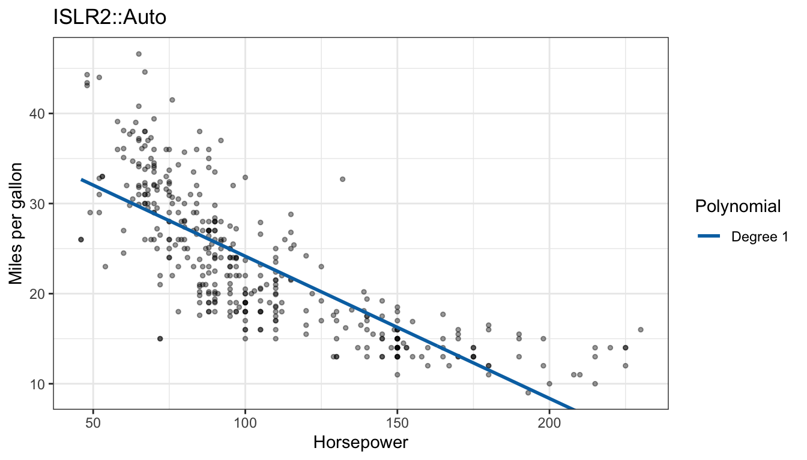

### + Degree 2

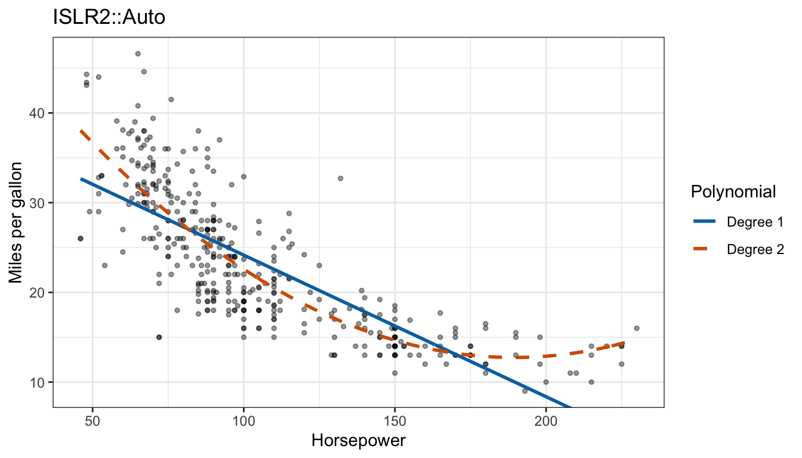

### + Degree 10

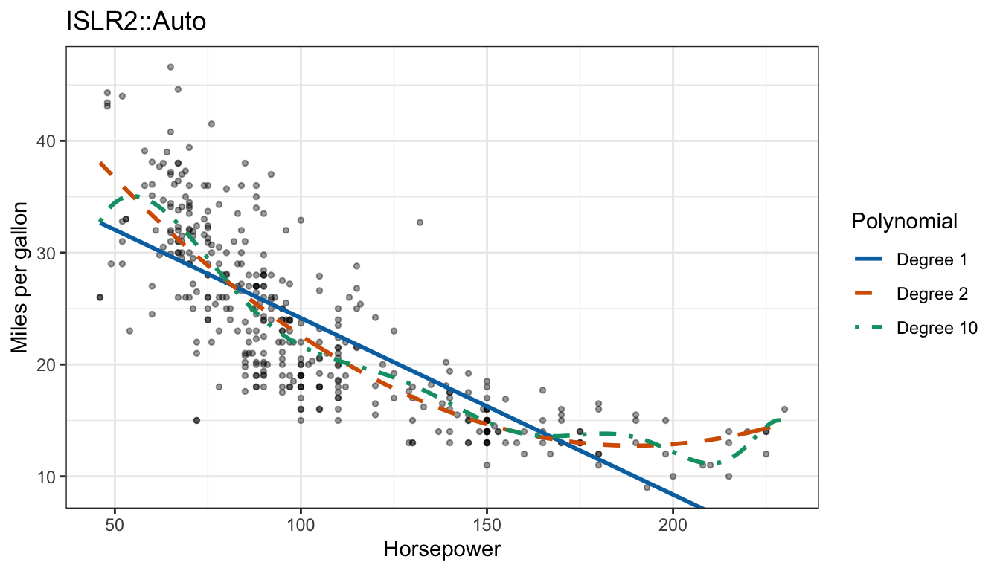

:::

::: notes
The degree d is the flexibility setting to be chosen. The features are the d powers of horsepower.

Data: ISLR2::Auto, 392 cars. The response variable is mpg, miles per gallon; the explanatory variable is horsepower. Fuel efficiency falls as horsepower rises, steeply at first and then more slowly. The question for the lecture is how to choose among polynomial models of different degree without a separate test set. The model is mpg_i = beta_0 + beta_1 horsepower_i + ... + beta_d horsepower_i^d + epsilon_i with epsilon_i independent N(0, sigma^2).

The tabs add least squares fits of degree 1, 2 and 10 to the scatterplot. The straight line misses the curvature, underpredicting at both ends and overpredicting in the middle; the quadratic follows the curve; the degree-10 polynomial follows it too, with extra wiggles at both ends of the range of horsepower, where cars are few. The degree d is the flexibility setting to be chosen, kept as d throughout (K is the number of neighbors later). The features here are the powers of horsepower, so row i of the model matrix is (1, horsepower_i, ..., horsepower_i^d). poly(horsepower, d) fits the same model with an orthogonal basis.
:::

## Training MSE

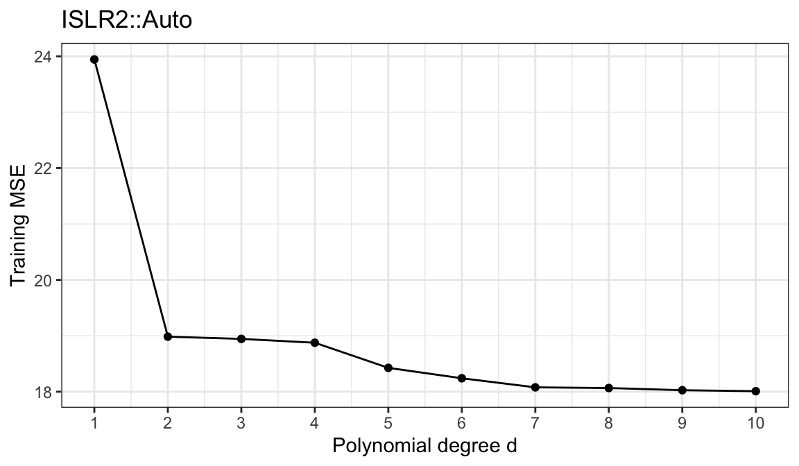{height=540}

::: notes
Training MSE: 23.94 at d = 1, 18.98 at d = 2, 18.01 at d = 10. Training error cannot choose d.

The training MSE is the average squared error on the same 392 cars the model was fit to. It cannot rise as d increases: the degree-d model is the degree-(d+1) model with the last coefficient set to zero, so least squares over the larger model can only match or lower the residual sum of squares. Training error rewards flexibility whether or not the flexibility captures anything that will appear in new data.

The regression lecture defined the test MSE on observations not used to fit. A large separate test set would make choosing d easy: fit each degree to the training data and keep the smallest test MSE. But a separate test set is rarely available; collecting one costs as much as the training data, and setting part of the data aside leaves less to fit with. Resampling methods estimate test error from the training data alone, by fitting to part of the data and measuring error on the part left out. This lecture develops three in increasing order of reuse: the validation set approach, leave-one-out cross-validation and k-fold cross-validation.
:::

# Validation set approach

::: notes
The first of the three methods.
:::

## Validation set algorithm

:::: {.columns}
::: {.column width="48%"}
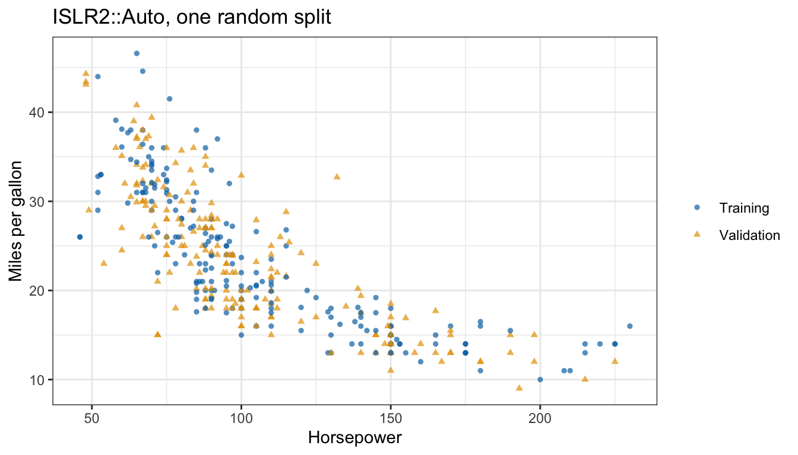
:::
::: {.column width="52%"}
1. Split the $n$ observations at random into a training set and a validation set
2. Fit the model to the training set
3. Predict the validation set and average the squared errors

::: {.fragment}
::: {style="font-size: 0.75em"}
$$\text{MSE}_{\mathcal{V}} = \frac{1}{n_{\mathcal{V}}}\sum_{i \in \mathcal{V}}\left[y_i - \widehat f(x_i)\right]^2$$
:::
:::

::: {.fragment}
::: {style="font-size: 0.7em"}
- $\mathcal{V}$ — validation set, $n_{\mathcal{V}}$ observations
- $\widehat f$ — fit to the training set only
:::
:::
:::
::::

::: notes
The figure shows the cars split at random into two halves of 196, a training set (blue circles) and a validation set (orange triangles). Both halves cover the range of horsepower and either shows the same curved decline as the full data. Every validation observation is new to f-hat, so MSE_V estimates the test MSE. It is also used to choose among degrees, so the validation set is not untouched test data: training data fit the model, validation data estimate test error and choose among models, and test data are never used for either. MSE_V is computed for each degree d to compare them. K is not involved; the degree d is the only setting.
:::

## Split variability

::: {.panel-tabset}

### One split

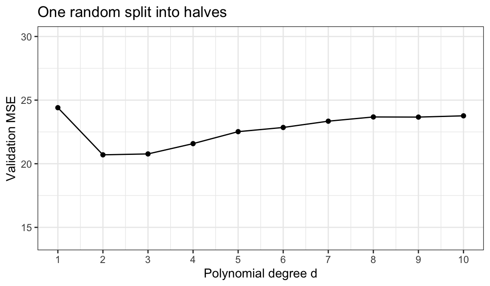

### 100 splits

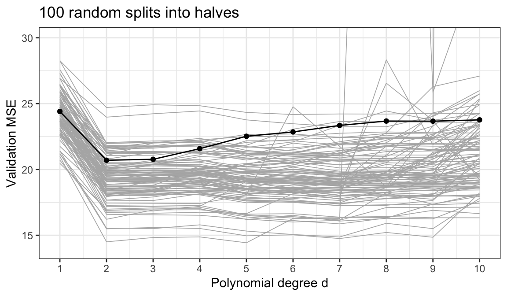

### Chosen degree

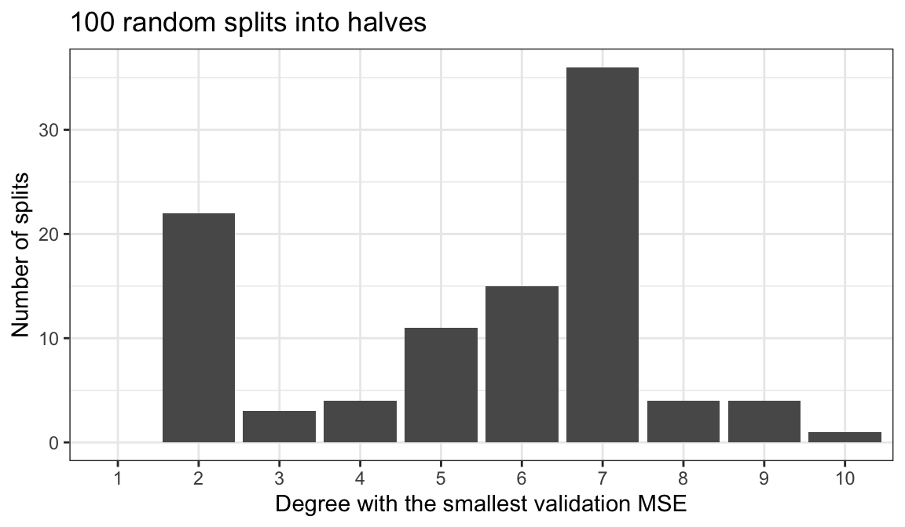

:::

::: notes
Quadratic: validation MSE from 14.50 to 24.71 across splits. Best degree is 2 through 10; degree 7 wins 36 of 100 splits.

The first tab is the validation MSE of the one split against the degree; the second adds the curves of all 100 random splits, grey, with the first in black; the third counts the degree with the smallest validation MSE in each split. Every curve drops sharply from degree 1 to degree 2, so every split agrees that a quadratic beats a line. Beyond that the splits disagree: the quadratic's validation MSE ranges from 14.50 to 24.71 across splits, while within a split the estimates for degrees 2 through 10 span a median of 1.87. 2 of the 100 curves leave the top of the plot at high degree, where a polynomial fit to half the cars extrapolates badly to a validation car outside their range of horsepower. The most common choice, degree 7, wins only 36 of 100 splits. This is the first weakness: the estimate, and the model it selects, depend on which observations land in which half.
:::

## Effect of training set size

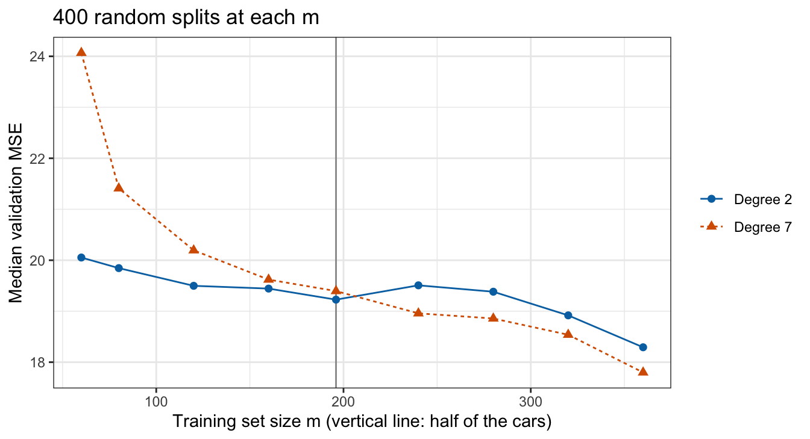{height=540}

::: notes
Degree 7: median validation MSE 24.07 at m = 60 and 19.39 at m = 196. The validation set approach overestimates the test error of the fit to all 392 cars.

The second weakness is that each model is fit to only part of the data. To see what that costs, the cars were split at random into a training set of m cars and a validation set of the other n - m, for m from 60 to 360, 400 times at each m. Because the validation cars are new to each fit, the typical validation MSE at a given m estimates the test MSE of a model fit to m cars. Test MSE generally falls as the training set grows and falls more steeply for the more flexible model; the quadratic goes from 20.05 to 19.23 over the same range. The median is plotted because the mean is dominated by a few catastrophic extrapolations (the mean at m = 60 for degree 7 is 5,778). The model that will be used is fit to all 392 cars, so an estimate from fits to half of them estimates the error of a worse model; the validation set approach tends to overestimate the test error of the final fit, more so for flexible models and small n.
:::

# Leave-one-out cross-validation

::: notes
The validation set approach leaves out half the data; leave-one-out cross-validation leaves out one observation at a time.
:::

## Held-out car

::: {.panel-tabset}

### Degree 2

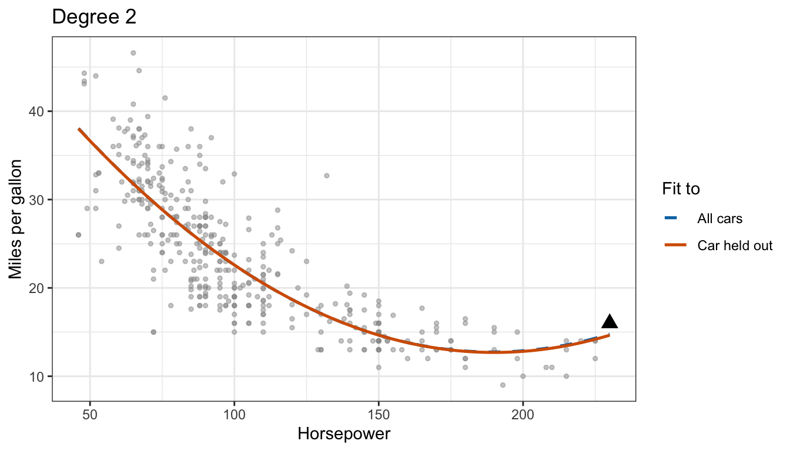

### Degree 10

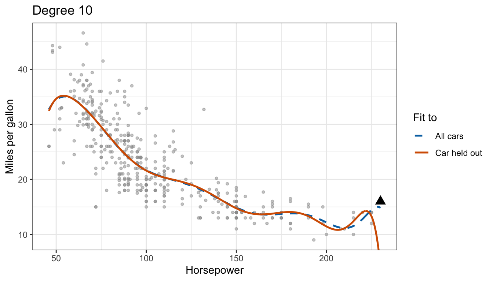

:::

::: notes
Black triangle: the car with the most horsepower, 230. Dashed curve: fit to all 392 cars. Solid curve: fit to the other 391.

The held-out car is a Pontiac Grand Prix with 230 horsepower, the car with the largest horsepower. For the quadratic the two fits nearly coincide, and the held-out car is predicted about as well without it as with it. For degree 10 the fit to all cars bends to pass near the held-out car, and without it the curve swings far below. The squared error of the held-out prediction measures how well the model predicts a car it has not seen, which the residual from the fit to all cars does not.
:::

## LOOCV estimate

$$\text{CV}_{(n)} = \frac{1}{n}\sum_{i=1}^n\left[y_i - \widehat f^{(-i)}(x_i)\right]^2$$

::: {.fragment}
- $\widehat f^{(-i)}$ — fit to the $n - 1$ observations other than observation $i$
- $\widehat f^{(-i)}(x_i)$ — its prediction for the held-out observation
:::

::: {.fragment}
$n$ fits per model
:::

::: notes
Leave-one-out cross-validation (LOOCV) repeats the held-out car for every observation. Each fit uses n - 1 observations, nearly all of the data, and there is no random split: every observation is held out exactly once. Written as a loop, LOOCV costs n fits per model, 392 for the cars.
:::

## Degree selection

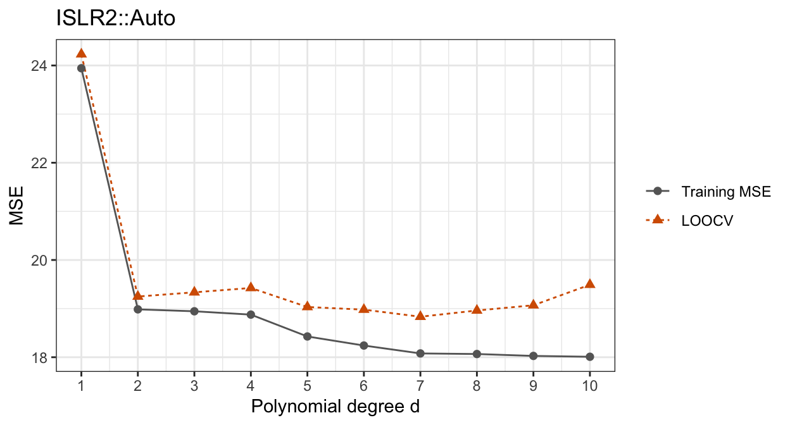{height=540}

::: notes
LOOCV: 24.23 at d = 1, 19.25 at d = 2, minimum 18.83 at d = 7. Training MSE keeps falling while LOOCV at d = 10 is 19.49.

The LOOCV estimate drops from 24.23 at degree 1 to 19.25 at degree 2 and then barely moves; its minimum, 18.83, is at degree 7, only 0.42 below the quadratic. Unlike the training MSE it does not keep falling: at degree 10 it is 19.49, above its minimum, while the training MSE is at its lowest. The curve is nearly flat from degree 2 on, so LOOCV does not clearly separate degrees 2 through 10. Objective 5 (use cross-validation to choose a flexibility setting) first appears here.
:::

# k-fold cross-validation

::: notes
Leave-one-out is the extreme of one observation per fold; k-fold cross-validation uses k folds in between.
:::

## Folds

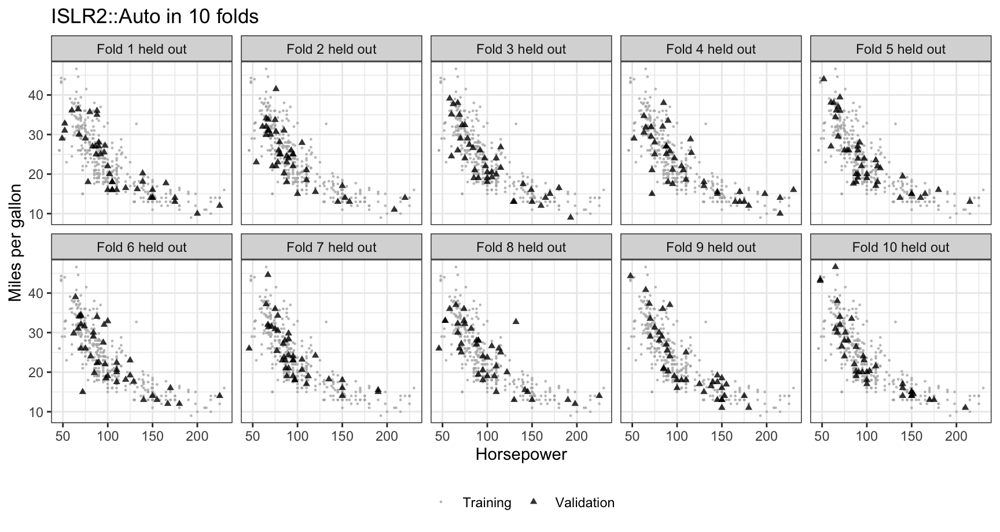{height=540}

::: notes
10 folds of 39 or 40 cars; the black triangles are the held-out fold in each panel.

The 392 cars are split at random into 10 groups of about equal size. Every car appears as a triangle in exactly one panel, and each group is scattered across the whole range of horsepower. k is the number of folds; here k = 10.
:::

## k-fold estimate

::: {style="font-size: 0.85em"}
$$\text{MSE}_\ell = \frac{1}{n_\ell}\sum_{i \in \mathcal{F}_\ell}\left[y_i - \widehat f^{(-\ell)}(x_i)\right]^2, \qquad \text{CV}_{(k)} = \sum_{\ell=1}^k \frac{n_\ell}{n}\,\text{MSE}_\ell$$
:::

::: {.fragment}
::: {style="font-size: 0.85em"}
- $k$ — number of folds (unrelated to $K$, the number of neighbors)
- $\mathcal{F}_\ell$ — set of observations in fold $\ell$, $n_\ell$ of them
- $\widehat f^{(-\ell)}$ — fit to the observations outside fold $\ell$
:::
:::

::: {.fragment}
LOOCV is the special case $k = n$
:::

::: notes
k-fold cross-validation divides the observations at random into k folds of about equal size. For each fold l it fits the model to the other k - 1 folds and computes the MSE on fold l. CV_(k) is the average of the fold MSEs weighted by fold size, which is the plain average when every fold has n/k observations. Every observation is held out exactly once and used for fitting k - 1 times. The symbol k, lowercase as in the name, is unrelated to K, the number of neighbors in KNN (and of classes in the generative classifier lectures), which returns in Classification.
:::

## Partition variability

::: {.panel-tabset}

### Validation set

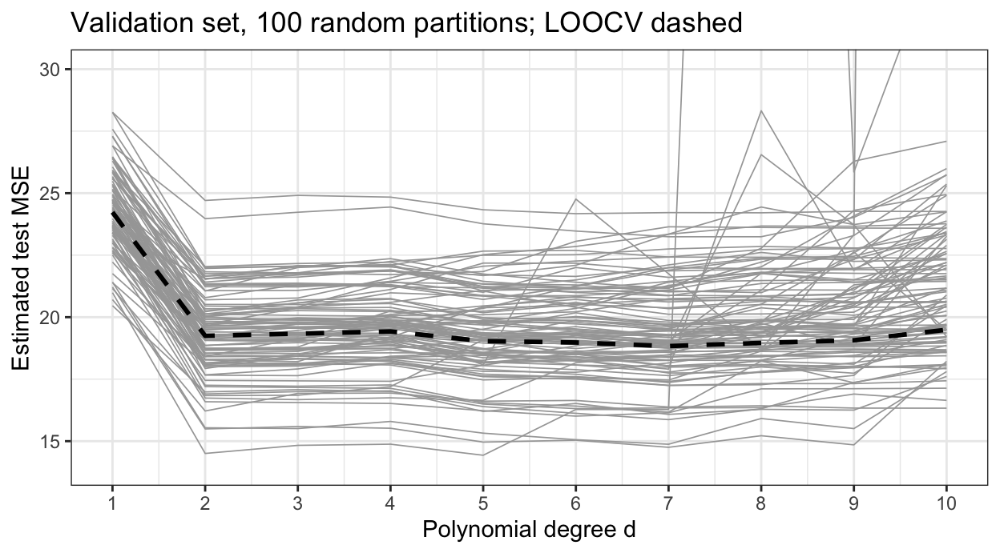

### 5-fold

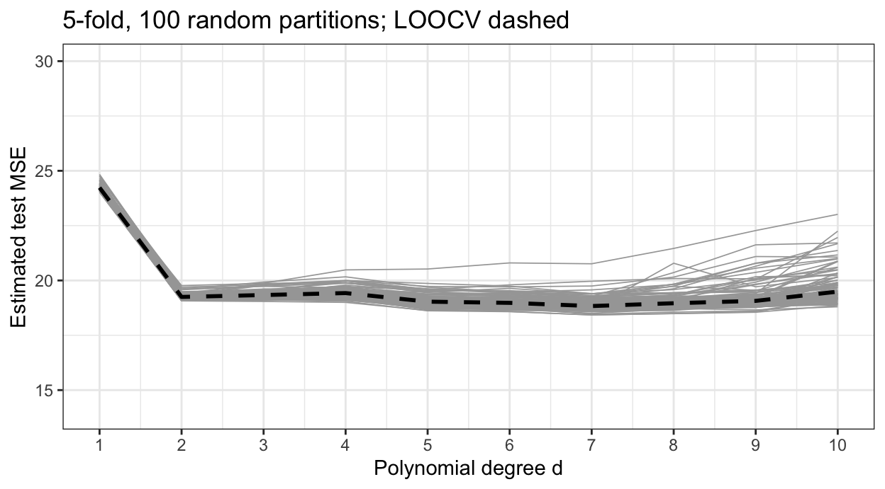

### 10-fold

:::

::: notes
Standard deviation of the degree-2 estimate across partitions: 1.70 for the validation set, 0.136 for 5-fold, 0.093 for 10-fold.

The third slide to drop if time is short. The tabs repeat the validation set curves of 100 random splits and add 100 random partitions into 5 folds and into 10 folds, each over the LOOCV curve (black, dashed). The band of curves narrows from tab to tab. At degree 2 the standard deviation of the estimate across random partitions is 1.70 for the validation set, 0.136 for 5-fold and 0.093 for 10-fold cross-validation. The 5-fold and 10-fold curves hug the LOOCV curve, while the validation set curves scatter widely on both sides of it: every observation is held out once and the held-out errors are averaged over all n of them, so the estimate depends far less on which observations share a fold. The degree with the smallest estimate is still not fixed: across partitions 10-fold cross-validation chooses degree 2, 6 and 7, because the curves are nearly flat from degree 2 on.
:::

## Fold count

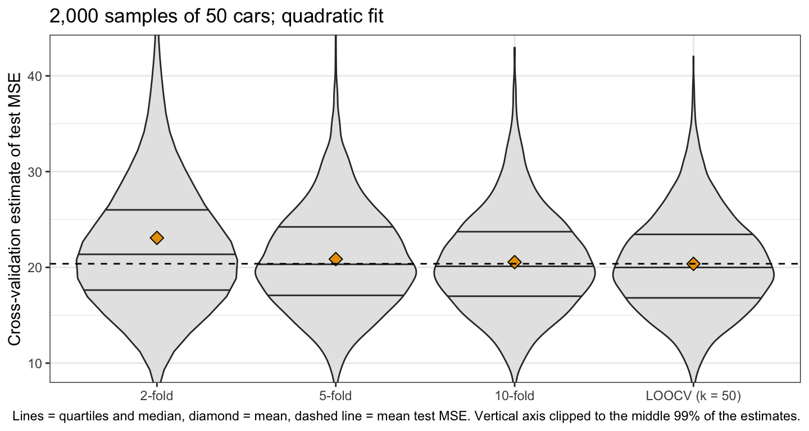{height=540}

::: notes
2,000 samples of 50 cars, quadratic fit. Mean test MSE of the fits 20.38; mean estimates 23.08 (2-fold), 20.86 (5-fold), 20.55 (10-fold), 20.37 (LOOCV).

To see how k affects bias and variance, the 392 cars were treated as a population: each of 2,000 times a sample of 50 cars was drawn without replacement and a quadratic fit to it; the actual test MSE of that fit is its average squared error on the 342 cars not drawn. The figure compares the cross-validation estimates from the same 50 cars, with k equal to 2, 5, 10 and 50 (LOOCV), against it. 2-fold cross-validation, fitting to 25 cars, overestimates by 2.70, with a simulation standard error of 0.52; by k = 5 the overestimate is small, 0.49, with a simulation standard error of 0.14. The standard deviations of the estimates are 23.06, 5.35, 5.15 and 5.01, so 10-fold and LOOCV vary about equally. The 2-fold standard deviation is dominated by 3 of the 2,000 samples whose estimates exceed five times the mean test MSE (the largest is 984.29), where a quadratic fit to 25 cars extrapolates badly to a held-out car; without them it is 7.61. The figure's vertical axis is clipped, so those estimates are not shown. If time is short, say the bias and variance numbers over the figure.
:::

## Computation and bias

- Computation: $k$ fits per model, LOOCV $n$ fits

::: {.fragment}
- Bias: each fit uses $n(k - 1)/k$ observations
  - 196 cars at $k = 2$
  - about 314 at $k = 5$
  - about 353 at $k = 10$
  - 391 at LOOCV
:::

::: {.fragment}
- Smaller $k$: more upward bias; LOOCV nearly unbiased
:::

::: notes
Third to drop if time is short (its lines go into Variance). For least squares the shortcut makes LOOCV cost one fit; for most other methods it is n fits, and k = 5 or 10 is a large saving. By the learning curve on Effect of training set size, a model fit to fewer observations has larger test error, so CV_(k) overestimates the test error of the model fit to all n, by more as k shrinks. The 20.37 average of LOOCV against the 20.38 mean test MSE on Fold count is the nearly unbiased case.
:::

## Variance

::: {style="font-size: 0.75em"}
$$Var\left[\frac{1}{k}\sum_{\ell=1}^k\text{MSE}_\ell\right] = \frac{1}{k^2}\sum_{\ell=1}^k\sum_{\ell'=1}^k Cov\left[\text{MSE}_\ell, \text{MSE}_{\ell'}\right] = \tau^2\left(\rho + \frac{1-\rho}{k}\right)$$
:::

::: {.fragment}
- $\tau^2$ — variance of each fold MSE
- $\rho$ — correlation of each pair of fold MSEs
:::

::: {.fragment}
Averaging more folds shrinks $(1 - \rho)/k$ but not $\rho\tau^2$
:::

::: {.fragment}
Usual choice: $k = 5$ or $10$
:::

::: notes
CV_(k) is an average of k fold MSEs; if each has variance tau squared and each pair has correlation rho, the variance is tau squared times (rho + (1 - rho)/k). In LOOCV any two fits share n - 2 of their n - 1 observations, so their held-out errors are strongly correlated and averaging n of them reduces the variance less than the number n suggests; with larger k each fold MSE is also computed from fewer observations, raising tau squared. Which effect dominates depends on the method and the data. The simulation's standard deviations combine two sources, which 50 cars were drawn and the random partition; the partition alone is the cleaner comparison: for all 392 cars held fixed, 0.136 for 5-fold, 0.093 for 10-fold and none for LOOCV. For a quadratic fit to 50 cars, 5-fold and 10-fold cross-validation had small bias and variance close to LOOCV's, and for a method without the least squares shortcut they need 5 or 10 fits rather than n. That combination is why k = 5 or 10 is the usual choice.
:::

# Classification

::: notes
So far the loss was squared error; for a classifier the loss is misclassification, and the flexibility setting is the number of neighbors K.
:::

## Credit card default data

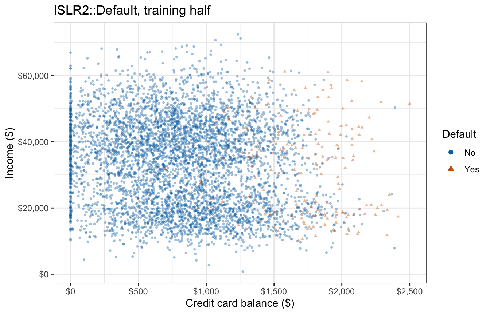{height=540}

::: notes
ISLR2::Default, the training half of 5,000 customers, 176 of whom defaulted (3.52%). The response variable is default; the explanatory variables are balance and income.

The QDA and naive Bayes lecture classified credit card customers as defaulters or not from balance and income, fitting every classifier to a random half of the 10,000 customers and evaluating it on the other half. Its KNN classifier used K = 71 neighbors, the smallest odd integer above the square root of n for the training half, a rule of thumb. The figure plots the same training half, recreated with the same seed. Defaulters sit at high balances at every income, mixed among non-defaulters with similar balances. The classifier standardizes balance and income inside each fit, so the features KNN sees are the standardized values.
:::

## Cross-validation error rate

::: {style="font-size: 0.85em"}
$$\text{Err}_\ell = \frac{1}{n_\ell}\sum_{i \in \mathcal{F}_\ell}\mathrm{I}\left(y_i \ne \widehat y_i^{(-\ell)}\right), \qquad \text{CV}_{(k)} = \sum_{\ell=1}^k\frac{n_\ell}{n}\,\text{Err}_\ell$$
:::

::: {.fragment}
- $\widehat y_i^{(-\ell)}$ — class predicted by the classifier fit outside fold $\ell$
- $\text{Err}_\ell$ — test error rate on fold $\ell$
:::

::: notes
Second to drop if time is short (say the formula over the Neighbor count figure). Cross-validation for a classifier replaces the squared error with a classification loss; the misclassification indicator gives the error rate. Any loss can take the place of the indicator. For KNN the classifier fit to the training folds includes the standardization of the features: their means and standard deviations are computed from the training folds, as they were from the training half in the QDA lecture.
:::

## Neighbor count

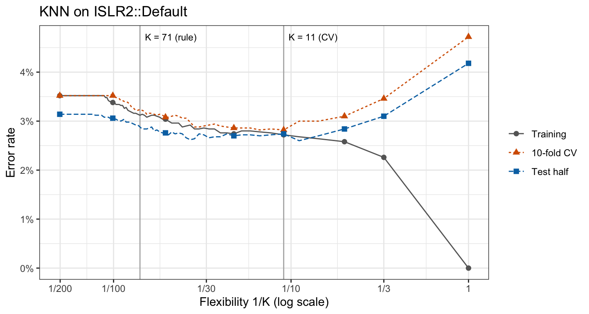{height=540}

::: notes
10-fold CV error: 4.72% at K = 1, minimum 2.82% at K = 11, 3.52% at K = 201. The rule of thumb K = 71 gives 3.24%. On the test half: 2.74% at K = 11, smallest 2.60% at K = 9.

The training half was divided into 10 folds, and the 10-fold cross-validation error rate computed for every odd K from 1 to 201. The training error rate falls to 0.00% at K = 1, where every training customer is its own nearest neighbor; the cross-validation error rate is U-shaped instead. At K = 201 KNN classifies every customer as a non-defaulter and its error rate equals the proportion of defaulters. The test half, which the cross-validation never touched, gives the same shape; its curve lies below the cross-validation curve at every value of K, in part because defaulters are rarer in the test half, 3.14% against 3.52%. Objective 5 closes here: cross-validation chooses K as it chose the polynomial degree d.
:::

## Conclusion

::: {style="font-size: 0.7em"}
- Training error
  - Always falls with flexibility, so it cannot choose a model
- Estimating test error
  - Validation set approach
    - Varies by split and overestimates the test error
  - Leave-one-out cross-validation (LOOCV)
    - Nearly unbiased, but needs $n$ fits
  - $k$-fold cross-validation
    - Far less variable than one split; $k = 5$ or $10$ is the usual choice
- Classification
  - Cross-validation chooses the number of neighbors $K$
:::

::: notes
Optional; the lecture may end on Neighbor count with the next lecture's preview said aloud: Friday 2026-10-16, cross-validation in practice: choosing among models on real data and the issues that choosing raises.
:::
