## Today

<!-- derived-from: 05-resampling/15-cv-in-practice.qmd @ uncommitted -->

- Candidate models
- Selection optimism
  - One training sample
  - Repeated samples
- Test data workflow
  - Workflow steps
  - Choosing
  - Final evaluation
- Activity

::: notes
Distilled from the chapter's four learning objectives and the slides this deck spends time on: the smallest cross-validation estimate among many candidates is optimistic; a workflow keeps test data out of every choice; the roles of training, validation and test data; test data used to choose lose their honesty. The chapter's Noisy minimum derivation and the Beyond this course callout are in the notes and not in the agenda. One running example: predicting the sale price of homes in Ames, Iowa; the question is which model should make the predictions. Candidate models covers the data and the models, with no transition slide of its own. The lecture then hands over to the group activity.

Timing: about 10 minutes, then the group activity. The Conclusion is optional. If time is short, drop in this order: Nested KNN candidates (say the 240 candidates over the Candidate models tabs), Choosing (say the choice over Workflow steps).
:::

## Ames home sales

::: {.panel-tabset}

### Living area

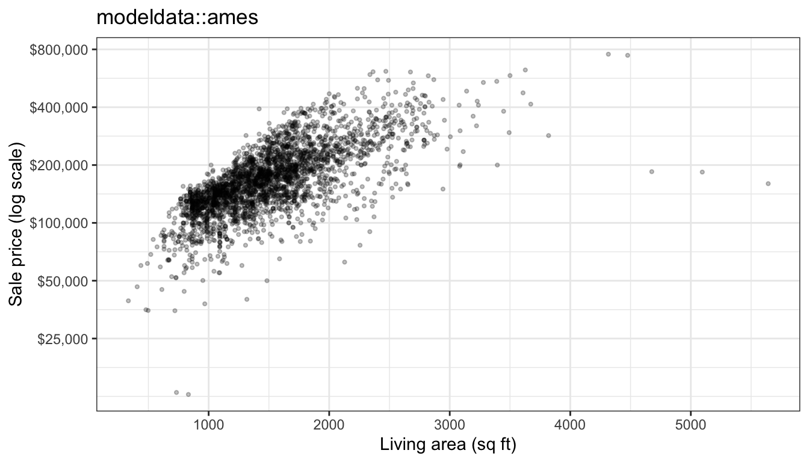

### Six explanatory variables

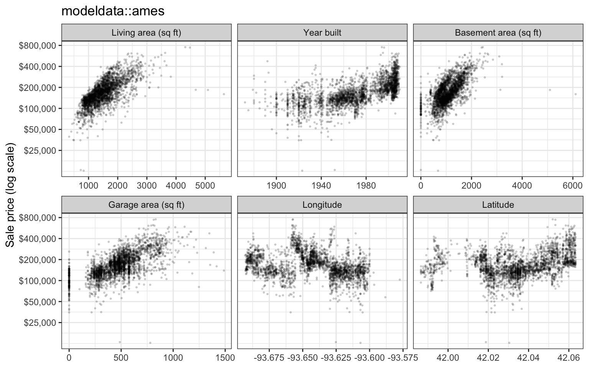

### Location

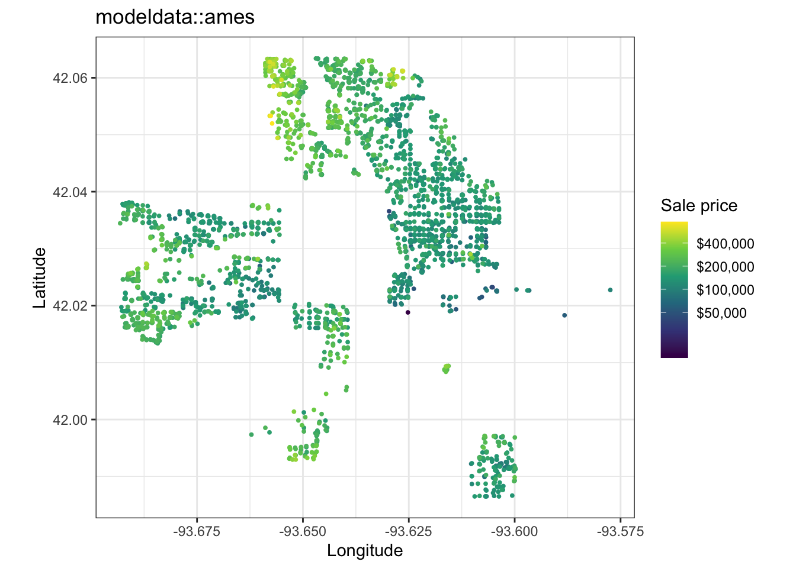

:::

::: notes
Data: modeldata::ames, 2,930 home sales in Ames, Iowa, from 2006 to 2010. The question is how accurately the sale price of a home can be predicted from its size, age and location, and which model should make the predictions.

The response variable is Sale_Price, analyzed as log10 of the price in dollars: prices are right-skewed, and an error on the log10 scale is a relative error, so a $20,000 miss counts more on a $100,000 home than on a $400,000 one. The explanatory variables are, in this order, above-ground living area (Gr_Liv_Area), year built (Year_Built), basement area (Total_Bsmt_SF), garage area (Garage_Area), Longitude and Latitude. The tabs plot the sale price against living area, against each of the six explanatory variables, and on a map.

On the log scale price rises roughly linearly with living area, with a few exceptions: 5 homes have more than 4,000 square feet, and some of them sold for far less than the trend. Newer homes and homes with larger basements and garages also sell for more; the vertical stripe at zero basement area is the homes without a basement. On the map the most expensive homes are in the north of the city and the least expensive in its center and east, so nearby homes sell for similar prices.

If time is short, leave the tabset on Living area.
:::

## Candidate models

::: {.panel-tabset}

### Training sample

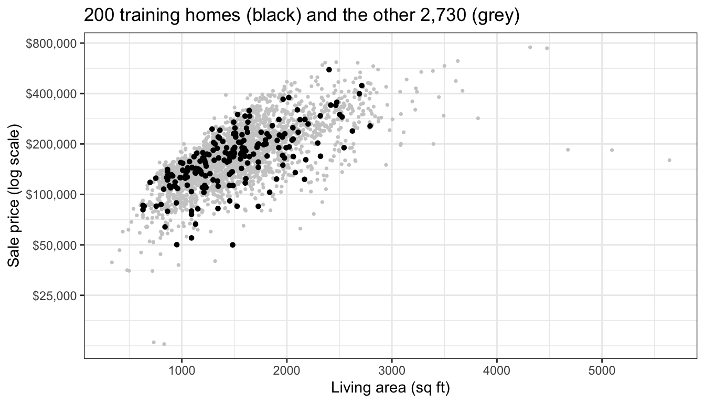

### + K = 1

### + K = 15

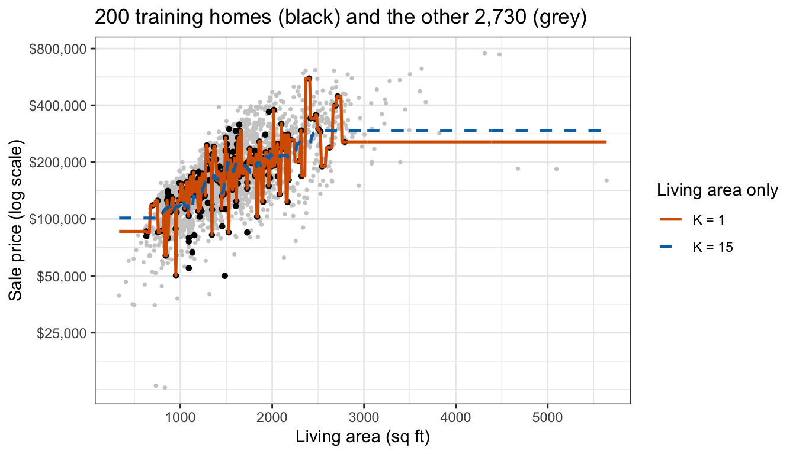

### + K = 40

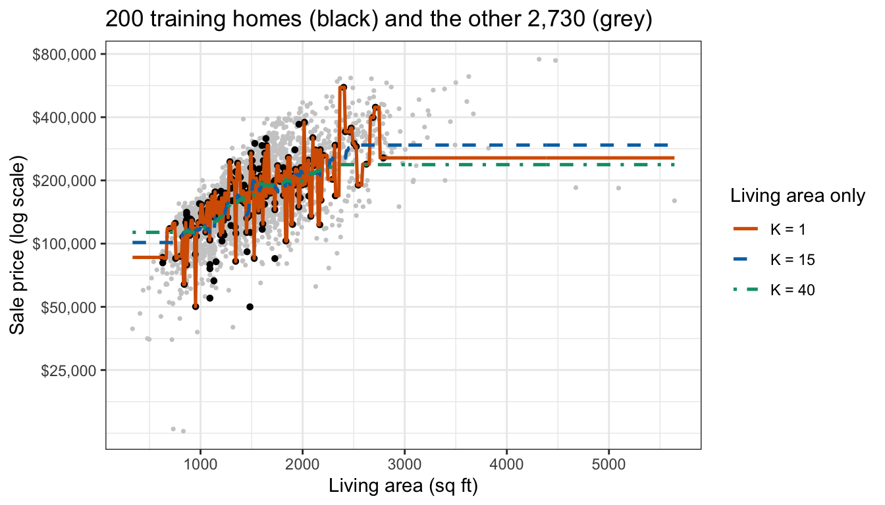

:::

::: notes
A training sample of 200 homes, drawn at random from the 2,930, will be used to choose a model. The first tab shows it (black) against the other 2,730 homes (grey). The other tabs add KNN fits that use living area only, with K = 1, 15 and 40 neighbors.

The training homes cover most of the range of living area but miss the largest homes. With K = 1 the fit jumps from one training home's price to the next; with K = 15 and K = 40 it follows the trend more smoothly. All three fits are flat beyond the largest training home, at the geometric mean price (the average on the log10 scale) of its nearest neighbors.

The candidates differ in two tuning parameters: how many of the six explanatory variables they use, q, and how many neighbors, K. The features are the q explanatory variables, each standardized with the mean and standard deviation of the training homes, so standardization is part of the fit.
:::

## Nested KNN candidates

::: {style="font-size: 0.85em"}
$$\widehat f_{q,K}(x_0) = \frac{1}{K}\sum_{i \in \mathcal{N}_{q,K}(x_0)} y_i$$
:::

::: {.fragment}
::: {style="font-size: 0.85em"}
- $y_i$ — $\log_{10}$ price of training home $i$
- $q$ — number of explanatory variables used
- $\mathcal{N}_{q,K}(x_0)$ — the $K$ training homes closest to $x_0$
- $K$ — number of neighbors
:::
:::

::: {.fragment}
$S = 240$ candidate models: $q = 1, \ldots, 6$ and $K = 1, \ldots, 40$
:::

::: notes
First in the drop order (say the 240 candidates over the Candidate models tabs). For a home with explanatory variables x_0, the KNN regression averages the response of its K nearest training homes. The first q explanatory variables, in the order listed, are used, so q = 1 is living area alone and q = 6 adds year built, basement area, garage area, longitude and latitude. The features are those q explanatory variables, standardized with the training homes' means and standard deviations. With K = 1, ..., 40 and q = 1, ..., 6 there are S = 240 candidate models.

The order of the explanatory variables was chosen without using the response; ordering them by their correlation with price in the data at hand would be another data-dependent step, and would have to be repeated inside every fold. The 10-fold cross-validation estimate is computed for all 240 candidates at once, with standardization inside the folds; q and K are then chosen by comparing the 240 estimates.
:::

# Selection optimism

::: notes
Cross-validation estimates the error of one model with little bias; the question is what happens to the smallest of 240 estimates.
:::

## One training sample

::: {.panel-tabset}

### Cross-validation

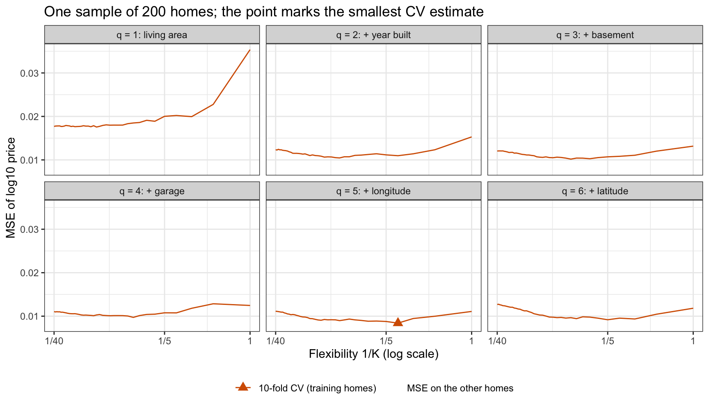

### + Other homes

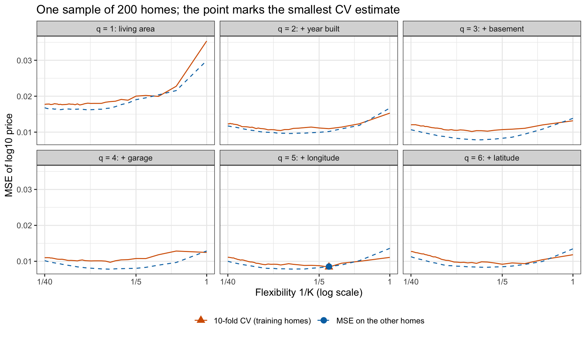

:::

::: notes
The first tab plots the 10-fold cross-validation estimate of every candidate against the flexibility 1/K, one panel per q; the point marks the smallest estimate. The remaining 2,730 homes were never used to fit or to choose, so they are test data for this sample, and the second tab adds each candidate's MSE on them.

Cross-validation chooses q = 5 and K = 4, with an estimated MSE of 0.00841. Fit to the same 200 homes, that model's MSE on the other homes is 0.00854, 1.5% above its cross-validation estimate. The candidate with the smallest MSE on the other homes is q = 4, K = 9, at 0.00780.

In every panel the two curves have similar shapes, and many candidates are close to the best: 31 of the 240 are within 5% of the smallest cross-validation estimate. In this sample the cross-validation estimate is above the MSE on the other homes for 97% of the candidates; the minimum falls where the cross-validation curve dips toward the other curve.
:::

## Repeated samples

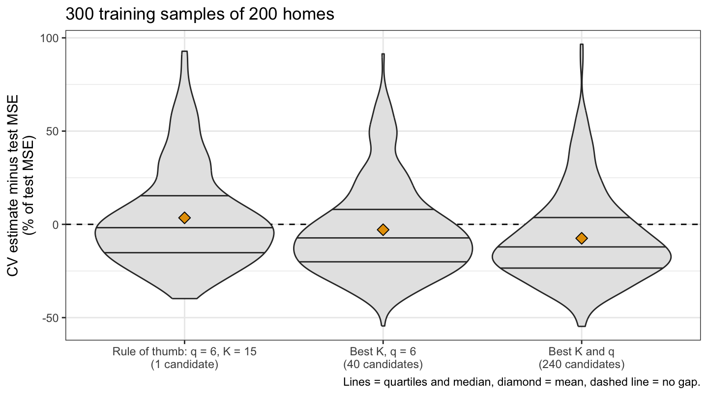{height=540}

::: notes
A training sample of 200 homes was drawn 300 times, with 10-fold cross-validation in each. Three procedures: the rule of thumb, one candidate fixed in advance (all six explanatory variables with K = 15, the smallest odd integer above the square root of 200), so nothing is chosen; the best K, the smallest estimate among the 40 values of K with all six explanatory variables; and the best K and q, the smallest estimate among all 240 candidates. Each chosen model's cross-validation estimate was compared with its MSE on the other 2,730 homes. A negative gap means the estimate was too optimistic.

For the rule of thumb the estimate averages 3.5% above the test MSE (simulation standard error 1.5 percentage points) and falls below it in 53% of samples. The best of 40 values of K averages 2.9% below, and the best of all 240 candidates 7.5% below (standard error 1.4 percentage points), below the test MSE in 70% of samples. The more candidates the minimum is taken over, the more optimistic it is.

The choosing also gains something real: the average test MSE of the model chosen from all 240 candidates is 0.00811, against 0.00874 for the rule of thumb. Cross-validation chooses good models; its minimum overstates how good the chosen model is. On these data the optimism is modest. By the two-candidate calculation in the notes (Noisy minimum), it grows with the noise in the estimates, which is larger for smaller training samples, and with the number of near-tied candidates, and it shrinks as the estimates become more correlated, vanishing when they are perfectly correlated.
:::

# Test data workflow

::: notes
In practice there is one data set, not a population to resample from. The remedy for the optimism is to keep some data out of the choosing entirely.
:::

## Workflow steps

:::: {.columns}
::: {.column width="48%"}
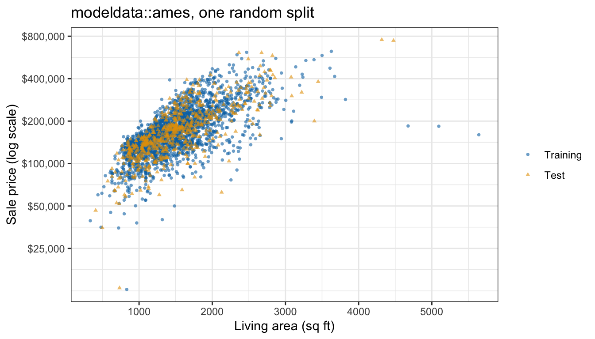
:::
::: {.column width="52%"}
1. Split off test data first
2. Choose by cross-validation on the training data
   - Standardize inside each fold
   - Held-out folds are validation sets
3. Refit the chosen model to all the training data
4. Evaluate it once on the test data
:::
::::

::: notes
The figure splits the 2,930 homes at random into 2,344 training homes (blue circles) and 586 test homes (orange triangles), 20% of the total. The two sets overlap over the bulk of the data. Of the 5 homes with more than 4,000 square feet, 2 are in the test set.

The simulation shows that the data used to choose a model cannot also give an honest estimate of its error. Step 1: split off test data first, at random, before any plotting, fitting or choosing. Step 2: standardization is part of the fit and is repeated inside each fold using only the training folds (computed inside the KNN function); q and K are then chosen by comparing the cross-validation estimates on the training data only, and the smallest estimate tends to be optimistic. The held-out folds are validation sets. Step 3: refit the chosen model to all the training data. Step 4: evaluate it once on the test data, and report that test MSE as the estimate of its error on new homes.

The three roles of the data: training data fit the model, validation data (the held-out folds) choose among models, test data evaluate the chosen model once.
:::

## Choosing

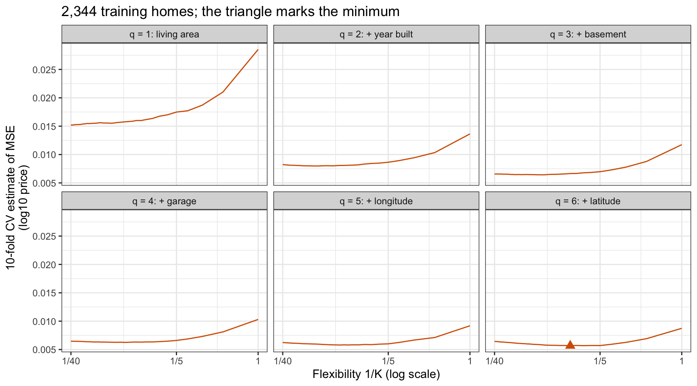{height=540}

::: notes
Second in the drop order (say the choice over Workflow steps). The figure plots the 10-fold cross-validation estimate of each of the 240 candidates on the 2,344 training homes. The curves are smoother than for the sample of 200; each curve rises steeply toward K = 1. The smallest estimate in each panel is 0.0152, 0.0080, 0.0064, 0.0063, 0.0058 and 0.0057 for q = 1 through 6: year built gives by far the largest improvement and basement area the next largest, while the last three explanatory variables lower it only slightly. Cross-validation chooses q = 6 and K = 9, with an estimated MSE of 0.00567. The held-out folds are validation sets, and no test home was used.
:::

## Final evaluation

- Chosen model: $q = 6$, $K = 9$
- Cross-validation estimate: 0.00567
- Test MSE, evaluated once: 0.00641

::: {.fragment}
Choose again with the test data and they become validation data
:::

::: notes
Refit to all 2,344 training homes and used once on the 586 test homes, the chosen model has a test MSE of 0.00641, against its cross-validation estimate of 0.00567. On the dollar scale the root mean squared error of 0.080 on the log10 scale is a root-mean-squared prediction error of a factor of 10^0.080 = 1.20, too high or too low.

The test MSE is 13% above the cross-validation estimate. Part of the difference comes from the 2 test homes with more than 4,000 square feet, which sold for $755,000 and $745,000 and were predicted at $446,000 and $446,000, the geometric mean price (the average on the log10 scale) of the nearest training homes; without them the test MSE is 0.00626. The gap is smaller than the standard error of the test MSE (0.00137, 21% of the test MSE), so it is consistent with the variability of an MSE computed from 586 homes; selection optimism is at most a modest part, about 7.5% at 200 homes in the simulation and smaller at 2,344. The test MSE is the number to report: no choice was made with the test homes, so the selection optimism does not affect it.

The test data can be used only once: if the test MSE were used to choose again, for example by going back to try another q after seeing it, the test homes would become one more validation set, and the reported error would be the minimum over the choices tried, with the same optimism as the minimum of the cross-validation curve.
:::

## Activity

- `modeldata::stackoverflow`, 5,594 developers
- Response variable: `Remote`
- Question: Which developers work remotely?
- Script: `15-cv-in-practice_activity.R`

::: notes
In small groups, work through 15-cv-in-practice_activity.R (the download link is on the notes page) in RStudio. It uses modeldata::stackoverflow, responses from 5,594 developers to Stack Overflow's annual Developer Survey, to ask which developers work remotely. Your group computes the error rate of always predicting "Not remote," splits off test data, compares logistic regression, LDA and KNN with several values of K by 10-fold cross-validation on the training data, chooses one, and evaluates it once on the test data. Most of the code is provided; the discussion questions at the end of the script are the point of the activity.
:::

## Conclusion

::: {style="font-size: 0.55em"}
- Candidate models
  - Cross-validation estimates a model fixed in advance with little bias
- Selection optimism
  - One training sample
    - The winning estimate is the one that fell lowest by chance
  - Repeated samples
    - More near-tied, noisy candidates make the minimum more optimistic
- Test data workflow
  - Workflow steps
    - Test data first; choose using the training data only
  - Choosing
    - Choose by cross-validation on the training data only
  - Final evaluation
    - Evaluate once; the test error is what you report
- Activity
  - Apply the whole workflow to new data
:::

::: notes
Optional; the lecture may end on Activity with the group work and then show this slide when the groups report back. The next lecture begins Chapter 6, linear model selection and regularization, with subset selection.
:::
