## Today

<!-- derived-from: 06-regularization/10-subset-selection.qmd @ uncommitted -->

::: {.columns}
::: {.column width="50%"}
- Used car prices
- Best subset selection
  - Algorithm
  - Fitting
  - Training RSS
  - Computational cost
- Stepwise selection
  - Forward stepwise
  - Backward stepwise
  - Path comparison
:::
::: {.column width="50%"}
- Model size
  - Penalized criteria
  - Likelihood criteria
  - Within-fold cross-validation
  - Chosen sizes
- Selected model
  - Coefficients
  - Optimistic inference
:::
:::

::: notes
Distilled from the chapter's five learning objectives and the slides this deck spends time on: best subset and stepwise selection and their cost; why the training RSS and R^2 cannot choose the size d; Cp, BIC and adjusted R^2, the likelihood forms of AIC and BIC, and the cross-validation of the model size with the selection inside each fold; interpreting the selected model and why its standard errors and p-values are optimistic. The Training MSE figure, the Training error optimism derivation, the Selection motives, the correlation figure and the Beyond this course callout are in the notes and not in the agenda. One running example, the price of used General Motors cars; the question is which of the recorded explanatory variables a model of price should use. Used car prices covers the data and the 14 candidate features, with no transition slide of its own; the other four parts each have one.

Timing: one 50-minute period. The Conclusion is optional. If time is short, drop in this order: Training MSE (say over Model size that the training MSE falls below sigma-hat^2 and so cannot choose the size), Training error optimism (say that the training RSS underestimates the new-response error by 2(d + 1) sigma^2 over Penalized criteria), Selection motives (open with the question aloud), Computational cost (say the 2^p over Algorithm and compare it with 106 on Forward stepwise), then the extra tabs of Used car prices (leave it on Mileage) and of Fitting (stop at 3 features).
:::

## Used car prices

::: {.panel-tabset}

### Mileage

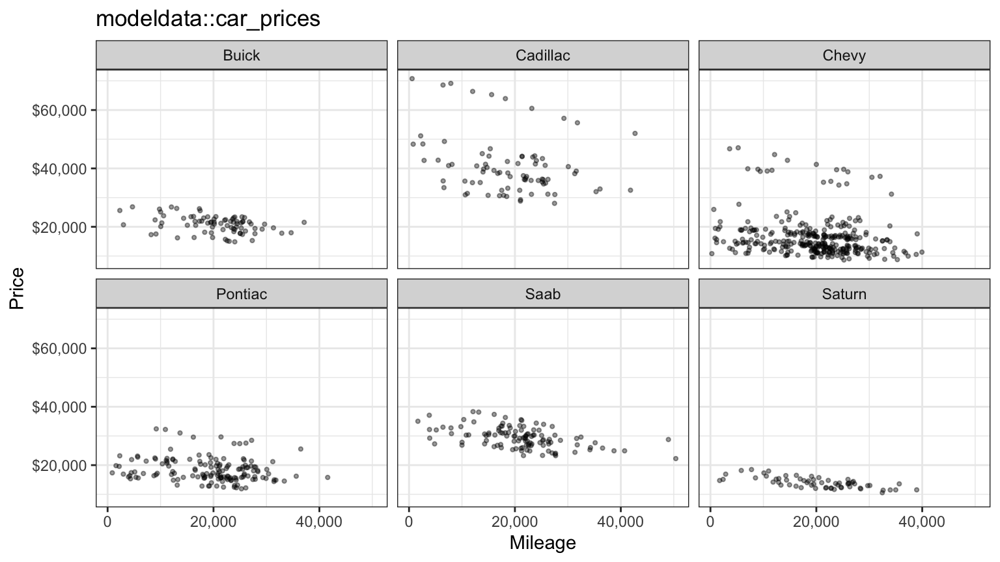

### Make and body style

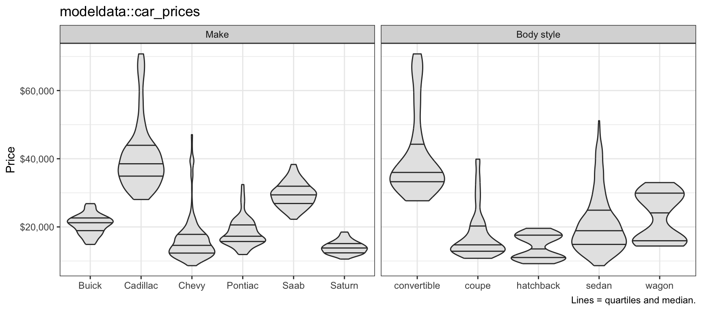

### Engine and options

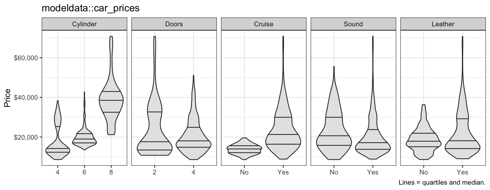

:::

::: notes
Data: modeldata::car_prices, 804 used General Motors cars for sale in 2005. The question is which of the recorded explanatory variables a model of a used car's price should use. The response is the price in dollars; the explanatory variables are the mileage, the number of cylinders, the number of doors, indicators of cruise control, an upgraded sound system and leather seats, the make and the body style (the next slides put the variables in the form the models use). The tabs plot price against mileage, one panel per make, against make and body style, and against each of the other explanatory variables. The violins carry quartile lines and the median.

Within every make price falls with mileage. Make matters more: every Cadillac costs more than every Saturn, and Saab prices sit well above those of Chevrolets and Pontiacs. Convertibles cost the most of the body styles. Cars with more cylinders or with cruise control tend to cost more. Doors and leather seats make little difference to the median price on their own: $17,631 with two doors against $18,073 with four, and $17,895 without leather against $18,126 with it. Cars with an upgraded sound system have a lower median price than cars without one, $17,161 against $20,648; Chevrolets, the most common make and one of the cheapest, have one 82.8% of the time. Prices spread more widely where they are higher: the Cadillac panel spans a far wider range of dollars than the Saturn panel.

If time is short, leave the tabset on Mileage.
:::

## Price scale

::: {.panel-tabset}

### Dollars

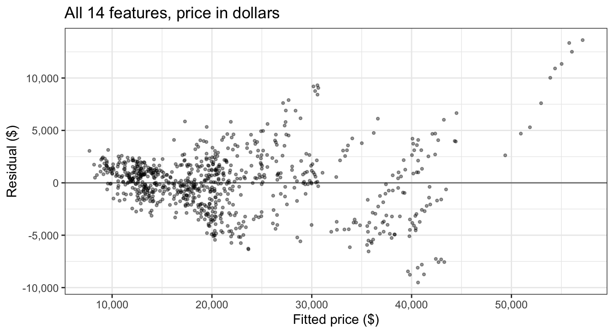

### Log scale

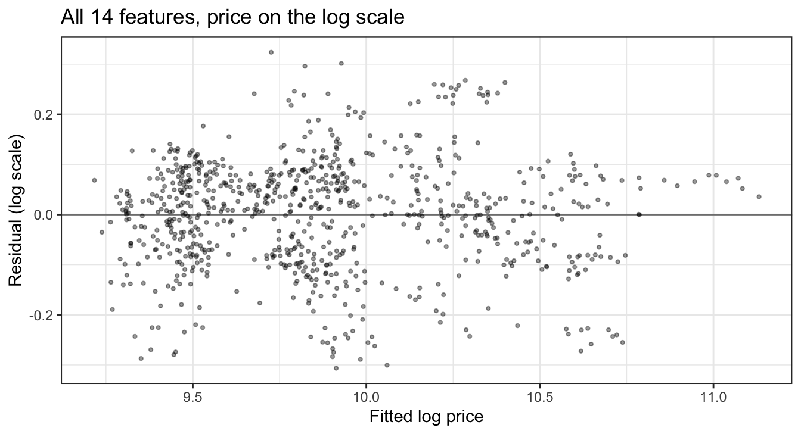

:::

::: notes
The tabs plot the residuals against the fitted values of the largest model, fit by least squares once with price in dollars as the response and once with its natural logarithm. In dollars the residuals fan out as the fitted price rises: the correlation between the absolute residual and the fitted value is 0.56. On the log scale it is 0.11, close to the constant variance the model assumes.

Errors of similar size on the log scale are errors of similar percentage in price, which matches prices that vary by a few thousand dollars for a Saturn and by many thousands for a Cadillac. From here on the response is the logarithm of price. The largest model explains 92.9% of the variability in log price, with an error standard deviation estimate of 0.1103.
:::

## Candidate features

- Response variable: $\log(\texttt{Price})$
- Explanatory variables: `Mileage`, `Cylinder`, `Doors`, `Cruise`, `Sound`, `Leather`, make, body style

::: {.fragment}
- Features, $p = 14$: `Mileage`, `Cylinder`, `Cruise`, `Sound`, `Leather`, `Buick`, `Cadillac`, `Chevy`, `Pontiac`, `Saab`, `convertible`, `coupe`, `hatchback`, `sedan`
:::

::: {.fragment}
- Reference levels: `Saturn`, `wagon`
:::

::: notes
The response variable is the natural logarithm of the price, as the previous slide decided. The explanatory variables are the raw columns the data record: mileage, cylinders, doors, cruise control, sound system, leather seats, the make and the body style. The features are the columns that enter the model.

The first five explanatory variables enter as recorded, with Cylinder treated as a number (4, 6 or 8). Make and body style are categorical explanatory variables whose indicator columns are complete sets: every car has exactly one make and one body style, so the six make indicators sum to the intercept column. Each needs a reference level whose indicator is left out: Saturn for make and wagon for body style. Doors is dropped because every convertible and coupe has two doors and every other car four, so with the body style indicators in the model Doors would be an exact linear combination of other columns.

That leaves p = 14 candidate features, and the largest model is y_i = beta_0 + beta_1 x_i1 + ... + beta_p x_ip + epsilon_i with epsilon_i independent N(0, sigma^2), where y_i is the log price of car i, i = 1, ..., n with n = 804, x_ij is the value of feature j for car i and the beta_j are the coefficients. A subset of the features is a smaller model of the same form with the coefficients of the other features set to zero.
:::

## Selection motives

- Interpretability
- Variance
- Search: $2^p$ candidate models

::: notes
The largest model fits well (R^2 of 92.9% for log price), so why use fewer features?

Interpretability: a model with fewer features is easier to explain, and each coefficient that is truly zero but estimated anyway adds noise to the story the model tells.

Variance: least squares fitted values are y-hat = H y with H = X (X^T X)^{-1} X^T, so Var[y-hat] = sigma^2 H, and its trace is sigma^2 (d + 1) for a model with d features and an intercept, so the average variance of the fitted values is sigma^2 (d + 1) / n. Every feature added raises it by sigma^2 / n whether or not its true coefficient is zero, and lowers the bias only if its coefficient is not zero. With n = 804 and p = 14 the cost is small here, and it grows as p approaches n.

Search: each feature is either in or out, so there are 2^p candidate models, 2^14 = 16,384 for these cars.

Optional: third in the drop order (open with the question aloud).
:::

# Best subset selection

::: notes
The first of the three algorithms for choosing which features to keep: fit every subset.
:::

## Algorithm

1. $\mathcal{M}_0$: the null model, no features
2. For $d = 1, \ldots, p$: fit all $\binom{p}{d}$ models with $d$ features; $\mathcal{M}_d$ is the one with the smallest RSS
3. Choose among $\mathcal{M}_0, \ldots, \mathcal{M}_p$ by $C_p$, BIC, adjusted $R^2$, or cross-validation

::: notes
Best subset selection fits every subset. Step 1: the null model predicts the mean of the response for every car. Step 2: for each size d, all binomial(p, d) models with exactly d features are fit by least squares, and M_d, the best model of size d, is the one with the smallest RSS, equivalently the largest R^2. Step 2 compares models of the same size, and for them the training RSS is a fair comparison, since each has the same number of coefficients to fit with. Step 3 compares models of different sizes, which is where training error fails, so it uses an estimate of the error on new data: Cp, BIC, adjusted R^2 or cross-validation.

RSS_d is the residual sum of squares of M_d. The number of models fit is the sum over d of binomial(p, d), which is 2^p.
:::

## Fitting

::: {.panel-tabset}

### 1 feature

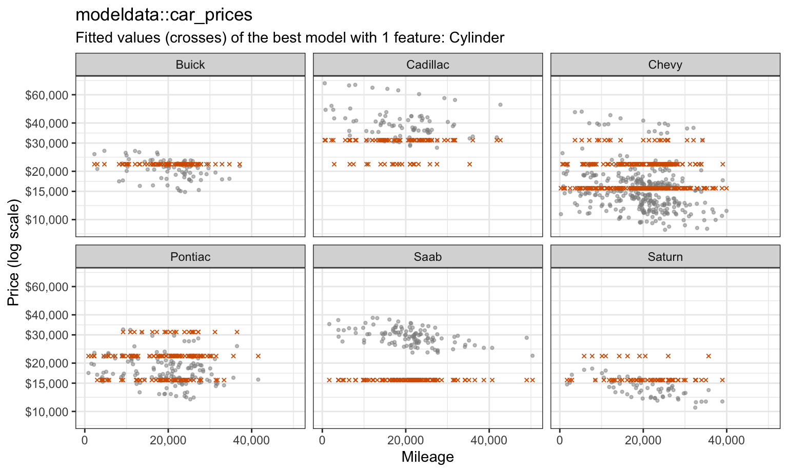

### 2 features

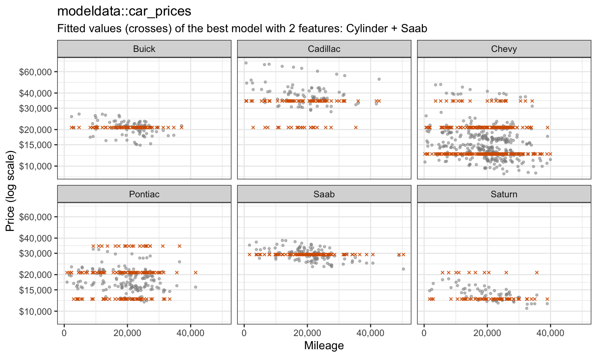

### 3 features

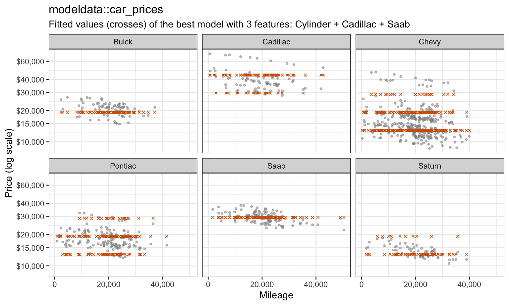

### 4 features

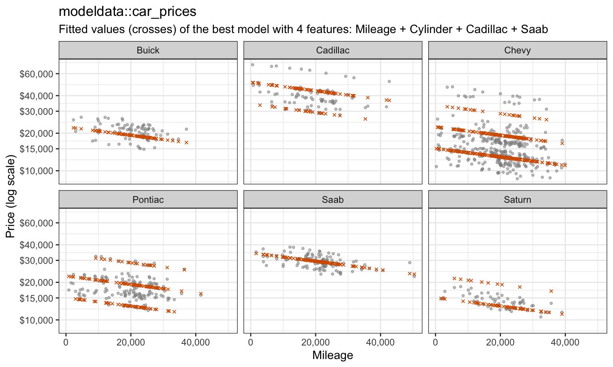

### Features by size

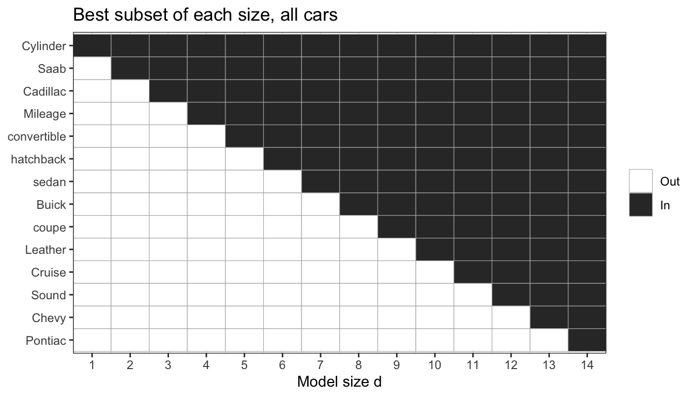

:::

::: notes
leaps::regsubsets() carries out step 2; its argument nvmax is the largest size to search. The plot is log price (on a dollar axis) against mileage, one panel per make, with the fitted values (crosses) of the best model of each size added. Within a make the cars form bands at different price levels, cars that differ in engine size and in other unrecorded ways, and within a band price falls with mileage.

The best single feature is Cylinder, which gives one fitted level per engine size and leaves Saabs, all four-cylinder cars, far below their prices. The best pair adds Saab, which lifts every Saab; the best triple adds Cadillac; and only at size 4 does Mileage enter, tilting each band downward.

The last tab shows the features in the best model of every size (rows are features in order of entry, columns the model size d). On these data the best models are nested: each contains the best model one size smaller. Nothing in the algorithm requires that, since each size is searched separately.

The slowest slide of the deck. If time is short, stop at the 3 features tab.
:::

## Training RSS

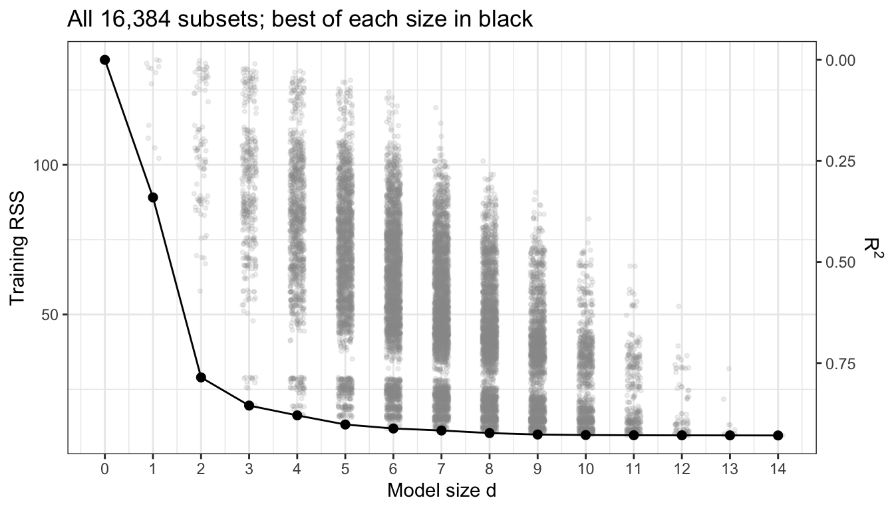{height=540}

::: notes
The figure plots the training RSS of all 16,384 subsets against their size, with the best of each size, RSS_d, joined by the black line. R^2 = 1 - RSS/TSS is a decreasing function of RSS, so the right axis reads off the same points as R^2.

RSS_d falls at every step, from RSS_0 = TSS = 135.06 to 89.11 at d = 1 and 9.60 at d = 14. It cannot do otherwise: adding any feature to M_d gives a model of size d + 1 whose least squares fit can match M_d by setting the new coefficient to zero, so RSS_{d+1} is at most RSS_d. The training RSS and R^2 therefore always choose d = p. This is the argument the cross-validation lecture made for polynomial degree: training error rewards every addition, whether or not it will help predict new cars.
:::

## Computational cost

- $2^p$ least squares fits
- $2^{14} = 16{,}384$ for these cars
- $2^{20}$ is about a million
- $2^{30}$ about a billion
- $2^{40}$ about a trillion

::: notes
The 16,384 least squares fits above take a few seconds. The count doubles with each candidate feature. The size of the search has a statistical cost too: the previous lecture showed that the smallest of many noisy estimates tends to be optimistic, and the more subsets searched, the more likely one of them fits the noise in these particular cars well. This motivates the cheaper searches that follow.

Fourth in the drop order (say the 2^p over Algorithm; the comparison with 106 is repeated on Forward stepwise).
:::

# Stepwise selection

::: notes
Two cheaper searches that build one nested path of models by adding or removing a single feature at a time.
:::

## Forward stepwise

1. $\mathcal{M}_0$: the null model
2. For $d = 0, \ldots, p - 1$: add the one feature to $\mathcal{M}_d$ with the smallest RSS to get $\mathcal{M}_{d+1}$
3. Choose among $\mathcal{M}_0, \ldots, \mathcal{M}_p$ as in best subset selection

::: {.fragment}
$$1 + \sum_{d=0}^{p-1}(p - d) = 1 + \frac{p(p+1)}{2}$$

106 models for $p = 14$, against 16,384 for best subset selection
:::

::: notes
Forward stepwise selection grows one model. At each step it fits the p - d models that add one feature to M_d and keeps the one with the smallest RSS. The number of models fit is 1 + p(p + 1)/2, which is 106 for p = 14, against 16,384 for best subset selection. Forward stepwise needs only d < n for each model it fits, so it can be used when p is at least n, stopping at size n - 1.
:::

## Backward stepwise

1. $\mathcal{M}_p$: the model with all $p$ features
2. For $d = p, \ldots, 1$: remove the one feature from $\mathcal{M}_d$ that leaves the smallest RSS to get $\mathcal{M}_{d-1}$
3. Choose among $\mathcal{M}_0, \ldots, \mathcal{M}_p$ as before

::: {.fragment}
Greedy: forward never removes a feature it has added, backward never restores one it has removed
:::

::: notes
Backward stepwise selection shrinks one model. It fits the same 1 + p(p + 1)/2 models, but it starts from the full least squares fit, so it needs n > p. Both methods are greedy: forward never removes a feature it has added, and backward never restores one it has removed, so their models are nested by construction. The best model of size d need not contain the best model of size d - 1, and when it does not, a stepwise path misses it.
:::

## Path comparison

|Method      |Size 1 (RSS)     |Size 2 (RSS)            |Size 3 (RSS)                      |
|:-----------|:----------------|:-----------------------|:---------------------------------|
|Best subset |Cadillac (44.51) |Cylinder + Saab (14.51) |Cylinder + Cadillac + Saab (9.56) |
|Forward     |Cadillac (44.51) |Cadillac + Saab (27.51) |Cylinder + Cadillac + Saab (9.56) |
|Backward    |Cylinder (45.52) |Cylinder + Saab (14.51) |Cylinder + Cadillac + Saab (9.56) |

::: notes
On all 804 cars the three methods give identical models at every size, because the best models happen to be nested. That is a property of these data, not of the methods. To see how often the paths differ, the three methods were run on 200 random halves of the cars. Forward stepwise differs from best subset at one or more sizes in 72.5% of the halves, and backward stepwise in 72.5%. The table shows the first three models of each method in one half where they differ, with each model's training RSS on that half.

In this half Cadillac alone has a slightly smaller RSS than any other single feature, so forward stepwise keeps it, and its best pair, Cadillac + Saab, has RSS 27.51, against 14.51 for the best pair, Cylinder + Saab, which does not contain the best single feature. Backward stepwise reaches the best pair from above and then keeps Cylinder at size 1. On all the cars the single-feature models are close too: Cylinder alone has RSS 89.11 and Cadillac alone 89.62. Forward stepwise misses the best pair in 45.5% of the halves.
:::

# Model size

::: notes
All three methods leave the same decision: which of M_0, ..., M_p to use. All 804 cars are training data, none held out, as they are in the test data workflow of the Cross-Validation in Practice lecture, so every estimate of error below comes from the same cars that choose the model. There are two ways to estimate the error on new data: adjust the training error for the size of the model, or estimate the error directly by cross-validation.
:::

## Training MSE

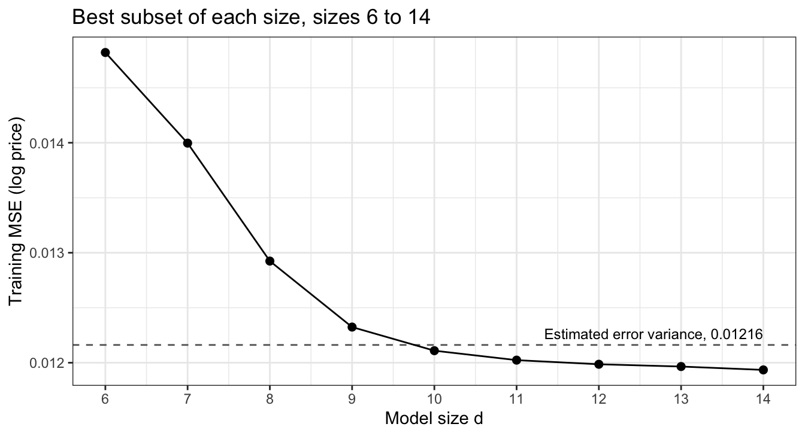{height=540}

::: notes
The figure plots the training MSE, RSS_d/n, of the best model of each size from d = 6 to 14, with a dashed line at the estimate of the error variance sigma^2 from the largest model, sigma-hat^2 = RSS_p/(n - p - 1) = 0.01216. The training MSE is below sigma-hat^2 from d = 10 on, and equals 0.01193 at d = 14. A new car's log price varies about its mean with variance sigma^2, so no model's average squared error on new responses can be below sigma^2; the training MSE of the larger models is below an estimate of it. The training error cannot choose the size.

Optional: first in the drop order (the Training RSS slide already makes the point that training error cannot choose the size).
:::

## Training error optimism

::: {style="font-size: 0.85em"}
$$E\left[\sum_{i=1}^n\left(y_i^0 - \widehat y_i\right)^2\right] = E\left[RSS\right] + 2\sigma^2\,\text{tr}(\mathbf{H}) = E\left[RSS\right] + 2(d+1)\sigma^2$$
:::

::: {.fragment}
- $y_i^0$ — new response at $x_i$
- $\mathbf{H}$ — hat matrix
- $d$ — number of features
:::

::: notes
Second in the drop order. Fix a least squares model with d features, and imagine new responses y_i^0 at the same feature values x_i, independent of y with the same distribution. The training residual is smaller than the error on a new response because y-hat_i was fit to y_i: the covariance of y_i and y-hat_i is h_ii sigma^2 (the derivation is in the notes), and summing over i gives the display. The training RSS underestimates the error on new responses at the same x_i by 2(d + 1) sigma^2 on average, an amount that grows with the size of the model. For the largest model of the Training MSE figure, 2(p + 1) sigma-hat^2 / n = 0.00045 lifts the training MSE of 0.01193 to 0.01239, above sigma-hat^2.
:::

## Penalized criteria

::: {style="font-size: 0.75em"}
$$C_p = \frac{1}{n}\left(RSS + 2d\widehat\sigma^2\right)$$
:::

::: {.fragment}
::: {style="font-size: 0.75em"}
$$\text{BIC} = \frac{1}{n}\left[RSS + \log(n)\,d\widehat\sigma^2\right]$$
:::
:::

::: {.fragment}
::: {style="font-size: 0.75em"}
$$\text{Adjusted } R^2 = 1 - \frac{RSS/(n - d - 1)}{TSS/(n - 1)}$$
:::
:::

::: {.fragment}
::: {style="font-size: 0.6em"}
- $RSS$ — training residual sum of squares
- $d$ — number of features
- $\widehat\sigma^2$ — error variance estimate from the model with all $p$ features
- $TSS$ — total sum of squares

Choose the smallest $C_p$ or BIC, the largest adjusted $R^2$
:::
:::

::: notes
Adding the optimism back gives Cp, BIC and adjusted R^2. sigma-hat^2 comes from the model with all p features, the same for every size, which keeps the larger models from estimating their own (smaller) error variance. The subscript p in Cp is Mallows' historical name, not the number of features.

Cp is RSS/n plus the optimism divided by n, with 2d in place of 2(d + 1); the difference, 2 sigma-hat^2 / n, is the same at every size and does not change which size wins. If sigma-hat^2 is unbiased for sigma^2, then for a model fixed in advance E[Cp] + 2 sigma^2/n = E[(1/n) sum_i (y_i^0 - y-hat_i)^2]: up to the constant 2 sigma^2/n, Cp estimates the average error on new responses at the observed feature values x_1, ..., x_n. Going from M_d to M_{d+1} lowers Cp if the drop in RSS divided by sigma-hat^2 exceeds 2 and lowers the BIC if it exceeds log(n) = 6.69. So the BIC penalizes each feature more than Cp and tends to choose smaller models; adjusted R^2, with the error variance of the larger model in the denominator, penalizes least.

On the cars, with sigma-hat^2 = 0.01216, Cp chooses d = 12, the BIC d = 10 and adjusted R^2 d = 14. The derivation holds for a model fixed in advance, but M_d was chosen as the best of binomial(p, d) fits, so all three criteria share some of the selection optimism of the previous lecture.
:::

## Likelihood criteria

::: {style="font-size: 0.75em"}
$$\log L = -\frac{n}{2}\log\left(2\pi\widehat\sigma^2\right) - \frac{RSS}{2\widehat\sigma^2}$$
:::

::: {.fragment}
::: {style="font-size: 0.75em"}
$$\text{AIC} = -2\log L + 2(d + 1), \qquad \text{BIC} = -2\log L + \log(n)(d + 1)$$
:::
:::

::: {.fragment}
::: {style="font-size: 0.6em"}
- $L$ — maximized likelihood under $\epsilon_i \stackrel{ind}{\sim} N\left(0, \sigma^2\right)$ with $\sigma^2$ fixed at $\widehat\sigma^2$
- $d + 1$ — coefficients, including the intercept
:::
:::

::: notes
Multiplying by sigma-hat^2/n and dropping the terms that do not depend on d, among them the intercept's share of each penalty (2 sigma-hat^2/n in the AIC), leaves Cp and the BIC of the previous slide, so for least squares with Gaussian errors AIC and Cp choose the same size. The likelihood forms apply to any model fit by maximum likelihood, for example the logistic and Poisson regressions of the earlier lectures, where there is no RSS.
:::

## Within-fold cross-validation

- Best subset search inside each fold, from the training folds only
- Predict the held-out fold with the best model of each size
- $\text{CV}_{(k)}(d)$ estimates the test MSE of the procedure "fit the best model of size $d$"

::: notes
Cross-validation estimates the test error of each size directly. The cross-validation lecture's rule applies: every data-dependent step of the fit is repeated inside each fold, using only the training folds. Here step 2 of best subset selection is a data-dependent step. Within fold l, the best model of each size is found from the training folds and then used to predict the validation fold, the held-out fold l. Cross-validation estimates the error of each size on new cars directly. Running best subset selection once on all 804 cars and cross-validating only the coefficients would let the held-out cars help choose the features that predict them.

CV_(k)(d), the k-fold estimate with k = 10, estimates the test MSE of the procedure "fit the best model of size d", not of one fixed set of features: the best model of a size can differ from fold to fold. In these folds the best model of a size differs from the one found on all the cars in 7.1% of the fold-and-size combinations, at sizes 1, 4 and 7. Cross-validation chooses d = 13, with CV_(10) = 0.01233.
:::

## Chosen sizes

::: {.panel-tabset}

### All sizes

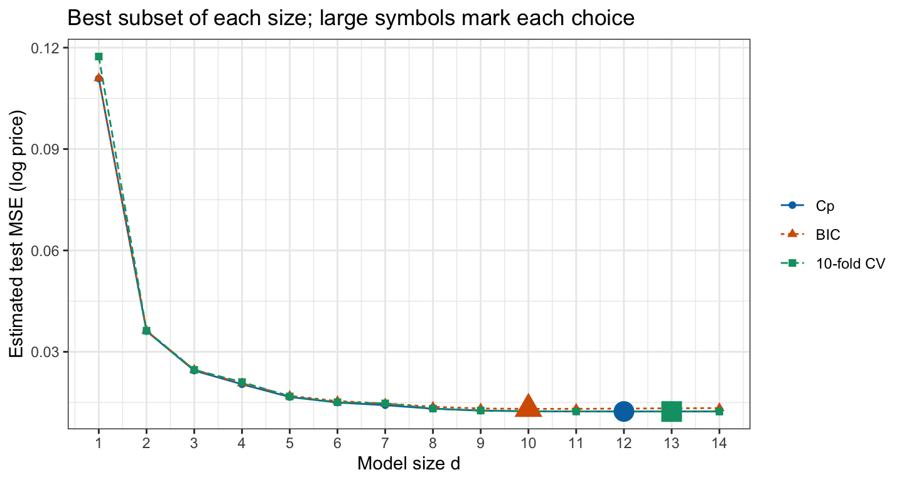

### Sizes 6 to 14

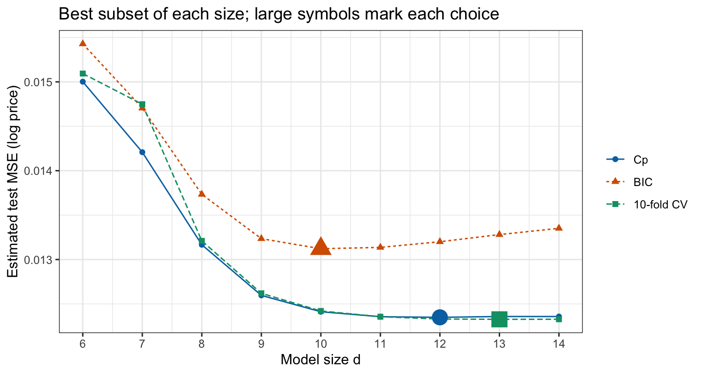

### Adjusted $R^2$

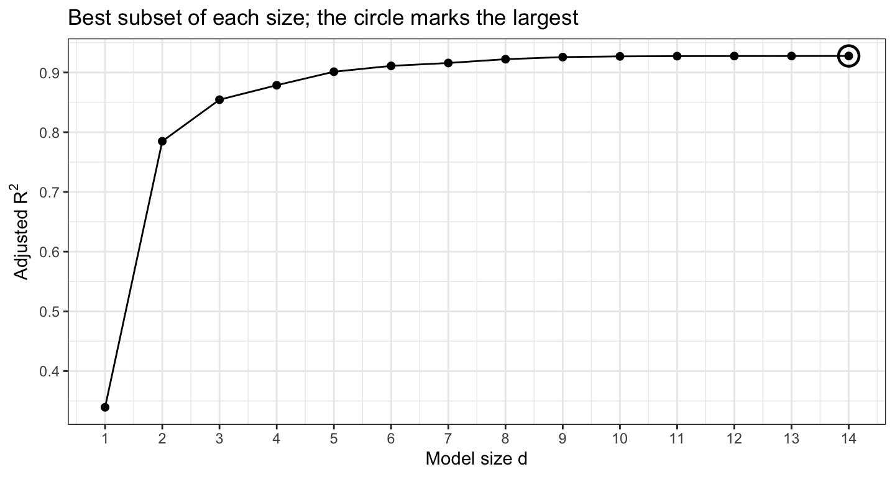

:::

::: notes
The first tab plots Cp, the BIC and the 10-fold cross-validation estimate against size, the second zooms in on sizes 6 to 14, and the third plots adjusted R^2. A large symbol marks the size each criterion chooses.

All four curves fall steeply over the first few sizes and then flatten: from d = 10 on, the cross-validation estimate is within 1% of its minimum. They disagree about where in the flat stretch to stop: the BIC chooses d = 10, Cp d = 12, adjusted R^2 d = 14 and cross-validation d = 13. As the penalties predict, the BIC chooses the smallest model and adjusted R^2 the largest. Cp and the cross-validation estimate are within 1% of each other at every size from d = 8 on, while the BIC, with its larger penalty, lies above both and rises after its minimum.

Cp and cross-validation estimate different errors, although the figure plots both on one axis. Cp estimates the error on new responses at the same feature values x_i as these cars; cross-validation predicts held-out cars whose feature values the fit has not seen, which is the error on new cars. Below d = 8 the cross-validation estimate is the larger at every size, 0.1174 against 0.1109 for Cp at d = 1, a gap that reflects this difference.

The differences in the flat stretch are small: the cross-validation estimate at the BIC's size is only 0.8% above its minimum. Over 20 further random partitions into folds, cross-validation chooses d = 10 once, d = 11 6 times, d = 12 5 times and d = 14 8 times, so the size it chooses depends on the partition. Cross-validation needs no sigma-hat^2 and does not rely on normal, constant-variance errors, at the price of 10 best subset searches instead of one.
:::

# Selected model

::: notes
The criteria leave sizes 10 through 14 nearly tied, so the smallest of them, the BIC's M_10, is interpreted here: it is easiest to explain and its cross-validation estimate is within 0.8% of the smallest.
:::

## Coefficients

::: {style="font-size: 0.65em"}
Table: Change in median price per 10,000 miles for Mileage, per cylinder for Cylinder, and from 0 to 1 for each indicator.

|Feature     | $\widehat\beta_j$| Change in median price|
|:-----------|-------------:|----------------------:|
|(Intercept) |         9.015|                       |
|Mileage     |    -8.199e-06|                  -7.9%|
|Cylinder    |        0.1865|                  20.5%|
|Leather     |       0.03446|                   3.5%|
|Buick       |        0.1204|                  12.8%|
|Cadillac    |        0.4288|                  53.5%|
|Saab        |        0.7032|                 102.0%|
|convertible |        0.1572|                  17.0%|
|coupe       |       -0.1178|                 -11.1%|
|hatchback   |       -0.2924|                 -25.4%|
|sedan       |       -0.1681|                 -15.5%|
:::

::: notes
The model drops Cruise, Sound, Chevy and Pontiac. With a normal error on the log scale, exp(x_i beta) is the median price, so exp(beta-hat_j) multiplies the median price per unit of feature j, a change of 100(exp(beta-hat_j) - 1)%.

Interpret the intercept first: exp(beta-hat_0) = $8,225 is the estimated median price when every feature is zero: no miles, no leather, a wagon, a reference make and zero cylinders. No car has zero cylinders, so beta-hat_0 only sets the level; the same car with four cylinders has estimated median price $17,341.

Mileage: each additional 10,000 miles multiplies the median price by 0.921, holding the other features fixed. Other features: each additional pair of cylinders multiplies the median price by 1.452, and the body style coefficients compare each style with a wagon.
:::

## Reference make

- Dropped: `Cruise`, `Sound`, `Chevy`, `Pontiac`
- Reference make: `Chevy`, `Pontiac` and `Saturn` together
- Dropping a dummy variable merges its level into the reference

::: notes
Because Chevy and Pontiac were dropped, their cars share the intercept with Saturn: the reference make is now Chevy, Pontiac and Saturn together, and each retained make coefficient (Buick, Cadillac and Saab) compares that make with those three. Dropping a dummy variable merges its level into the reference. The dropped Cruise and Sound are features that are simply left out.
:::

## Optimistic inference

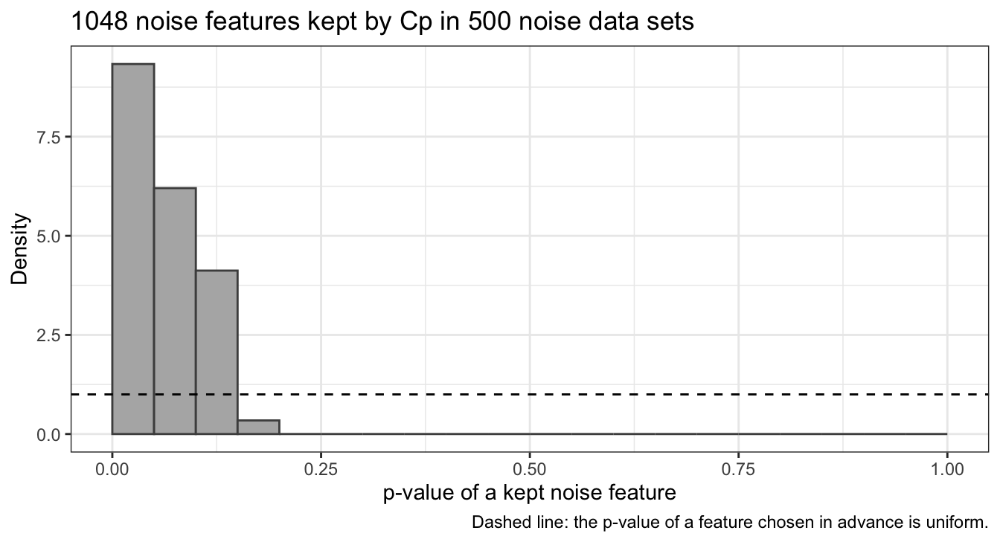{height=540}

::: notes
summary(selected) reports standard errors and p-values as though these 10 features had been chosen before seeing the data. They were chosen because they fit these cars well, which makes both optimistic for two reasons.

Error variance: the standard errors are proportional to the selected model's sigma-hat, which comes from RSS_d, the smallest of 1,001 residual sums of squares of size d = 10. The smallest of many RSS values tends to be lower than the RSS of a model fixed in advance, so sigma-hat tends to be too small. On the cars the selected model has sigma-hat = 0.1108 against 0.1103 for the largest model, so the data alone do not show it: with 804 cars the search lowers sigma-hat only a little, and dropping Cruise, Sound, Chevy and Pontiac raises it by more. Large |t|: a feature enters because its estimated coefficient is large relative to its standard error in these data, so its |t| statistic is large and its p-value small, whatever its true coefficient.

The simulation keeps the features of the 804 cars but replaces log price with independent normal noise with standard deviation 0.1103, so every true coefficient is zero. Each noise data set goes through best subset selection with the size chosen by Cp, and the selected model is refit with lm(). The histogram shows the p-values that summary() reports for every noise feature kept. Cp keeps at least one noise feature in 89.8% of the 500 data sets. The p-value of a feature chosen in advance is uniformly distributed, below 0.05 in 5% of data sets; 46.7% of the kept noise features have p < 0.05. The selected models' sigma-hat^2 averages 1.0% below sigma^2, the first reason at work, and small here because n is large relative to p.
:::

## Conclusion

::: {.columns .closing style="font-size: 0.5em"}
::: {.column width="52%"}
- Used car prices
  - Subset selection chooses which of $p$ features a model uses
- Best subset selection
  - Algorithm
    - Best model of each size, then choose among sizes
  - Fitting
    - Within one size, the training RSS compares fairly
  - Training RSS
    - RSS and $R^2$ always choose the largest model
  - Computational cost
    - The number of fits doubles with every feature
- Stepwise selection
  - Forward stepwise
    - Add one feature at a time
  - Backward stepwise
    - Remove one feature at a time; needs $n > p$
  - Path comparison
    - Greedy paths need not contain the best model of each size
:::
::: {.column width="48%"}
- Model size
  - Penalized criteria
    - The BIC favors smaller models; adjusted $R^2$ charges least
  - Likelihood criteria
    - For Gaussian least squares, AIC and $C_p$ choose the same size
  - Within-fold cross-validation
    - Repeat the best subset search inside every fold
  - Chosen sizes
    - Criteria and cross-validation disagree where estimated error is flat
- Selected model
  - Coefficients
    - Dropping a dummy variable merges its level into the reference
  - Optimistic inference
    - Standard errors and $p$-values ignore the selection: $\widehat\sigma$ too small, features kept for large $|t|$
:::
:::

::: notes
Optional; the lecture may end here if time allows. The next lecture, ridge regression, keeps all p features and instead shrinks their coefficients toward zero by penalizing their size, with the amount of shrinkage chosen by cross-validation.
:::
