## Today

<!-- derived-from: 06-regularization/20-ridge-regression.qmd @ 2cc8a47 -->

::: {.columns}
::: {.column width="50%"}
- Delivery times
  - Data
  - Features
  - Least squares
- Ridge regression
  - Item counts
  - Penalized criterion
  - Closed form
  - Estimate path
:::
::: {.column width="50%"}
- Bias-variance tradeoff
  - Prediction spread
  - Training sample size
- Tuning parameter selection
  - Cross-validation
  - Test evaluation
:::
:::

::: notes
Distilled from the chapter's six learning objectives and the slides this deck spends time on: the ridge criterion, the tuning parameter and the unpenalized intercept; the closed form of the estimate; the estimates moving smoothly toward zero without reaching it; the predictions of ridge regression over repeated training samples, and why shrinkage helps more when the training sample is small; choosing lambda by cross-validation on the training data and evaluating once on the test data. The mean and variance of the ridge estimator, why the features must be standardized (the scale figure), the squared bias and variance definitions and their decomposition, the repeated-sample comparison of the whole procedure with least squares, the comparison of the ridge and least squares estimates, the glmnet conversion of lambda (optional slide), the orthogonal-case aside, the glmnet check of the conversion, the Beyond this course callouts and the chapter's hand-off to the lasso are in the notes and not in the agenda. One running example, the delivery times of orders from one restaurant, and the question is how long a new order will take when only 100 orders have been recorded. Delivery times covers the data, the features and the least squares fit, with no transition slide of its own; the other three parts each have one.

Timing: one 50-minute period; the core slides come to about 37 minutes and the optional slide to about 1 more. The Conclusion is the closing slide. If time is short, drop in this order: glmnet scaling (say that glmnet's lambda differs from this chapter's by a factor n over s_y), Item counts (say the single order that determines item_20 over Penalized criterion), the extra tabs of Data (leave it on Distance, hour, items) and of Prediction spread (show the first and last tabs).
:::

## Delivery times

- Question: how long will a food delivery order take?
- Response variable: `time_to_delivery`, in minutes
- Explanatory variables: `hour`, `day`, `distance`, `item_01`, ..., `item_27`

::: {.fragment}
- Training orders: 100, a small random sample
- Test orders: 9,912, every other order
:::

::: notes
The question is how long a delivery will take, from the time the order is placed until it arrives. The data are modeldata::deliveries, 10,012 orders from one restaurant. The response is time_to_delivery in minutes. The explanatory variables are the hour the order was placed (a decimal hour on a 24-hour clock), the day of the week, the delivery distance in miles, and 27 columns item_01, item_02, ... that count how many of each menu item the order contains. The test orders are split off first, before any plotting or fitting. The training data are a small random sample of orders; every other order is test data. The training sample size was chosen to be small relative to the 36 coefficients of the model, so that their estimates are poorly determined; the bias-variance section also shows what happens with 300 training orders. The next lecture, on the lasso, uses the same split and the same folds.
:::

## Data

::: {.panel-tabset}

### Distance, hour, items

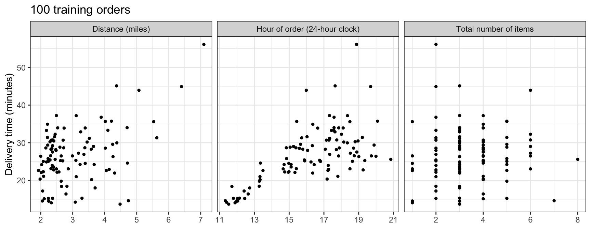

### Day

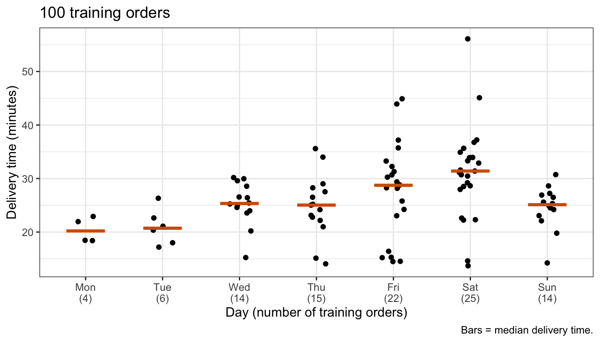

:::

::: notes
The tabs plot the delivery time of the 100 training orders against distance, hour and the total number of items in the order, and against the day. Delivery time rises with distance and with the hour of the order: steeply from 11:00 to about 13:30 and more slowly after, so a straight line in hour is only an approximation. It rises less clearly with the number of items. The median delivery time is shortest on Monday and Tuesday (20.2 and 20.7 minutes), between 25.0 and 25.3 minutes on Wednesday, Thursday and Sunday, and longest on Friday and Saturday (28.7 and 31.4), but only 4 of the training orders were placed on a Monday and 6 on a Tuesday. The item counts are nearly uncorrelated with each other: over the 351 pairs of items, the median absolute correlation in the training orders is 0.07, and 97% of the pairs are below 0.2 in absolute value.

If time is short, leave the tabset on Distance, hour, items.
:::

## Features

- Features, $p = 35$: `hour`, `distance`, 27 item counts, 6 day dummies

::: {.fragment}
- Reference level: Monday
:::

::: notes
Hour, distance and the 27 item counts enter as features as recorded. Day enters as 6 dummy variables with Monday as the reference level, so the model has p = 35 features. The model is y_i = beta_0 + sum_j beta_j x_ij + epsilon_i with epsilon_i independent N(0, sigma^2), where y_i is the delivery time of training order i = 1, ..., n with n = 100 and x_ij is the value of feature j for order i.
:::

## Least squares

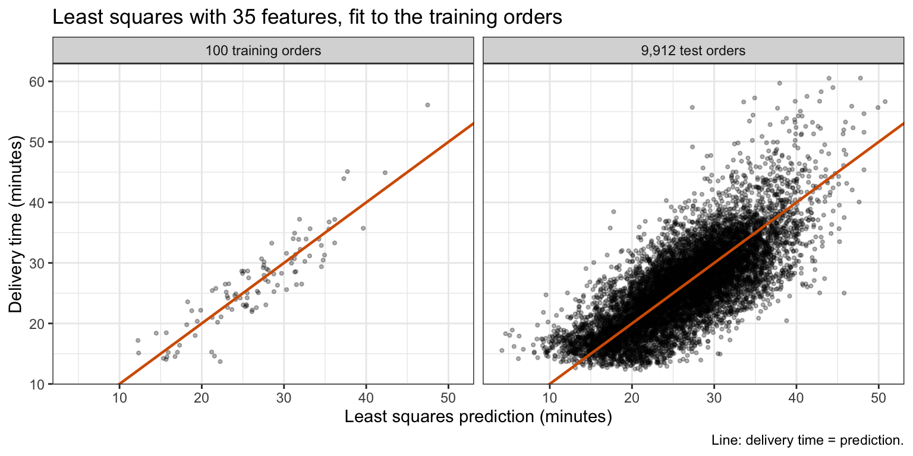{height=540}

::: notes
The figure plots the delivery time against the least squares prediction, for the 100 training orders the model was fit to and for the test orders; the line is delivery time equals prediction. The training orders sit closer to the line than the test orders. The training MSE is 10.13 and the test MSE 22.02, 2.17 times as large. The Subset Selection lecture showed that, for a correct linear model, the training RSS underestimates the error on new responses at the same feature values by 2(p + 1) sigma^2 on average. With E[RSS] = sigma^2 (n - p - 1), the fact behind the unbiased estimate sigma-hat^2 = RSS/(n - p - 1), the expected error on those new responses is sigma^2 (n + p + 1), a ratio of (n + p + 1)/(n - p - 1) = 2.12 here, close to the observed ratio, although the test orders have new feature values as well as new responses. With p + 1 = 36 coefficients estimated from 100 orders, the average variance of the fitted values, sigma^2 (p + 1)/n, is 36% of the error variance.
:::

# Ridge regression

::: notes
Ridge regression keeps every feature but pulls the estimates toward zero.
:::

## Item counts

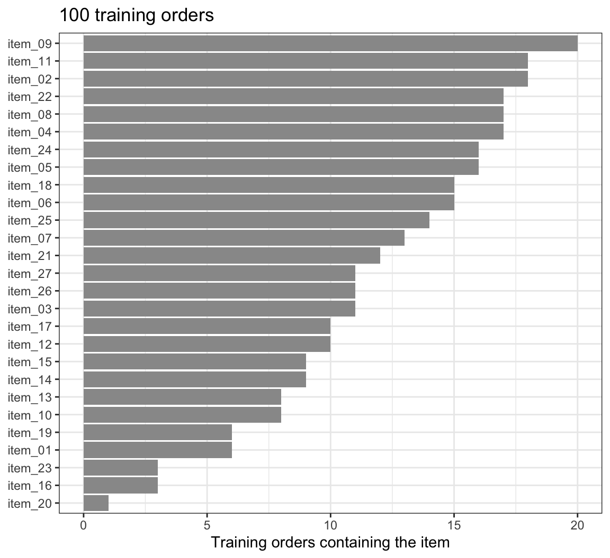{height=540}

::: notes
The figure counts how many of the 100 training orders contain each menu item. Each item appears in between 1 and 20 of the training orders, a median of 11. item_20 appears in only one order, so its least squares estimate is set almost entirely by how far that order's delivery time is from the prediction of the other features, its error epsilon_i included. Ridge regression keeps every feature but pulls the estimates toward zero.

Core, but second in the drop order (say the single order that determines item_20 over Penalized criterion).
:::

## Penalized criterion

::: {style="font-size: 0.75em"}
$$\sum_{i=1}^n\left(y_i - \beta_0 - \sum_{j=1}^p\beta_j\tilde x_{ij}\right)^2 + \lambda\sum_{j=1}^p\beta_j^2 = RSS + \lambda\sum_{j=1}^p\beta_j^2$$
:::

::: {.fragment}
::: {style="font-size: 0.6em"}
- $\tilde x_{ij} = \left(x_{ij} - \bar x_j\right)/s_j$ — feature $j$ of order $i$, standardized
- $\lambda \ge 0$ — tuning parameter
- $\lambda\sum_{j=1}^p\beta_j^2$ — shrinkage penalty
- $\beta_0$ — intercept, not penalized
:::
:::

::: notes
Ridge regression estimates the coefficients by minimizing the display. The mean x-bar_j is the mean of feature j over the n training orders and s_j its standard deviation, computed with divisor n. The intercept beta_0 and the coefficients beta_1, ..., beta_p of the standardized features are on the standardized scale: each beta_j is the change in mean delivery time per standard deviation of its feature, and equals s_j times the coefficient of feature j on the original scale of the model. The RSS rewards values of the coefficients that fit the training orders; the penalty charges lambda per unit of squared coefficient, so an estimate grows only as far as the drop in RSS pays for it.

The intercept is not penalized. It is the mean delivery time when every standardized feature is at its mean of zero, and penalizing it would pull every prediction toward zero minutes, an arbitrary point. Without a penalty on beta_0, adding a constant to every y_i adds the same constant to the intercept and changes no slope.
:::

## Closed form

::: {style="font-size: 0.75em"}
$$\widehat\beta_0 = \bar y, \qquad \widehat\beta^R_\lambda = \left(\tilde{\mathbf{X}}^\top\tilde{\mathbf{X}} + \lambda\mathbf{I}_p\right)^{-1}\tilde{\mathbf{X}}^\top\left(y - \bar y\mathbf{1}\right)$$
:::

::: {.fragment}
::: {style="font-size: 0.6em"}
- $\tilde{\mathbf{X}}$ — standardized features, without a column of ones
- $\mathbf{I}_p$ — $p \times p$ identity matrix
:::
:::

::: {.fragment}
::: {style="font-size: 0.8em"}
- $\lambda = 0$: least squares
- $\lambda \to \infty$: $\widehat\beta^R_\lambda \to 0$, the null model
:::
:::

::: notes
Setting the derivatives of the criterion to zero gives beta-hat_0 = y-bar and the ridge estimate; each column of X-tilde sums to zero, so the derivative with respect to beta_0 does not involve the slopes, and the criterion is a convex quadratic, so this is its minimum. For lambda greater than 0 the matrix X-tilde^T X-tilde + lambda I_p is invertible even when X-tilde^T X-tilde is not, so the ridge estimate is unique even when p is at least n. At lambda = 0 the ridge estimate is the least squares estimate on the standardized features, which gives the same predictions as least squares on the features as recorded. As lambda goes to infinity every estimated slope goes to zero and every prediction is y-bar, the null model. Here beta-hat_0 = y-bar is the standardized-scale intercept and the ridge estimate is the estimate of the standardized-scale coefficients. An estimate on the original scale is the ridge estimate divided by s_j, and the original-scale intercept estimate is y-bar minus the sum over j of x-bar_j times the ridge estimate_j over s_j. The chapter's ridge_fit() computes the closed form and returns the estimates on the original scale.
:::

## glmnet scaling

::: {style="font-size: 0.75em"}
$$\frac{1}{2n}RSS + \frac{\lambda_{\text{glmnet}}}{2}\sum_{j=1}^p\beta_j^2$$
:::

::: {.fragment}
::: {style="font-size: 0.75em"}
$$\lambda = \frac{n\,\lambda_{\text{glmnet}}}{s_y}$$
:::
:::

::: {.fragment}
::: {style="font-size: 0.6em"}
- $\lambda_{\text{glmnet}}$ — the value `glmnet()` calls `lambda`
- $s_y$ — standard deviation of $y$, divisor $n$
:::
:::

::: notes
glmnet::glmnet() with alpha = 0 fits ridge regression, but its documented criterion is the first display. Multiplying that criterion by 2n gives RSS + n lambda_glmnet times the sum of squared coefficients. Two more steps happen inside glmnet() for a numeric response. It divides y by its standard deviation s_y, fits, and multiplies the estimates by s_y afterward; fitting y/s_y with penalty n lambda_glmnet gives the same criterion divided by s_y^2, so this step alone would give lambda = n lambda_glmnet. It also divides the supplied lambda_glmnet by s_y before fitting y/s_y. For the lasso's absolute-value penalty this division exactly undoes the effect of dividing y by s_y; glmnet() applies it to the squared penalty too, where it does not. The net effect, checked numerically in the notes, is that lambda_glmnet corresponds to the lambda of this chapter's criterion by the second display. glmnet() standardizes the features itself, with divisor n, and reports estimates on the original scale. From here on lambda is this chapter's, converted where glmnet() is used.

Optional: first in the drop order (say that glmnet's lambda differs from this chapter's by a factor n over s_y).
:::

## Estimate path

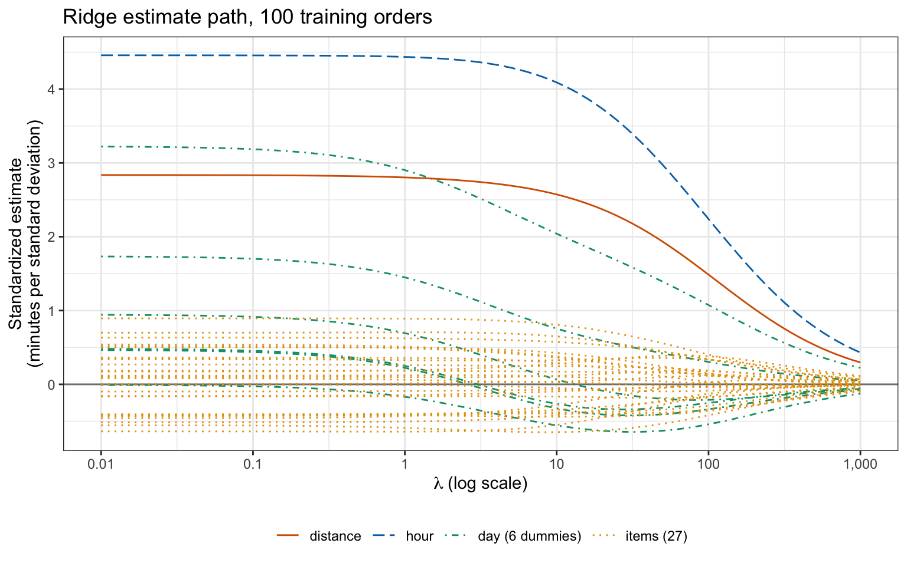{height=540}

::: notes
The figure plots each standardized estimate of the ridge fit to the 100 training orders against lambda, from 0.01 to 1,000. At the left the estimates are those of least squares. The largest are hour (4.5), daySat (3.2) and distance (2.8) minutes per standard deviation, and 31 of the 35 are within a minute of zero. As lambda grows the estimates move toward zero smoothly, and none reaches it: at lambda = 1,000 the hour estimate is still 0.43. The length of the vector of standardized estimates falls at every step of the grid, from 6.89 to 0.66, but a single estimate need not: 20 of the 35 move away from zero somewhere along the path, and 8 change sign, among them 3 of the 6 day dummies. The dummy variables of one categorical explanatory variable are correlated, since an order placed on one day was placed on no other, and the penalty shrinks them together.
:::

# Bias-variance tradeoff

::: notes
To see what shrinkage does to predictions, this section draws repeated training samples. Of the 9,912 test orders, 4,000 are the test orders at which every prediction is made, and the remaining 5,912 test orders are the orders from which the repeated training samples are drawn. Both are this chapter's test orders too: the demonstration chooses nothing, and the delivery model is chosen and fit from the 100 training orders alone. From the remaining test orders, 500 training samples of 100 orders were drawn, ridge regression was fit to each sample at each lambda on a grid, and each fit predicted the 4,000 test orders. The test MSE in this section's figures is the mean squared error at those 4,000 test orders, averaged over the samples.
:::

## Prediction spread

::: {.panel-tabset}

### $\lambda = 0$

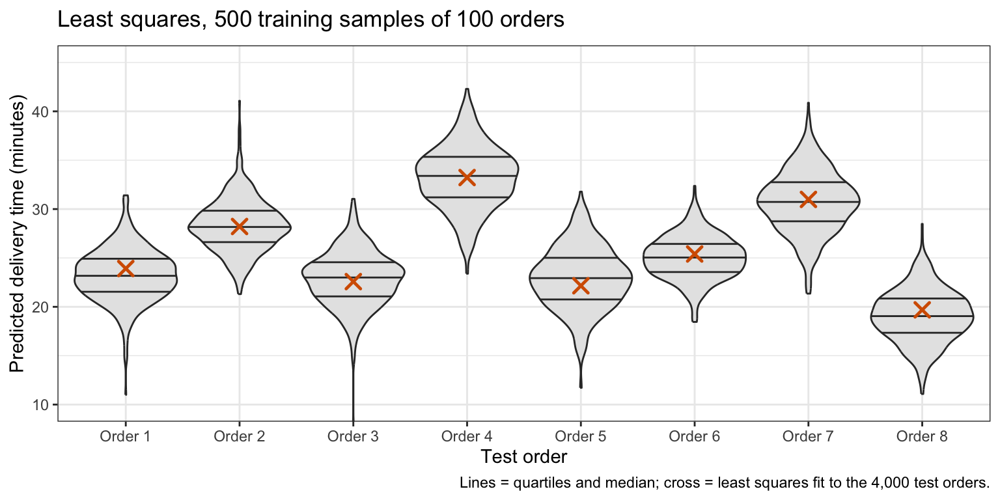

### $\lambda = 15.8$

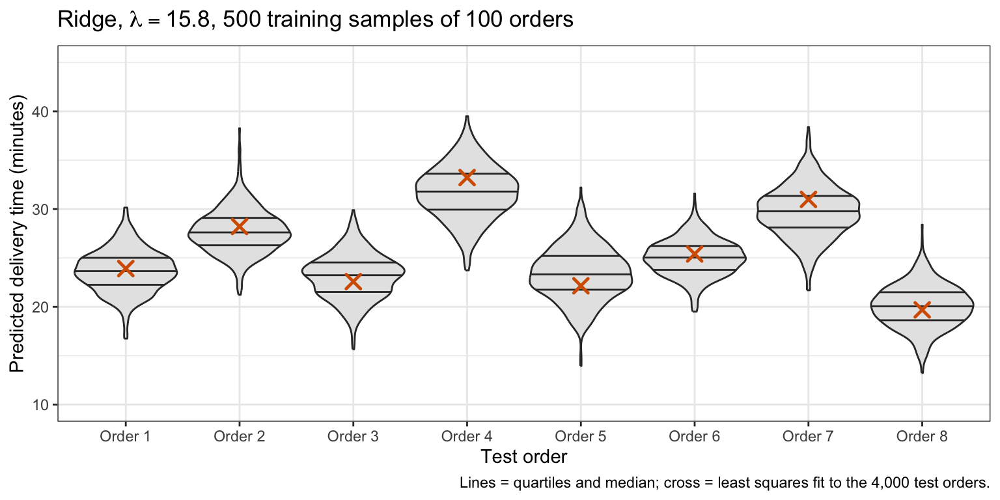

### $\lambda = 1{,}000$

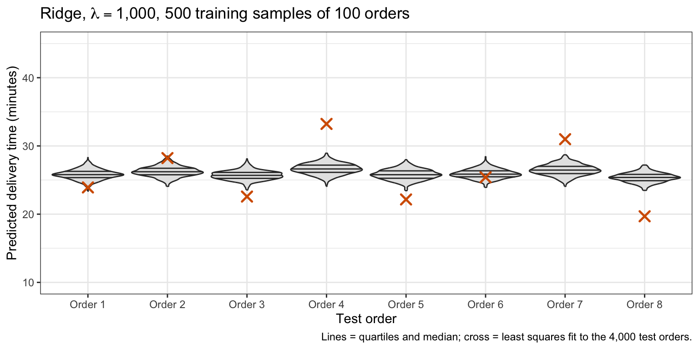

:::

::: notes
The tabs plot the predictions of 8 of the 4,000 test orders for three values of lambda. Each violin shows one order's predictions over the 500 training samples, and the cross marks its fitted value from least squares fit to the 4,000 test orders themselves. With lambda = 0, least squares, each order's predictions are centered near its cross but spread over several minutes. At lambda = 15.8 they spread less and are pulled slightly toward the mean. At lambda = 1,000 they spread least, but they are pulled toward the mean delivery time, above the cross for the quick orders and below it for the slow ones.

If time is short, show the first and last tabs.
:::

## Training sample size

::: {.panel-tabset}

### $n = 100$

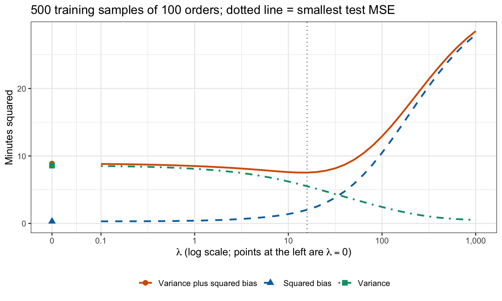

### $n = 300$

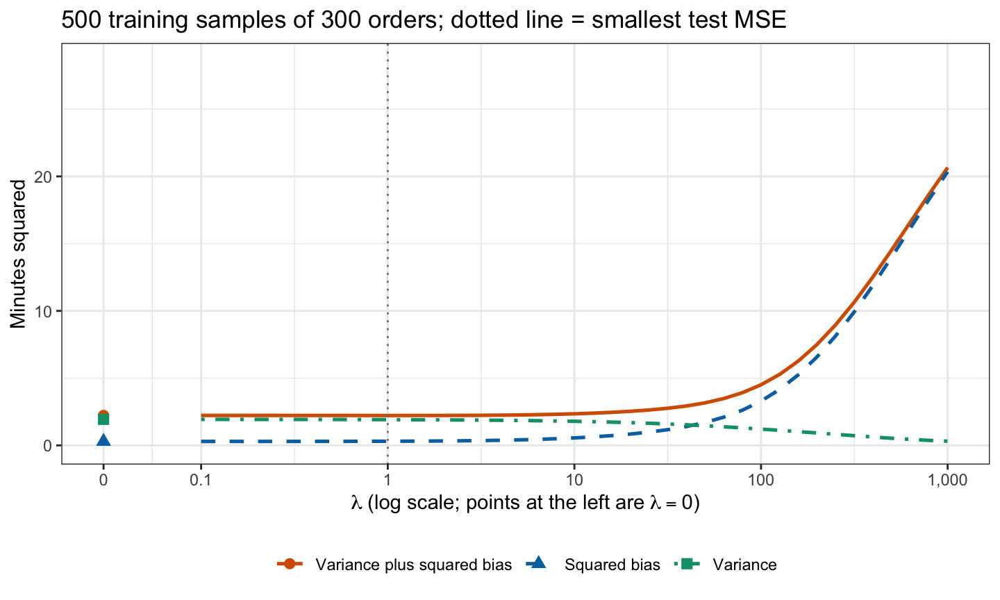

:::

::: notes
The tabs plot the squared bias, the variance and their sum against lambda, from 500 training samples of 100 orders and, separately, 500 of 300 orders. Each sample's ridge fit at each lambda predicts the 4,000 test orders, and each term is averaged over those test orders and over the samples; the notes define the terms. Variance plus squared bias is the test MSE minus MSE*, which does not depend on lambda (MSE* = 13.71), so it is smallest at the lambda with the smallest test MSE, marked by the dotted line. With n = 100, least squares has squared bias 0.30 and variance 8.57. As lambda grows the variance falls and the squared bias rises, slowly at first, so their sum falls to its minimum at lambda = 15.8; there the test MSE is 21.24 against 22.58 for least squares, 5.9% lower. Beyond the minimum the squared bias dominates and the test MSE climbs toward that of the null model.

With n = 300 the variance of least squares is only 1.94, so there is little for shrinkage to remove before the squared bias from shrinking the large estimates of hour, distance and the days outweighs it: the smallest test MSE, at lambda = 1.0, is less than 0.1% below that of least squares. How much shrinkage helps depends on the data and on the sample size, so lambda has to be chosen from the training data.
:::

# Tuning parameter selection

::: notes
Lambda is chosen like any tuning parameter: by k-fold cross-validation on the training data, then a refit to all the training data, and the chosen model is evaluated once on the test data.
:::

## Cross-validation

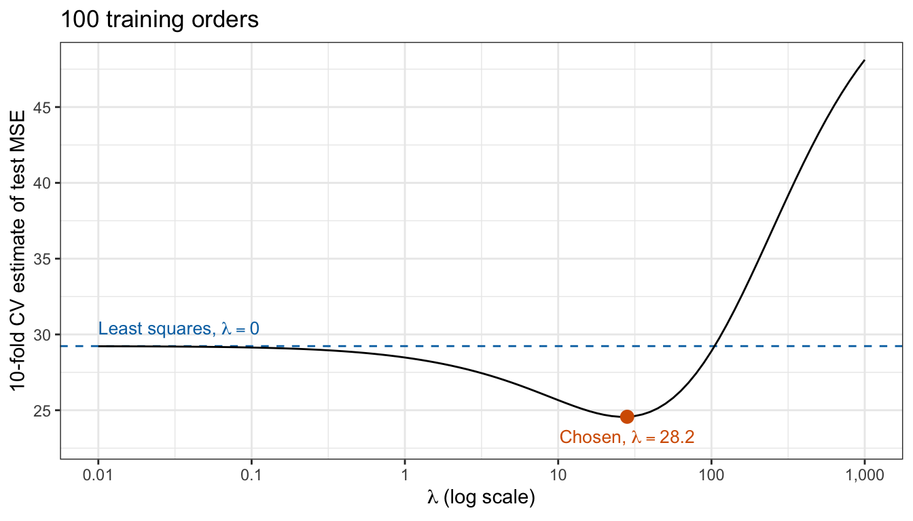{height=540}

::: notes
cv.glmnet() computes the 10-fold cross-validation estimate CV_(10)(lambda) for every lambda on a grid, with the folds drawn with the split. For each fold glmnet() standardizes and fits from the other 9 folds and predicts the held-out fold; the held-out folds are validation sets. The figure plots the estimate against lambda, with the estimate for least squares on the same folds as a dashed line and the chosen lambda, the one with the smallest estimate, as a point. The estimate falls from 29.23 for least squares to its smallest value, 24.57, at lambda = 28.2 (lambda_glmnet = 2.071), and rises again beyond it, above the least squares estimate from lambda = 112 on. The estimated reduction, 15.9%, is small relative to its uncertainty: plus or minus one standard error is 19.62 to 29.52 at the minimum and 23.51 to 34.95 for least squares, intervals that overlap almost entirely. The curve is flat near its minimum: from lambda = 18 to 35 the estimate is within 1% of its smallest value. In 2 of the 10 folds some item appears in none of the training folds, and glmnet() gives it an estimate of zero. The repeated training samples of the previous section put the smallest average test MSE at lambda = 15.8; cross-validation sees only the 100 training orders and chooses a larger value.

Optional footnote of the chapter: the lambda axis is this chapter's lambda only approximately. cv.glmnet() converts with the n and s_y of all 100 training orders, but each fold is fit to 90 orders with their own s_y, so the lambda a fold applies is 0.87 to 0.95 times the plotted value. Applying this chapter's lambda exactly in every fold gives a smallest estimate of 24.49 at lambda = 25.1; no conclusion changes.
:::

## Test evaluation

|Method        | $\lambda$| Training MSE| 10-fold CV estimate| Test MSE|
|:-------------|---------:|------------:|-------------------:|--------:|
|Least squares |         0|        10.13|               29.23|    22.02|
|Ridge         |      28.2|        12.23|               24.57|    20.38|

::: notes
cv.glmnet() also fits the whole path to all 100 training orders, so predicting with s = "lambda.min" uses the model refit to all the training data. The chosen model is evaluated once on test data, the 9,912 test orders, with least squares for comparison. Ridge regression's test MSE is 20.38, against 22.02 for least squares, 7.5% lower. The paired difference in squared error over the test orders has mean 1.64 and standard error 0.18, so the improvement is not an accident of which orders are test orders. That standard error treats the two fitted models as fixed: it reflects only which orders are test orders, not which training orders were drawn. Both cross-validation estimates are above the test MSE: each fit in cross-validation uses 90 orders, and with so few orders per feature the error falls quickly as orders are added; an estimate from 100 orders is also noisy. The reduction cross-validation estimated, 15.9%, is 2.1 times the 7.5% reduction on the test orders.

The 7.5% is the gain on this one training sample, a favorable draw: over 500 repeated training samples of 100 orders, the same procedure, lambda by 10-fold cross-validation and then a refit, has a lower MSE at the 4,000 test orders than least squares in 72% of the samples and a higher one in 28%, and its average MSE is 3.7% below that of least squares; with training samples of 300 orders it has the lower MSE in only 44% and its average MSE is 0.2% above that of least squares. Do not quote the 7.5% as the gain to expect.
:::

## Conclusion

- Ridge penalizes the squared coefficients, not the intercept
- The ridge estimate has a closed form between least squares and the null model
- Estimates shrink smoothly toward zero as $\lambda$ grows, and none reaches it
- The gain over least squares is largest for small training samples
- Choose $\lambda$ by cross-validation, evaluate once on test data

::: notes
The next lecture, the lasso, replaces the squared penalty with lambda times the sum of the absolute values of the coefficients, which sets some estimates exactly to zero, and compares the two on the same training and test orders. The standard errors and p-values from lm() do not apply to ridge estimates, which are shrunken.
:::
