## Today

<!-- derived-from: 06-regularization/30-lasso.qmd @ 1ffd3f0 -->

::: {.columns}
::: {.column width="50%"}
- Delivery times
- Lasso
  - Penalized criterion
  - Constraint regions
  - Soft thresholding
  - Estimate path
:::
::: {.column width="50%"}
- Tuning parameter selection
  - Cross-validation
  - Test evaluation
  - Lasso estimates
- Repeated training samples
  - Test MSE
  - Selected sets
:::
:::

::: notes
Distilled from the chapter's six learning objectives and the slides this deck spends time on: the lasso criterion and its contrast with ridge; why the L1 constraint region gives exact zeros; soft thresholding of the least squares estimate for orthogonal features; reading the estimate path and the number of nonzero estimates; choosing lambda by cross-validation, one test evaluation, and the comparison of lasso, ridge and least squares; the instability of the selected set and the bias of the lasso estimator. The derivation of soft thresholding, the argument for lambda-max, the coordinate descent paragraph, the glmnet conversion of lambda (optional slide), the l0 budget of best subset selection (optional slide), the Estimator bias figure (optional slide), the Beyond this course callout and the hand-off to principal components are in the notes and not in the agenda. This lecture is the sequel to the ridge lecture on the same data, the same split and the same folds, and the question it opens from is what ridge left open: all 35 ridge estimates are nonzero. Delivery times has no transition slide of its own and Estimate path, a chapter section of its own, is shown inside the Lasso part; the other three parts each have one transition.

Timing: one 50-minute period; the core slides come to about 38 minutes. The Conclusion is the closing slide. If time is short, drop in this order: glmnet scaling (say that glmnet's lambda differs from this chapter's by the factor 2n, with no s_y), Best subset selection (say that best subset selection is the same problem with a budget on the number of nonzero coefficients), Data (the Delivery times slide already names the variables), Estimator bias (say that the lasso's and ridge's average estimates are below least squares'), then the extra tabs of Constraint regions, two features (show "+ Lasso" and "+ Ridge").
:::

## Delivery times

- Question: does a model that keeps only some of the 35 features predict delivery times better than one that uses all of them?
- Response variable: `time_to_delivery`, in minutes
- Explanatory variables: `hour`, `day`, `distance`, `item_01`, ..., `item_27`

::: {.fragment}
- Training orders: 100, the ridge lecture's sample
- Test orders: 9,912, the ridge lecture's test orders
:::

::: notes
This is the ridge lecture's data, the split and the folds, so the lasso is compared with ridge regression and least squares on exactly the same training and test orders. The question is whether a model that keeps only some of the 35 features predicts delivery times better than one that uses all of them. The data are modeldata::deliveries, 10,012 orders from one restaurant. The response is time_to_delivery in minutes. The explanatory variables are the hour the order was placed (a decimal hour on a 24-hour clock), the day of the week, the delivery distance in miles, and 27 columns item_01, item_02, ... that count how many of each menu item the order contains. Day enters the model as 6 dummy variables with Monday as the reference level, so there are 35 features. The training sample is deliberately small relative to the 36 coefficients of the model, so that they are poorly determined; the repeated samples at the end also use 300 training orders.
:::

## Data

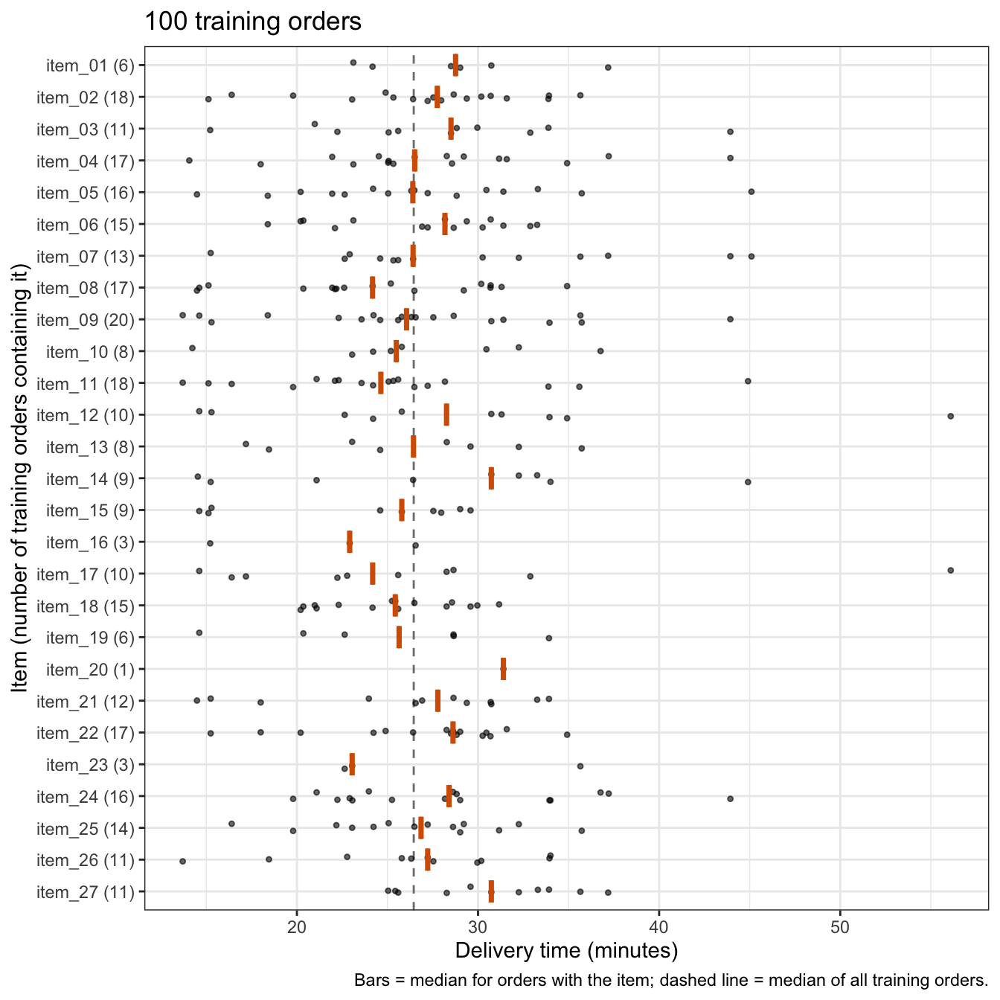{height=540}

::: notes
The figure plots, for each of the 27 items, the delivery times of the training orders that contain it. Each item is in between 1 and 20 of the 100 training orders. The median delivery time of the orders containing an item ranges from 22.9 to 31.4 minutes, around the overall median of 26.5, and the times of the orders containing any one item vary widely. These orders also differ in distance, hour and day, which the ridge lecture showed matter, so a difference between items here need not be an effect of the items.

Optional: third in the drop order; if time is short, skip this slide.
:::

## Ridge estimates

{height=540}

::: notes
The figure repeats the ridge lecture's estimate path: the ridge estimate of each standardized coefficient, fit to the training orders, against lambda. The ridge estimates shrink toward zero as lambda grows, but at every one of the 101 values of lambda on the grid all 35 are nonzero. At lambda = 1,000 the item estimate closest to zero, that of item_23, is still 4.0 x 10^-3 minutes per standard deviation.
:::

# Lasso

::: notes
The lasso keeps the structure of ridge regression, the RSS plus a penalty, and changes the penalty to lambda times the sum of the absolute values of the coefficients. That change sets some estimates exactly to zero.
:::

## Two features

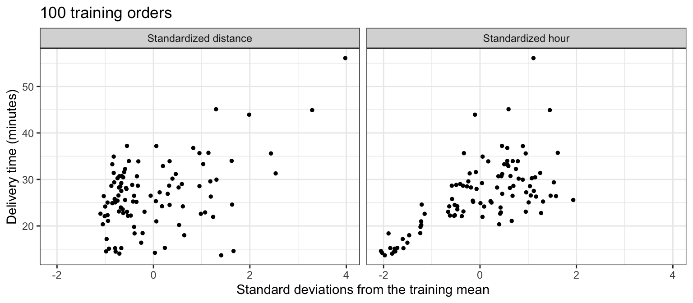{height=540}

::: notes
The geometry of this section uses two features, the standardized distance and hour of the training orders. The figure plots the delivery time against each. Delivery time rises with both, and the two are nearly uncorrelated in the training orders (correlation 0.06).
:::

## Penalized criterion

::: {style="font-size: 0.75em"}
$$\sum_{i=1}^n\left(y_i - \beta_0 - \sum_{j=1}^p\beta_j\tilde x_{ij}\right)^2 + \lambda\sum_{j=1}^p\left|\beta_j\right| = RSS + \lambda\sum_{j=1}^p\left|\beta_j\right|$$
:::

::: {.fragment}
::: {style="font-size: 0.6em"}
- $\tilde x_{ij}$ — feature $j$ of order $i$, standardized
- $\lambda \ge 0$ — tuning parameter
- $\lambda\sum_{j=1}^p\left|\beta_j\right|$ — $\ell_1$ penalty; ridge: $\ell_2$ penalty $\lambda\sum_{j=1}^p\beta_j^2$
- $\beta_0$ — intercept, not penalized
:::
:::

::: notes
The lasso estimates the coefficients by minimizing the display. The features are standardized with divisor n and beta_0, beta_j are on the standardized scale, as in the ridge lecture. The intercept is not penalized and the features are standardized, for the reasons the ridge lecture gave, and the l1 penalty is no more scale equivariant than the l2 penalty. The criterion is convex but not differentiable where some beta_j = 0, and in general its minimum has no closed form, unlike ridge regression.
:::

## Maximum lambda

::: {style="font-size: 0.75em"}
$$\lambda \ge \lambda_{\max} = \max_{j}\, 2\left|\sum_{i=1}^n\tilde x_{ij}\left(y_i - \bar y\right)\right|$$
:::

::: {.fragment}
::: {style="font-size: 0.8em"}
- $\lambda = 0$: least squares
- $\lambda \ge \lambda_{\max}$: $\widehat\beta_0 = \bar y$ and every slope estimate is zero, the null model
:::
:::

::: {.fragment}
::: {style="font-size: 0.8em"}
- Training orders: $\lambda_{\max} = 967.4$, set by `hour`
:::
:::

::: notes
At lambda = 0 the lasso is least squares. Unlike ridge regression, it reaches the null model at a finite lambda. At beta = 0, changing one coefficient beta_j to t changes the RSS by -2t times the sum over i of x-tilde_ij (y_i - y-bar), plus n t^2, and the penalty by lambda times the absolute value of t, so no estimate can leave zero when lambda is at least lambda-max. The standardized features are centered, so whatever the slopes, the intercept that minimizes the criterion is beta-hat_0 = y-bar, the mean delivery time of the training orders; take beta_0 = y-bar. Because the criterion is convex and the penalty is a sum over j, every slope estimate is zero and every prediction is y-bar, the null model. For the training orders lambda-max = 967.4, set by hour, the feature most correlated with the delivery time.
:::

## Constraint regions

::: {style="font-size: 0.8em"}
Minimize the RSS subject to
:::

::: {style="font-size: 0.75em"}
$$\sum_{j=1}^p\left|\beta_j\right| \le s, \qquad\text{and for ridge regression}\qquad \sum_{j=1}^p\beta_j^2 \le s$$
:::

::: {.fragment}
::: {style="font-size: 0.6em"}
- $s \ge 0$ — budget
- smaller $\lambda$, larger $s$
:::
:::

::: notes
Minimizing the lasso criterion is equivalent to minimizing the RSS subject to the first constraint, and ridge regression to the second. Each lambda corresponds to some budget s, a smaller lambda to a larger s. The budget s is the textbook's symbol; it is unrelated to the standard deviations s_j and s_y. For the two standardized features the region is a diamond for the lasso and a disk for ridge regression, and the RSS has elliptical contours centered at the least squares estimate. The constrained estimate is where the smallest contour touches the region.
:::

## Constraint regions, two features

::: {.panel-tabset .square-tabs}

### RSS contours

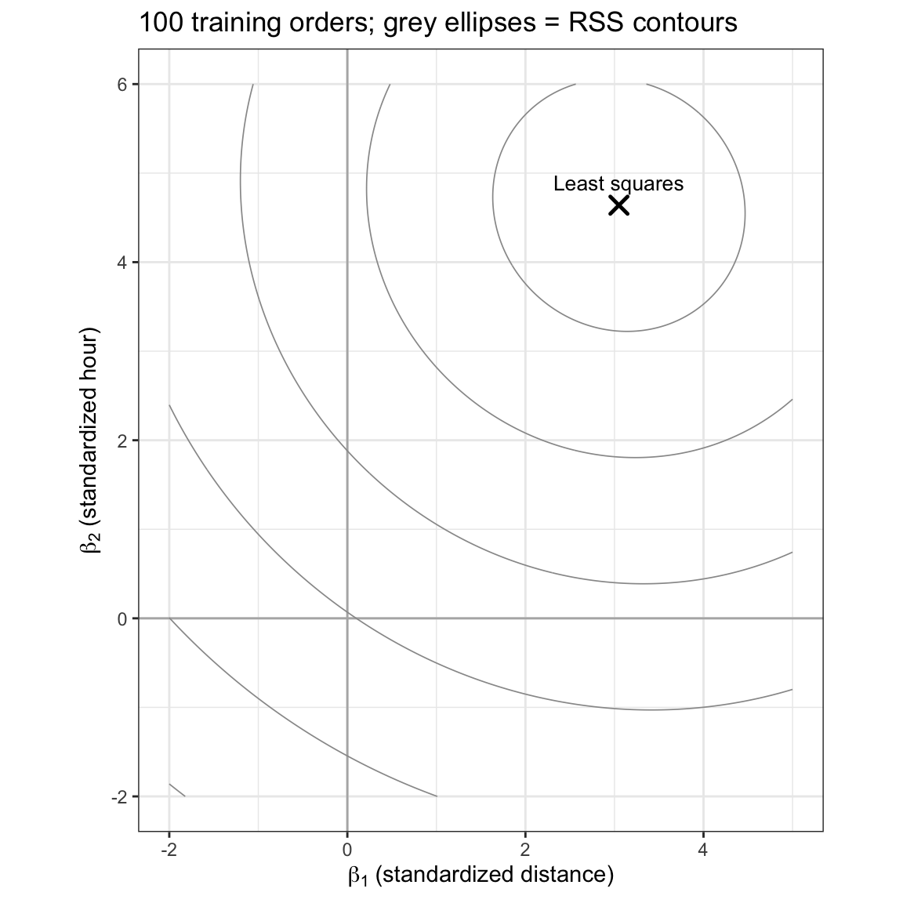

### + Lasso

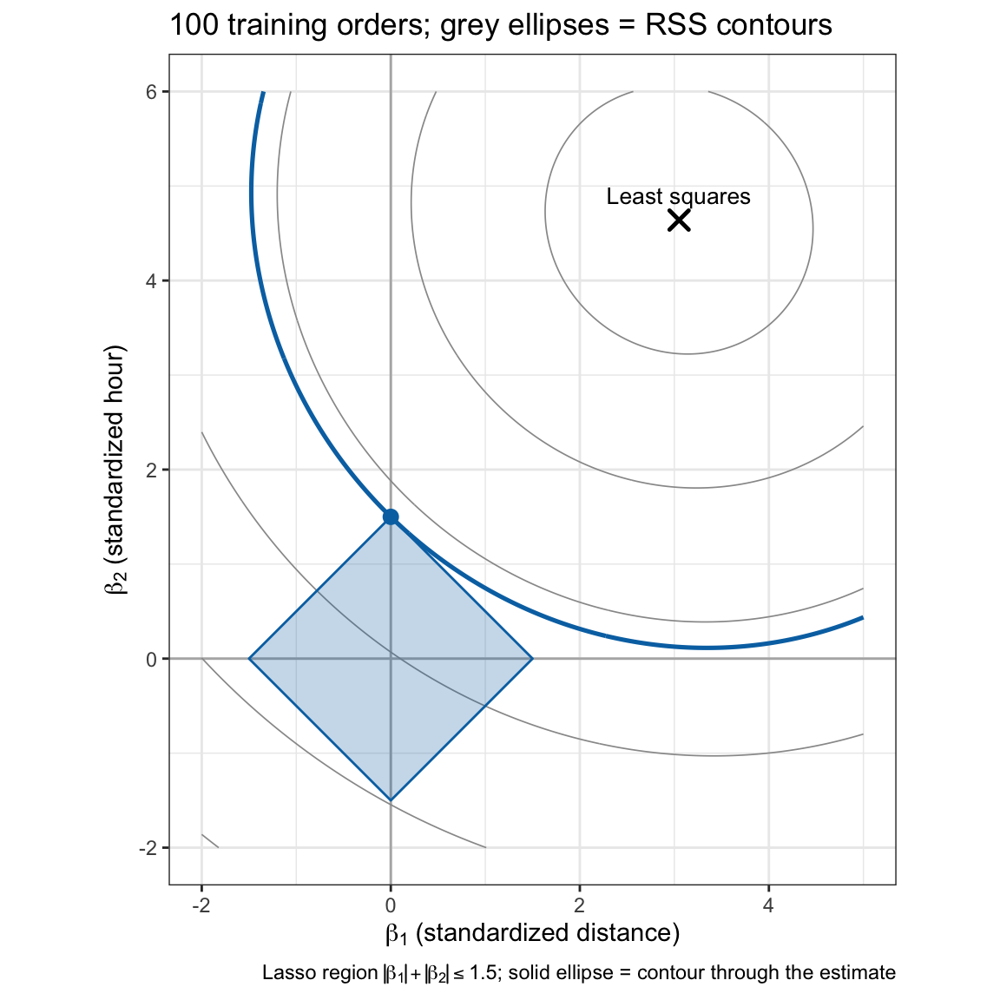

### + Ridge

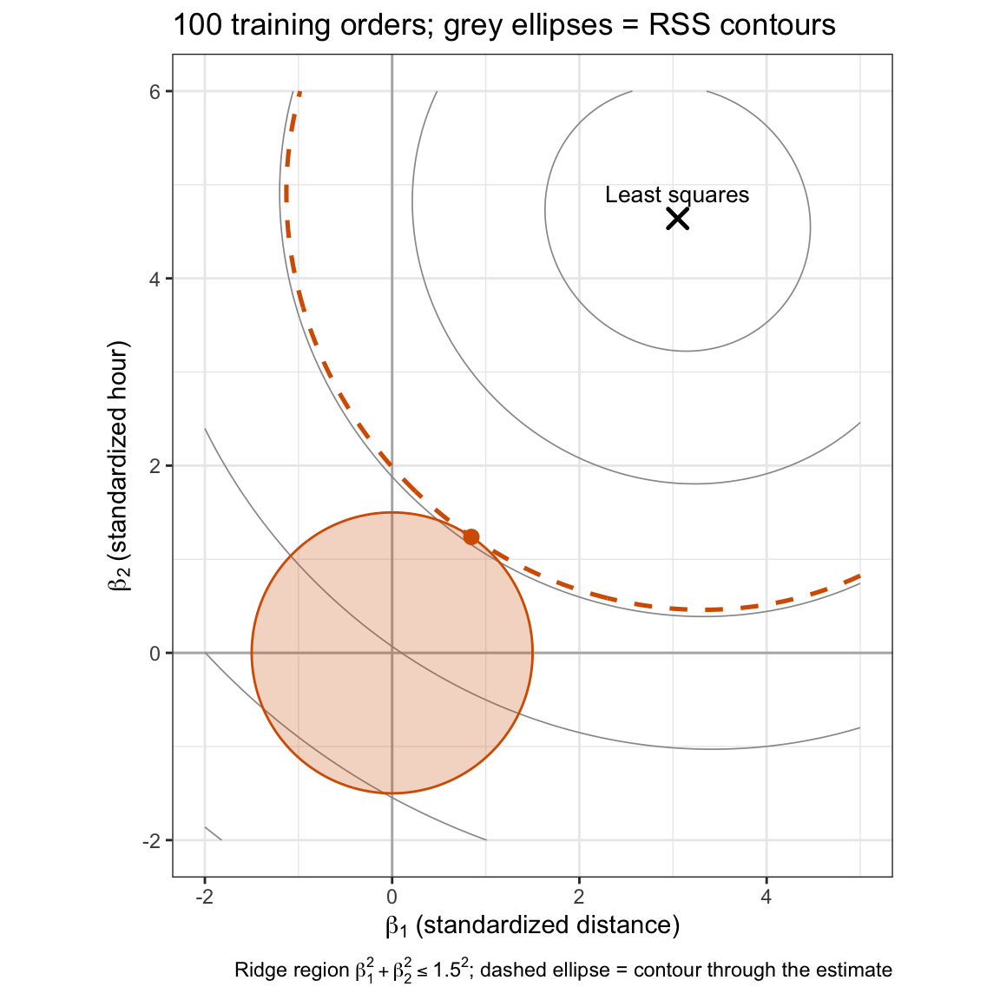

### Estimates at the corner

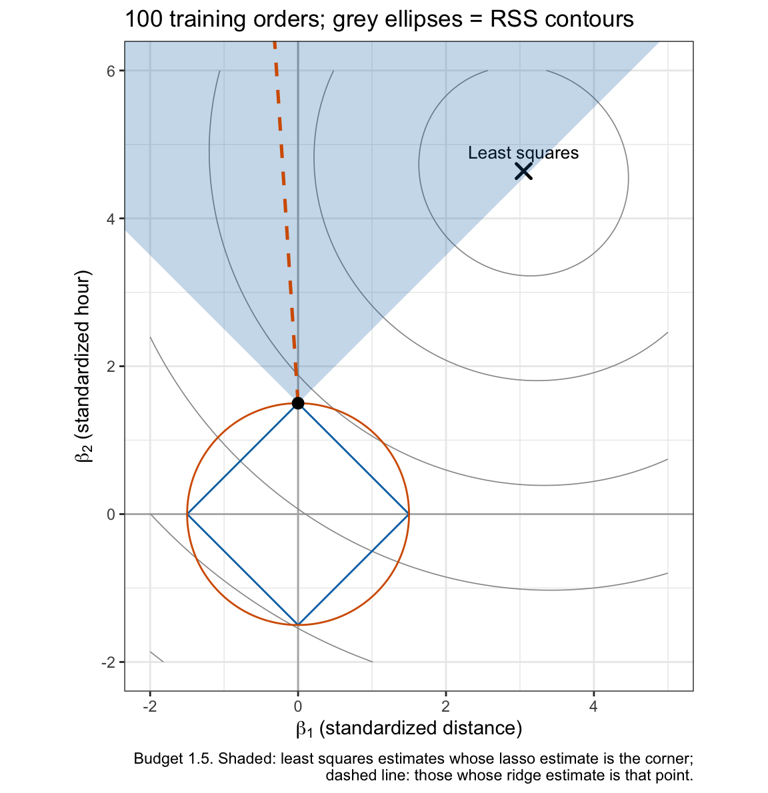

:::

::: notes
The RSS contours of the two standardized features, centered at the least squares estimate (3.05, 4.64). The estimate lies outside both regions, so each constrained estimate is on the boundary. With budget s = 1.5 the smallest contour touches the diamond at its corner (0.00, 1.50): the estimate of the distance coefficient is exactly zero. The disk, through the same corners, is touched at (0.85, 1.24), where neither estimate is zero.

Which point of the boundary is touched depends on where the least squares estimate is. The last tab draws, for s = 1.5, the least squares estimates whose lasso estimate is the corner, a wedge (shaded), and those whose ridge estimate is the axis point (0, 1.5), a single ray (dashed). The ray is tilted 3.7 degrees from the hour axis; it would run along the axis only if the features were uncorrelated, so that only a least squares estimate on the axis would give a zero estimate. Either way the ray has no area, and a zero ridge estimate is a coincidence. The wedge has area, and the least squares estimate of the training orders falls inside it, near its edge (u = 0.97, the edge being at u = 1): the lasso keeps the distance estimate at zero for every budget below s = 1.59. (The derivation of the ray and the wedge is in the notes.)

Modest claim: the figure shows one budget and two nearly uncorrelated features; it illustrates the mechanism but does not show how often it acts. In p dimensions the region has corners and edges on which many beta_j are zero at once, and the least squares estimates whose lasso estimate lies on one of them fill a set of positive volume; for ridge regression the least squares estimates that give some ridge estimate exactly zero fill a set of zero volume.

If time is short, show the middle two tabs.
:::

## Best subset selection

::: {style="font-size: 0.75em"}
$$\sum_{j=1}^p\mathrm{I}\left(\beta_j \ne 0\right) \le s$$
:::

::: {.fragment}
::: {style="font-size: 0.6em"}
- $\sum_j\mathrm{I}\left(\beta_j \ne 0\right)$ — number of nonzero coefficients, the $\ell_0$ penalty
- lasso: a convex relaxation
:::
:::

::: notes
Best subset selection is the same problem with the budget sum of the indicators that beta_j is not zero, at most s, on the number of nonzero coefficients; that count, used as a penalty, is the l0 penalty. It is not convex, and minimizing it means searching over subsets. The lasso replaces it with a convex relaxation, the l1 budget, which can be minimized quickly.

Optional: second in the drop order; if time is short, drop this slide.
:::

## Soft thresholding

::: {style="font-size: 0.8em"}
Orthogonal standardized features: $\tilde{\mathbf{X}}^\top\tilde{\mathbf{X}} = n\mathbf{I}_p$
:::

::: {style="font-size: 0.7em"}
$$\widehat\beta^L_{\lambda j} = \text{sign}\left(\widehat\beta_j\right)\left(\left|\widehat\beta_j\right| - \frac{\lambda}{2n}\right)_+, \qquad \widehat\beta^R_{\lambda j} = \frac{n}{n + \lambda}\widehat\beta_j$$
:::

::: {.fragment}
::: {style="font-size: 0.6em"}
- $\widehat\beta_j$ — least squares estimate
- $\widehat\beta^L_{\lambda j}$ — lasso estimate
- $\widehat\beta^R_{\lambda j}$ — ridge estimate
- $(u)_+ = \max(u, 0)$
- $\lambda/(2n)$ — threshold
:::
:::

::: notes
When the standardized features are orthogonal the least squares estimate of coefficient j is the sum over i of x-tilde_ij (y_i - y-bar), divided by n, and the RSS equals a constant plus n times the sum of the squared differences beta_j - beta-hat_j, so the lasso criterion splits into one problem per coefficient: minimize n (beta_j - beta-hat_j)^2 + lambda |beta_j|. For beta_j > 0 the derivative 2n (beta_j - beta-hat_j) + lambda is zero at beta-hat_j - lambda/(2n), which is positive only if beta-hat_j > lambda/(2n). For beta_j < 0, likewise beta-hat_j + lambda/(2n), negative only if beta-hat_j < -lambda/(2n). Otherwise the absolute value of beta-hat_j is at most lambda/(2n), the criterion decreases toward zero from both sides, and the minimum is zero. Together they give the display. The map from the least squares estimate to the lasso estimate is soft thresholding at lambda/(2n). Ridge regression multiplies every estimate by n/(n + lambda), so it moves the large estimates furthest, where the lasso moves every estimate larger than the threshold toward zero by the same amount, and sets the others to zero.

In general the lasso is computed by coordinate descent: glmnet() cycles through the coefficients, minimizing over one at a time with the others fixed. With the others fixed, the problem in beta_j is this one-coefficient problem with beta-hat_j replaced by the least squares coefficient of the partial residuals, so each step is a soft thresholding.
:::

## Lasso and ridge estimates

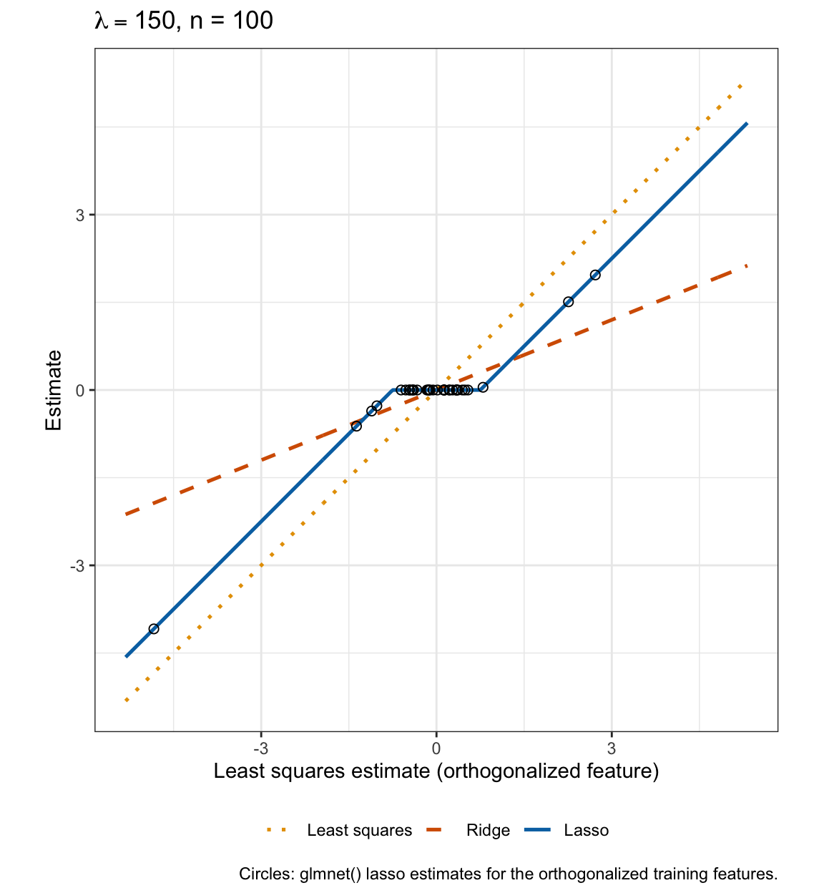{height=540}

::: notes
The delivery features are not orthogonal, so the figure uses orthogonalized versions, sqrt(n) times an orthonormal basis for the span of the standardized training features, 35 centered columns with X-tilde^T X-tilde = n I_p exactly and no meaning of their own. The lines are the formulas at lambda = 150 and the circles are the lasso estimates glmnet() computes for these features, with lambda converted as on the next slide. At lambda = 150 the ridge factor n/(n + lambda) is 0.40. Ridge regression multiplies every estimate by that factor, so it moves the large estimates furthest. The lasso threshold lambda/(2n) is 0.75, in the units of the estimates. The lasso moves every estimate larger than 0.75 in absolute value toward zero by exactly that amount, and sets the other 28 of the 35 to zero, moving each of them by its own magnitude. The glmnet() estimates match soft thresholding to within 1.4 x 10^-15.
:::

## glmnet scaling

::: {style="font-size: 0.75em"}
$$\frac{1}{2n}RSS + \lambda_{\text{glmnet}}\sum_{j=1}^p\left|\beta_j\right|$$
:::

::: {.fragment}
::: {style="font-size: 0.75em"}
$$\lambda = 2n\,\lambda_{\text{glmnet}}$$
:::
:::

::: {.fragment}
::: {style="font-size: 0.6em"}
- $\lambda_{\text{glmnet}}$ — the value `glmnet()` calls `lambda`
- no $s_y$, unlike ridge regression's $\lambda = n\lambda_{\text{glmnet}}/s_y$
:::
:::

::: notes
glmnet::glmnet() with alpha = 1 fits the lasso, with the documented criterion in the first display, or multiplied by 2n, RSS + 2n lambda_glmnet times the sum of the absolute coefficients. As the ridge lecture explained, glmnet() also divides y and the supplied lambda_glmnet by s_y. Fitting y/s_y with coefficients beta/s_y and tuning parameter lambda_glmnet/s_y divides both the RSS and the penalty by s_y^2, which leaves the minimizer unchanged. For the lasso the two divisions cancel, so lambda = 2n lambda_glmnet, with no s_y, unlike ridge regression's n lambda_glmnet/s_y. The circles in the soft thresholding figure were computed at lambda_glmnet = 150/(2 x 100) = 0.75 and fall on the formula, which checks the conversion. The s_y of ridge regression's conversion must not be carried over: the analogous lambda = 2n lambda_glmnet / s_y would supply lambda_glmnet = 5.51, s_y = 7.35 times as large, and glmnet() would then set all 35 estimates to zero, against the 28 of soft thresholding at lambda = 150. From here on lambda is this chapter's, converted where glmnet() is used.

Optional: first in the drop order (say that glmnet's lambda differs from this chapter's by the factor 2n).
:::

## Estimate path

::: {.panel-tabset}

### Estimate path

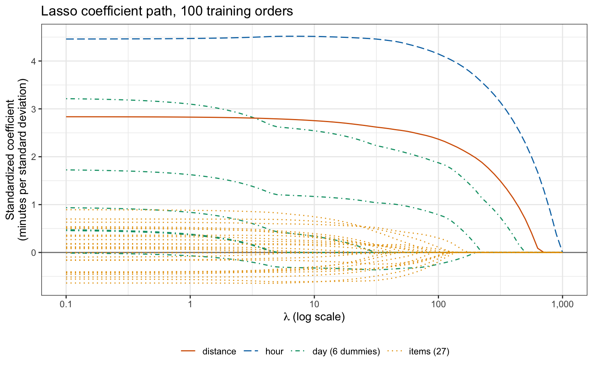

### Nonzero estimates

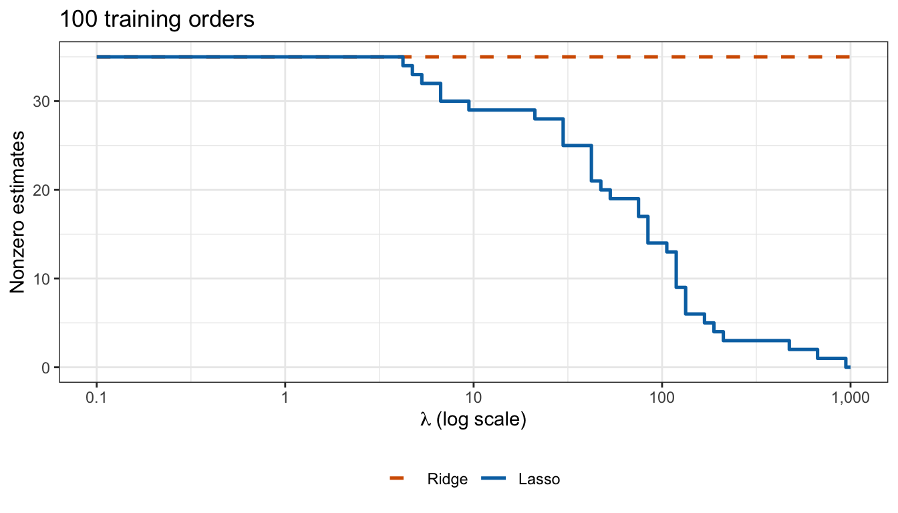

:::

::: notes
The tabs plot the lasso estimates of the standardized coefficients, fit to the training orders, against lambda, from 0.1 to 1,000, and the number of nonzero estimates, with ridge regression's for comparison. Read from the right. At lambda = 1,000, above lambda-max = 967.4, every estimate is zero. As lambda decreases the first features to enter are hour, distance and daySat. Hour enters at lambda-max itself. The grid does not contain the points of entry; the largest grid values of lambda at which the three are nonzero are 891, 631 and 447. Each estimate leaves zero continuously rather than jumping to its least squares value. At lambda = 100, 14 of the 35 estimates are nonzero; at lambda = 10, 29. On this path no estimate returns to zero once it has entered. An estimate can return to zero when features are correlated; the largest absolute correlation between two of the 35 training features is 0.47. At lambda = 0.1 all 35 are nonzero, within 0.01 minutes per standard deviation of least squares. The number of nonzero estimates plays the role of the model size d of subset selection.
:::

# Tuning parameter selection

::: notes
Lambda is chosen like any tuning parameter: by k-fold cross-validation on the training data, then a refit to all the training data and one evaluation on the test data.
:::

## Cross-validation

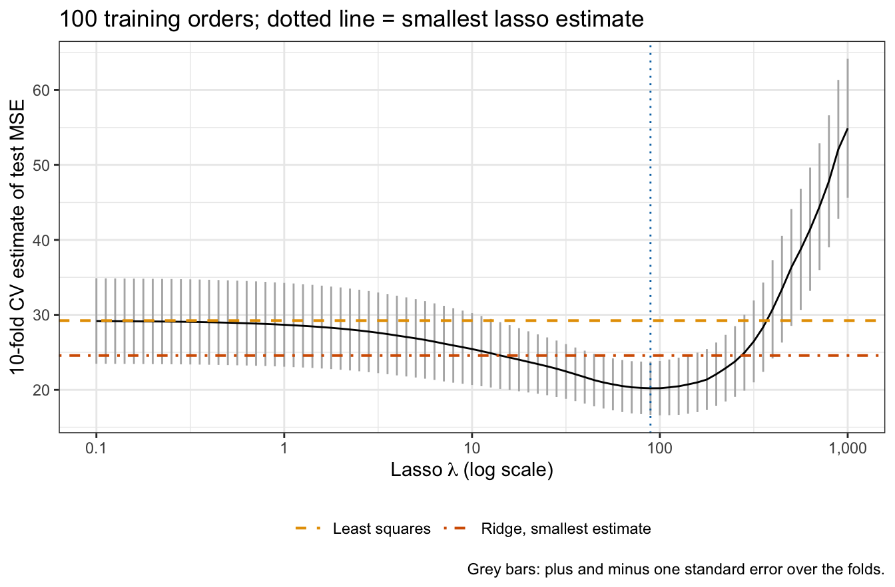{height=540}

::: notes
cv.glmnet() computes the 10-fold cross-validation estimate CV_(10)(lambda) on the grid of the path, with the ridge lecture's folds; inside each fold glmnet() standardizes from the other 9 folds only. Ridge regression is cross-validated on the same folds and grid as in the ridge lecture. The figure plots the estimate for the lasso and for ridge regression, each against its own lambda, with the least squares estimate (lambda = 0) as a dashed line and each chosen lambda marked. The estimate is smallest, 20.20, at lambda = 89.1 (lambda_glmnet = 0.446), where the lasso estimates of 14 coefficients are nonzero, against 29.23 for least squares and 24.57 for ridge regression at lambda = 28.2. The minimum is shallow: from lambda = 50 to 158, with 20 down to 6 nonzero lasso estimates, the cross-validation estimate is within 5% of its smallest value.

Plus or minus one standard error over the folds, the estimate is 16.65 to 23.76 for the lasso at its minimum, 19.62 to 29.52 for ridge regression at its minimum, and 23.51 to 34.95 for least squares, so the lasso and least squares intervals overlap only from 23.51 to 23.76.

Optional footnote of the chapter: each fold is fit to 90 orders, so by lambda = 2n lambda_glmnet the lambda a fold applies is 0.90 times the plotted value, which uses all 100 training orders. Applying this chapter's lambda exactly in every fold gives a smallest estimate of 20.21 at lambda = 79.4; no conclusion below changes.
:::

## Test evaluation

|Method        | $\lambda$| Nonzero estimates| Training MSE| 10-fold CV estimate| Test MSE|
|:-------------|---------:|-----------------:|------------:|-------------------:|--------:|
|Least squares |         0|                35|        10.13|               29.23|    22.02|
|Ridge         |      28.2|                35|        12.23|               24.57|    20.38|
|Lasso         |      89.1|                14|        13.78|               20.20|    16.96|

::: notes
cv.glmnet() also fits the path to all 100 training orders, so predicting with s = "lambda.min" uses the refit. The three chosen models are evaluated once on the 9,912 test orders. The lasso's test MSE is 16.96, against 20.38 for ridge regression and 22.02 for least squares, 16.8% and 23.0% lower. The paired difference in squared error, ridge minus lasso, has mean 3.42 and standard error 0.16 over the test orders. As in the ridge lecture, that standard error treats the fitted models as fixed and says nothing about another training sample; the repeated samples at the end of the lecture do.

All three cross-validation estimates are above the test MSEs, by factors of 1.19 to 1.33. Each fit in cross-validation uses 90 orders, and with so few orders per feature the error falls quickly as orders are added; an estimate from 100 orders is also noisy. The lasso and ridge estimates are, in addition, each the smallest over a grid of lambda values, selected for being low, so as estimates of the chosen model's error they are optimistic. The least squares estimate involves no such choice.

The 23.0% is the gain on this one training sample, not the gain to expect; the repeated samples show it, so do not quote it as such.
:::

## Lasso estimates

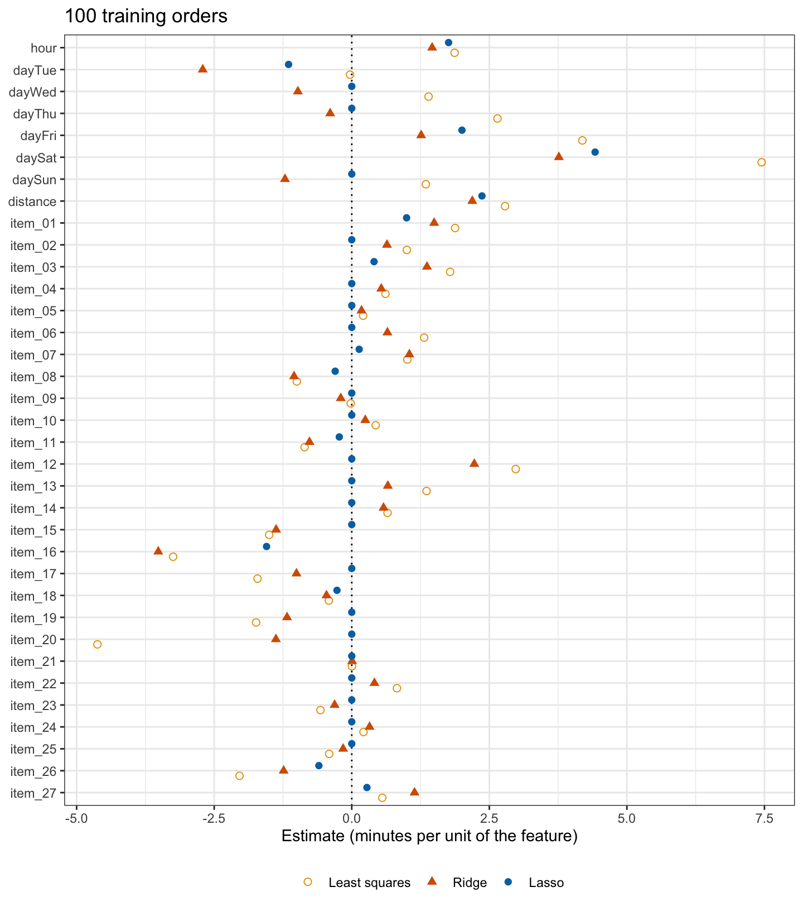{height=540}

::: notes
The figure compares the estimates of the three fits, on the original scale, all fit to the 100 training orders. The lasso keeps 14 of the 35 features and its other estimates are exactly zero. The next slide reads them in order.
:::

## Interpretation

- Intercept, original scale: $\widehat\beta_0 = -10.5$ minutes, for a Monday order at hour 0, distance 0, no items
- Hour: 1.76 minutes per hour (ridge 1.46, least squares 1.87)
- Distance: 2.37 minutes per mile (ridge 2.19, least squares 2.79)
- Day: keeps Tue, Fri, Sat; drops Wed, Thu, Sun, predicted like Monday
- Items: keeps 9 of 27, minutes per additional unit of the item

::: {.fragment}
- Nonzero lasso estimates are shrunken toward zero
- `lm()` standard errors and $p$-values do not apply
:::

::: notes
Read in order. Intercept: on the original scale, beta-hat_0 = −10.5 minutes is the predicted time of a Monday order placed at hour 0, at distance 0, with no items, far outside the data. (The standardized-scale intercept is y-bar = 26.7 minutes.) A Monday order with no items at the training orders' mean hour, 16.2, and mean distance, 3.05 miles, has predicted time 25.3 minutes. Hour and distance: each hour later adds 1.76 minutes (ridge 1.46, least squares 1.87), and each mile adds 2.37 minutes (ridge 2.19, least squares 2.79), holding the other features fixed. Relative to least squares, ridge regression shrinks the two by 22% and 21%, the lasso by 6% and 15%. Day: the lasso keeps the dummies for Tue, Fri and Sat, with estimates −1.1, 2.0 and 4.4 minutes, and drops those for Wed, Thu and Sun. As in the Subset Selection lecture, a dropped dummy merges its day into the reference: the model predicts Wed, Thu and Sun orders like otherwise identical Monday orders. Items: the lasso keeps 9 of the 27 items. Each unit of item_01, item_03, item_27 and item_07 raises the predicted time, by 1.00, 0.41, 0.28 and 0.13 minutes, and each unit of item_16, item_26, item_08, item_18 and item_11 lowers it, by 1.55, 0.60, 0.30, 0.27 and 0.23 minutes. The other 18 items do not affect the prediction. Read these signs with care: item_16, with the most negative item estimate, is in only 3 of the training orders, and the repeated samples below show how much the kept items depend on the training sample. (From Selected sets: its lasso estimate is −1.55, but the least squares fit to the 4,000 test orders gives 0.27 with p-value 0.28, so it is not shown to slow deliveries; the lasso fit also drops item_10, the most often selected item.)

Of the 14 nonzero lasso estimates, 13 are smaller in absolute value than their least squares counterparts. Nonzero lasso estimates are shrunken toward zero, by lambda/(2n) in the orthogonal case, so the lasso estimator, the rule that turns a training sample into an estimate, is biased toward zero for a nonzero coefficient, as the repeated samples below show. And because the features were selected using the same data, the standard errors, t-statistics and p-values that lm() would report, for the lasso fit or for least squares refit to the selected features, do not apply, as in the subset selection lecture. glmnet() reports none.
:::

# Repeated training samples

::: notes
As in the ridge lecture, 4,000 of the 9,912 test orders are the test orders at which every prediction is made, and the remaining 5,912 test orders are the orders from which the repeated training samples are drawn: M = 500 samples of n of the remaining test orders. The next random draws here are the ridge lecture's, so the samples, and the folds drawn within each, are the ridge lecture's. In each sample lambda is chosen by 10-fold cross-validation, for the lasso and for ridge regression on the same folds, each is refit, and its MSE at the 4,000 test orders is compared with that of least squares fit to the same sample, for n = 100 and n = 300.
:::

## Test MSE

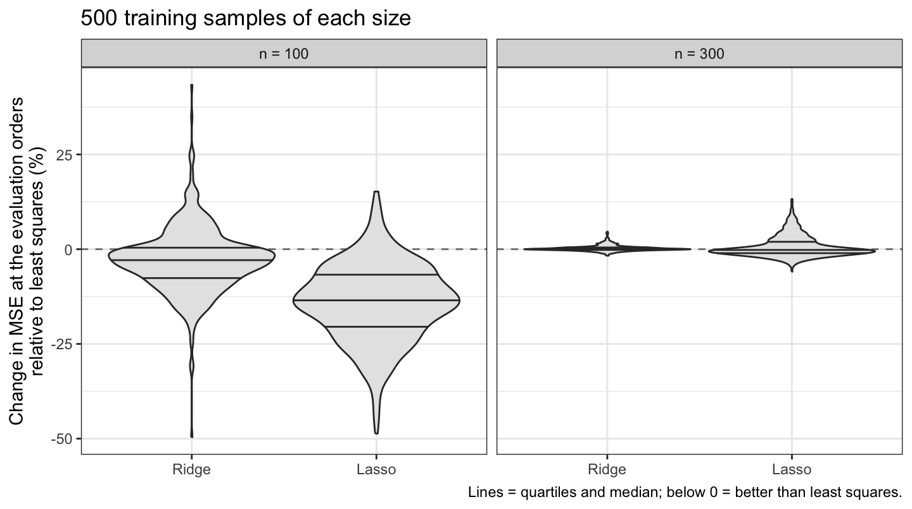{height=540}

::: notes
The figure plots, for each sample, the percent change in MSE at the 4,000 test orders relative to least squares, in violins with quartile lines and the median; below 0 is better than least squares. The facts to read off the violins are on the next slide.
:::

## Average over samples

- $n = 100$: the lasso has the lower MSE than least squares in 94% of the samples; its average MSE is 15.0% below
- $n = 300$: the lasso has the lower MSE in 56% of the samples; its average MSE is 0.6% above least squares

::: notes
With n = 100 the average MSE is 19.19 for the lasso, 21.74 for ridge regression and 22.58 for least squares. The lasso has a lower MSE than least squares in 94% of the samples and than ridge regression in 94%; ridge regression beats least squares in 72%, the ridge lecture's figure. On these data, with 100 training orders, the lasso's advantage is not an accident of one training sample, although its average MSE, 15.0% below that of least squares, is a smaller gain than the 23.0% on the test orders. This training sample is a favorable draw for the lasso: the median gain over the samples is 13.5%, 90% of the gains lie between −1.9% and 31.5%, and 18.4% of the samples gain at least as much as this one, about the 82nd percentile. With n = 300 the averages are 16.04, 15.97 and 15.94. The lasso beats least squares in 56% of the samples, but its average MSE is 0.6% above that of least squares: it loses less often than it wins, but by more. With 300 orders least squares has little variance left to remove, and neither penalty improves on it on average.
:::

## Selected sets

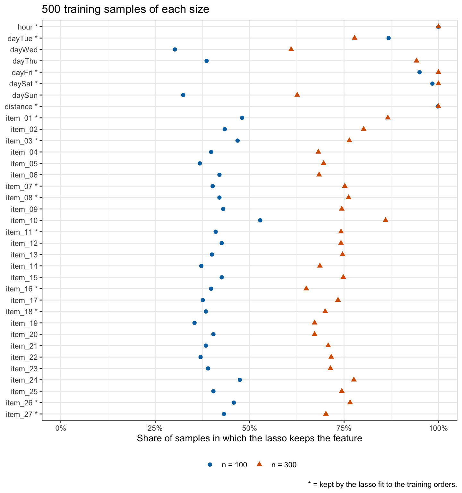{height=540}

::: notes
The figure plots how often the lasso kept each feature over the samples. With n = 100, hour and distance are kept in 100.0% and 99.8% of the samples and each item in between 35% and 53%. The lasso keeps a median of 16 features, from 4 to 35, and the 500 samples give 494 different selected sets. With n = 300 it keeps more, a median of 29, and each item in more samples.

The selected items are not the only items that slow deliveries. The least squares fit to the 4,000 test orders uses test orders to fit a model, so it is a reference outside the workflow and not a test of anything. It gives 25 of the 27 items a positive estimate with p-value below 0.05, a median of 0.6 minutes per item, the largest for item_01 and item_10, the two items the lasso keeps most often; even item_10 is kept in only 53% of the samples. The lasso fit to the training orders drops item_10 and gives item_16 its most negative item estimate, −1.55 minutes, where the least squares fit to the 4,000 test orders gives 0.27 (p-value 0.28). Of the 5 items with negative estimates in the lasso fit to the training orders, 4 have a positive estimate with p-value below 0.05 in the least squares fit to the 4,000 test orders. Almost every item slows deliveries a little; with 100 orders those small effects are estimated with large error, and which of them clear the threshold depends on the noise in the sample. A dropped item is not shown to have no effect.
:::

## Estimator bias

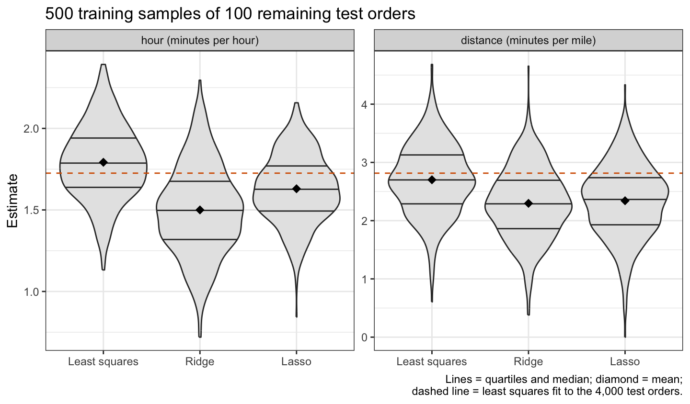{height=540}

::: notes
Bias is a property of an estimator, the rule that turns a training sample into estimates, not of the estimates from one sample: it is the difference between the average of the estimates over repeated training samples and the coefficient they estimate. The figure plots the estimates of the hour and distance coefficients, on the original scale, from the three fits to each of the 500 training samples of 100 of the remaining test orders, in violins with quartile lines and the mean (diamond). The dashed lines are the estimates of the least squares fit to the 4,000 test orders, the reference outside the workflow. Over the samples, least squares averages 1.79 minutes per hour and 2.70 per mile, close to the 1.73 and 2.82 of the least squares fit to the 4,000 test orders. The lasso averages 1.63 and 2.34 (zeros included), 9% and 13% below the least squares averages: the lasso estimators of the hour and distance coefficients are biased toward zero. Ridge regression averages 1.50 and 2.30, 16% and 15% below.

The lasso plausibly predicts better than ridge regression on these data for two reasons. It sets to zero the item estimates too noisy to help the predictions. And ridge regression has one lambda for all 35 coefficients: a lambda large enough to shrink the noisy item estimates also shrinks the large hour and distance estimates more than the lasso does, in the fit to the training orders and on average over the samples. Neither reason has been isolated from the other here.

Optional: fourth in the drop order; if time is short, skip this slide and say that the lasso's and ridge's average estimates are below least squares'.
:::

## Conclusion

- The lasso penalizes absolute coefficients, so some estimates are exactly zero
- Soft thresholding shrinks estimates and zeroes the small ones
- Choose $\lambda$ by cross-validation; evaluate once on test data
- The lasso's gain depends on the data and the sample size
- The selected set is unstable and the lasso estimator is biased toward zero

::: notes
The lasso's geometry gives exact zeros, where ridge regression's estimates are shrunken but, except by coincidence, not zero. The smallest cross-validation estimate is optimistic as an estimate of the chosen model's error, because lambda was chosen to make it small. Whether the lasso predicts better than ridge regression or least squares depends on the data and the training sample size, and is best judged over repeated samples rather than one. The set of features it selects can change from sample to sample, especially when many features have small effects of similar size, so a dropped feature is not shown to have no effect. The nonzero lasso estimates are shrunken toward zero, the lasso estimator of a nonzero coefficient is biased toward zero, and lm()'s standard errors and p-values do not apply to the lasso estimates. The next lecture begins dimension reduction with principal components: directions of maximum variance in the features, their loadings and scores, and the proportion of variance each explains.
:::
