## Today

<!-- derived-from: 06-regularization/40-principal-components.qmd @ adedf71 -->

::: {.columns}
::: {.column width="50%"}
- Diamond measurements
- First principal component
  - Loadings and scores
  - Maximum variance
  - Closest line
- Later components
  - Orthogonal directions
  - Variance explained
  - Components kept
:::
::: {.column width="50%"}
- Scaling
- Interpretation
  - Loadings
  - Unsupervised learning
:::
:::

::: notes
Distilled from the chapter's six learning objectives and the slides this deck spends time on: the loading vector and scores of the first component and the eigenvector result; the closest-line view; the later components, the proportion of variance explained and the choice of M; why the features are standardized; reading the loadings; and that principal component analysis is unsupervised and not variable selection. The recording errors and the 23 removed diamonds, the two-feature eigenvalues, the remaining-variation violins, the proof for the later components, the prcomp() check, the outlier-sensitivity paragraph, the raw units and scores slides (optional) and the Beyond this course callout are in the notes and not in the agenda. This lecture begins dimension reduction: the previous three lectures kept some of the p features or shrank their estimates, and this one replaces the p features by M < p linear combinations of them, the principal components. Here M is the number of components kept; in the ridge and lasso lectures it was the number of repeated training samples. The next lecture regresses on them.

Timing: one 50-minute period; the core slides come to about 37 minutes. The Conclusion is the closing slide. If time is short, drop in this order: Scores (say that the first two scores place each diamond and that price rises from left to right), Raw units (say that the six explanatory variables have standard deviations from 0.47 to 2.23 in different units), then the extra tabs of Two features (show Data, First component and All directions), then the second click of Components kept.
:::

## Diamond measurements

- Question: can fewer than six directions capture most of the variation in these numbers?
- Explanatory variables: `carat`, `depth`, `table`, `x`, `y`, `z`

::: {.fragment}
- Features: these six, standardized
- Response variable: `price`, not used in this lecture
:::

::: notes
Diamonds are described by six numbers: weight, two proportions and three physical dimensions. ggplot2::diamonds records 53,940 diamonds, of which 53,917 are retained after 23 with an impossible or extreme dimension are removed (20 with a dimension of 0 mm and 3 with an extreme value of more than 20 mm, widths of 58.9 and 31.8 mm and a depth of 31.8 mm on diamonds whose other dimensions are 5.12 to 8.09 mm), a rule in the notes' Recording errors figure. Carat is the weight (one carat is 200 mg); depth is the total depth percentage, the height of the diamond as a percentage of its average width, 100 z / [(x + y)/2], computed from the three dimensions; table is the width of the flat top facet as a percentage of the widest point; x, y and z are the length, width and depth in mm. cut, color and clarity are ordered categories with no numeric scale, so they are left out. The response variable is the price, which this lecture does not use, and it is not a feature. The features are the standardized explanatory variables, p = 6. The price comes back on the Price slide as an outside check.
:::

## Correlated measurements

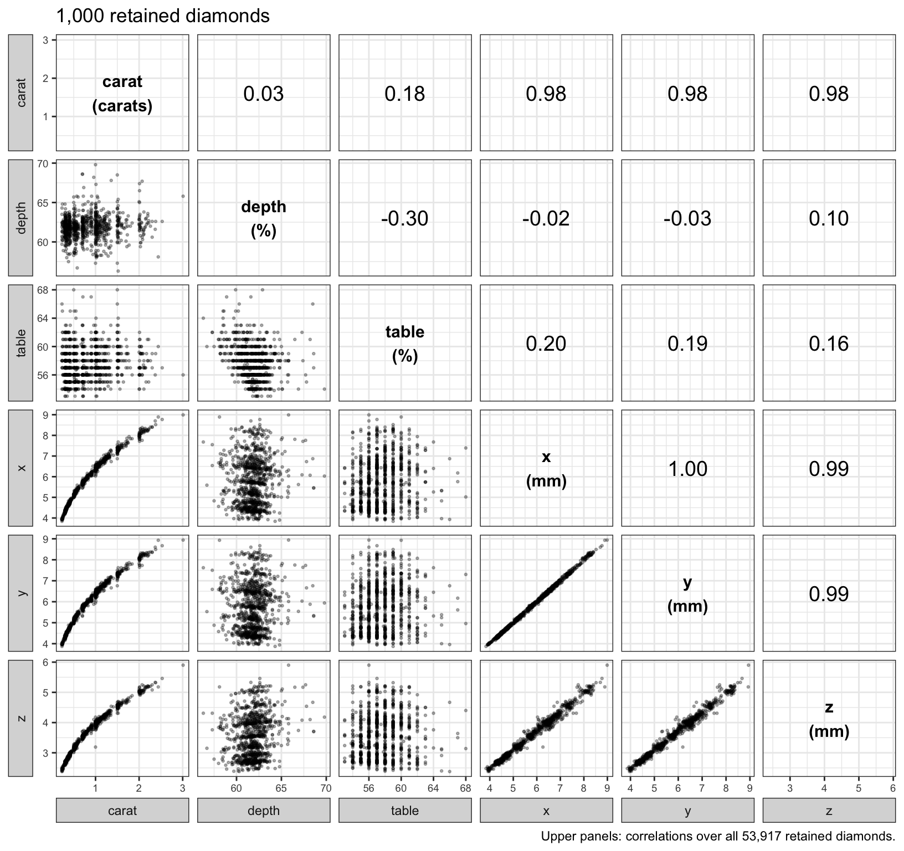

::: notes
The lower panels plot each pair of explanatory variables for 1,000 diamonds drawn at random from the retained ones, and the upper panels give the correlations over all 53,917. Carat, length, width and depth in mm rise together, with correlations 0.98 to 1.00. Length, width and depth are close to linear in one another, and carat curves upward against each of them, since weight grows with volume. Depth percentage and table are nearly unrelated to these four (correlations −0.03 to 0.20) and weakly to each other (−0.30). Four of the six explanatory variables are close to one measurement, the size of the diamond.

Depth percentage is not a separate measurement: over the n retained diamonds, recorded depth differs from 100 z / [(x + y)/2] by a median of 0.03 percentage points, the size of the rounding in the recorded values; only 77 diamonds differ by more than 1 point, the largest by 44.5 points. The six explanatory variables therefore carry five measurements: weight, table and the three dimensions. Depth percentage is nearly uncorrelated with size because it records the depth z relative to x and y, a shape, not a size.
:::

## Features

::: {style="font-size: 0.7em"}
$$\tilde x_{ij} = \frac{x_{ij} - \bar x_j}{s_j}, \qquad s_j = \sqrt{\frac{1}{n}\sum_{i=1}^n\left(x_{ij} - \bar x_j\right)^2}$$
:::

::: {.fragment}
::: {style="font-size: 0.6em"}
- $x_{ij}$ — explanatory variable $j$ of diamond $i$
- $\bar x_j$, $s_j$ — mean and standard deviation of explanatory variable $j$
- $\tilde x_{ij}$ — feature $j$ of diamond $i$
:::
:::

::: {.fragment}
::: {style="font-size: 0.7em"}
$$\mathbf{R} = \frac{1}{n}\tilde{\mathbf{X}}^\top\tilde{\mathbf{X}}$$
:::

::: {style="font-size: 0.6em"}
- $\mathbf{R}$ — sample correlation matrix
:::
:::

::: notes
The features are the standardized explanatory variables, in the order carat, depth, table, x, y, z, so p = 6. The mean and the standard deviation (divisor n) are the ridge lecture's. Each feature has mean 0 and (1/n) times the sum of its squares equal to 1. R is the p by p sample correlation matrix, whose entries are the upper panels of the scatterplot matrix. The bold R is a matrix and is unrelated to the coefficient of determination R^2, which appears once, in the section on price. The section on scaling shows what happens without standardization.
:::

# First principal component

::: notes
The first principal component is the direction in the p-dimensional feature space along which the diamonds vary most. This section shows it for two features, defines the loading vector and the scores, and shows that the direction of largest variance is also the line closest to the data.
:::

## Two features

::: {.panel-tabset .square-tabs}

### Data

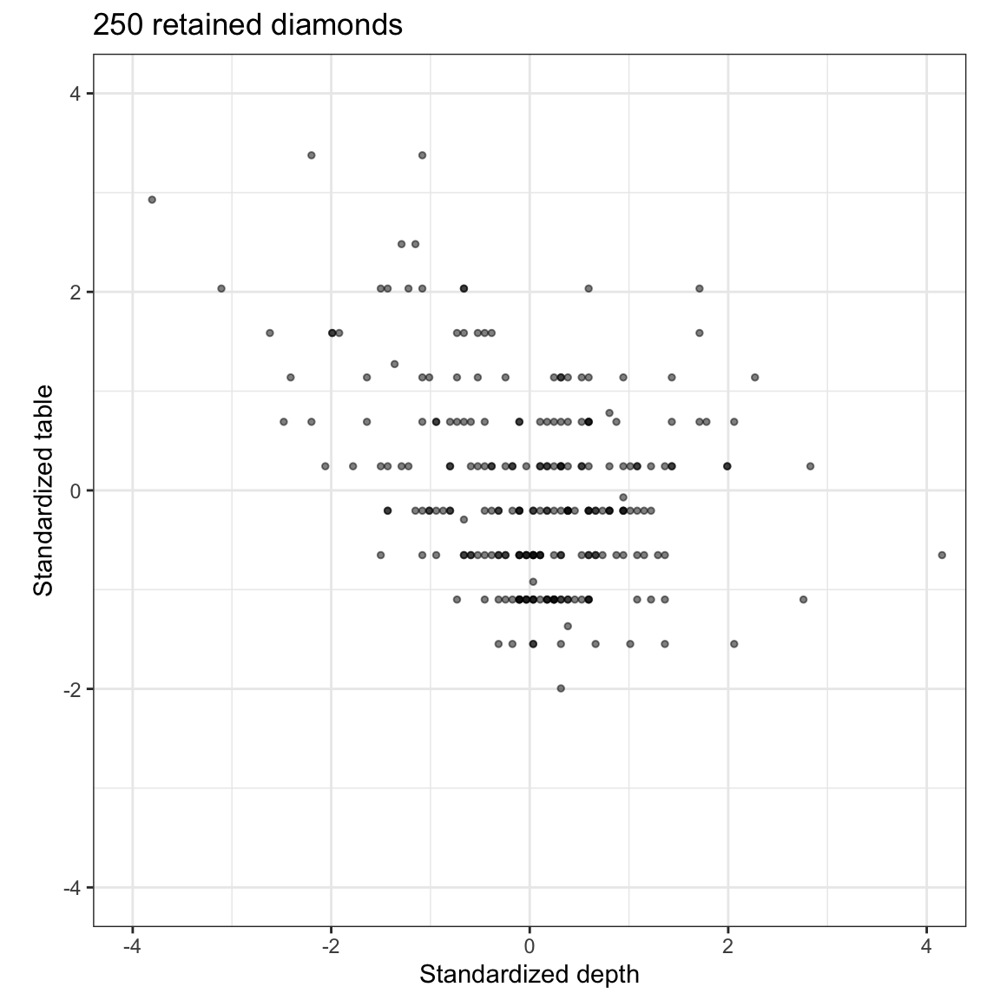

### Depth axis

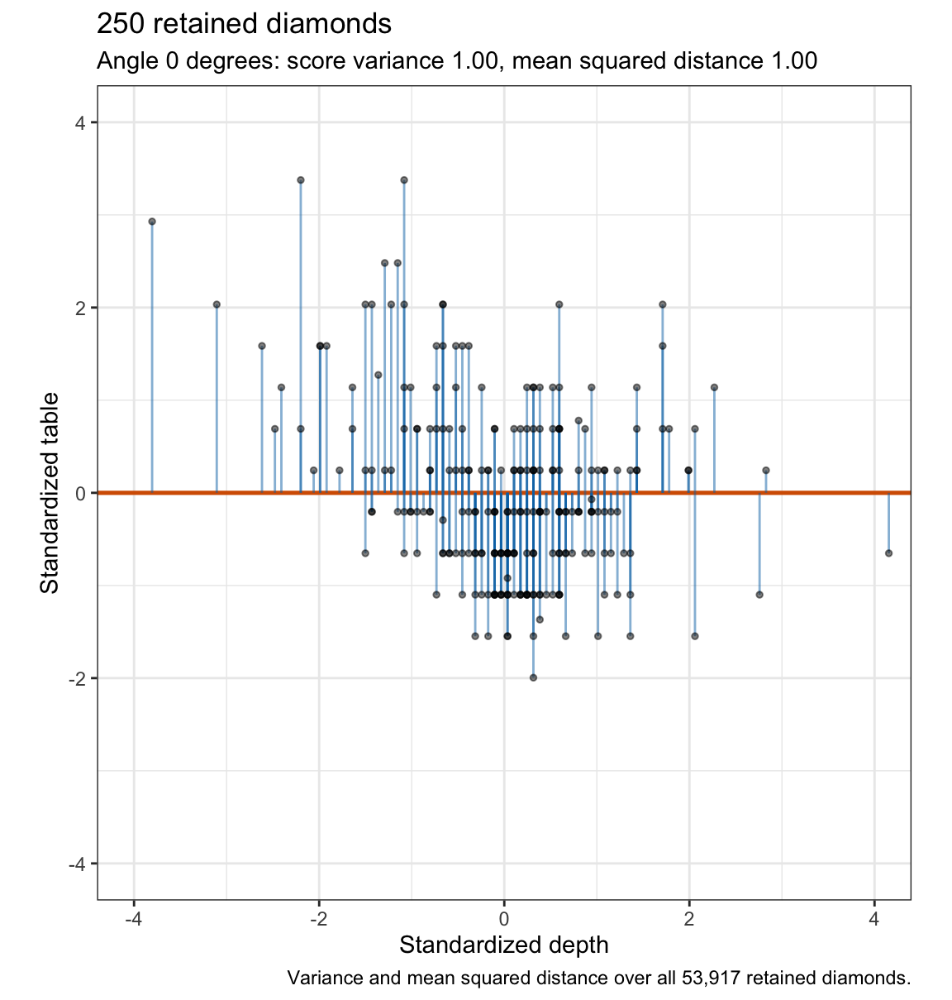

### First component

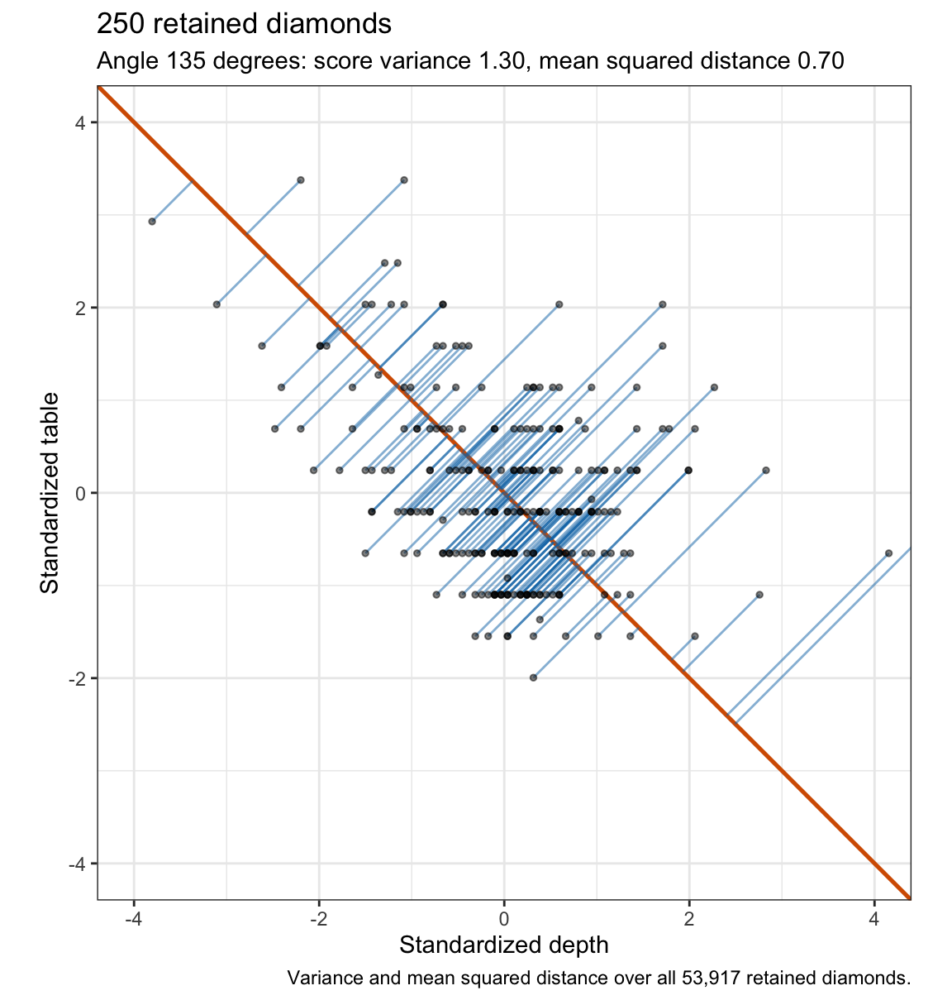

### All directions

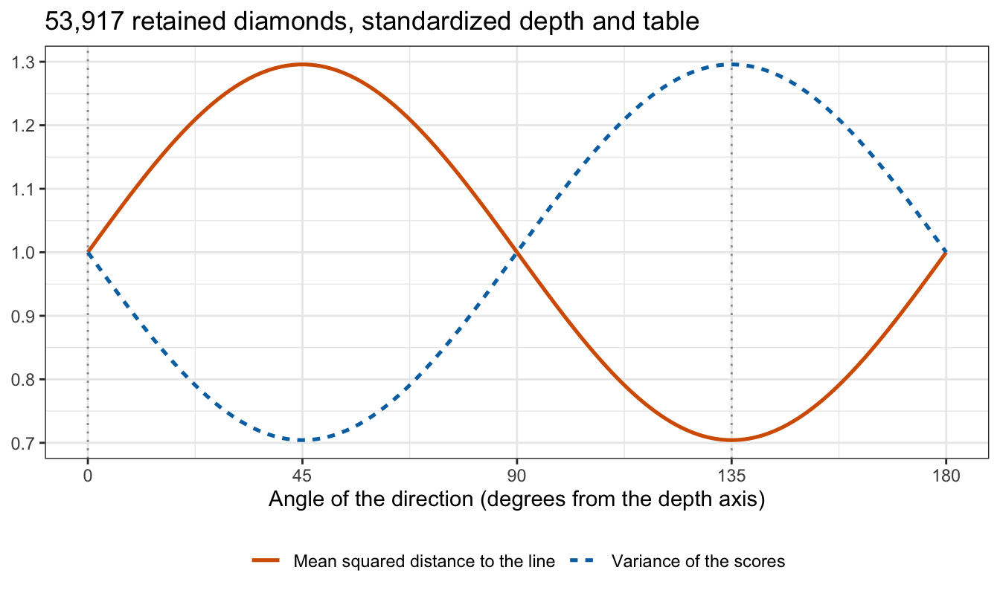

:::

::: notes
The first tab plots standardized table against standardized depth for the first 250 diamonds of the subsample, and the other tabs add a direction through the origin and each diamond's perpendicular projection onto it. The cloud is tilted down to the right, the negative correlation r = −0.30 between depth and table. Projected onto the depth axis, the diamonds' positions along the line have variance 1.00, the variance of standardized depth. Along the line at 135 degrees, which runs with the tilt, they spread more, variance 1.30, and the projection segments are shorter. The last tab sweeps the direction through every angle: the variance of the positions along the line is largest at the same angle at which the mean squared distance to the line is smallest, and the two curves sum to p = 2 at every angle.

For two standardized features with r not 0, the first principal component is always one of the two 45-degree lines (the eigenvalues of R are 1 ± r, with eigenvectors (1, 1)/sqrt 2 and (1, −1)/sqrt 2), the correlation deciding which one and how much variance it carries. With r = 0 the eigenvalues tie and every direction is a first component.

If time is short, show Data, First component and All directions.
:::

## Loadings and scores

::: {style="font-size: 0.7em"}
$$Z_1 = \phi_{11}\tilde X_1 + \phi_{21}\tilde X_2 + \cdots + \phi_{p1}\tilde X_p, \qquad \sum_{j=1}^p\phi_{j1}^2 = 1$$
:::

::: {.fragment}
::: {style="font-size: 0.6em"}
- $Z_1$ — first principal component: the combination with the largest sample variance
- $\tilde X_j$ — feature $j$
- $\phi_{j1}$ — loading of feature $j$; $\phi_1 = \left(\phi_{11}, \ldots, \phi_{p1}\right)^\top$ — loading vector
:::
:::

::: {.fragment}
::: {style="font-size: 0.7em"}
$$z_{i1} = \sum_{j=1}^p\phi_{j1}\tilde x_{ij} = \tilde x_i\phi_1$$
:::

::: {style="font-size: 0.6em"}
- $z_{i1}$ — score of diamond $i$
:::
:::

::: notes
The first principal component is the linear combination of the features with the largest sample variance, subject to the loadings having unit sum of squares; without the constraint the variance could be made as large as desired by multiplying the loadings by a constant. The loading vector is a unit-length direction in the p-dimensional feature space. The score of diamond i is its signed position along that direction, and the n-vector of scores is z_1 = X-tilde phi_1. phi_j1 is the loading here, not the dispersion parameter phi of the generalized linear models lecture. In the two-feature figure the line at angle theta has unit direction a = (cos theta, sin theta), each blue segment ends at the projection of a diamond onto it, and the first component is the line with the largest variance of the scores x-tilde_i a. The loading vector and the scores are computed from the n diamonds, so they are estimates.
:::

## Maximum variance

::: {style="font-size: 0.8em"}
Sample variance of the scores of a unit vector $a$
:::

::: {style="font-size: 0.7em"}
$$\frac{1}{n}\sum_{i=1}^n\left(\tilde x_i a\right)^2 = \frac{1}{n}a^\top\tilde{\mathbf{X}}^\top\tilde{\mathbf{X}}a = a^\top\mathbf{R}a$$
:::

::: {.fragment}
::: {style="font-size: 0.8em"}
Maximize $a^\top\mathbf{R}a$ subject to $a^\top a = 1$
:::

::: {style="font-size: 0.7em"}
$$2\mathbf{R}a - 2va = 0 \quad\Rightarrow\quad \mathbf{R}a = va$$
:::

::: {style="font-size: 0.6em"}
- $v$ — Lagrange multiplier
:::
:::

::: {.fragment}
::: {style="font-size: 0.6em"}
- $\phi_1$ — eigenvector of $\mathbf{R}$ with the largest eigenvalue $v_1$
- $v_1$ — variance of the first component's scores
:::
:::

::: notes
The features have mean 0, so the scores of any unit vector a have mean 0 and sample variance a-transpose R a. To maximize it subject to a-transpose a = 1, introduce a Lagrange multiplier v and set the gradient of a-transpose R a minus v times (a-transpose a minus 1) to zero, which gives 2 R a minus 2 v a equal to zero, so R a = v a. So a maximizing direction is an eigenvector of R with eigenvalue v, and multiplying R a = v a on the left by a-transpose shows that the variance of its scores is v. Of all the unit eigenvectors, the one with the largest eigenvalue gives the largest variance: phi_1 is the eigenvector of the sample correlation matrix with the largest eigenvalue v_1, and v_1 is the variance of the first component's scores. Both are estimates, computed from the n diamonds, of the leading eigenvector and eigenvalue of the population correlation matrix of the explanatory variables.

For the diamonds the estimated loading vector is (0.49, 0.00, 0.12, 0.50, 0.50, 0.50) in the order carat, depth, table, x, y, z, with v_1 = 4.00 against 1 for any single feature; the loadings figure later in the deck shows it.
:::

## Closest line

::: {style="font-size: 0.7em"}
$$\left\|\tilde x_i\right\|^2 = z_{i1}^2 + \left\|\tilde x_i - z_{i1}\phi_1^\top\right\|^2$$
:::

::: {.fragment}
::: {style="font-size: 0.7em"}
$$\frac{1}{n}\sum_{i=1}^n\left\|\tilde x_i - z_{i1}\phi_1^\top\right\|^2 = p - \phi_1^\top\mathbf{R}\phi_1$$
:::
:::

::: {.fragment}
::: {style="font-size: 0.6em"}
- $\left\|\tilde x_i - z_{i1}\phi_1^\top\right\|^2$ — squared distance from diamond $i$ to the line
- $\phi_1^\top\mathbf{R}\phi_1$ — variance of the scores
:::
:::

::: notes
Because phi_1 has unit length, Pythagoras splits each diamond's squared distance from the origin into its squared score and its squared distance from the line. Averaging over the diamonds, and using (1/n) times the sum of the squares of each feature equal to 1, the mean squared distance from the diamonds to the line through the origin in direction phi_1 is p minus the variance of the scores. The direction that maximizes the variance therefore minimizes the mean squared distance, so the first principal component is also the line closest to the data. In the last tab of Two features the two curves sum to p = 2 at every angle.
:::

# Later components

::: notes
The first component leaves most of the size features with almost nothing, but depth and table keep nearly all of their variance, so the next direction should be found mostly in depth and table. The remaining-variation violins in the notes show this (the remaining variances of the four size features are 0.007 to 0.027, and depth and table keep 1.000 and 0.943). This section describes all p components, how much variance each explains, and how many to keep.
:::

## Orthogonal directions

::: {style="font-size: 0.8em"}
$m$th component: maximum variance among unit vectors orthogonal to $\phi_1, \ldots, \phi_{m-1}$
:::

::: {style="font-size: 0.7em"}
$$v_1 \ge v_2 \ge \cdots \ge v_p \ge 0$$
:::

::: {.fragment}
::: {style="font-size: 0.7em"}
- $\phi_m$ — eigenvector of $\mathbf{R}$ with the $m$th largest eigenvalue $v_m$
- $v_m$ — variance of the $m$th component's scores
- scores of different components are uncorrelated
:::
:::

::: {.fragment}
::: {style="font-size: 0.7em"}
$$\sum_{m=1}^p v_m = \operatorname{tr}\left(\mathbf{R}\right) = p$$
:::

::: {style="font-size: 0.6em"}
- $p$ — total variance of the standardized features
:::
:::

::: notes
The m-th principal component maximizes the sample variance of the scores among unit vectors orthogonal to phi_1, ..., phi_(m−1), for m = 2, ..., p. The eigenvectors of the symmetric matrix R can be chosen orthonormal and ordered by their eigenvalues, assuming no ties. Any unit vector is a = the sum of c_m phi_m with the sum of c_m squared equal to 1, and a-transpose R a is the weighted average of the eigenvalues, the sum of c_m squared times v_m. Orthogonality to phi_1, ..., phi_(m−1) forces the first m − 1 weights to zero, and the largest weighted average of v_m, ..., v_p puts all the weight on v_m. So phi_m is the eigenvector with the m-th largest eigenvalue and all p components come from one eigendecomposition. The scores are uncorrelated, because for m not equal to l their sample covariance is phi_m-transpose R phi_l = v_l phi_m-transpose phi_l = 0. The variances add up to p, the trace of R. For the diamonds the sum of the six eigenvalues is 6.00 and the largest correlation between two columns of scores is 2.9 x 10^−11 in absolute value.

prcomp() with scale. = TRUE computes the same components: up to sign its loadings pca$rotation agree with the eigenvectors of R to within 1.4 x 10^−10 and its scores are sqrt((n − 1)/n) times the scores here because it standardizes with divisor n − 1; its variances pca$sdev^2, computed with divisor n − 1 as well, equal the eigenvalues v_m (to within 6.3 x 10^−13) because the two factors cancel; and its signs are whatever its algorithm returns.
:::

## Variance explained

::: {style="font-size: 0.75em"}
$$\text{PVE}_m = \frac{v_m}{\sum_{l=1}^p v_l} = \frac{v_m}{p}$$
:::

::: {.fragment}
::: {style="font-size: 0.6em"}
- $v_m$ — variance of the $m$th component's scores
- $p$ — total variance of the standardized features
- $\sum_{m=1}^M\text{PVE}_m$ — cumulative PVE of the first $M$ components
:::
:::

::: notes
The proportion of variance explained by component m is its variance over the total variance, which is p for p standardized features. The cumulative PVE of the first M components is the sum of the first M proportions. The next slide gives them for the diamonds.
:::

## Variance explained by component

|Component | Variance $v_m$|    PVE| Cumulative PVE|
|:---------|--------------:|------:|--------------:|
|PC1       |          3.999| 66.66%|         66.66%|
|PC2       |          1.284| 21.40%|         88.06%|
|PC3       |          0.683| 11.38%|         99.44%|
|PC4       |          0.031|  0.52%|         99.95%|
|PC5       |          0.002|  0.03%|         99.98%|
|PC6       |          0.001|  0.02%|        100.00%|

::: notes
The first component explains 66.7% of the variance of the six features, the second 21.4% and the third 11.4%. Together the first 3 explain 99.4%, and the last 3 share the remaining 0.56%. Components with small variance are sensitive to a few bad rows: computed from all 53,940 diamonds, the 23 removed ones included, the first 3 variances change by at most 1.7%, but the last 3 sum to 0.100 instead of 0.034, 3.0 times as much.
:::

## Scree plot

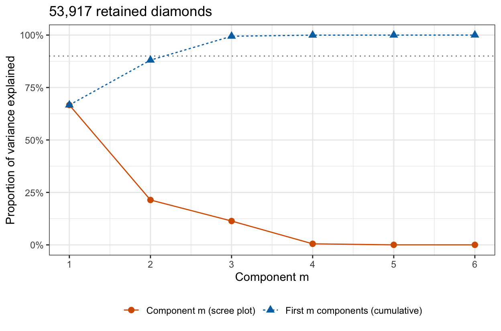

::: notes
The figure plots the PVE of each component, the scree plot, and the cumulative PVE. The PVE falls by a factor of 22 from component 3 to component 4, the largest ratio between consecutive components. The dotted line is the 90% threshold; the cumulative PVE passes it at the third component.
:::

## Components kept

- Elbow: keep the components before the scree plot flattens
- Cumulative threshold: keep the fewest components whose cumulative PVE reaches a chosen level

::: {.fragment}
- Diamonds: $M = 3$ by both rules
:::

::: {.fragment}
- Both are judgments
:::

::: notes
Keeping the first M components replaces the p features by M new variables, the columns of scores z_1, ..., z_M, and M is the dimension of the reduced feature set. For the diamonds the PVE falls by a factor of 22 from component 3 to component 4, the largest ratio between consecutive components, so M = 3 by the elbow. At 90% (the dotted line), M = 3 as well, since the first 2 reach 88.1%. Both are judgments, the elbow read from a picture and the threshold a choice. Neither looks at the price. When the components are used to predict a response, the next lecture chooses M by cross-validation instead.

If time is short, skip the second click.
:::

# Scaling

::: notes
So far the features were standardized; this section shows what changes when they are not, which is the objective to predict which explanatory variable dominates the first component.
:::

## Raw units

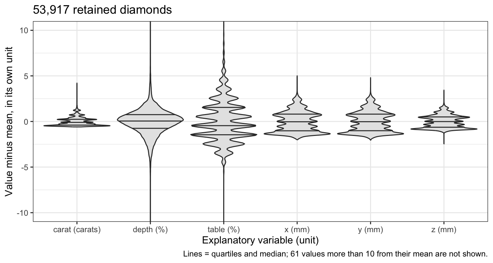

::: notes
The figure shows the six explanatory variables as recorded, each centered at its mean, on one axis. On their own scales they spread very differently: the standard deviations are carat 0.47, depth 1.43, table 2.23, x 1.12, y 1.11 and z 0.69, so table varies most and carat least, in units that cannot be compared.

Optional: second in the drop order; if time is short, skip this slide.
:::

## Unstandardized components

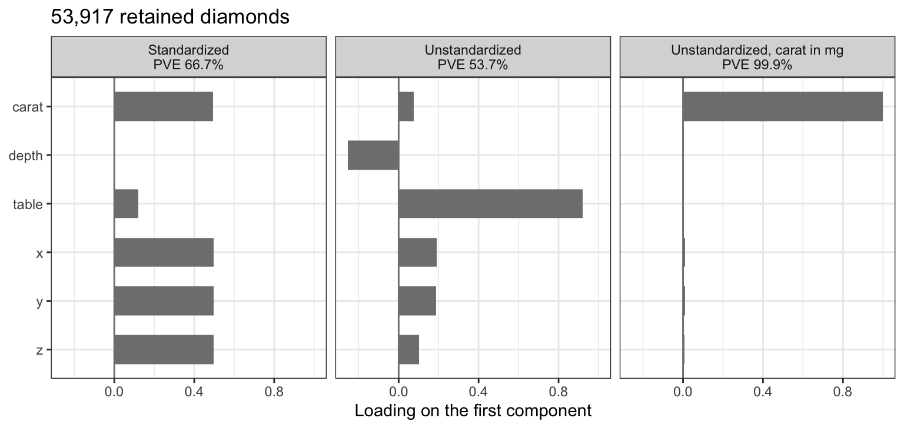

::: notes
Principal components of the centered but unstandardized explanatory variables maximize a-transpose S a, with S the sample covariance matrix, whose diagonal holds the squared standard deviations of the Raw units slide. Unstandardized, the first component is mostly table, loading 0.92, the variable with the largest variance, and it no longer measures size. Recording weight in milligrams (1 carat = 200 mg) raises the standard deviation of carat to 94.8 and makes the first component almost entirely weight, loading 1.000, explaining 99.9% of a total variance that weight now dominates.

Standardized features remove the dependence on units: the correlation matrix is the same in carats or milligrams, and the standardized first loading vectors agree to within 1.7 x 10^−14. The features are therefore standardized before principal component analysis unless the explanatory variables share a unit in which their variances are comparable, as the three dimensions in mm would on their own. Like the means and standard deviations of the ridge and lasso lectures, the loadings are computed from the data, so when components feed a model that is cross-validated, the standardization and the loadings are recomputed from the training folds in each fold.
:::

# Interpretation

::: notes
This section reads the six components for the diamonds: what each loading vector means and how the scores place the diamonds. It closes with what principal component analysis does not do.
:::

## Loadings

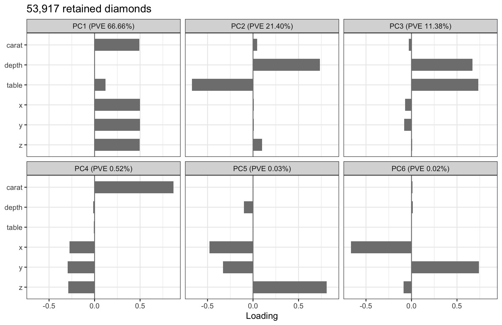

::: notes
The figure plots the estimated loadings of all six components. A loading is the weight a feature receives in the component's score, and each is read relative to the others in its loading vector. PC1: carat, x, y and z load 0.49 to 0.50, table 0.12 and depth 0.00; four perfectly correlated features, uncorrelated with the others, would each load 1/sqrt 4 = 0.5. PC2: depth loads 0.73 and table −0.67, with the size features near zero. PC3: both load positively, 0.67 and 0.73. PC4 to PC6 contrast carat, x, y and z with one another, for example weight against the linear dimensions in PC4, whose carat loading is 0.87, and their variances are small because the four measurements rarely disagree. The next slide gives the reading of each.
:::

## Reading the loadings

- PC1, size: high score is a large diamond
- PC2, depth against table: high score is deep with a narrow table
- PC3, depth and table together: high score is deep and wide-topped
- PC4 to PC6, disagreements among the size measures

::: {.fragment}
- The sign of a loading vector is arbitrary
:::

::: notes
Read in order. PC1 is size: a high score is a large diamond. PC2 is a contrast in shape between depth and table, as the two-feature figure found: a high score is a deep diamond with a narrow table, a low score a shallow one with a wide table. Depth percentage is z relative to x and y, so the depth part of this component, and of PC3, re-expresses dimensions already in the data rather than adding a measurement. PC3 loads depth and table together: a high score is a diamond that is both deep and wide-topped. PC4 to PC6 are disagreements among carat, x, y and z.

The sign: phi_m and −phi_m have the same length and give scores with the same variance, so the sign of a loading vector is arbitrary. Flipping it flips every loading and every score of that component and changes no interpretation: "high PC2 is deep and narrow-topped" becomes "low PC2 is deep and narrow-topped." The chapter flips each vector so that its largest loading in absolute value is positive, and prcomp() and other software may return either sign.
:::

## Scores

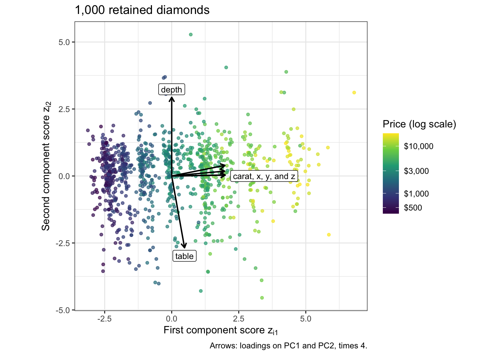

::: notes
The biplot plots the first two scores of the 1,000 subsampled diamonds, colored by price, and draws the first two loadings of each feature as an arrow. The color changes from left to right, from the cheapest diamonds to the most expensive, and much less from bottom to top. The carat, x, y and z arrows nearly coincide and point along the first axis; depth points up and table down. Each row of the n by M matrix of scores is a diamond described by M new variables in place of its p features, and with M = 2 the figure is that description.

Optional: first in the drop order; if time is short, skip this slide.
:::

## Price

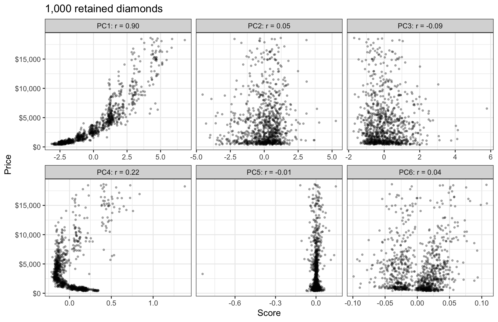

::: notes
Principal component analysis used the six features and never the price. The figure plots price against each component's scores for the subsampled diamonds, and each panel gives the correlation over all n diamonds. Price rises with the first component's scores, steeply and with a curve, correlation 0.90. That is an observation about these data, not a fitted model, and nothing in the construction of the first component guaranteed it: the first component is the direction of largest variance among the features, the features of these diamonds happen to vary most in size, and price is also most strongly associated with size. Among the later components the largest correlation in absolute value, 0.22, belongs to PC4, whose scores correlate more strongly with price than those of PC2 (0.05) or PC3 (−0.09), although PC4 explains only 0.52% of the variance while PC2 and PC3 explain 21.4% and 11.4%.
:::

## Prediction

- Unsupervised: computed from the features alone
- The component with the most variance need not be the best predictor
- Not variable selection: every component uses all $p$ features

::: notes
Principal component analysis is unsupervised: the loadings, the scores and the variances are computed from the features alone, and the components are ordered by the variance of the features, not by any relation to a response. The component with the largest variance need not be the most useful for prediction; a component with little variance, such as PC4 here, can carry information about the response that the first few do not, and a rule that keeps the first M components by PVE can discard it. Because the scores of different components are uncorrelated, the squared correlations of price with the six scores add: they sum to 0.861, which equals the R^2 of the least squares regression of price on all six scores, 0.861. Of that total, PC4 accounts for 0.046, and PC2 and PC3 together for 0.010. This is an observation about these data, not principal components regression; the bold R in this lecture is the correlation matrix and is unrelated to R^2.

Principal components are also not variable selection: every component is a combination of all p features. Even the smallest loading in absolute value, that of depth on PC1, is 4.6 x 10^−5, not zero, so computing even the first score of a new diamond requires all six explanatory variables, however few components a model keeps.
:::

## Conclusion

- Components are directions of decreasing variance of the features
- The first component is the top eigenvector and the closest line
- Choose $M$ from the scree plot or a cumulative PVE; both are judgments
- Standardize the features unless the units are comparable
- Components ignore the response and use every feature

::: notes
The components are ordered by the variance of the standardized features, the proportion of variance explained by component m being v_m over p. The first component's loading vector is the unit vector that maximizes the sample variance of the scores, the eigenvector of the sample correlation matrix with the largest eigenvalue, and it also minimizes the mean squared distance from the data to a line, because the variance and that distance sum to p. The number of components M kept is the dimension of the reduced feature set, and the scree plot's elbow or a cumulative PVE threshold chooses it by judgment. Components depend on the units of the explanatory variables, so the features are standardized unless the units are comparable. A component is interpreted from its loadings, whose overall sign is arbitrary. The components are computed without the response: the component with the most variance need not be the best predictor, a low-variance component can matter for prediction, and every component uses every feature.

The next lecture, principal components regression and partial least squares, regresses the log price of the same diamonds on the first M components, chooses M by cross-validation, and compares the components with directions that partial least squares chooses using the response.
:::
