## Today

<!-- derived-from: 06-regularization/50-pcr-and-pls.qmd @ uncommitted -->

::: {.columns}
::: {.column width="50%"}
- Diamond prices
  - Data
  - Least squares
- Principal components regression
  - Model
  - Estimate path
  - Shrinkage factors
  - Components kept
:::
::: {.column width="50%"}
- Partial least squares
  - First direction
  - Later directions
  - Directions compared
  - Directions kept
- Comparison
:::
:::

::: notes
Distilled from the chapter's six learning objectives and the slides this deck spends time on: the PCR model, its estimates and their variance; PCR as a linear model in the standardized features and not variable selection; ridge regression's shrinkage factors against PCR's; choosing M by cross-validation with every data-dependent step recomputed in each fold; the first PLS direction as the unit vector with the largest squared covariance with the response, and the later directions; and the test MSE of the three fits. The Dropped components derivation, the pcr() and plsr() checks, the separate test MSE subsections of PCR and PLS, the Bias and variance subsection and the Beyond this course callout are in the notes and not in the agenda. The previous lecture replaced the p features by M < p principal components; this one regresses the response on them, then on directions chosen with the response. M is the number of components or directions kept; in the ridge and lasso lectures it was the number of repeated training samples. The next lecture is high dimensions.

Timing: one 50-minute period; the core slides come to about 36.5 minutes and the optional slides to about 2.5 more. The Conclusion is the closing slide. If time is short, drop in this order: Loadings of three directions (say the first PLS direction and the first principal component nearly coincide, and the least squares direction loads negatively on carat), Least squares (say the carat estimate is negative although carat and log price are positively correlated), Factors by component (say ridge regression's factors fall with the variance of the component and PCR's are 1 then 0), then the Variance tab of Directions compared (show Training R²).
:::

## Diamond prices

- Question: do a few linear combinations of the six measurements predict price better than all six?
- Response variable: `price`, in US dollars
- Explanatory variables: `carat`, `depth`, `table`, `x`, `y`, `z`

::: {.fragment}
- Training diamonds: 100
- Test diamonds: 53,817
:::

::: notes
The diamonds are those of the principal components lecture, with the 23 diamonds that have a dimension of 0 or larger than 20 mm removed, leaving 53,917. The test diamonds are split off before any plotting or fitting. The training sample size is that of the ridge and lasso lectures. The average variance of the least squares fitted values is sigma squared times p + 1 over n: with n = 100 training diamonds it is 7% of the error variance, and with all 53,917 diamonds it would be 0.013%, leaving a method that trades bias for variance little variance to remove. In the explanatory variables the depth z in mm is a distance, while the column depth is a percentage.
:::

## Data

::: {.panel-tabset}

### Price

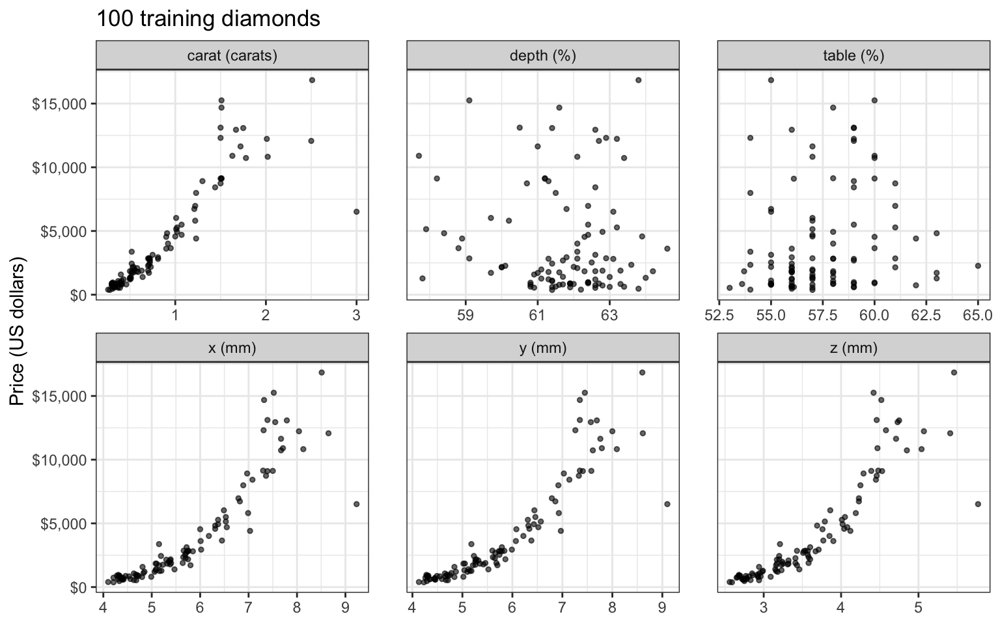

### Log price

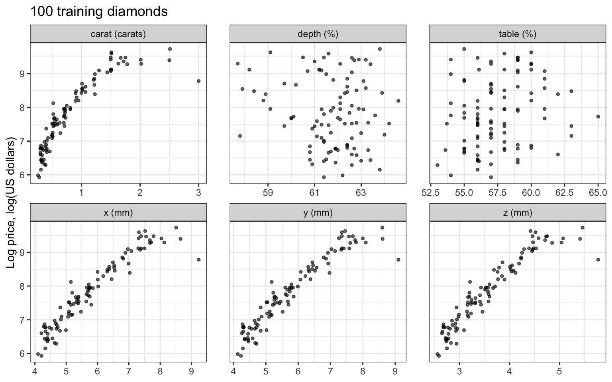

:::

::: notes
The tabs plot the price and the log price of the training diamonds against each explanatory variable. Price is right skewed: the mean training price is above the median, and its spread grows with size. Log price rises along a nearly straight line in x, y and z, with a spread that does not grow, and bends against carat. Depth and table percentage show little relation to either response. The response is therefore the natural log of price, whose relationships with the dimensions are close to linear and whose spread is close to constant; every mean squared error below is in squared log dollars.
:::

## Least squares

- Response: $y_i = \log\left(\texttt{price}_i\right)$
- Training MSE 0.0618, test MSE 0.0726
- Carat estimate −1.86 (standard error 0.24), correlation of carat with log price 0.88

::: notes
Least squares on the six explanatory variables. The carat estimate is negative although carat and log price are strongly positively correlated: the estimate compares diamonds of equal length, width, and depth, and among those the fit predicts the heavier ones to be cheaper. The principal components below separate that contrast from overall size.

Optional: second in the drop order; if time is short, skip this slide.
:::

# Principal components regression

::: notes
PCR regresses the response on the first M principal components of the training features, which are computed without the response. This section shows the model and its estimates, its relation to ridge regression, and how M is chosen.
:::

## Scores and price

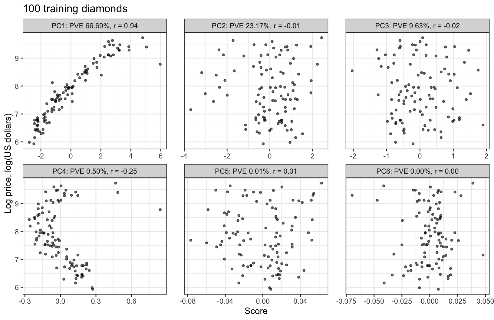

::: notes
Log price rises along a nearly straight line in the first scores, correlation 0.937. The second and third components explain 32.8% of the variance of the features between them, and their scores are nearly uncorrelated with log price (−0.013 and −0.022). The fourth explains 0.50%, and its scores have correlation −0.249; the last two are flat. The training loadings of the first four components are within 0.06 of those computed from all 53,917 diamonds, so the components keep the interpretations of the principal components lecture: PC1 is size, PC2 and PC3 combine depth and table percentage, and PC4 contrasts weight with the three dimensions.
:::

## Model

::: {style="font-size: 0.7em"}
$$y_i = \theta_0 + \sum_{m=1}^M\theta_m z_{im} + \epsilon_i, \qquad \epsilon_i \stackrel{ind}{\sim} N\left(0, \sigma^2\right)$$
:::

::: {.fragment}
::: {style="font-size: 0.6em"}
- $y_i$ — log price of training diamond $i$
- $z_{im} = \tilde x_i\phi_m$ — score on the $m$th principal component
- $M \in \{0, 1, \ldots, p\}$ — number of components kept
- $\theta_0, \ldots, \theta_M$ — coefficients; $\epsilon_i$ — error with variance $\sigma^2$
:::
:::

::: notes
The model is fit by least squares. The score is the standardized features of diamond i times the loading vector of component m, both computed from the training diamonds. A test diamond is standardized with the training means and standard deviations and projected on the training loading vectors, as a new diamond would be. M = 0, with no scores, is the null model. The scores have mean 0 and are uncorrelated, so the normal equations separate, which the next slide uses.
:::

## Component estimates

::: {style="font-size: 0.7em"}
$$\widehat\theta_0 = \bar y, \qquad \widehat\theta_m = \frac{z_m^\top\left(y - \bar y\mathbf{1}\right)}{z_m^\top z_m} = \frac{z_m^\top\left(y - \bar y\mathbf{1}\right)}{nv_m}, \quad m = 1, \ldots, M$$
:::

::: {style="font-size: 0.6em"}
- $\widehat\theta_m$ — simple regression estimate of $y$ on $z_m$
- $v_m$ — variance of the $m$th scores
:::

::: {.fragment}
::: {style="font-size: 0.7em"}
$$E\left[\widehat\theta_m\right] = \theta_m, \qquad Var\left[\widehat\theta_m\right] = \frac{z_m^\top z_m\,\sigma^2}{\left(nv_m\right)^2} = \frac{\sigma^2}{nv_m}$$
:::
:::

::: notes
Each estimate is the estimate of the simple linear regression of y on z_m alone, so keeping one more component leaves the earlier estimates unchanged. For the variance, treat the features as fixed and suppose the linear model in all p features is correct. The components with the least variance have the most variable estimates.
:::

## Estimates and standard errors

|Component | Variance $v_m$| Estimate $\widehat\theta_m$| Standard error| $\lvert\widehat\theta_m\rvert$ / standard error|
|:---------|--------------:|-----------------------:|--------------:|-------------------------------------------:|
|PC1       |         4.0012|                   0.479|          0.013|                                        37.1|
|PC2       |         1.3899|            &minus;0.011|          0.022|                                         0.5|
|PC3       |         0.5779|            &minus;0.029|          0.034|                                         0.9|
|PC4       |         0.0298|            &minus;1.474|          0.149|                                         9.9|
|PC5       |         0.0009|                   0.235|          0.873|                                         0.3|
|PC6       |         0.0003|            &minus;0.133|          1.518|                                         0.1|

::: notes
The table gives, for each component of the training features, its variance, the estimate and the standard error, sigma-hat over the square root of n v_m. The standard error of the last estimate is 118 times that of the first, the square root of v_1 over v_6. The estimates for PC5 and PC6 are 0.3 and 0.1 standard errors from zero, and the estimate for PC4, −1.47, is 10 standard errors from zero. A diamond heavier than its dimensions suggest is predicted to be cheaper.

Dropping a component lowers the mean squared error of the fitted values about the true mean at the training diamonds, with the features fixed, exactly when theta_m squared times v_m is less than sigma squared over n, that is, when the absolute value of theta_m is less than the standard error of its estimate (the Dropped components subsection of the notes, not in this deck). This is the error in estimating the mean; the expected squared error in predicting a new response at the same features adds sigma squared, which no choice of M changes. The last column is a rough guide to that condition. PCR can drop only the components after the last one it keeps, so keeping PC4 means keeping PC2 and PC3 as well.
:::

## Standardized-scale estimates

::: {style="font-size: 0.7em"}
$$\widehat y_i = \bar y + \sum_{m=1}^M\widehat\theta_m\sum_{j=1}^p\phi_{jm}\tilde x_{ij} = \bar y + \sum_{j=1}^p\widehat\beta_j\tilde x_{ij}, \qquad \widehat\beta = \boldsymbol{\Phi}_M\widehat\theta$$
:::

::: {style="font-size: 0.6em"}
- $\boldsymbol{\Phi}_M$ — $p \times M$ matrix of the first $M$ loading vectors
- $\widehat\beta_j$ — PCR estimate on the standardized scale
:::

::: {.fragment}
::: {style="font-size: 0.7em"}
- $M = p$ is least squares
- $M = 0$ is the null model: $M$ is the tuning parameter
- Not variable selection: every $\widehat\beta_j$ is in general nonzero
:::
:::

::: notes
Substituting the scores into the fitted values shows that PCR is a linear model in the p standardized features, fit under a constraint: its estimate must lie in the span of the first M loading vectors. The estimate on the original scale is beta-hat_j over s_j, as in the ridge lecture. M = p is least squares because the p by p loading matrix is orthogonal, so the scores span the same column space as the features. M = 0 and M = p play the roles that lambda to infinity and lambda = 0 play in ridge regression. Every loading is nonzero, so predicting a new diamond needs all six explanatory variables, whatever M is.
:::

## Estimate path

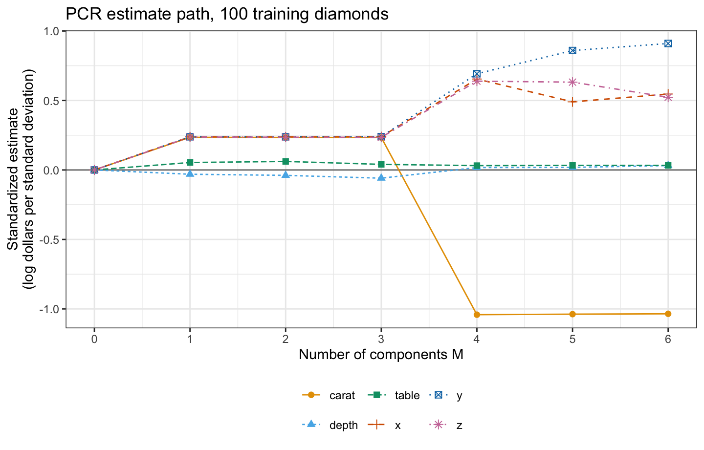

::: notes
Up to M = 3 the four size features have nearly equal estimates, 0.234 to 0.240: the first component spreads the effect of size evenly over them, and PC2 and PC3 barely change it. At M = 4 the carat estimate turns negative, to −1.04, and the estimates for x, y and z rise: PC4 separates weight from the dimensions. At M = p the estimates are those of least squares. No estimate is zero at any M of 1 or more.
:::

## Shrinkage factors

::: {style="font-size: 0.7em"}
$$\widehat y^R_\lambda = \bar y\mathbf{1} + \sum_{m=1}^p\frac{v_m}{v_m + \lambda/n}\,\widehat\theta_mz_m$$
:::

::: {.fragment}
::: {style="font-size: 0.7em"}
- Ridge regression: every term times $v_m/\left(v_m + \lambda/n\right)$, between 0 and 1
- PCR: the first $M$ terms times 1, the rest times 0
:::
:::

::: notes
With the standardized features and the ridge criterion, X-tilde transpose X-tilde is n R, whose eigenvectors are the loading vectors, so ridge regression acts on the principal components too. It keeps every component and multiplies its least squares term by a factor that is smallest for the components with the least variance. PCR multiplies by 1 or 0. Both favor the high-variance directions: PCR keeps or drops each component, as subset selection keeps or drops each feature, and ridge regression shrinks every component continuously. The display is the last link of the notes' chain of equalities, which starts from the closed form of the ridge fitted values.
:::

## Factors by component

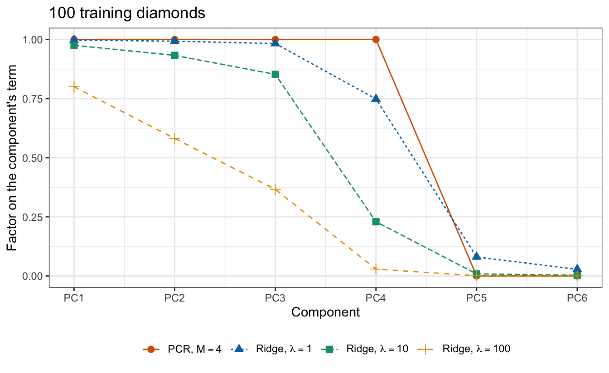

::: notes
The factors of ridge regression fall with the variance of the component. At lambda = 10 the PC4 term keeps 23% of its least squares size, where PCR with M = 4 keeps all of it, while PCR keeps the PC2 and PC3 terms in full although their estimates are small. The closed-form ridge estimate and Phi times the shrunken theta-hat agree to within 3.8 times 10 to the minus 15.

Optional: third in the drop order; if time is short, skip this slide.
:::

## Components kept

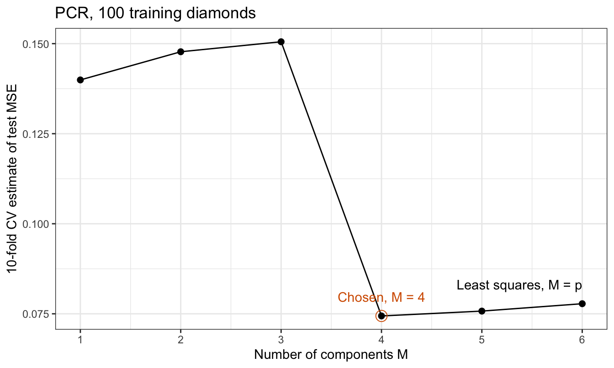

::: notes
M is chosen by 10-fold cross-validation on the training diamonds. The standardization and the principal components are computed from the data the model is fit to, so in each fold they are recomputed from the training folds only. The estimate for the null model is 1.063. With one component it falls to 0.1399, and it rises with the second and third components, to 0.1505, which add a variance of sigma squared over n each to the fit but almost nothing to its mean. The fourth component halves it, to 0.0744. Beyond that the estimate rises again, to 0.0778 for least squares, and the smallest estimate is at M = 4.

Principal components do not use the response, so computing them once from all the training diamonds and cross-validating only the regression on the scores changes the estimate by at most 0.00103. For PLS, below, it would not.
:::

# Partial least squares

::: notes
PCR chose its directions without the response: PC2 and PC3 explain 32.8% of the variance of the features and add 0.0006 to the training R squared of log price, while PC4 explains 0.50% and adds 0.062. Partial least squares chooses its directions with the response.
:::

## Features and price

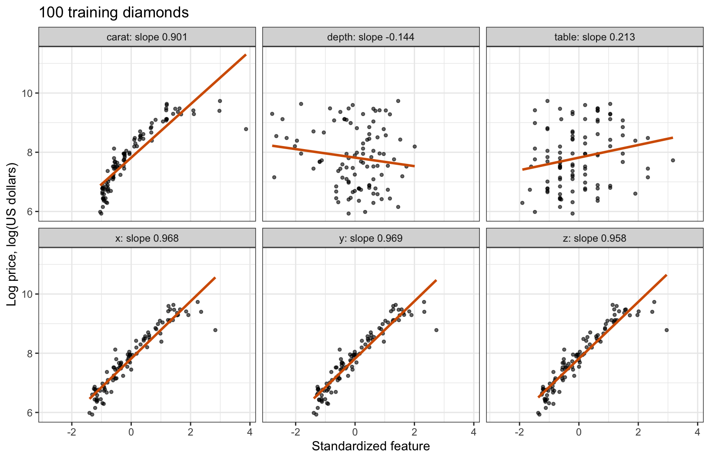

::: notes
The four size features have slopes 0.901 to 0.969 log dollars per standard deviation, depth −0.144 and table 0.213. Each feature has mean 0 and variance 1, so its slope, one over n times the sum of the feature times the centered response, is also the sample covariance of the feature with log price.
:::

## First direction

::: {style="font-size: 0.7em"}
$$\phi^{\text{PLS}}_{j1} = \frac{g_j}{\sqrt{\sum_{l=1}^p g_l^2}}, \qquad g_j = \frac{1}{n}\sum_{i=1}^n\tilde x_{ij}\left(y_i - \bar y\right)$$
:::

::: {style="font-size: 0.6em"}
- $g_j$ — simple regression estimate of $y$ on feature $j$
- $\phi^{\text{PLS}}_1 = g/\left\|g\right\|$ — first PLS direction
:::

::: {.fragment}
::: {style="font-size: 0.7em"}
- The first PLS direction is the unit vector whose scores have the largest squared covariance with the response
:::
:::

::: notes
A feature gets a large loading when it is strongly related to the response, not when it varies with the other features. The scores of a unit vector a have mean 0 and sample covariance with y equal to a-transpose g, and by the Cauchy-Schwarz inequality the square of that is at most the squared norm of g, with equality only at a = plus or minus g over its norm. The first principal component is the unit vector whose scores have the largest variance.

The squared covariance factors as the squared correlation of the scores with y, times the variance of the scores, times the variance of y. So PLS balances two goals: the first principal component maximizes the variance of the scores alone, and the least squares fitted values maximize the squared correlation alone.
:::

## Loadings of three directions

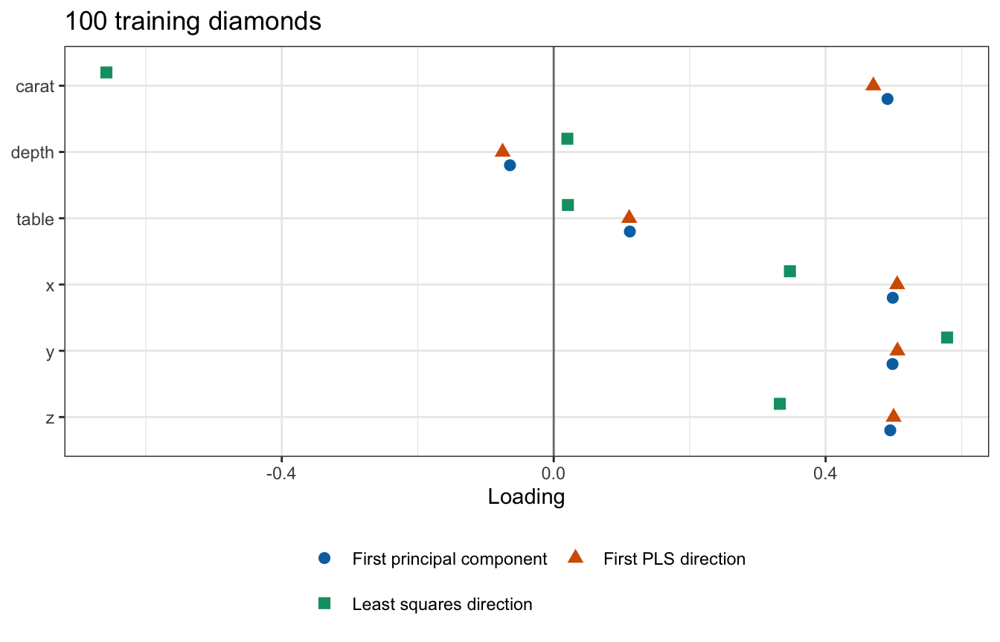

::: notes
The figure plots the loadings of the first principal component, the first PLS direction and the least squares direction, each of unit length. On these diamonds the first PLS direction and the first principal component nearly coincide, their loadings within 0.021 of each other, because the direction in which the features vary most, size, is also the one most related to log price. The least squares direction loads negatively on carat and leans on the contrast between weight and the dimensions that PC4 carries.

Optional: first in the drop order; if time is short, skip this slide.
:::

## Criteria of three directions

|Direction                 | Variance of scores| Squared correlation with log price| Squared covariance with log price|
|:-------------------------|------------------:|----------------------------------:|---------------------------------:|
|First principal component |              4.001|                             0.8781|                            3.6687|
|First PLS direction       |              3.999|                             0.8793|                            3.6712|
|Least squares direction   |              0.397|                             0.9408|                            0.3900|

::: notes
Each direction wins on its own criterion: the first principal component has the largest variance, 4.0012, the least squares direction the largest squared correlation, 0.9408, the training R squared of least squares, and the first PLS direction the largest squared covariance, 3.6712. The least squares direction has variance only 0.397.
:::

## Later directions

::: {style="font-size: 0.7em"}
$$\tilde{\mathbf{x}}^{(2)}_{\cdot j} = \tilde{\mathbf{x}}_{\cdot j} - \frac{\left(z^{\text{PLS}}_1\right)^\top\tilde{\mathbf{x}}_{\cdot j}}{\left(z^{\text{PLS}}_1\right)^\top z^{\text{PLS}}_1}\,z^{\text{PLS}}_1$$
:::

::: {style="font-size: 0.6em"}
- $\tilde{\mathbf{x}}_{\cdot j}$ — column $j$ of $\tilde{\mathbf{X}}$, feature $j$ over the training diamonds
- $\tilde{\mathbf{x}}^{(2)}_{\cdot j}$ — residuals of column $j$ regressed on $z^{\text{PLS}}_1$
:::

::: {.fragment}
::: {style="font-size: 0.7em"}
$$\phi^{\text{PLS}}_2 \propto \left(\tilde{\mathbf{X}}^{(2)}\right)^\top\left(y - \bar y\mathbf{1}\right), \qquad z^{\text{PLS}}_2 = \tilde{\mathbf{X}}^{(2)}\phi^{\text{PLS}}_2$$
:::
:::

::: {.fragment}
::: {style="font-size: 0.7em"}
- The scores are uncorrelated
- PLS is a linear model in the features
- $M = p$ is least squares
:::
:::

::: notes
The second PLS direction repeats the construction on what the first scores do not explain; direction m uses the residuals of the features after regressing them on the first m minus 1 scores. The scores are uncorrelated because every column of the residual features is orthogonal to the earlier scores, so, as for PCR, the estimate on M PLS scores is the simple regression estimate on each. PLS is a linear model in the features because each residual matrix is the feature matrix minus multiples of earlier scores, which are combinations of the features. With M = p the p scores span the column space of the features, as they do here.
:::

## Directions compared

::: {.panel-tabset}

### Variance

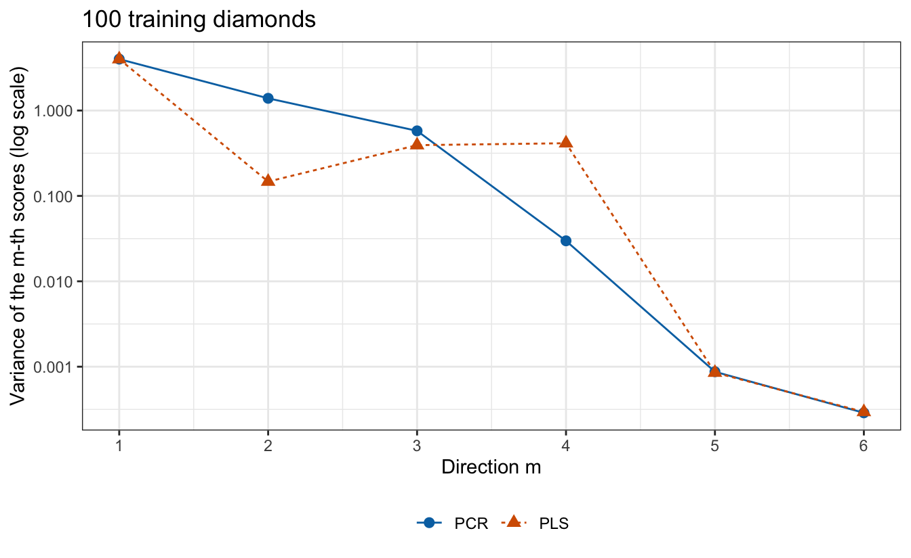

### Training R²

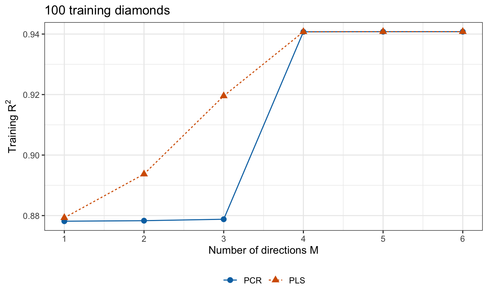

:::

::: notes
The tabs compare the PLS directions with the principal components of the training features: the variance of the scores on each direction, and the training R squared of the regression of log price on the first M directions. The principal component variances fall by construction. The PLS variances do not: the second PLS direction has variance 0.147, against 1.390 for PC2, and the third and fourth have more, 0.393 and 0.414. PLS scores are uncorrelated too. The training R squared of PLS rises with each of the first four directions, from 0.879 to 0.941, while that of PCR stays near 0.878 until PC4 lifts it to 0.941. PLS fits the training diamonds at least as well as PCR at every M less than p, and both reach the least squares fit at M = p.

If time is short, show Training R² only.
:::

## Directions kept

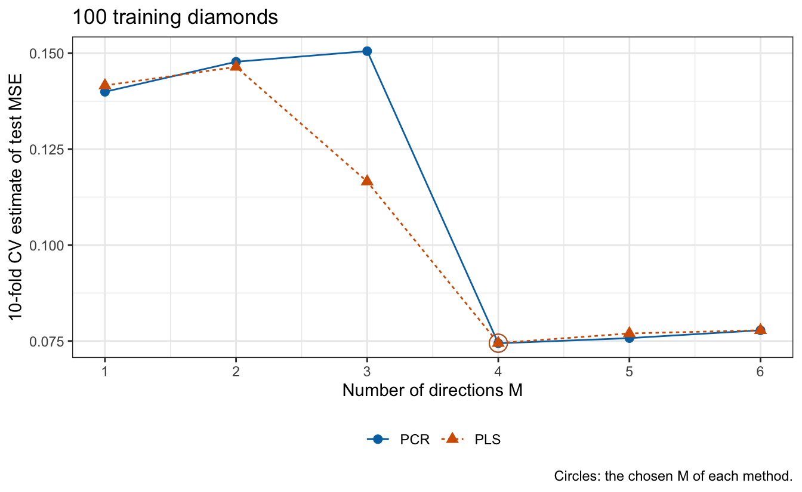

::: notes
PLS directions use the response, so they too are recomputed from the training folds in each fold. At M = 3 the PLS estimate is 0.1165, against 0.1505 for PCR, because the second and third PLS directions carry part of what PC4 adds. PLS reaches its smallest estimate, 0.0745, at M = 4, and PCR its smallest, 0.0744, at M = 4, both below the least squares estimate of 0.0778.

Computing the PLS directions once from all 100 training diamonds, and cross-validating only the regression on their scores, lowers the estimate by as much as 0.0160, at M = 3 (14% of the estimate there), against at most 0.00103 for PCR. The log prices of each held-out fold then helped choose the directions they are predicted with, so the estimate is optimistic. The size of the optimism depends on M: at the chosen M = 4 it is only 0.0001, and the estimates computed outside the folds would choose M = 4, the same value. The directions are part of the fit, and anything the fit computes from the data is recomputed inside each fold.
:::

## Test MSE

|Method        | $M$| Training MSE| 10-fold CV estimate| Test MSE|
|:-------------|---:|------------:|-------------------:|--------:|
|Least squares |   6|       0.0618|              0.0778|   0.0726|
|PCR           |   4|       0.0619|              0.0744|   0.0727|
|PLS           |   4|       0.0619|              0.0745|   0.0727|

::: notes
The table compares the three fits, each chosen and fit with the training diamonds and evaluated once on the 53,817 test diamonds; least squares is the fit with M = p. On this training sample PCR and PLS with M = 4 tie least squares: the test MSEs are within 0.21% of one another. The paired difference in squared error over the test diamonds, least squares minus PLS, has mean −0.00015 and standard error 0.00009, so on this training sample least squares predicts the test diamonds slightly better. As in the ridge lecture, that standard error treats the fitted models as fixed and says nothing about another training sample. One training sample of 100 diamonds cannot show whether either method helps on average; the lecture after next compares PCR and PLS with least squares over repeated training samples.

All three cross-validation estimates are above the test MSEs. Choosing the smallest estimate on a noisy curve cannot be the reason, since least squares involves no choice. The three estimates are means of the held-out squared errors of the same 100 diamonds on the same folds, and those squared errors have correlation at least 0.998 across the three fits, so the three estimates are high or low together. Here one diamond accounts for much of it: the heaviest training diamond, with its low price, contributes 12% of the least squares estimate, and without it the three estimates would be 0.0688, 0.0657 and 0.0657, all below the test MSEs.
:::

## Conclusion

- Dimension reduction regresses on $M < p$ directions
- PCR keeps or drops components; ridge regression shrinks them all
- PLS uses the response: it can lower bias but can add variance
- Recompute the directions in each cross-validation fold
- Neither method selects variables

::: notes
Dimension reduction regresses the response on M < p linear combinations of the standardized features, and controls the flexibility of the fit through M. Because the scores are uncorrelated, each estimate is the simple regression estimate on its own scores. Either method is a linear model in all p features with a constrained estimate, so neither selects variables. In PCR the estimate on component m has variance sigma squared over n v_m, so the components with the least variance have the noisiest estimates. PLS balances the variance of the scores against their correlation with the response; choosing the directions with the response can lower bias for a given M but can add variance. M is chosen by k-fold cross-validation, with every data-dependent step recomputed from the training folds in each fold.

The next lecture, high dimensions, turns to data with more features than observations, p > n: why R squared, training error and p-values mislead there, and why choosing the tuning parameter and carrying out cross-validation correctly matter even more than they do here.
:::
