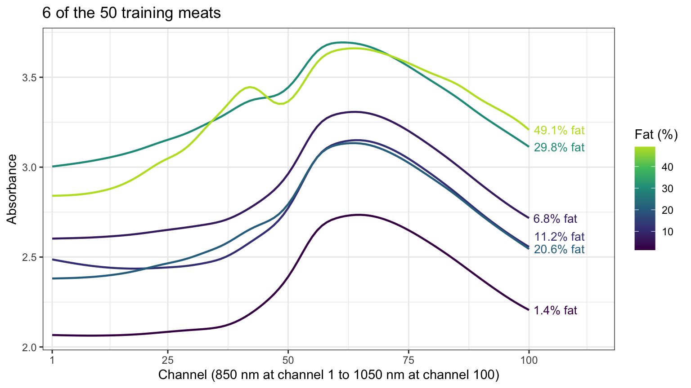
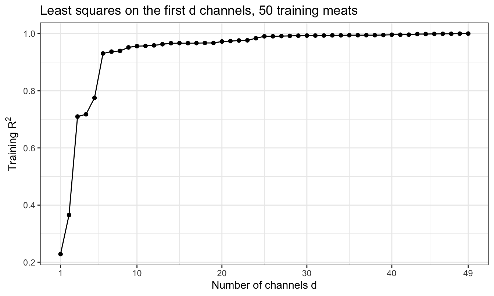
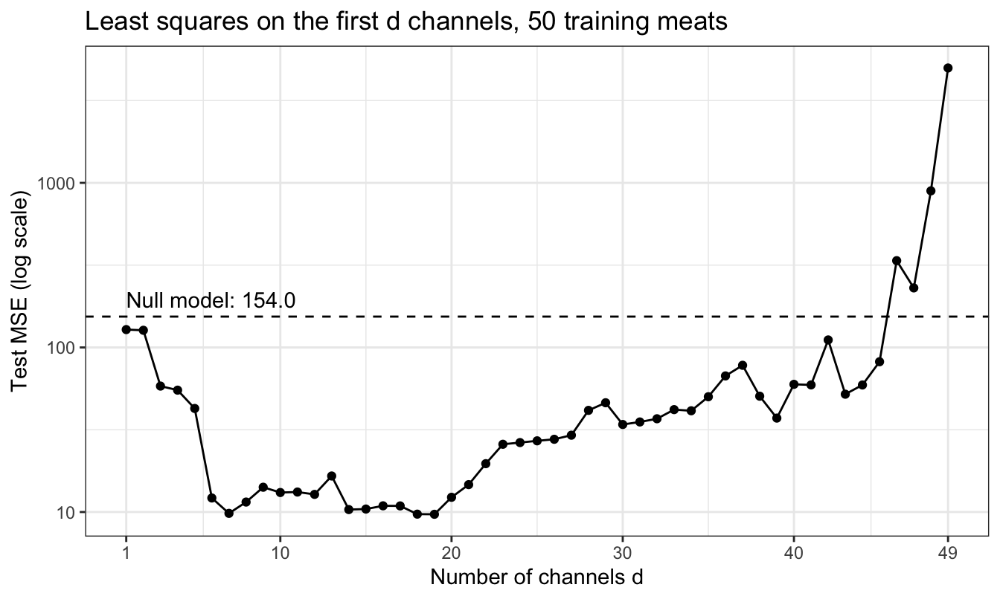
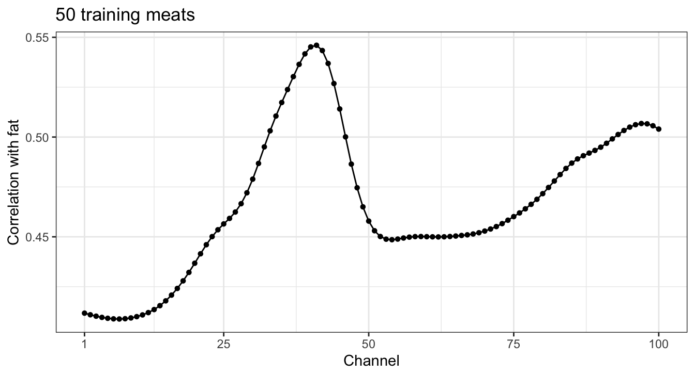
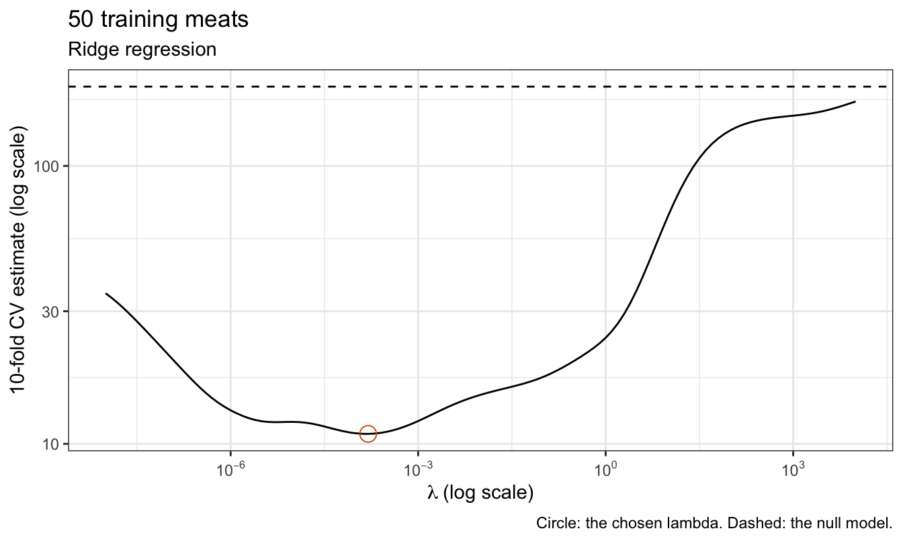
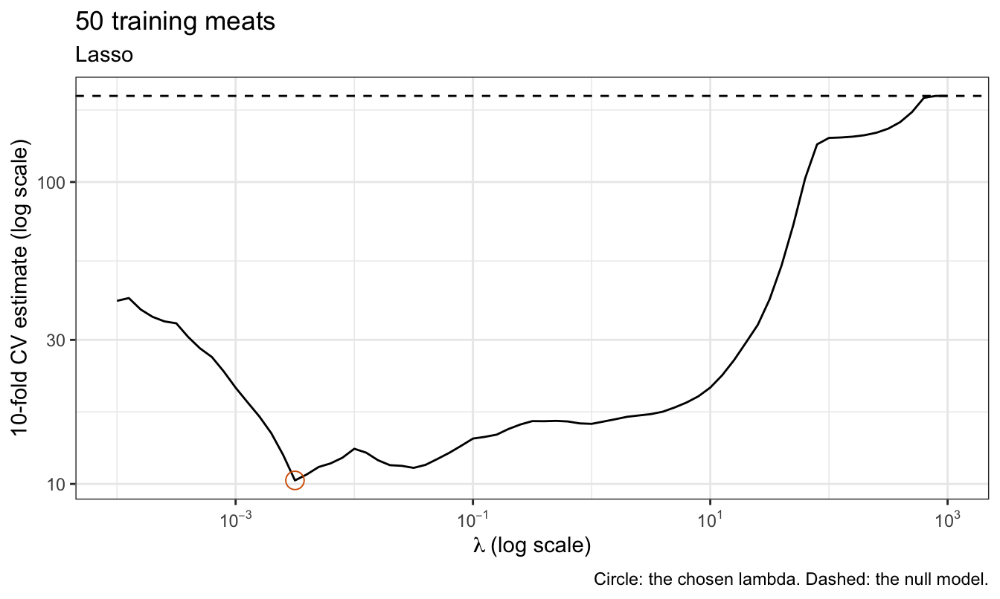
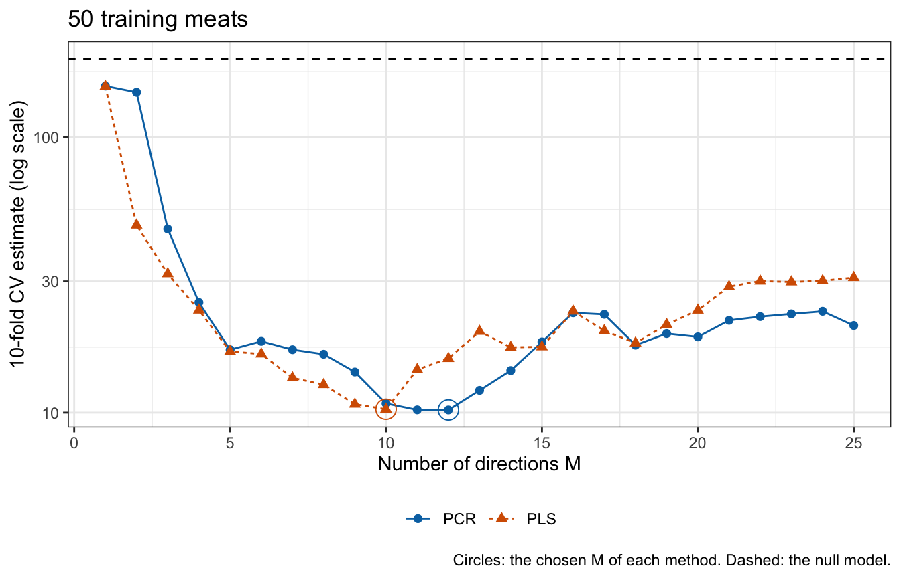
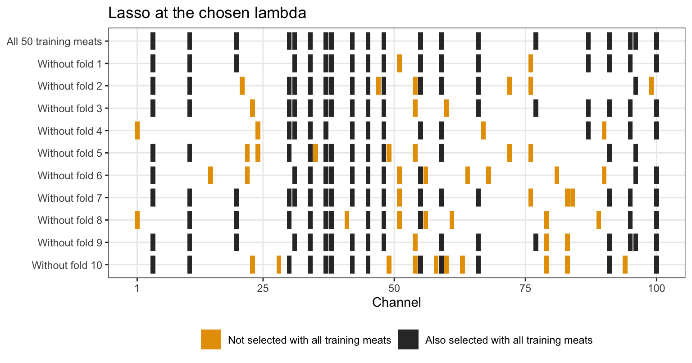

## Today

<!-- derived-from: 06-regularization/60-high-dimensions.qmd @ uncommitted -->

::: {.columns}
::: {.column width="50%"}
- Meat spectra
  - Data
- Least squares
  - Perfect fits
  - Channel sweep
  - Inference
  - Penalized criteria
  - AIC
:::
::: {.column width="50%"}
- Regularization
  - Channels and fat
  - Four methods
  - Computation
  - Tuning
  - Test MSE
  - Selected channels
:::
:::

::: notes
Distilled from the chapter's five learning objectives and the slides this deck spends time on: why X-transpose X is singular and a least squares fit can reach training R squared 1 when there are more features than training observations; why the training R squared, the training MSE, the overall F-test and sigma-hat do not estimate the test MSE; why Cp, AIC and BIC cannot choose a model size (with sigma squared fixed at the estimate from the model with all p features that estimate is 0/0; with sigma squared estimated in each model, as AIC() and BIC() do, both go to minus infinity at a perfect fit); choosing lambda or M for ridge regression, the lasso, PCR and PLS by cross-validation with every data-dependent step recomputed in each fold, and comparing the chosen fits with the null model by test MSE; and why, when the features are highly correlated, the set of features the lasso selects changes from fold to fold within a training sample and is not the set that matters. The Dimensions subsection (p = 100 and n = 50 are on the Meat spectra slide), the glmnet and active-set solver code, the Beyond this course callout and the hand-off to the next lecture are in the notes and not in the agenda. Every earlier lecture in this chapter had more training observations than features; this lecture's data have more features than training observations, so least squares fails outright and the choice of flexibility decides whether a fit predicts at all. The next lecture compares the methods across repeated training samples.

Timing: one 50-minute period; the core slides come to about 36.5 minutes and the optional slide to about 2.5 more. The Conclusion is the closing slide. If time is short, drop in this order: Computation (say that glmnet meets its stopping rule far from the minimum on these channels, so ridge regression uses its closed form and the lasso an active-set method), AIC (say that AIC() and BIC() go to minus infinity as RSS goes to 0), Channels and fat (say that no single channel predicts fat well), then the Lasso tab of Tuning.
:::

## Meat spectra

- Question: from a small training sample, how well can the fat content of chopped meat be predicted from its absorbance at each of 100 channels?
- Observation: a meat, a sample of finely chopped meat
- Response variable: `fat`, in percent
- Explanatory variables: absorbance at 100 channels, `x_001`, ..., `x_100`

::: {.fragment}
- Training sample: 50 meats, so $p = 100 > n = 50$
- Test meats: 143
:::

::: notes
modeldata::meats was recorded on a Tecator Infratec food analyzer. Each row is one meat, a sample of finely chopped meat; the notes call the observations meats, after the data set, and keep the word sample for a set of observations, as in training sample. The analyzer shines near-infrared light, at wavelengths from 850 to 1050 nm, just beyond visible red, through the meat and records its absorbance at 100 channels spread over that range. Absorbance is minus log base 10 of the fraction of the light that passes through, so an absorbance of 2 means 1% passes through. Water, fat and protein absorb these wavelengths differently, so the spectrum carries information about the composition. The fat content was measured separately by chemical analysis, which is slow; predicting it from the spectrum, which the analyzer records quickly, is the practical goal. Of the 215 rows, 22 repeat an earlier row in all 103 columns; a test meat identical to a training meat is not new data, so the repeats are removed, leaving 193 meats, of which a training sample of 50 meats and 143 test meats, split off before any plotting or fitting. The 100 features are the standardized absorbances. Every earlier lecture in this chapter had more training observations than features; here there are more features than training observations, the high-dimensional setting.
:::

## Data

{height=600}

::: notes
The figure plots the spectra of 6 training meats, chosen to span the range of fat content. The training meats range from 1.4% to 49.1% fat. Every spectrum has the same shape, rising to a peak near channel 64 and falling after it, and the spectra differ mostly by a vertical shift. The shift is only loosely related to fat: over the training meats, the correlation of fat with a meat's mean absorbance is 0.47. The fattest meats shown also have a bump or shoulder near channel 42 that the leaner ones lack. The fat content is in the details of the shape, which no single channel records. Over the 50 training meats, every pair of channels has correlation at least 0.981, and adjacent channels at least 0.99985.
:::

# Least squares

::: notes
With p + 1 > n, least squares has no unique fit. This part shows the perfect fit, how the sweep over the number of channels behaves on the test meats, and why the usual numbers from a least squares fit and the penalized criteria cannot warn of the failure.
:::

## Perfect fits

::: {style="font-size: 0.75em"}
$$\mathbf{X}^\top\mathbf{X}\,b = \mathbf{X}^\top y$$
:::

::: {style="font-size: 0.6em"}
- $\mathbf{X}$ — $n \times (p + 1)$ model matrix, a column of ones and one column per channel
- $b$ — $(p + 1)$-vector of candidate estimates, the intercept first
- $y$ — $n$-vector of the training responses
:::

::: {.fragment}
::: {style="font-size: 0.7em"}
- $p + 1 > n$: $\mathbf{X}^\top\mathbf{X}$ is singular, so the estimate is not unique
- Rank $n$: the fitted values equal the responses, training RSS 0 and training $R^2 = 1$
:::

::: {style="font-size: 0.6em"}
- $RSS = \sum_{i=1}^n\left(y_i - \widehat y_i\right)^2$ — training residual sum of squares
:::
:::

::: notes
The model matrix has rank at most n, the number of rows, so with p + 1 > n the (p + 1) by (p + 1) matrix X-transpose X has rank at most n < p + 1 and is singular. If beta-hat solves the normal equations, so does beta-hat plus v for every v with Xv = 0, and these v form a space of dimension at least p + 1 − n; every solution has the same fitted values X beta-hat. When the rank is n, the columns of X span all of R^n, so y is itself a combination of them. lm() on all 100 channels returns estimates for the intercept and the first 49 channels, x_001 to x_049, and NA for the other 51: it has picked one of the infinitely many solutions by setting those 51 estimates to zero. The model matrix has rank 50, which is n, and the training R squared is 1.0000.
:::

## Channel sweep

::: {.panel-tabset .tall-tabs}

### Training R²

### Test MSE

:::

::: notes
The perfect fit does not need all 100 channels: any n − 1 = 49 channels with a model matrix of rank n give one. The sweep fits least squares on the first d channels of a random ordering, for d = 1, ..., n − 1, where d is the number of features in the model, as in the subset selection lecture; adding channels in wavelength order would add, at each step, a channel with correlation at least 0.99985 with the one before it. The training R squared rises with every channel added, from 0.228 with one channel to 0.956 with 10 and to 1 at d = 49, where the training MSE is 0. The test MSE falls at first, to its smallest value, 9.69, at d = 19, then climbs. At d = 49 it is 4,988, 32 times the test MSE of the null model, 154.0, which predicts every meat by the training mean. With d + 1 = n the fit passes through every training meat, so its fitted values carry all of the noise in the responses. Its estimates solve n equations in n unknowns whose columns are nearly copies of one another, and they run from −425,568 to 523,355 percentage points of fat per unit of absorbance. A test spectrum that differs slightly from the training spectra, in a direction in which the training spectra barely vary, is multiplied by these estimates. The training R squared cannot see any of this: it measures how well the fit reproduces the responses it was fit to.
:::

## Inference

::: {style="font-size: 0.75em"}
$$H_0: \beta_1 = \cdots = \beta_d = 0$$
:::

::: {.fragment}
::: {style="font-size: 0.7em"}
- $d = 46$: overall $F$-test $p$-value 0.0016, training $R^2$ 0.9993
- None of the 46 estimates has a $p$-value below 0.05
- $\widehat\sigma = 1.49$ percentage points, but the test root mean squared error is 18.3
:::
:::

::: notes
The usual output of lm() does not warn of the failure either. d = 46 is the largest d whose overall F-test of H_0 has p-value below 0.01. The residual standard error is 1.49 percentage points of fat, but the test MSE is 337, 2.2 times the test MSE of the null model, a root mean squared error of 18.3 percentage points. Each of these numbers answers its own question. The F-test asks whether fat is related to the 46 channels at all, and it is. Sigma-hat estimates the standard deviation of the errors epsilon_i in y_i = beta_0 + the sum over j of beta_j x_ij + epsilon_i, not of the prediction errors, which add the variance of the estimates; with 3 residual degrees of freedom that variance is enormous. None of them estimates how well the fit predicts new meats.
:::

## Penalized criteria

::: {style="font-size: 0.7em"}
$$C_p = \frac{1}{n}\left(RSS + 2d\widehat\sigma^2\right), \qquad \text{BIC} = \frac{1}{n}\left[RSS + \log(n)\,d\widehat\sigma^2\right]$$
:::

::: {.fragment}
::: {style="font-size: 0.7em"}
- $\sigma^2$ fixed at $\widehat\sigma^2$ from the model with all $p$ features: its $RSS$ over $n - \text{rank}(\mathbf{X})$
- $\text{rank}(\mathbf{X}) = n$: $\widehat\sigma^2 = 0/0$, undefined
:::
:::

::: {.fragment}
::: {style="font-size: 0.7em"}
- $\widehat\sigma^2 = 0$: $C_p$ and BIC reduce to $RSS/n$, smallest for the largest model
:::
:::

::: notes
Cp and BIC are from the subset selection lecture, with sigma squared fixed at sigma-hat squared from the model with all p candidate features: its RSS divided by its residual degrees of freedom, n minus rank(X), which is n − p − 1 only when X has full column rank. With all p = 100 channels, rank(X) = n, so the RSS and the residual degrees of freedom are both 0 and sigma-hat squared = 0/0 is undefined. The largest model with a unique fit, d = n − 1, is no help: its RSS is 0 with n − d − 1 = 0 residual degrees of freedom. Setting sigma-hat squared to 0 reduces Cp and BIC to RSS/n, the training MSE, which is smallest, at 0, for the largest model. Any other estimate of sigma squared would come from a smaller model, which would have to be chosen first.
:::

## AIC

::: {style="font-size: 0.7em"}
- Subset selection lecture's AIC: $\sigma^2$ fixed at $\widehat\sigma^2$, equivalent to $C_p$
:::

::: {.fragment}
::: {style="font-size: 0.7em"}
- `AIC()` and `BIC()` in R: $\sigma^2$ estimated in each model by $RSS/n$
:::

::: {style="font-size: 0.75em"}
$$-2\log L = n\log\left(2\pi\,RSS/n\right) + n$$
:::
:::

::: {.fragment}
::: {style="font-size: 0.7em"}
- As $RSS \to 0$, $-2\log L \to -\infty$: both smallest at $d = 49$, where they are $-\infty$
:::
:::

::: notes
The subset selection lecture's AIC also fixes sigma squared at sigma-hat squared, which makes it equivalent to Cp, so it fails the same way. AIC() and BIC() in R use a different form: the Gaussian log-likelihood with sigma squared estimated separately in each model by RSS/n, so that minus 2 log L is n log(2 pi RSS/n) plus n, plus a penalty of 2 or log(n) per estimated parameter. As RSS goes to 0, minus 2 log L goes to minus infinity and no finite penalty offsets it. Over the sweep, AIC() is smallest at d = 49, where it is minus infinity, and BIC() at d = 49, where it is minus infinity. Once the training error can reach 0, none of the criteria can stop the search at a smaller model.

Optional: second in the drop order; if time is short, skip this slide.
:::

# Regularization

::: notes
Ridge regression, the lasso, PCR and PLS constrain the fit. This part shows what a single channel offers, the four methods, how each tuning parameter is chosen, how the chosen fits do on the test meats, and which channels the lasso selects.
:::

## Channels and fat

{height=600}

::: notes
The figure plots, for the training meats, the correlation of fat with each channel's absorbance. No channel predicts fat well alone: the correlations run from 0.409 to 0.546, at channel 41, so the best single channel explains 30% of the variance of fat in the training meats. The correlations change smoothly from channel to channel, as the channels themselves do. Predicting fat well needs a combination of many channels, and with p > n the combination must be constrained.

Optional: third in the drop order; if time is short, skip this slide.
:::

## Four methods

::: {style="font-size: 0.75em"}
- Ridge regression: minimize $RSS + \lambda\sum_{j=1}^p\beta_j^2$
- Lasso: minimize $RSS + \lambda\sum_{j=1}^p\left|\beta_j\right|$
- PCR: regress fat on the first $M$ principal component scores
- PLS: regress fat on $M$ directions chosen with the response
:::

::: {style="font-size: 0.6em"}
- $\lambda \ge 0$ — tuning parameter
:::

::: {.fragment}
::: {style="font-size: 0.75em"}
- $\lambda$ or $M$ chosen by 10-fold cross-validation
- Standardization, components and directions recomputed in each fold
:::
:::

::: notes
Each method is fit to the 50 training meats with the standardized features, the absorbance of meat i at channel j standardized with the mean and standard deviation, divisor n, of channel j over the training meats; X-tilde is the n by p matrix of standardized features. For any lambda > 0 the matrix X-tilde transpose X-tilde plus lambda I_p, with I_p the p by p identity matrix, is positive definite, so the ridge estimate is unique even with p > n. The lasso sets some estimates to exactly zero. Each of lambda and M is chosen by 10-fold cross-validation on the folds drawn with the training sample, with the standardization, the principal components and the PLS directions recomputed from the training folds in each fold.
:::

## Computation

::: {style="font-size: 0.8em"}
$$\widehat\beta^R_\lambda = \left(\tilde{\mathbf{X}}^\top\tilde{\mathbf{X}} + \lambda\mathbf{I}_p\right)^{-1}\tilde{\mathbf{X}}^\top\left(y - \bar y\mathbf{1}\right)$$
:::

::: {style="font-size: 0.6em"}
- $\mathbf{I}_p$ — $p \times p$ identity matrix
- $\bar y$ — mean of the training responses $y$; $\mathbf{1}$ — $n$-vector of ones
:::

::: {.fragment}
::: {style="font-size: 0.7em"}
$$\tilde{\mathbf{x}}_{\cdot j}^\top r = \frac{\lambda}{2}\,\text{sign}\left(\widehat\beta^L_{\lambda j}\right) \quad \text{if } \widehat\beta^L_{\lambda j} \ne 0, \qquad \left|\tilde{\mathbf{x}}_{\cdot j}^\top r\right| \le \frac{\lambda}{2} \quad \text{if } \widehat\beta^L_{\lambda j} = 0$$
:::

::: {style="font-size: 0.6em"}
- $r = y - \bar y\mathbf{1} - \tilde{\mathbf{X}}\widehat\beta^L_\lambda$ — residuals
- $\tilde{\mathbf{x}}_{\cdot j}$ — column $j$ of $\tilde{\mathbf{X}}$
:::
:::

::: notes
glmnet() fits ridge regression and the lasso by coordinate descent, updating one estimate at a time, and stops when no update in a pass changes the criterion by more than a tolerance, its argument thresh, times the criterion of the null model. On these channels it meets that rule far from the minimum of the criterion, as the Test MSE slide shows; a tighter thresh and a larger maxit, the limit on passes, close the gap but can take minutes for each fit. So ridge regression uses its closed form, from the ridge lecture, where y is the n-vector of training responses, y-bar their mean and 1 the n-vector of ones, computed from the singular value decomposition of X-tilde. The lasso estimate is the one that satisfies, for every channel j, the lasso conditions: the first sets the derivative of the criterion in beta_j to zero; the second says that moving beta_j away from zero in either direction would raise the penalty by more than it lowers the RSS. An active-set method solves the first condition exactly, as a linear system, on a set of nonzero estimates with fixed signs, and changes the set until the second holds for every other channel; its code is in the collapsed Code callout of the notes' Computation subsection and is not shown. Both fits work on this chapter's lambda directly, with no conversion to glmnet()'s. Over the 71 values of lambda on the lasso grid, from 10^3 to 10^-4, the lasso conditions hold to within a fraction 1.3 x 10^-5 of lambda/2.

Optional: first in the drop order; if time is short, skip this slide.
:::

## Tuning

::: {.panel-tabset .tall-tabs}

### Ridge

### Lasso

### PCR and PLS

:::

::: notes
The tabs plot the 10-fold cross-validation estimate against lambda for ridge regression and the lasso and against M for PCR and PLS, each with the estimate for the null model as a dashed line. All four curves fall from the null model's estimate, 192.8, to a minimum between 10.2 and 10.9 and rise again as the fit becomes more flexible. Ridge regression chooses lambda = 1.6 x 10^-4. That is small in absolute terms, but the principal component variances v_m of the standardized channels fall from 99.3 for the first component to 6.2 x 10^-7 for the 15th, and the factor v_m/(v_m + lambda/n) of the PCR lecture keeps at least half of the term of the first 12 components and shrinks the rest toward zero. The lasso chooses lambda = 3.2 x 10^-3, with 20 nonzero estimates; its curve is jagged at small lambda, where channels enter and leave the active set. PCR chooses M = 12 components and PLS M = 10 directions.

If time is short, skip the Lasso tab.
:::

## Test MSE

|Method |Tuning                         | Nonzero| 10-fold CV| Test MSE|
|:------|:------------------------------|-------:|----------:|--------:|
|Null   |                               |       0|     192.81|   153.95|
|Ridge  |$\lambda = 1.6 \times 10^{-4}$ |     100|      10.86|     8.09|
|Lasso  |$\lambda = 3.2 \times 10^{-3}$ |      20|      10.27|    13.26|
|PCR    |$M = 12$                       |     100|      10.23|     8.71|
|PLS    |$M = 10$                       |     100|      10.29|     9.52|

::: notes
Each method with its chosen tuning parameter, fit to all 50 training meats, and the null model are evaluated once on the 143 test meats. The table gives, for each method, its chosen tuning parameter, its number of nonzero estimates, its 10-fold cross-validation estimate and its test MSE. On this training sample every method predicts the test meats far better than the null model: their test MSEs are 8.1 to 13.3, against 154.0, and against 4,988 for least squares on 49 channels. The ordering among them, with ridge regression best and the lasso worst, holds on this training sample of 50 meats; another training sample could rank them differently, and one training sample cannot show which method is best on average.

The default glmnet() fits would have told a different story about which channels the lasso uses. At the chosen lambda, the default lasso fit, with thresh = 1e-7, has 99 nonzero estimates, against 20 for the active-set fit, and a criterion 2.5 times the minimum, although its test MSE, 9.93, is lower than the active-set fit's, 13.26: a fit that stops far from the lasso's minimum keeps almost every channel, and on this training sample dense fits predict better. With neighboring channels correlated at least 0.99985, a change to one estimate in a pass of coordinate descent is almost undone by the change to its neighbor, so each update lowers the criterion little and the stopping rule is met early. The default ridge fit's predictions of the test meats differ from the closed form by up to 5.8 percentage points.

A much tighter tolerance brings glmnet() close to the exact fits. With thresh = 1e-12 and maxit = 1e9, its lasso fits for lambda >= 1 predict the test meats to within 0.050 of the active-set fits; the remaining gap is glmnet()'s, since at lambda = 1 its criterion is 714.9403 against 714.9391 for the active-set fit. With thresh = 1e-14 and maxit = 1e7, its ridge fit at lambda = 1 predicts the test meats to within 3.1 x 10^-4 of the closed form.
:::

## Selected channels

{height=600}

::: notes
The lasso chose 20 channels. The figure marks the channels with a nonzero estimate in the lasso fit, at the chosen lambda, to all 50 training meats and to the training folds of each fold, 45 meats each. The 11 fits select 11 different sets of channels, of 16 to 23 channels each. Only 3 channels are selected by every fit, and 51 of the 100 channels are selected by at least one. Every pair of channels has correlation at least 0.981, so the lasso's choice among them turns on small differences among the training meats in each fold. The selected set is therefore one of many sets that predict fat, not the set of wavelengths at which fat absorbs. The fold fits, with their different sets, have test MSEs from 10.7 to 30.6; ridge regression, PCR and PLS give every channel a nonzero estimate and, on this training sample, predict the test meats better than the lasso. The lasso lecture found the same instability across repeated training samples; here it appears across the folds of a single training sample. A channel the lasso drops is not shown to be unrelated to fat.
:::

## Conclusion

- Least squares fails when $p + 1 > n$
- Training $R^2$ and training MSE cannot choose among fits
- $C_p$, BIC and AIC with fixed $\sigma^2$ need an estimate that is $0/0$
- `AIC()` and `BIC()` go to $-\infty$ at a perfect fit
- Cross-validate $\lambda$ or $M$, recomputing every step in each fold
- Correlated features: the lasso's set changes from fold to fold

::: notes
When the number of features p is close to or above the number of training observations n, least squares fails. With p + 1 > n the matrix X-transpose X is singular, the normal equations have infinitely many solutions, and when X has rank n every one of them fits the training responses exactly, with training RSS 0 and training R squared 1. As the number of features approaches n, the training error falls toward zero while the test error rises sharply, because the fit reproduces the noise and its estimates on correlated features become huge. The training R squared and the training MSE always improve with more features. The overall F-test and sigma-hat answer other questions, and a small p-value can accompany a fit that predicts worse than the null model. Cp, BIC and AIC with sigma squared fixed at the estimate from the model with all p features need that estimate, which is 0/0 when p >= n − 1; setting it to 0 turns them into the training MSE. AIC and BIC with sigma squared estimated in each model go to minus infinity at a perfect fit. Ridge regression, the lasso, PCR and PLS constrain the fit, and a tuning parameter chosen by k-fold cross-validation on the training data decides how much. Every data-dependent step of the fit, such as the standardization and the PCR and PLS directions, is recomputed from the training folds inside each fold; the chosen model is then refit to all the training data and evaluated once on test data. When the features are highly correlated, many different sets of features can predict about equally well, so the set the lasso selects changes from fold to fold within a training sample and does not identify the features that matter.

The next lecture compares subset selection, ridge regression, the lasso, PCR and PLS across repeated training samples, to see which of them predicts best on average and how much the answer depends on the data.
:::

