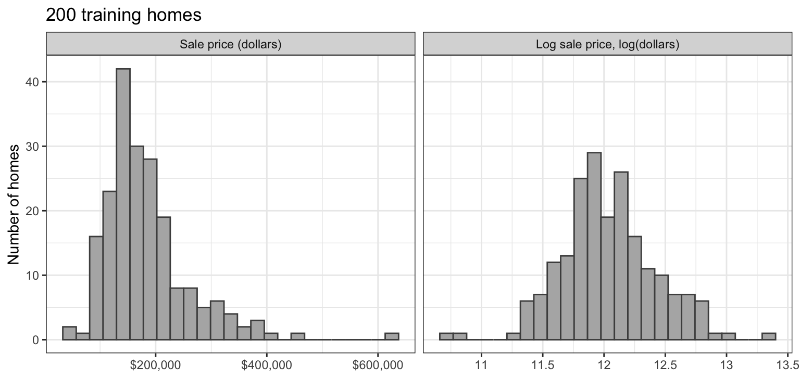
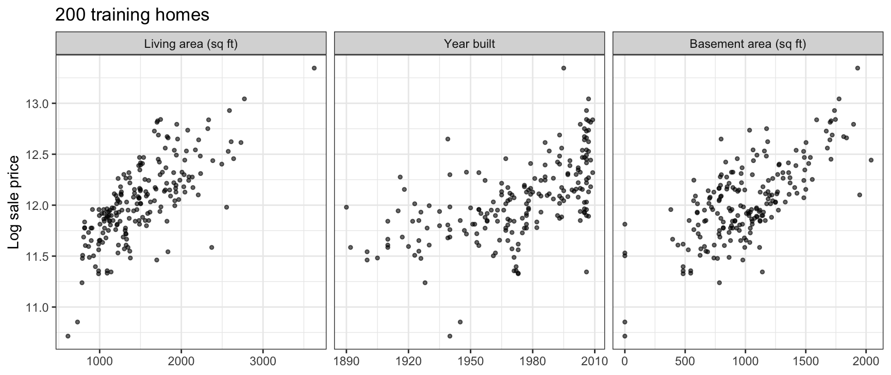
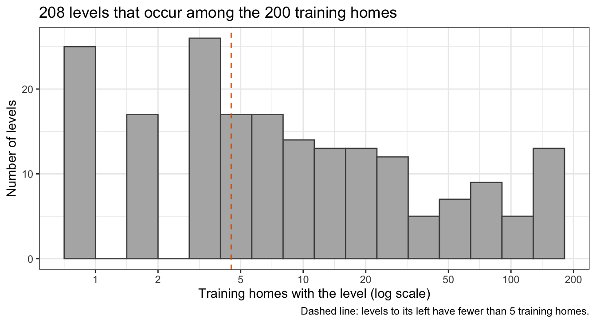
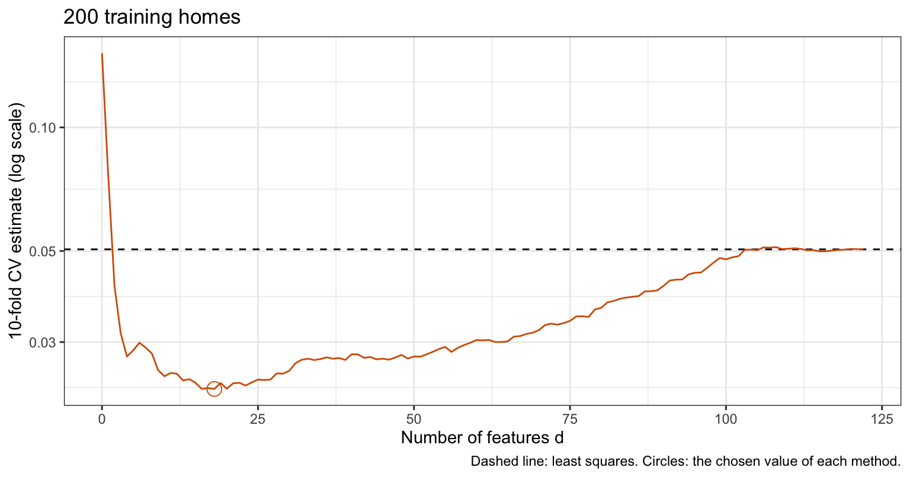
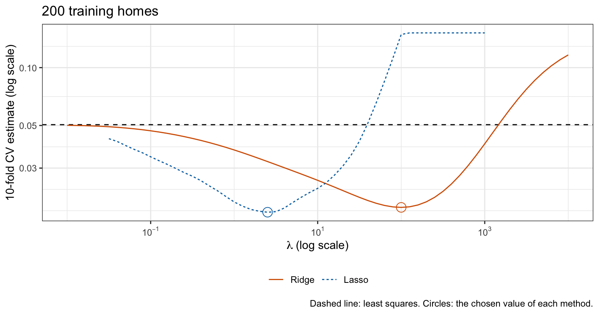
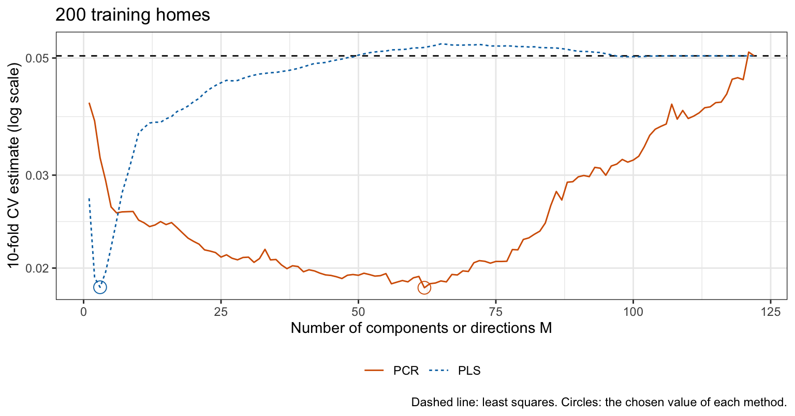
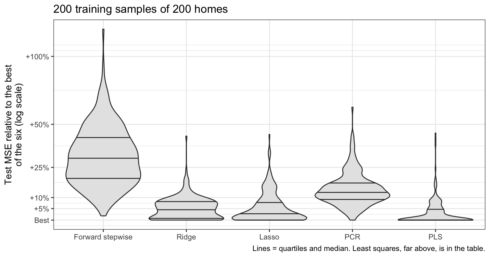
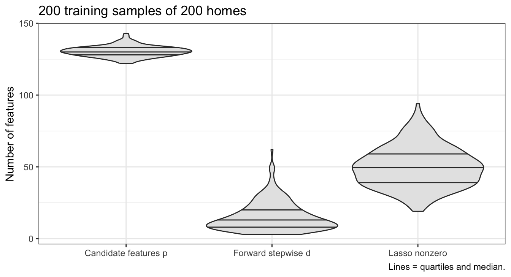

## Today

<!-- derived-from: 06-regularization/70-method-comparison.qmd @ 640b5d1 -->

::: {.columns}
::: {.column width="50%"}
- Ames home sales
  - Data
  - Training homes
  - Candidate features
- Training-sample fits
  - Six fits
  - Cross-validation curves
  - Test evaluation
  - Kept dummies
:::
::: {.column width="50%"}
- Repeated training samples
  - Method ranking
  - Kept features
- Six methods compared
  - Properties
  - Expected settings
:::
:::

::: notes
Distilled from the chapter's six learning objectives and the slides this deck spends time on: comparing least squares, forward stepwise selection, ridge regression, the lasso, PCR and PLS by what each does to the estimates, whether it selects features and its tuning parameter; choosing each tuning parameter by 10-fold cross-validation with every data-dependent step recomputed in each fold, and evaluating the chosen fits once on test data; why one training sample cannot rank the methods, and reading the repeated-samples results; what the lasso and forward stepwise selection do with the dummy variables of a categorical variable, and why a chosen fit's cross-validation estimate can miss its test MSE in either direction; and the setting in which each method is expected to predict best, and why one dataset cannot establish it. The data cleaning (the five homes above 4,000 square feet), the three feature-building rules, the feature correlations, the lasso convergence check and the Beyond this course callout are in the notes and not in the agenda. This is the capstone of the regularization chapter: the earlier lectures gave five ways to control the flexibility of least squares, and this one fits all six methods to one training sample and compares them. The next class is the review for Exam 2, and Exam 2 follows it; after the exam the course moves to tree-based methods and random forests.

Timing: one 50-minute period. If time is short, drop in this order: Candidate features (say that levels with fewer than 5 training homes join the reference), Kept dummies (say that the lasso and forward stepwise selection treat each dummy on its own), Kept features.
:::

# Ames home sales

::: notes
The earlier lectures of this chapter gave five ways to control the flexibility of least squares, which fits every feature without restraint: subset selection keeps some features and drops the rest, ridge regression and the lasso shrink the estimates, and PCR and PLS regress on a few linear combinations of the features. Each lecture used its own data; this lecture fits all six to one training sample and compares them.
:::

## Data

- Question: which of the six methods predicts the sale price of a home best, and what does each give up?
- Observation: a home
- Response variable: `Sale_Price`, in dollars; the models use its logarithm
- Explanatory variables: 33 numeric and 40 categorical

::: {.fragment}
- Training sample: 200 homes, with $p = 122$ candidate features
- Test homes: 2,725
:::

::: notes
modeldata::ames, the data of the Cross-Validation in Practice lecture, records 2,930 home sales in Ames, Iowa, from 2006 to 2010; that lecture used six explanatory variables and this one uses all of them. The numeric explanatory variables are areas, counts of rooms and baths, years, and the home's longitude and latitude; the categorical ones have 2 to 29 levels, and Neighborhood has 29. With one dummy variable for every level but one they give 276 columns. The data's compiler recommends removing every home with more than 4,000 square feet before modeling, which leaves 2,925 homes. BsmtFin_SF_1 is a coded version of BsmtFin_Type_1 and is dropped, and an indicator, Frontage_Missing, marks the homes whose lot frontage of 0 means it is missing. The response is the natural log of the sale price because its spread is closer to constant and an error on the log scale is a relative error in price; every MSE is in squared log dollars. The training sample is small on purpose: with p comparable to n, least squares can be fit but has much variance for the other methods to remove. The ridge lecture showed that the average variance of the least squares fitted values is sigma squared (p + 1)/n, here 62% of the error variance.
:::

## Training homes

::: {.panel-tabset .mid-tabs}

### Sale price

### Size and age

:::

::: notes
The tabs plot the distribution of the sale price of the 200 training homes, on the dollar and log scales, and the log price against three explanatory variables. Sale price is right skewed: the mean training price is above the median. Log price is close to symmetric, and it rises roughly linearly with living area, year built and basement area; the stripe at zero basement area is the homes without a basement.
:::

## Candidate features

{height=600}

::: notes
Optional: first in the drop order. The figure counts, for every level of every categorical variable, the training homes that have it. Of the 283 levels, 75 occur in no training home and 68 in fewer than 5; a dummy variable for a level with one or two training homes would have an estimate set by those homes alone. The features are built from the training homes by three rules. Rule 1: the most common level of each categorical variable is its reference and a level with fewer than 5 training homes joins the reference. Rule 2: each remaining level other than the reference gets a dummy variable, and the numeric variables enter as recorded. Rule 3: a column that is constant among the training homes or an exact linear combination of the columns before it is dropped. Rule 2 gives 133 columns and rule 3 drops 11 of them, leaving p = 122 candidate features for n = 200 training homes. The rules use the explanatory variables and no sale prices, and are applied once to the training sample, not inside each fold.
:::

# Training-sample fits

::: notes
All six methods are fit to the one training sample of 200 homes, each tuning parameter is chosen by 10-fold cross-validation on it, and the chosen fits are evaluated once on the 2,725 test homes.
:::

## Six fits

::: {style="font-size: 0.75em"}
- Least squares: all $p$ features, no tuning parameter
- Forward stepwise selection: size $d = 0, 1, \ldots, p$
- Ridge regression: minimize $RSS + \lambda\sum_{j=1}^p\beta_j^2$
- The lasso: minimize $RSS + \lambda\sum_{j=1}^p\left|\beta_j\right|$
- PCR: first $M$ principal components of the standardized features
- PLS: first $M$ PLS directions
:::

::: {.fragment}
::: {style="font-size: 0.75em"}
- $d$, $\lambda$ or $M$ chosen by 10-fold cross-validation
- Standardization, forward stepwise path, components and directions recomputed in each fold
:::
:::

::: notes
Each method is fit by a function that takes the features and responses of a set of homes and returns estimates for every value of its tuning parameter. The features are standardized for ridge regression, the lasso, PCR and PLS, with the mean and standard deviation of each feature over the homes the method is fit to; least squares and forward stepwise selection give the same fits with or without standardization. Forward stepwise selection is tuned by cross-validation, like the other methods with a tuning parameter, rather than by BIC: the BIC of the Subset Selection lecture fixes sigma squared at the estimate from the model with all p features, which here rests on only n - p - 1 = 77 residual degrees of freedom. The lasso is fit by glmnet() with lambda converted as in the Lasso lecture and a tolerance tight enough to meet the lasso conditions of the High Dimensions lecture, which the chapter checks.
:::

## Cross-validation curves

::: {.panel-tabset .mid-tabs}

### Forward stepwise

### Ridge and lasso

### PCR and PLS

:::

::: notes
The tabs plot each method's 10-fold cross-validation estimate against its tuning parameter, with least squares as a dashed line and each chosen value circled. Forward stepwise selection with d = p, ridge regression and the lasso as lambda goes to 0, and PCR and PLS with M = p are all least squares. Every curve has its minimum well below the estimate for least squares, 0.0505. Toward the flexible end the forward stepwise and ridge curves rise to the least squares line; the lasso grid stops at lambda = 0.032, where its curve is still 15% below the line, and the PLS curve rises above the line, by at most 5.4%, before meeting it at M = p. Forward stepwise selection chooses d = 18 features, but its curve is flat: it is within 5% of its minimum at 11 sizes between d = 13 and 24. Ridge regression chooses lambda = 100.0 and the lasso lambda = 2.51; the two lambdas are on different scales, one charging squared estimates and the other absolute values, so they are not comparable. PLS chooses M = 3 directions and PCR M = 62 components; PLS reaches its minimum with a few directions chosen with the response, while PCR's components are ordered by the variance of the features, not by their relation to price, and its curve is within 5% of its minimum at 12 values of M between 46 and 66.
:::

## Test evaluation

|Method           |Tuning            | Nonzero estimates| 10-fold CV estimate| Test MSE|
|:----------------|:-----------------|-----------------:|-------------------:|--------:|
|Least squares    |None              |               122|              0.0505|   0.0462|
|Forward stepwise |$d = 18$          |                18|              0.0231|   0.0269|
|Ridge            |$\lambda = 100.0$ |               122|              0.0187|   0.0241|
|Lasso            |$\lambda = 2.51$  |                57|              0.0177|   0.0228|
|PCR              |$M = 62$          |               122|              0.0184|   0.0262|
|PLS              |$M = 3$           |               122|              0.0184|   0.0246|

::: notes
Each method with its chosen tuning parameter is refit to all 200 training homes and evaluated once on the 2,725 test homes. On this training sample the lasso has the smallest test MSE, 0.0228, followed in order by ridge regression, PLS, PCR, forward stepwise selection and least squares, whose test MSE is 0.0462. A test MSE of 0.0228 is a root mean squared error of 0.151 on the log scale, a typical error of about 16% in price. The cross-validation estimates of the five tuned methods are 0.70 to 0.86 times their test MSEs, and that of least squares, the one estimate that involves no choice, is 1.09 times its test MSE. Each fold fits 180 homes rather than 200. Refit to the training folds of each fold, least squares has an average test MSE of 0.0590, against 0.0462 for the fit to all 200 homes: its residual degrees of freedom fall from 77 to 57, and its error on new homes rises steeply. For the tuned methods the same refits raise the test MSE by only 1.0% to 8.5%, so fewer homes per fold cannot explain why their estimates sit below the test MSE. Each tuned estimate is the smallest on its curve, chosen for being low, and so optimistic; and all of them rest on the held-out folds of one sample of 200 homes, which may be easier or harder to predict than the test homes.
:::

## Kept dummies

::: {style="font-size: 0.8em"}
- Lasso keeps 57 of the 122 features, forward stepwise selection 18
- Neighborhood dummies: 15; the lasso keeps 8, forward stepwise selection 3
- Some but not all dummies of a variable kept: lasso 15 variables, forward stepwise selection 4
- Ridge regression, PCR and PLS: every dummy nonzero
:::

::: {.fragment}
::: {style="font-size: 0.8em"}
- A dropped dummy merges its level into the reference, `North_Ames` for `Neighborhood`
:::
:::

::: notes
Optional: second in the drop order. Neither the lasso nor forward stepwise selection treats the dummy variables of one categorical explanatory variable as a group. As in the Subset Selection lecture, a dropped dummy merges its level into the reference: the lasso fit predicts a home in a neighborhood whose dummy it dropped as it predicts an otherwise identical home in North_Ames. A group lasso that keeps or drops all of a variable's dummies together is in the Beyond this course callout of the notes and is not taught.
:::

# Repeated training samples

::: notes
The ranking above belongs to one training sample of 200 homes. As in the ridge and lasso lectures, 1,000 of the 2,725 test homes are the test homes at which every prediction is made, and the remaining 1,725 are the homes from which the repeated training samples are drawn: 200 samples of n = 200. In each sample the candidate features are rebuilt by the three rules, every method's tuning parameter is chosen by 10-fold cross-validation on the sample's own folds, and each chosen fit predicts the 1,000 test homes.
:::

## Method ranking

::: {.panel-tabset .mid-tabs}

### Relative to the best

### Summary

|Method           | Mean test MSE| Median test MSE| Samples won| Median change from least squares|
|:----------------|-------------:|---------------:|-----------:|--------------------------------:|
|Least squares    |        0.0614|          0.0504|           0|                                 |
|Forward stepwise |        0.0303|          0.0295|           0|                       &minus;42%|
|Ridge            |        0.0242|          0.0240|          39|                       &minus;53%|
|Lasso            |        0.0242|          0.0239|          52|                       &minus;53%|
|PCR              |        0.0262|          0.0258|           1|                       &minus;49%|
|PLS              |        0.0237|          0.0233|         108|                       &minus;54%|

:::

::: notes
The figure plots, for each sample, the test MSE of each method other than least squares relative to the smallest of the six in that sample; least squares, far above, is in the table. PLS, the lasso, ridge regression and PCR win 108, 52, 39 and 1 of the 200 samples, and least squares and forward stepwise selection win none. PLS wins most often, but ridge regression and the lasso stay close to it: their test MSEs are a median of 2.3% and 1.6% above that of PLS, and they beat it in 34% and 38% of the samples. Every other method improves on least squares by a median of 42% to 54%. The single training sample ranked the lasso first and PLS third; one training sample cannot rank methods whose test MSEs are this close. The large differences appear in nearly every sample: every other method has a smaller test MSE than least squares in 99.5% to 100.0% of the samples, and forward stepwise selection has a larger test MSE than ridge regression, the lasso and PLS in 98.0% to 99.5% of the samples and than PCR in 87%. The 200 samples are drawn from the same 1,725 homes and overlap. Over the samples, the median of the chosen fit's cross-validation estimate divided by its test MSE is 1.50 for least squares and 0.90 to 1.03 for the five tuned methods; the estimate exceeds the test MSE in 86% of the samples for least squares and in 34% to 60% for the tuned methods, so their estimates fall on both sides of the test MSE.
:::

## Kept features

{height=600}

::: notes
Optional: third in the drop order. The figure plots, over the 200 samples, the number of candidate features and the number kept by forward stepwise selection and by the lasso. The rules give 122 to 143 candidate features per sample. Forward stepwise selection keeps a median of 13 of them, from 3 to 62, and the lasso a median of 49.5, from 19 to 94. The lasso keeps more features than forward stepwise selection in 99.5% of the samples, each with a shrunken estimate, where forward stepwise selection keeps fewer at their least squares size. Both numbers vary widely from sample to sample, as the lasso's selected sets did in the Lasso lecture. The median chosen M is 2 for PLS and 40 for PCR.
:::

# Six methods compared

::: notes
The table collects what the earlier lectures showed about each method; the expected settings are expectations drawn from the reasoning of those lectures, some stated here for the first time, not results.
:::

## Properties

::: {style="font-size: 0.55em"}
|Property               |Least squares      |Forward stepwise                      |Ridge                       |Lasso                                  |PCR                                          |PLS                                                |
|:----------------------|:------------------|:-------------------------------------|:---------------------------|:--------------------------------------|:--------------------------------------------|:--------------------------------------------------|
|Estimates              |Unconstrained      |Kept: least squares; dropped: 0       |All shrunk toward 0, none 0 |Shrunk; some exactly 0                 |In the span of the first $M$ components      |In the span of $M$ directions                      |
|Selects features       |No                 |Yes                                   |No                          |Yes                                    |No                                           |No                                                 |
|Tuning parameter       |None               |Size $d$                              |$\lambda$                   |$\lambda$                              |$M$                                          |$M$                                                |
|Standardization        |Not needed         |Not needed                            |Needed                      |Needed                                 |Needed                                       |Needed                                             |
|Needs from $n$ and $p$ |$n > p$            |$d < n$                               |Any $p$                     |Any $p$                                |$M$ at most the rank of $\tilde{\mathbf{X}}$ |$M$ at most the rank of $\tilde{\mathbf{X}}$       |
|Computation            |One fit            |$1 + p(p + 1)/2$ fits                 |One SVD for every $\lambda$ |Coordinate descent for each $\lambda$  |One SVD for every $M$                        |One step per direction                             |
|Interpretation         |Every estimate     |A least squares model on $d$ features |Every estimate, shrunken    |Some shrunken estimates                |Directions; needs every feature              |Directions; needs every feature                    |
:::

::: notes
The methods differ most in what they do to the estimates. Forward stepwise selection applies a hard threshold: a feature is in, at its least squares size given the others, or out at zero. The lasso applies a soft threshold, moving every kept estimate toward zero and setting the rest to zero; for orthogonal features this is the soft thresholding of the Lasso lecture. Ridge regression shrinks every estimate and drops none, most strongly along the principal components with the least variance. PCR and PLS replace the p features by M directions, keeping each direction's least squares term in full and dropping the rest, so they select directions, not features.
:::

## Expected settings

::: {style="font-size: 0.75em"}
- **Least squares**: $n$ large relative to $p$
- **Forward stepwise selection and the lasso**: a few features carry the signal, the rest are noise
- **Ridge regression**: many features with small effects of similar size
- **PCR**: response related to the directions in which the features vary most
- **PLS**: response related to directions that are not the leading principal components
:::

::: {.fragment}
::: {style="font-size: 0.75em"}
- Expectations from reasoning, not results: one dataset does not establish them
:::
:::

::: notes
The earlier lectures give the reasons. Least squares: the average variance of its fitted values, sigma squared (p + 1)/n, is small when n is large relative to p, and the other methods then have little variance to trade for bias. Forward stepwise selection and the lasso: dropping a noise feature removes its variance and adds no bias; this is the lasso lecture's expectation, extended to forward stepwise selection. Ridge regression: the contrasting expectation of the lasso lecture. PCR: like ridge regression it favors the directions in which the features vary most. PLS: choosing directions with the response can reach directions that are not the leading components with fewer directions, at the cost of variance. The 2,925 home sales are one dataset with one structure: that PLS won most often here, by a few percent, is a finding about these homes and this training sample size, not evidence for or against the expectation for PLS.
:::

## Conclusion

- The methods differ in what they do to the estimates
- Only forward stepwise selection and the lasso select features
- Cross-validate $d$, $\lambda$ or $M$, recomputing the fit's data-dependent steps in each fold
- A cross-validation estimate can miss the test MSE in either direction
- One training sample ranks the methods for that sample only
- One dataset cannot establish the expected settings

::: notes
Least squares, subset selection, ridge regression, the lasso, PCR and PLS are six ways of fitting a linear model to the same features. Subset selection keeps some features at their least squares estimates and sets the rest to zero, a hard threshold. The lasso shrinks every estimate toward zero and sets some exactly to zero, a soft threshold. Ridge regression shrinks every estimate and sets none to zero. PCR and PLS constrain the estimates to a few directions, chosen without the response for PCR and with it for PLS, and select no feature. Only subset selection and the lasso select features, and both treat each dummy variable of a categorical explanatory variable on its own, so dropping a dummy merges its level into the reference. Each method other than least squares has one tuning parameter, chosen the same way, by k-fold cross-validation on the training sample with the standardization, forward stepwise path, components and directions recomputed from the training folds in each fold; the rules that defined the candidate features use no responses and were applied once, a simplification. The chosen fit is refit to all the training data and evaluated once on test data, and its cross-validation estimate can miss its test error in either direction: the smallest estimate on a curve is optimistic, while fitting each fold to fewer homes raises it, most for least squares. The test MSEs of one training sample rank the methods for that sample only; comparing them over repeated training samples shows which differences are larger than the variation from sample to sample.

The next class is the review for Exam 2, and Exam 2 follows it. After the exam the course moves to tree-based methods and random forests, ISLR2 Chapter 8.
:::
