## Today

<!-- derived-from: 08-trees/10-decision-trees.qmd @ 5524cc4 -->

::: {.columns}
::: {.column width="50%"}
- Concrete strength
  - Data
  - Training specimens
- Regression trees
  - Regions and predictions
  - Best split
  - Recursive binary splitting
  - Fitting and partition
:::
::: {.column width="50%"}
- Pruning
  - Overfitting
  - Cost-complexity pruning
  - Cross-validation and pruned tree
  - All explanatory variables
- Classification trees
  - Penguin species
  - Most common class
  - Node impurity
  - Fitting and pruning
- Strengths and weaknesses
  - Interpretability and nonlinearity
  - Step functions and instability
:::
:::

::: notes
Distilled from the chapter's six learning objectives and the slides this deck spends time on: describing a regression tree as a partition into regions with the mean training response as the prediction, and reading a prediction from a printout or diagram; deriving the best single split and the decrease in RSS, and why recursive binary splitting is greedy and top-down; cost-complexity pruning, choosing alpha by 10-fold cross-validation and evaluating the pruned tree on test data; the classification error rate, Gini index and entropy of a node and why the Gini index or entropy, not the error rate, grows a classification tree; fitting with rpart() and prune() and evaluating by test MSE or a test confusion matrix; and comparing trees with linear models. The data cleaning, the split search, the tree-drawing code, the rpart() fits to all explanatory variables as code, the concavity argument, the Beyond this course callouts and the hand-off to the next lecture are in the notes and not in the agenda. Most models so far were linear in features built by hand; a tree needs no features built by hand. The next lecture averages many trees: bagging and random forests.

Timing: one 50-minute period is tight for 41 slides; the outline lists the order in which to drop slides.
:::

# Concrete strength

::: notes
Most models so far have been linear in a set of features, with any curvature or interaction built into the features by hand. A decision tree instead splits the values of the explanatory variables into rectangles and predicts a constant in each. This lecture grows trees for a numeric response (regression trees) and for a class (classification trees), and prunes them back.
:::

## Data

- Question: how well do the ingredients of a concrete mix and its age predict how much load the concrete can bear?
- Observation: a specimen, one cylinder of one mix, crushed at one age
- Response variable: `compressive_strength`, in megapascals (MPa)
- Explanatory variables: seven ingredients, in kg per cubic meter of mix, and `age`, in days

::: {.fragment}
- Training sample: 700 specimens
- Test specimens: 305
:::

::: notes
modeldata::concrete records laboratory tests of concrete cylinders (Yeh 2006, Journal of Materials in Civil Engineering 18). The rows that repeat an earlier row exactly, strength included, are treated as duplicated records of one specimen and removed with distinct(), so that no specimen is both a training and a test specimen; rows that repeat the mix and age with a different strength are separate specimens and stay. The training specimens are a random sample of 700; every other specimen is a test specimen.
:::

## Training specimens

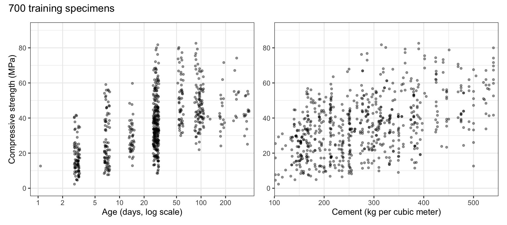{height=520}

::: notes
Strength rises steeply with age over the first month, from a mean of 17.6 MPa at 3 days to 36.6 MPa at 28 days, and more slowly, and noisily, afterward; 40% of the training specimens were tested at 28 days, the standard age for testing concrete. Strength rises with cement too, with a wide spread at every cement content: specimens with the same cement differ in age and in the other six ingredients. The relation with age is far from a straight line, and a linear model would need features, such as a log of age, built for that curvature. Many mixes were tested at several ages: 68% of the test specimens have a mix, the seven ingredients, that some training specimen also has, so the test MSEs below measure predictions for mixes like those tested, often at a new age, not for mixes never tested.
:::

# Regression trees

::: notes
A regression tree is a partition of the explanatory variables into regions with a constant prediction in each. This part defines the model, the best single split, and the recursive search, and then fits a tree.
:::

## Age and cement

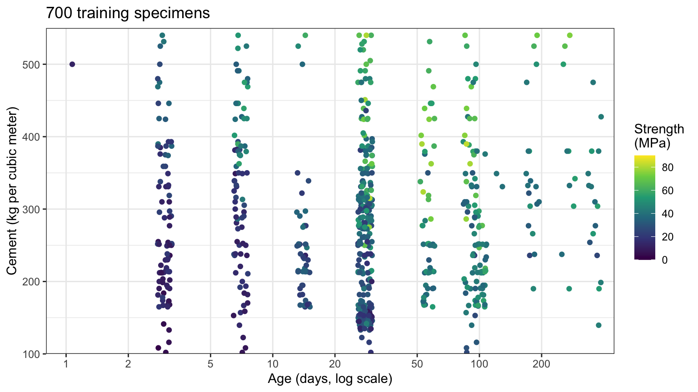{height=570}

::: notes
The dark, weak specimens sit at the left, at young ages, and in the bottom band of low cement; the light, strong ones sit at the right and the top. A vertical line near 3 weeks and a horizontal line or two in cement would already separate much of the weak concrete from the strong.
:::

## Regions and predictions

::: {style="font-size: 0.75em"}
$$\widehat f(x) = \sum_{\ell=1}^{L} \widehat y_{R_\ell}\,\mathrm{I}\left(x \in R_\ell\right),$$
:::

::: {style="font-size: 0.6em"}
- $x$ — value of the $p$ explanatory variables $X = (X_1, \ldots, X_p)$
- $R_\ell$ — $\ell$th region, a rectangle in the $p$ explanatory variables
- $\widehat y_{R_\ell}$ — mean response of the training observations in $R_\ell$
- $\mathrm{I}\left(x \in R_\ell\right)$ — 1 if $x$ falls in $R_\ell$, 0 otherwise
:::

::: {.fragment}
::: {style="font-size: 0.7em"}
$$\text{RSS} = \sum_{\ell=1}^{L}\sum_{i:\, x_i \in R_\ell}\left(y_i - \widehat y_{R_\ell}\right)^2.$$
:::
:::

::: notes
A regression tree turns those lines into a model. It divides the values of the explanatory variables into L non-overlapping rectangles, the regions R_1, ..., R_L, and predicts the mean training response of a region for every observation that falls in it. A tree splits on the explanatory variables as recorded, so here each feature is an explanatory variable; observation i has values x_i = (x_i1, ..., x_ip) and response y_i. Within one region, the sum of (y_i − c)² has derivative −2 times the sum of (y_i − c) in c, which is zero at the region's mean, so the mean is the constant with the smallest RSS in that region. The regions themselves are harder: there are too many ways to partition the values into rectangles to search them all, so a tree builds its regions one split at a time.
:::

## Best split

::: {style="font-size: 0.7em"}
$$R_1(j, s) = \left\{X \in R \mid X_j < s\right\}, \qquad R_2(j, s) = \left\{X \in R \mid X_j \ge s\right\}$$
:::

::: {style="font-size: 0.6em"}
- $R$ — region being split
- $X_j$ — explanatory variable $j$
- $s$ — cut point
:::

::: {.fragment}
::: {style="font-size: 0.6em"}
$$\sum_{i:\, x_i \in R_1(j, s)}\left(y_i - \widehat y_{R_1}\right)^2 + \sum_{i:\, x_i \in R_2(j, s)}\left(y_i - \widehat y_{R_2}\right)^2$$
:::

::: {style="font-size: 0.6em"}
- RSS of the two regions after the split, minimized over $(j, s)$
:::
:::

::: notes
A split of a region R on explanatory variable j at cut point s makes two regions; at the first split R is every value of the explanatory variables. The best split is the pair (j, s) that minimizes the RSS of the two regions after the split.
:::

## Decrease in RSS

::: {style="font-size: 0.6em"}
- RSS before the split minus RSS after it
:::

::: {style="font-size: 0.75em"}
$$n_1\left(\bar y_1 - \bar y\right)^2 + n_2\left(\bar y_2 - \bar y\right)^2 = \frac{n_1 n_2}{n_1 + n_2}\left(\bar y_1 - \bar y_2\right)^2.$$
:::

::: {style="font-size: 0.6em"}
- $n_1, n_2$ — training observations in the two regions
- $\bar y_1, \bar y_2$ — their means
- $\bar y$ — mean before the split
:::

::: notes
Write n_1 and n_2 for the numbers of training observations in the two regions, ȳ_1 and ȳ_2 for their means, n_R = n_1 + n_2 for the number in the region being split (the training sample size n only at the first split), and ȳ for the mean before the split. In R_1, the sum of (y_i − ȳ)² equals the sum of (y_i − ȳ_1)² plus n_1 (ȳ_1 − ȳ)², because the cross term is zero, and likewise in R_2. Since ȳ_1 − ȳ = n_2 (ȳ_1 − ȳ_2)/n_R and ȳ_2 − ȳ = −n_1 (ȳ_1 − ȳ_2)/n_R, the RSS before the split minus the RSS after it is the display. The best split separates two means as far apart as possible, weighted toward regions of similar size. The RSS after the split changes only when s crosses an observed value of X_j, so only the cut points between consecutive distinct values need checking: at most n_R − 1 for each explanatory variable; rpart() uses the midpoints.
:::

## Best split: cut points

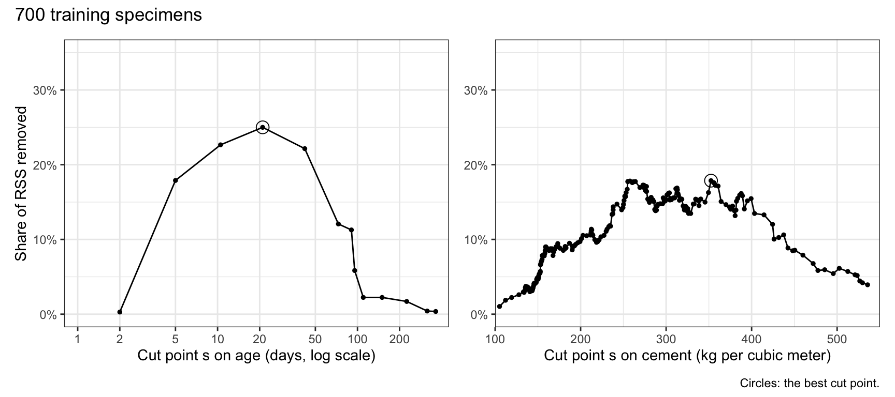{height=520}

::: notes
The figure plots, for every cut point s on age and on cement, the share of the training RSS that the split of all 700 training specimens removes. The best split on age is at s = 21 days, which removes 25.0% of the RSS; the best split on cement is at s = 352.5 kg per cubic meter, which removes 17.9%. With specimens tested at only 14 ages, age has only 13 cut points to check. Over all 8 explanatory variables, the best first split is on age, with cement next (17.9%).
:::

## Recursive binary splitting

1. Start with all the training observations in one region, the **root**
2. In each current region, find the best split $(j, s)$ of the training observations in that region alone, and split
3. Repeat in each new region until a stopping rule holds

::: {.fragment}
- **Greedy**: each split is the best one at its own step
- **Top-down**: from the root to the **leaves**
:::

::: {.fragment}
- Default stopping rules: fewer than 20 observations in a region, a leaf with fewer than 7, a split lowering the RSS by less than 1% of the root's
:::

::: notes
The search is greedy: each split is the best one at its own step, chosen without looking ahead to the splits it makes possible later. It is top-down: it starts from the root and works down. The regions at the end are the leaves, or terminal nodes; the splits are the internal nodes. rpart() stops splitting a region when it holds fewer than 20 training observations (minsplit), when a split would leave a leaf with fewer than 7 (minbucket), or when the best split would lower the tree's RSS by less than 1% of the RSS of the root (the default complexity parameter cp). These are defaults, chosen for speed; the Pruning section chooses the tree's size from the data instead. The tree rpart() grows with these defaults is the default tree.
:::

## Fitting a regression tree

::: {.code-small}
```r
# The default tree on age and cement.
two_fit <- rpart(compressive_strength ~ age + cement, data = train)
two_fit
```

```
n= 700 

node), split, n, deviance, yval
      * denotes terminal node

 1) root 700 188853.400 35.76574  
   2) age< 21 219  35098.050 23.59484  
     4) cement< 354.5 156  11805.220 18.54385  
       8) age< 10.5 113   4471.562 15.02124 *
       9) age>=10.5 43   2246.643 27.80093 *
     5) cement>=354.5 63   9457.747 36.10206  
      10) age< 5 24   1784.060 28.62667 *
      11) age>=5 39   5507.202 40.70231 *
   3) age>=21 481 106544.400 41.30717  
     6) cement< 352.5 378  61539.100 37.40508  
      12) cement< 164.8 81   6032.791 25.56395 *
      13) cement>=164.8 297  41051.690 40.63448  
        26) age< 42 156  20125.900 36.77500  
          52) cement< 257.7 62   6430.345 32.35226 *
          53) cement>=257.7 94  11682.890 39.69213 *
        27) age>=42 141  16031.170 44.90454 *
     7) cement>=352.5 103  18127.390 55.62748 *
```
:::

::: notes
Each line is a node: its number, the split that leads to it, its number of training specimens, its RSS (deviance), and its mean strength (yval). An asterisk marks a leaf. Node 1, the root, holds all 700 specimens, with mean 35.8 MPa. The first split sends the specimens younger than 21 days to node 2 and the rest to node 3, and each node m has children 2m and 2m + 1. A specimen's prediction is the mean of the leaf it reaches. The tree has 9 leaves.
:::

## Regression tree diagram

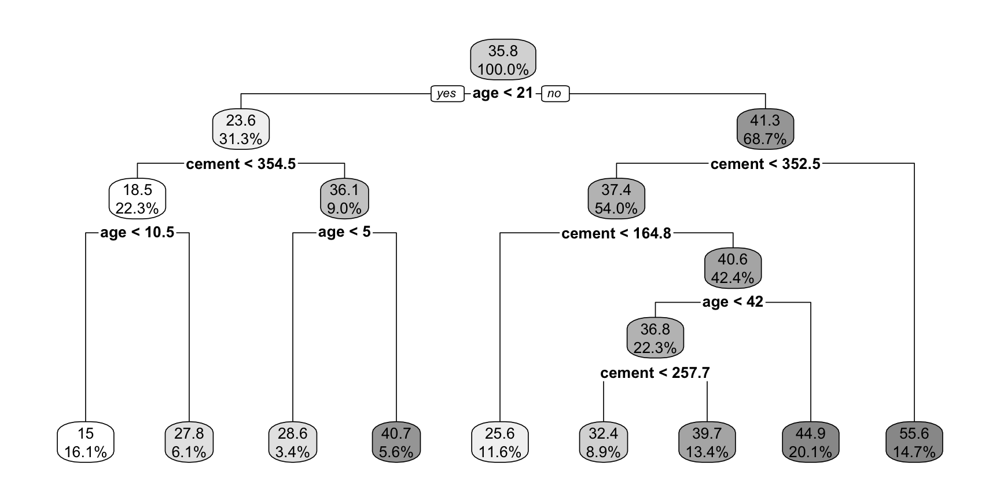{height=570}

::: notes
The diagram draws the same tree. Each box shows a node's mean strength and its share of the training specimens; a specimen goes left when the condition under the box holds.
:::

## Partition

::: {.panel-tabset .mid-tabs}

### One split

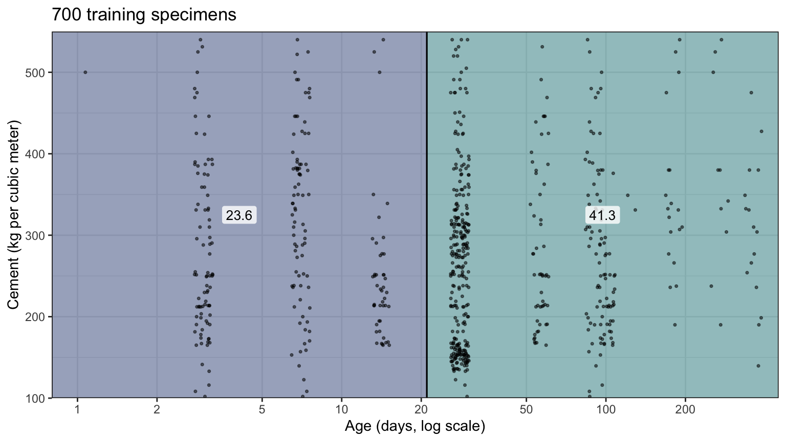

### Two levels

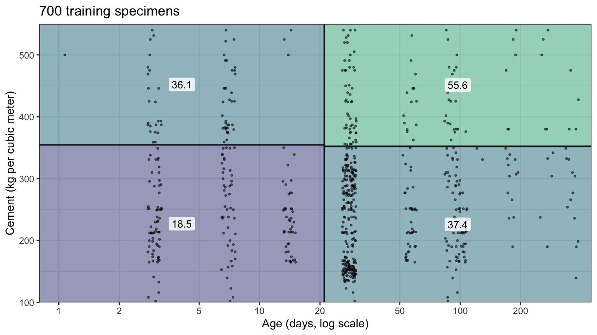

### Three levels

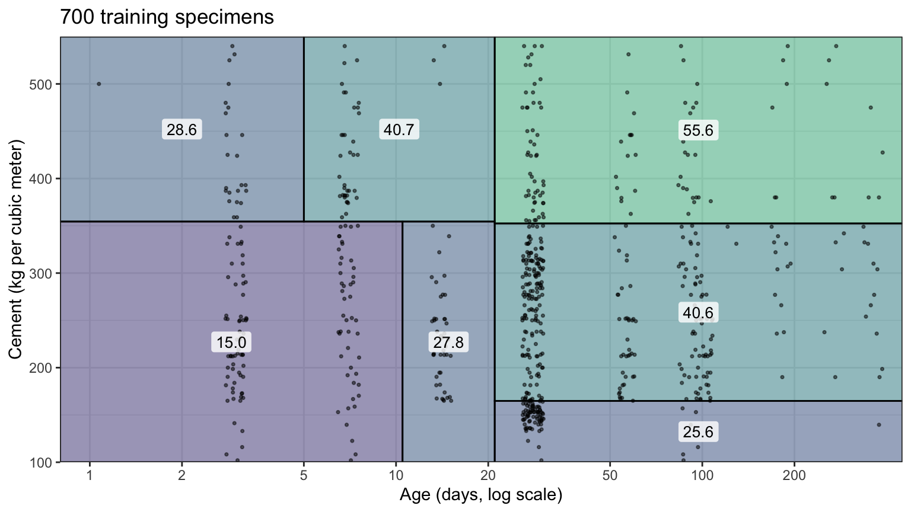

### Four levels

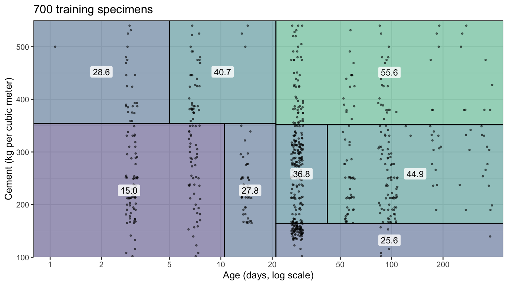

### Fitted tree

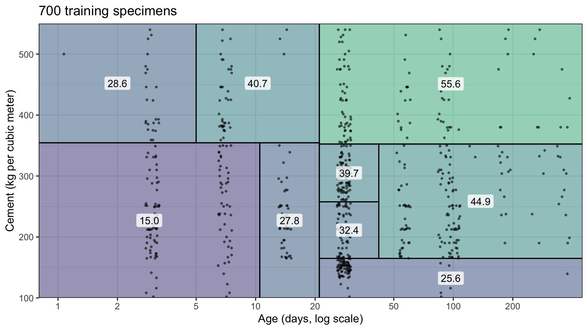

:::

::: notes
The tabs draw the tree's regions over the training specimens, one level of splits at a time; the last tab is the whole fitted tree. Each rectangle is a leaf, labeled with its mean strength. The fitted tree has 5 levels of splits, so its tab is the fifth level. Every boundary is a vertical or horizontal line, and each later split divides only the region it is made in: after the first split on age, the young and the old specimens are split on cement at different cut points. The fitted function is a step function in two explanatory variables, constant on each rectangle and jumping at its edges.
:::

# Pruning

::: notes
This part prunes the tree on age and cement only. With all 8 explanatory variables the full tree's test MSE is no worse than the pruned tree's, as the All explanatory variables slide shows. The default stopping rules ended the tree at 9 leaves; growing it without them gives the full tree T_0.
:::

## Full tree

```r
# The full tree: no threshold on the decrease in RSS, and leaves as small
# as one specimen.
full_control <- rpart.control(cp = 0, minsplit = 2, minbucket = 1)
full_fit <- rpart(compressive_strength ~ age + cement, data = train,
                  control = full_control)

# Number of leaves.
c(leaves = sum(full_fit$frame$var == "<leaf>"))
```

```
leaves 
   564 
```

::: notes
Growing the tree without the stopping rules, until no region can be split, gives the full tree T_0: no threshold on the decrease in RSS (cp = 0), and leaves as small as one specimen (minsplit = 2, minbucket = 1). It has 564 leaves for 700 training specimens.
:::

## Overfitting

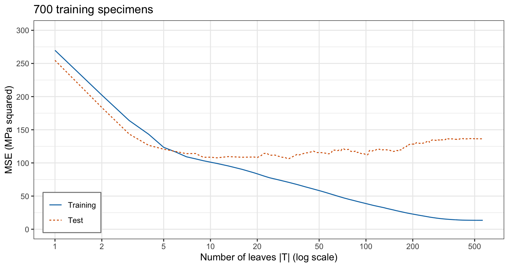{height=560}

::: notes
The figure plots the training and test MSE of the subtrees met while pruning the full tree back to the root, by their number of leaves. The training MSE falls with every added leaf, to 13.5 for the full tree; it is not zero because specimens with the same age and cement but different other ingredients share a leaf. The test MSE reaches its smallest value, 106.5, at 32 leaves and is higher for larger trees, 136.4 for the full tree. Its smallest leaves hold one or a few specimens each, and their means follow those specimens' other ingredients and measurement error, not a pattern that recurs in the test specimens.
:::

## Cost-complexity pruning

::: {style="font-size: 0.7em"}
$$C_\alpha(T) = \sum_{\ell=1}^{|T|}\sum_{i:\, x_i \in R_\ell}\left(y_i - \widehat y_{R_\ell}\right)^2 + \alpha|T|,$$
:::

::: {style="font-size: 0.6em"}
- $T$ — subtree of the full tree $T_0$, some internal nodes turned into leaves
- $|T|$ — number of leaves of $T$; $R_\ell$ — its $\ell$th leaf
- $\alpha$ — tuning parameter, the RSS a leaf must remove to be worth keeping
:::

::: {.fragment}
::: {style="font-size: 0.7em"}
- $\alpha = 0$: the minimizer is $T_0$; larger $\alpha$, fewer leaves, down to the root alone
- `rpart()`: `cp` is $\alpha$ divided by the RSS of the root
:::
:::

::: notes
Stopping early is a poor remedy: a split that removes little RSS can lead to splits below it that remove much more, and a stopping rule never sees them. Cost-complexity pruning instead grows T_0 and cuts it back: for each alpha at least 0 it finds the subtree T of T_0 that minimizes the criterion. Like lambda in ridge regression and the lasso, alpha trades the fit to the training data against a penalty on the model; the penalty counts leaves, as the subset selection criteria count features, rather than measuring the size of estimates. The minimizing subtrees are nested: as alpha increases, the next subtree is found by collapsing the internal node whose removal raises the RSS least per leaf removed (weakest link pruning), so the whole sequence comes from one pass over T_0, one subtree per row of the table on the next slide. rpart() scales the tuning parameter by the RSS of the root, so a split is kept only if it lowers the RSS by at least cp times the root's RSS; the default cp = 0.01 is the stopping rule of the default tree.
:::

## Cross-validation

```r
# The full tree's table, and the rows around its smallest xerror.
cp_table <- full_fit$cptable
best_row <- which.min(cp_table[, "xerror"])
cp_table[best_row + (-2:2), ]
```

```
            CP nsplit rel error    xerror       xstd
17 0.005262351     21 0.2978793 0.4307607 0.02853326
18 0.004928922     22 0.2926170 0.4226674 0.02808284
19 0.003547482     23 0.2876881 0.4076152 0.02743197
20 0.003334777     25 0.2805931 0.4134854 0.02712277
21 0.003269014     26 0.2772583 0.4204379 0.02827351
```

::: notes
While fitting, rpart() also runs 10-fold cross-validation over the sequence of subtrees and stores the results in cptable, which printcp() prints. The full tree's table has one row per subtree; the rows shown are those around the smallest cross-validation estimate. Each row is one subtree of the sequence: CP is the value of cp at which it becomes the minimizer, nsplit its number of splits (one fewer than its number of leaves), rel error its training RSS divided by the root's RSS, and xerror its cross-validation sum of squared errors divided by the root's RSS. xstd is a standard error of xerror.
:::

## Cross-validation curve

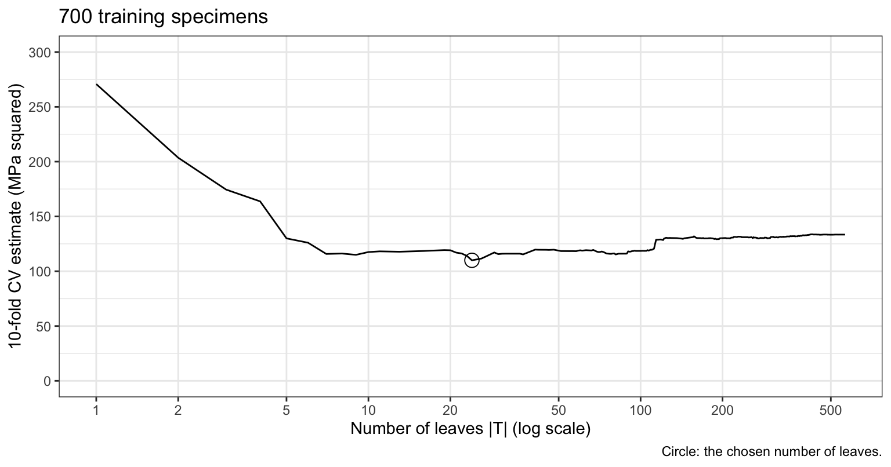{height=560}

::: notes
The figure plots the cross-validation estimate of the MSE, xerror times the root's RSS divided by n. The estimate is smallest, 110.0, at 24 leaves, and it rises for larger trees as the test MSE did. In each fold the full tree is grown from the training folds and pruned with the same values of cp, so the estimate for a value of cp judges the whole procedure, not one particular tree.
:::

## Pruned tree

```r
# Prune the full tree at the cp with the smallest xerror.
cp_best <- cp_table[best_row, "CP"]
pruned_fit <- prune(full_fit, cp = cp_best)

# Test MSE of the full and the pruned tree.
y_test <- test$compressive_strength
c(full = mean((y_test - predict(full_fit, test))^2),
  pruned = mean((y_test - predict(pruned_fit, test))^2))
```

```
    full   pruned 
136.3742 111.5602 
```

::: notes
The full tree is pruned at the cp with the smallest xerror and the full and pruned trees are evaluated once on the test specimens. The pruned tree has 24 leaves and test MSE 111.6, against 136.4 for the full tree, 108.5 for the default tree with 9 leaves, and 172.7 for least squares on age and cement, which fits a straight line in age to a curve. The smallest test MSE of any subtree is 106.5. Pruning at the cross-validation choice removes 83% of the full tree's excess over it. The default tree's test MSE is within 2% of that smallest value: here the default stopping rules happened to stop near the best size.
:::

## Pruned tree regions

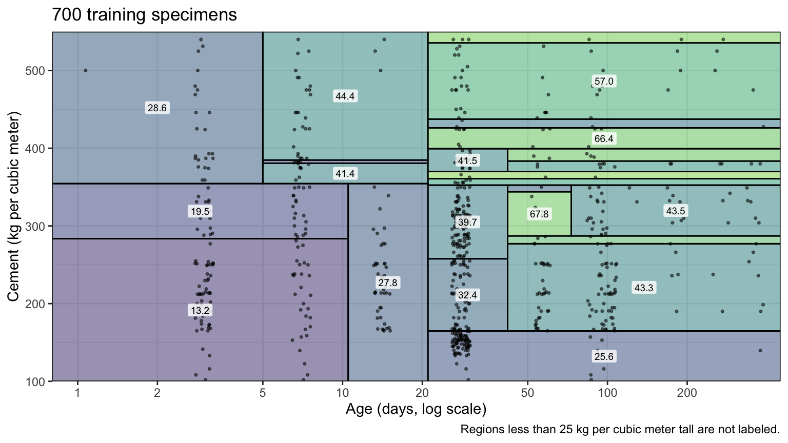{height=570}

::: notes
The figure draws the pruned tree's regions. Its first split is the default tree's, on age at 21 days. Below it, more steps in cement and age divide each side, and some regions are thin bands of cement that hold a few specimens. Regions less than 25 kg per cubic meter tall are not labeled.
:::

## All explanatory variables

::: {.auto-table}
|Method        | Leaves, age and cement| Test MSE, age and cement| Leaves, all 8| Test MSE, all 8|
|:-------------|----------------------:|------------------------:|-------------:|---------------:|
|Least squares |                   none|                    172.7|          none|           106.4|
|Default tree  |                      9|                    108.5|            15|            86.8|
|Full tree     |                    564|                    136.4|           659|            40.3|
|Pruned tree   |                     24|                    111.6|           179|            42.2|
:::

::: notes
The same steps on all 8 explanatory variables: the full tree grown and pruned at the smallest cross-validation estimate, compared with least squares, least squares with log(age) in place of age, and the default tree. With all 8 explanatory variables the pruned tree has 179 leaves and test MSE 42.2, a root mean squared error of 6.5 MPa against a standard deviation of 15.9 MPa among the test strengths; least squares on the same 8 has test MSE 106.4. The default tree, stopped early at 15 leaves, has test MSE 86.8, against 40.3 and 42.2 for the full and pruned trees grown past it: the splits a stopping rule never reaches are where most of the gain is. Pruning changes little here. The cross-validation estimate is within 5% of its smallest value for 517 subtrees, with 54 to 659 leaves, so the choice among large trees is loose, and the full tree's test MSE, 40.3, is no worse than the pruned tree's. On age and cement alone, specimens that share a small leaf still differ in six ingredients the tree cannot see, and the full tree fits those differences. With all 8 recorded, 619 of the full tree's 659 leaves hold a single training specimen, and each of the other 40 holds specimens of the same age; 68% of the test specimens have a mix that some training specimen also has, often at another age. In this chapter, pruning helped more on age and cement alone, which leave much of the strength unexplained, than on all 8 explanatory variables.
:::

# Classification trees

::: notes
A classification tree splits the explanatory variables into regions in the same way and predicts for a region its most common class among the training observations in it.
:::

## Penguin species

- Question: which of three species is a penguin, given four measurements of its body?
- Observation: a penguin
- Response variable: `species`: Adelie, Chinstrap, Gentoo
- Explanatory variables: bill length and bill depth (mm), flipper length (mm), body mass (g)

::: {.fragment}
- Training sample: 240 penguins
- Test penguins: 102
:::

::: notes
modeldata::penguins records 344 penguins of three species from three islands of the Palmer Archipelago, Antarctica. Two penguins have none of the four measurements and are removed, leaving 342. Sex is missing for some of those; sex is not used, so they stay. Island is not used either, because a split on a categorical variable is not covered in this lecture. The training penguins are a random sample of 240; every other penguin is a test penguin.
:::

## Training penguins

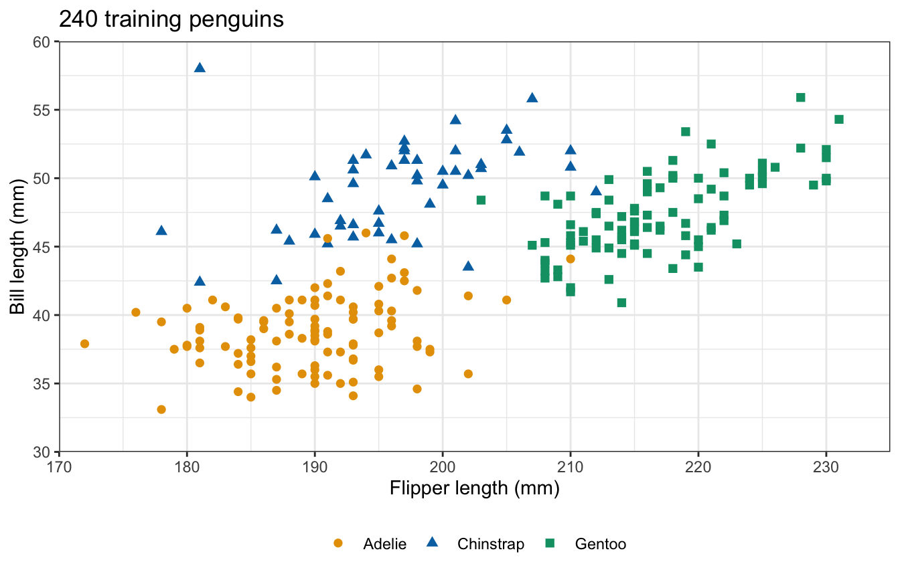{height=570}

::: notes
The training penguins are 102 Adelie, 48 Chinstrap, and 90 Gentoo. Gentoo penguins have the longest flippers, and among the shorter-flippered penguins Chinstrap penguins have longer bills than Adelie penguins. One vertical line and one horizontal line in the left part of the plot would separate the three species, with a few penguins on the wrong side.
:::

## Most common class

::: {style="font-size: 0.75em"}
$$\widehat p_{\ell k} = \frac{1}{n_\ell}\sum_{i:\, x_i \in R_\ell}\mathrm{I}\left(y_i = k\right),$$
:::

::: {style="font-size: 0.6em"}
- $K$ — number of classes, indexed $k = 1, \ldots, K$
- $n_\ell$ — training observations in region $R_\ell$
- $\widehat p_{\ell k}$ — proportion of them in class $k$
:::

::: {.fragment}
::: {style="font-size: 0.7em"}
- Prediction for $R_\ell$: the class $k$ with the largest $\widehat p_{\ell k}$
:::
:::

::: notes
A classification tree splits the explanatory variables into regions in the same way, and predicts for a region its most common class among the training observations in it. The proportions themselves estimate the probability of each class for an observation in R_ℓ. Here K = 3.
:::

## Node impurity

::: {style="font-size: 0.65em"}
$$E_\ell = 1 - \max_k \widehat p_{\ell k}, \qquad G_\ell = \sum_{k=1}^K \widehat p_{\ell k}\left(1 - \widehat p_{\ell k}\right), \qquad D_\ell = -\sum_{k=1}^K \widehat p_{\ell k}\log \widehat p_{\ell k}$$
:::

::: {style="font-size: 0.6em"}
- $E_\ell$ — classification error rate
- $G_\ell$ — Gini index
- $D_\ell$ — entropy, natural log, $0\log 0 = 0$
:::

::: {.fragment}
::: {style="font-size: 0.7em"}
$$\frac{n_1 Q_1 + n_2 Q_2}{n_1 + n_2}$$
:::

::: {style="font-size: 0.6em"}
- Impurity of a split: $Q$ is any of the three, $Q_1$ and $Q_2$ its values in the two regions
:::
:::

::: notes
A regression tree chooses the split with the smallest RSS. A classification tree chooses the split with the smallest impurity, a measure of how mixed the classes in a region are. All three measures are zero when every observation in the region is in one class (a pure node), and largest when the classes are equally common. The impurity of a split is the average of the impurities of its two regions, weighted by their numbers of observations.
:::

## Impurity of a split

|Node             | Adelie| Chinstrap| Gentoo|   n| Error rate| Gini index| Entropy|
|:----------------|------:|---------:|------:|---:|----------:|----------:|-------:|
|Root             |    102|        48|     90| 240|      0.575|      0.639|   1.053|
|flipper < 206.5  |    101|        44|      1| 146|      0.308|      0.431|   0.651|
|flipper >= 206.5 |      1|         4|     89|  94|      0.053|      0.102|   0.234|
|Split (weighted) |       |          |       |    |      0.208|      0.302|   0.488|

::: notes
The best split of the training penguins by the Gini index is on flipper_length_mm at 206.5 mm. The table gives the class counts and the three impurities of the root, of its two children, and of the split. The right child is nearly pure Gentoo, and the left child holds nearly all the Adelie and Chinstrap penguins. The split removes 64% of the root's error rate, 53% of its Gini index, and 54% of its entropy.
:::

## Gini index and entropy

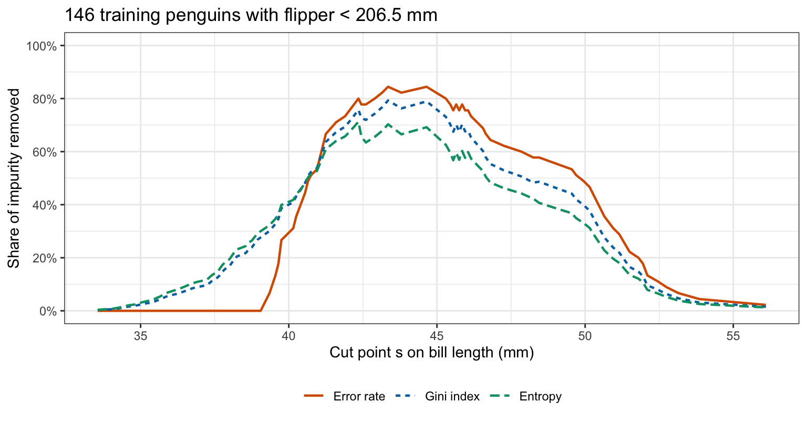{height=560}

::: notes
The figure plots, for every cut point on bill length within the left child, the share of the left child's impurity that a split there removes, by each measure. All three measures are largest near the same cut point, which separates Adelie from Chinstrap. Away from it they differ. At every cut point up to 39.05 mm the error rate removes nothing: both regions keep Adelie as their most common class, so the count of penguins outside it does not change. The Gini index and the entropy still fall at those cut points, because one region becomes purer. The reason is concavity: the Gini index and the entropy are strictly concave functions of the proportions, so by Jensen's inequality the weighted impurity after a split is smaller than before unless the two parts have the same proportions; the error rate is concave but linear wherever the most common class stays the same. A tree grown on the error rate can stop at a split like that, while splits below it would separate the classes. rpart() grows a classification tree with the Gini index by default; parms = list(split = "information") uses the entropy. The error rate is the usual measure for pruning, where the goal is prediction accuracy.
:::

## Fitting a classification tree

```r
# A classification tree on the four measurements.
penguin_fit <- rpart(species ~ bill_length_mm + bill_depth_mm +
                       flipper_length_mm + body_mass_g,
                     data = penguin_train, method = "class")
print(penguin_fit, digits = 4)
```

```
n= 240 

node), split, n, loss, yval, (yprob)
      * denotes terminal node

1) root 240 138 Adelie (0.425000 0.200000 0.375000)  
  2) flipper_length_mm< 206.5 146  45 Adelie (0.691781 0.301370 0.006849)  
    4) bill_length_mm< 43.35 99   2 Adelie (0.979798 0.020202 0.000000) *
    5) bill_length_mm>=43.35 47   5 Chinstrap (0.085106 0.893617 0.021277) *
  3) flipper_length_mm>=206.5 94   5 Gentoo (0.010638 0.042553 0.946809)  
    6) bill_depth_mm>=17.05 7   3 Chinstrap (0.142857 0.571429 0.285714) *
    7) bill_depth_mm< 17.05 87   0 Gentoo (0.000000 0.000000 1.000000) *
```

::: notes
Each line gives a node's number of training penguins, the number not in its most common class (loss), that class (yval), and the class proportions in the order Adelie, Chinstrap, and Gentoo. The tree has 4 leaves and splits on flipper_length_mm, bill_length_mm, and bill_depth_mm; body_mass_g is not used. Its first split is the one in the impurity table.
:::

## Fitted classification tree

::: {.panel-tabset .mid-tabs}

### Diagram

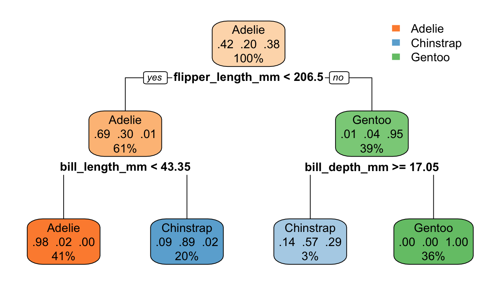

### Regions

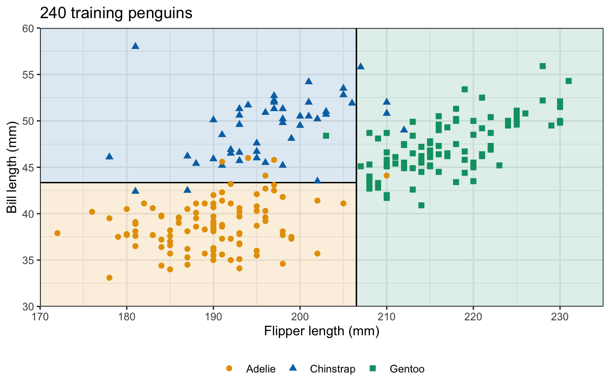

:::

::: notes
The diagram shows the most common class of each node, its class proportions, and its share of the training penguins. The second tab draws the tree's regions over the data plot, each shaded by its predicted species. The region of long flippers is drawn as one rectangle: its split on bill depth, a measurement the plot does not show, is left out.
:::

## Test confusion matrix

```r
# Predicted species of the test penguins, against their species.
penguin_pred <- predict(penguin_fit, penguin_test, type = "class")
confusion <- table(Predicted = penguin_pred,
                   Observed = penguin_test$species)
confusion
mean(penguin_pred == penguin_test$species)
```

```
           Observed
Predicted   Adelie Chinstrap Gentoo
  Adelie        48         3      0
  Chinstrap      1        17      1
  Gentoo         0         0     32
[1] 0.9509804
```

::: notes
The tree classifies 95.1% of the 102 test penguins correctly and misclassifies 5. Predicting the most common species for every penguin would be right for 48.0% of them.
:::

## Pruning a classification tree

```r
# The full classification tree, and its table from two rows above the
# smallest xerror.
penguin_full <- rpart(species ~ bill_length_mm + bill_depth_mm +
                        flipper_length_mm + body_mass_g,
                      data = penguin_train, method = "class",
                      control = full_control)
penguin_cp <- penguin_full$cptable
penguin_best <- which.min(penguin_cp[, "xerror"])
penguin_cp[max(1, penguin_best - 2):nrow(penguin_cp), ]
```

```
           CP nsplit   rel error     xerror       xstd
2 0.275362319      1 0.362318841 0.36231884 0.04559079
3 0.028985507      2 0.086956522 0.12318841 0.02879998
4 0.010869565      3 0.057971014 0.07246377 0.02243258
5 0.007246377      5 0.036231884 0.07246377 0.02243258
6 0.003623188      9 0.007246377 0.07971014 0.02347629
7 0.000000000     11 0.000000000 0.07246377 0.02243258
```

::: notes
A classification tree is pruned in the same way, with the error rate in place of the RSS in the cost-complexity criterion. The rows shown are those of the full tree's table from two above its smallest cross-validation estimate to the full tree. For a classification tree, rel error and xerror are numbers of misclassified training penguins divided by the root's, the 138 penguins that are not Adelie. The smallest cross-validation estimate, 10 misclassified training penguins, is at 4 leaves (4, 6, and 12 leaves tie, and the smallest tree is taken); the default tree has 4. The two trees differ in node 3: the default tree splits it at bill_depth_mm >= 17.05, leaving a leaf of 7 penguins, and the chosen tree at bill_depth_mm >= 17.65, leaving a leaf of 5, which the default minbucket = 7 forbids. The chosen tree classifies 96.1% of the test penguins correctly, against 95.1% for the default tree, 98 of 102 against 97.
:::

# Strengths and weaknesses

::: notes
The strengths are interpretability, and nonlinearity and interactions without feature engineering; the weaknesses are step-function predictions and high variance.
:::

## Interpretability

- Default concrete tree on age and cement: 9 leaves
- Default penguin tree: 4 leaves
- Any number of classes, no change to the method

::: {.fragment}
- Pruned tree on all 8 explanatory variables: 179 leaves
:::

::: notes
A small tree is a list of rules a reader can follow without software. A classification tree handles any number of classes with no change to the method. Interpretability fades with size: the pruned tree on all 8 explanatory variables has 179 leaves, more than anyone reads.
:::

## Nonlinearity and interactions

- Test MSE on all 8 explanatory variables: pruned tree 42.2, least squares 106.4
- Least squares with $\log(\texttt{age})$ in place of age: 48.5

::: {.fragment}
- Default tree on age and cement: younger than 21 days, cement split at 354.5; older, at 164.8, 257.7 and 352.5
:::

::: notes
A tree needs no features built for curvature or interaction. Least squares with log(age) in place of age, a feature chosen after seeing the curve in the data plot, has test MSE 48.5; the tree does better without being told about the curvature. A split on another variable below a split is an interaction: in the default tree on age and cement, the specimens younger than 21 days are split on cement at 354.5 kg per cubic meter, and the older ones at 164.8, 257.7, and 352.5, so the step in strength that cement makes depends on age.
:::

## Step functions

::: {.panel-tabset .mid-tabs}

### Tree and least squares

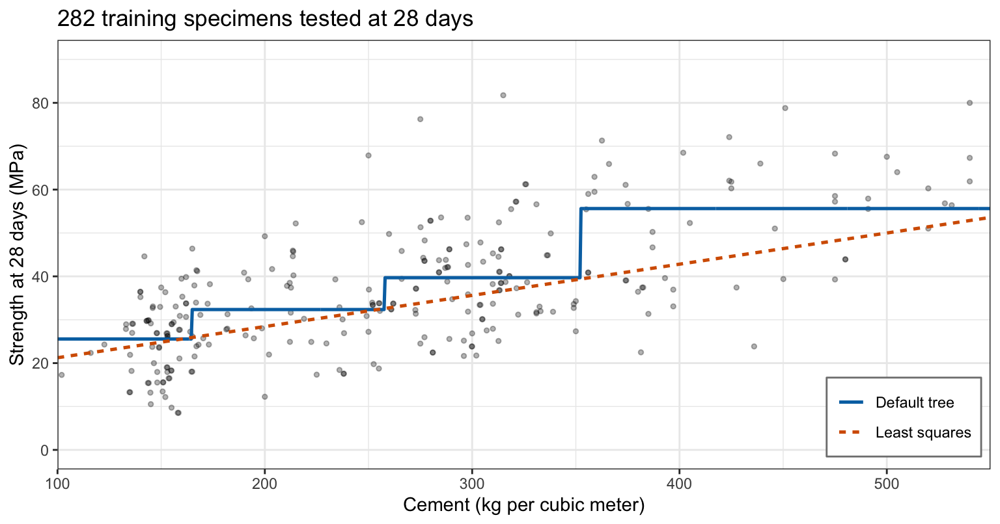

### Trees on halves

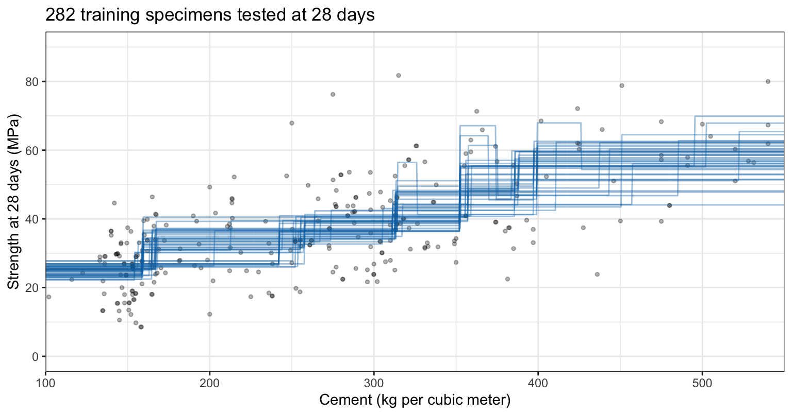

:::

::: notes
A halving splits the 700 training specimens at random into two halves of 350. The tabs plot predicted strength at 28 days against cement, over the training specimens tested at that age. The first tab draws the default tree and least squares on age and cement, fit to all 700 training specimens; the second draws the default trees fit to the 40 halves of 20 halvings. The tree's prediction is flat between cut points and jumps at each one, so two mixes on either side of a cut point get different predictions however close they are, and two mixes far apart within a region get the same one. Least squares draws a straight line through the same specimens. The trees on halves differ in where they put their steps and how high each step is.
:::

## Instability

::: {.panel-tabset .mid-tabs}

### First half

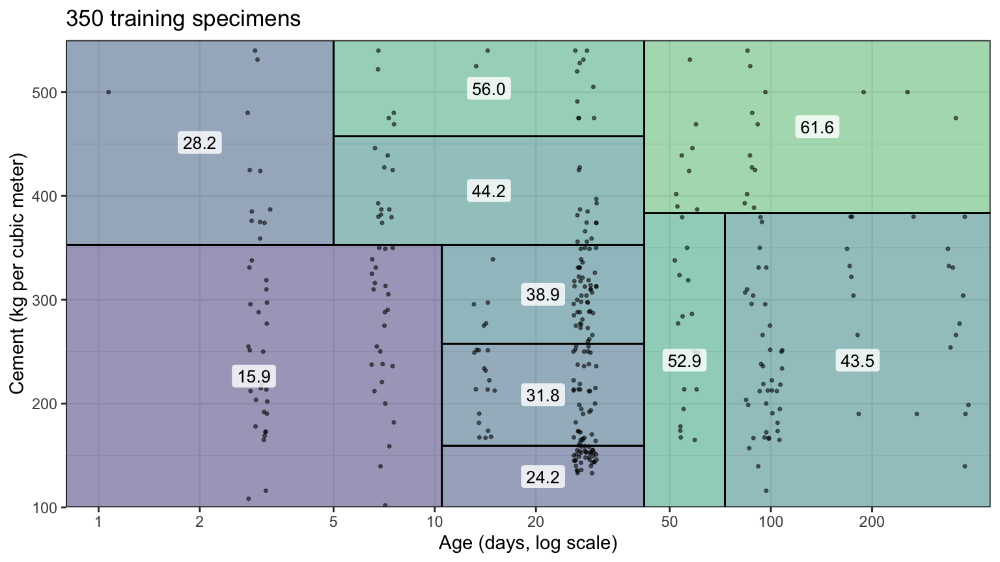

### Second half

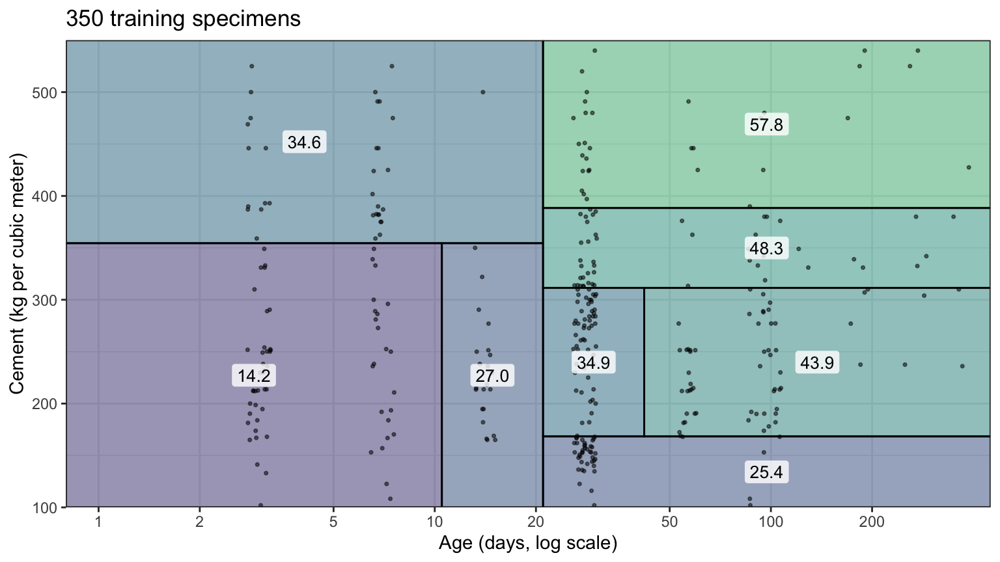

:::

::: notes
The tabs draw the regions of the two trees of one halving, each over its own half of the training specimens: the first halving, in the order drawn, whose two trees split first in different places. The tree on the first half splits first on age < 42 and has 10 leaves; the tree on the second half splits first on age < 21 and has 8. Each later split is made inside a region the first split creates, so the two partitions differ throughout. Over 200 random halvings, the two halves split first at the same place 50% of the time; the most common first split, age < 21, is the first split of 74% of the 400 trees. Their predictions for a test specimen differ by 6.2 MPa on average (root mean square over the test specimens, averaged over the halvings). Least squares fits to the same halves differ by 1.6 MPa. A tree has high variance: each split is chosen from the data and a different first or second split changes every split below it.
:::

## Conclusion

- A tree predicts a constant in each rectangle: the mean, or the most common class
- Recursive binary splitting is greedy and top-down
- Gini index or entropy, not the error rate, grows a classification tree
- Cross-validated pruning sets the size of the tree
- Small trees are readable and capture nonlinearity and interactions
- Predictions are step functions with high variance

::: notes
A decision tree divides the values of the explanatory variables into rectangular regions and predicts a constant in each: the mean training response of the region for a regression tree, and its most common class for a classification tree, whose class proportions estimate the class probabilities. It splits on the explanatory variables as recorded, so it needs no features built by hand. The regions are grown by recursive binary splitting, a greedy, top-down search; each split minimizes the RSS of the two new regions or, for classes, the weighted Gini index or entropy, which, unlike the classification error rate, are strictly concave in the class proportions and so reward any split that makes a region purer. Cost-complexity pruning minimizes the training RSS (or error) plus alpha times the number of leaves, which gives a nested sequence of subtrees from the full tree at alpha = 0 to the root; cp in rpart() is chosen by 10-fold cross-validation and the chosen tree evaluated once on test data. Trees are easy to read when they are small, capture nonlinearity and interactions without feature engineering, and handle any number of classes. Their predictions are step functions, and they have high variance: a different training sample can change the first splits and, through them, every region below.

The next lecture reduces that variance by averaging many trees: bagging fits a tree to each of many bootstrap samples, and random forests also restrict each split to a random subset of the explanatory variables.
:::
