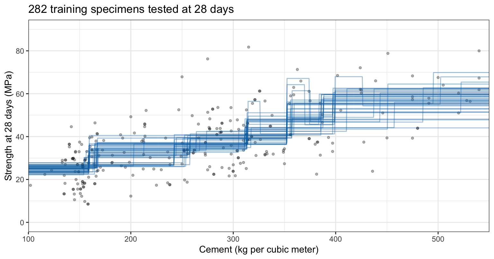
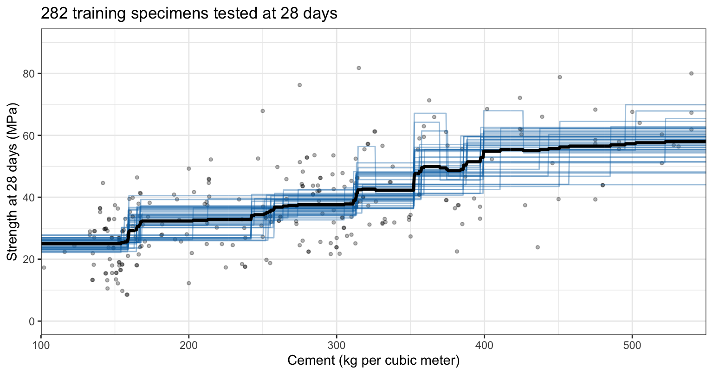
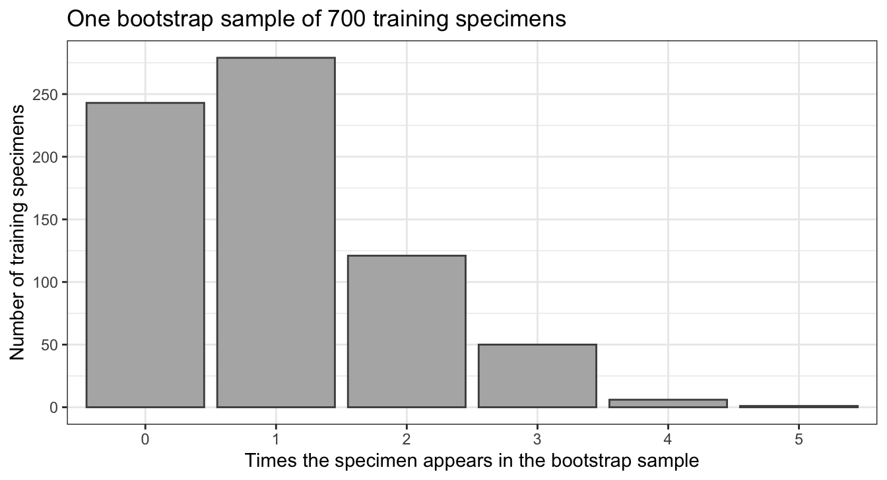
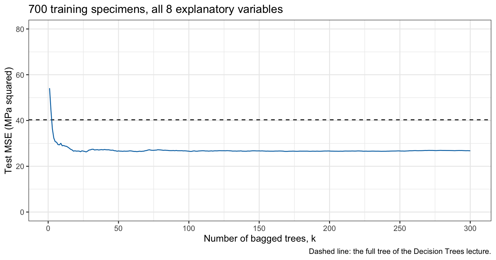
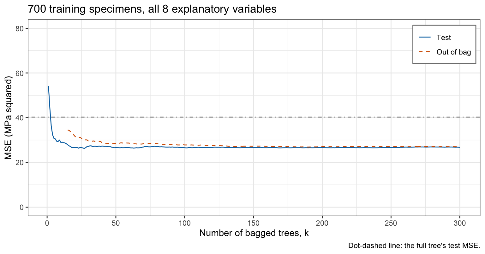
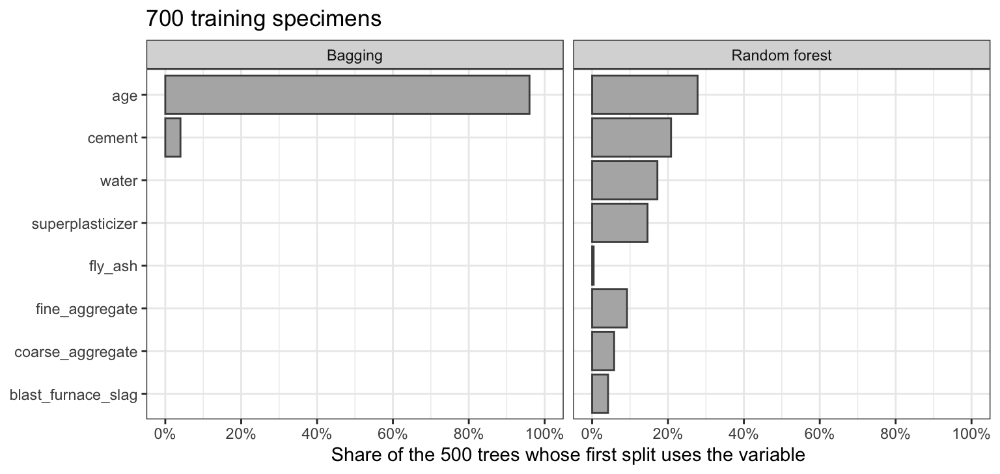
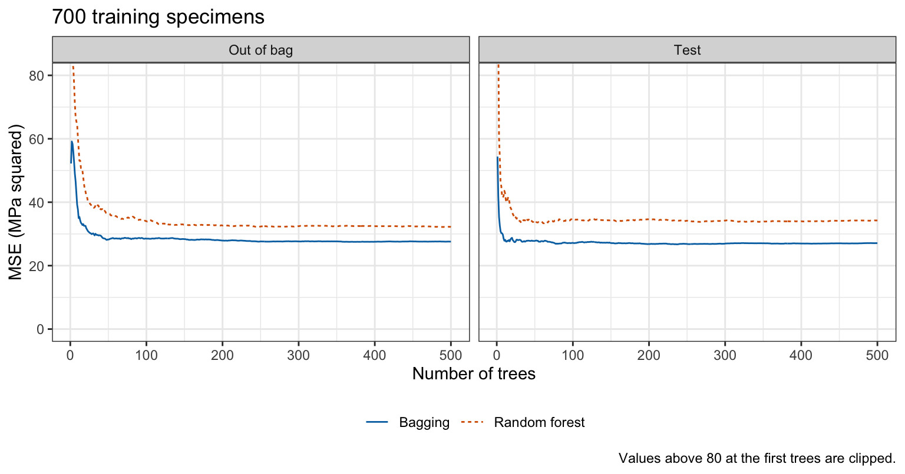
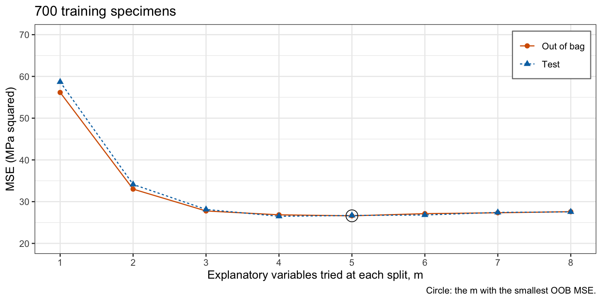
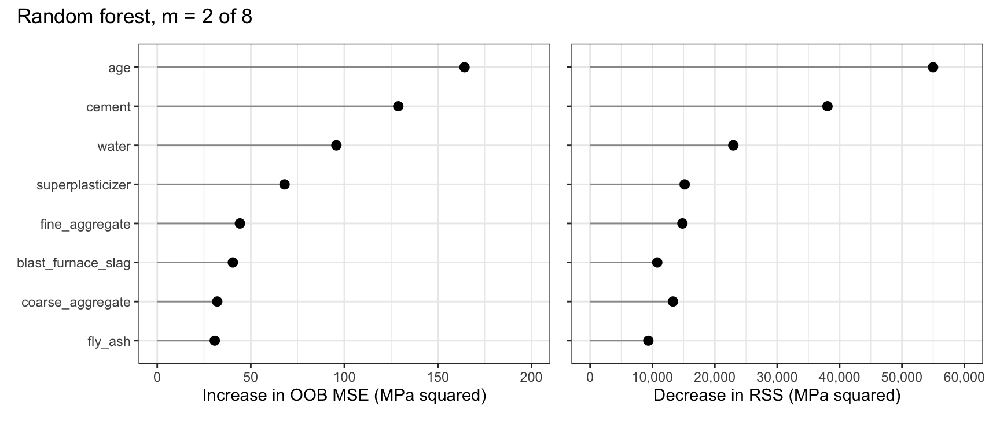
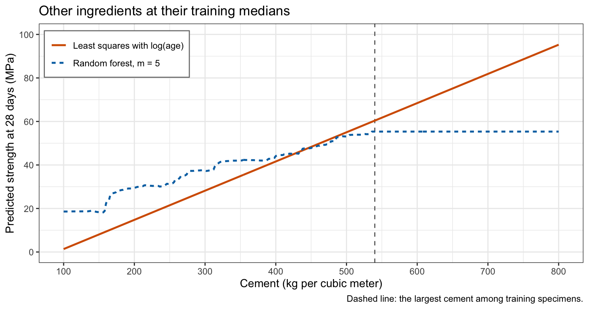

## Today

<!-- derived-from: 08-trees/20-bagging-and-random-forests.qmd @ 5524cc4 -->

::: {.columns}
::: {.column width="34%"}
- Data
- Bagging
  - Unstable trees
  - Averaging
  - Bootstrap samples
  - Bagged trees
- Out-of-bag error
  - Out-of-bag prediction
  - Out-of-bag and test error
:::
::: {.column width="33%"}
- Random forests
  - Definition
  - Correlated trees
  - Split restriction
  - Fitting a random forest
  - Forest size
  - Choosing $m$
:::
::: {.column width="33%"}
- Variable importance
  - Two measures
  - Interpretation
- Comparison
  - Test error
  - Extrapolation
  - Interpretability and cost
:::
:::

::: notes
Distilled from the chapter's six learning objectives and the slides this deck spends time on: the variance of an average of B predictions with common variance and pairwise correlation, and why averaging trees reduces variance and helps less when the trees are correlated; bagging (a full tree per bootstrap sample, predictions averaged), the share of observations a bootstrap sample leaves out, and bagging written with rpart(); the out-of-bag prediction and error as an estimate of test error without held-out data; a random forest that decorrelates its trees by choosing among m random explanatory variables at each split, fit with randomForest(), with m and the number of trees chosen from the out-of-bag error; the two variable importance measures as rankings without direction or effect size; and the comparison with a single tree and with least squares on test error, interpretability and behavior outside the range of the training data. The one-tree split counts are an optional slide and are not in the agenda. The left-out counts, the forest-size table, the Beyond this course callout and the hand-off to the next lecture are in the notes and not in the agenda. The Decision Trees lecture ended with a weakness: trees fit to different training samples differ, in their regions and in their predictions. This lecture averages many trees to reduce that variance; the reading is ISLR2 Sections 8.2.1 and 8.2.2.

Timing: the core slides come to about 45 minutes; the outline lists the order in which to drop the rest.
:::

# Data

::: notes
The data and splits are those of the Decision Trees lecture, so its numbers can be compared with this lecture's. Question: with the same data, can an average of many trees predict the compressive strength of concrete better than one tree can?
:::

## Concrete specimens

::: {style="font-size: 0.75em"}
- Response: `compressive_strength`
- Explanatory variables:
  - `cement`
  - `blast_furnace_slag`
  - `fly_ash`
  - `water`
  - `superplasticizer`
  - `coarse_aggregate`
  - `fine_aggregate`
  - `age`
:::

::: {style="font-size: 0.75em; margin-top: 1em"}
- Training specimens: 700
- Test specimens: 305
:::

::: notes
modeldata::concrete records the compressive strength (MPa) of concrete specimens with 7 ingredient amounts (kg per cubic meter) and the age (days) as explanatory variables, p = 8 in all. Exact duplicate rows are removed, and the training specimens are a random sample, the first random draw after set.seed(20261031), as in the Decision Trees lecture. A collapsed callout in the chapter recomputes that lecture's test results to confirm the split: on the concrete test specimens, test MSE 106.4 for least squares with main effects only, 48.5 for the same main effects with log(age) in place of age, 86.8 for the default tree, and 40.3 and 42.2 for the full and pruned trees.
:::

# Bagging

::: notes
Bagging fits each tree to a bootstrap sample of the training data. This part shows why averaging trees helps, defines a bootstrap sample and the bagged prediction, and writes the algorithm out with rpart().
:::

## Unstable trees

::: {.panel-tabset .mid-tabs}

### Halves



### Their average



:::

::: notes
The earlier lecture split the training specimens at random into two halves of 350, a halving, and fit the default tree on age and cement to each half. The chapter repeats this for new halvings. The first tab plots the predicted strength at 28 days against cement of the trees from the first few of them, over the training specimens tested at 28 days; the second adds their average. The 40 trees, from 20 halvings, put their steps in different places, and at a given cement content their predictions span up to 29.9 MPa. Over all 200 halvings, the most common first split, age < 21, is the first split of 74% of the 400 trees. The average of the 40 curves in the second tab is smoother than any one of them: it still steps, but in many small steps.
:::

## Averaging

::: {style="font-size: 0.75em"}
$$
\begin{aligned}
Var\left[\frac{1}{B}\sum_{b=1}^B \widehat f_b(x)\right]
&= \frac{1}{B^2}\left\{\sum_{b=1}^B Var\left[\widehat f_b(x)\right] + \sum_{b \ne b'} Cov\left[\widehat f_b(x), \widehat f_{b'}(x)\right]\right\} \\
&= \frac{B\sigma^2 + B\left(B - 1\right)\rho\sigma^2}{B^2}
= \rho\sigma^2 + \frac{1 - \rho}{B}\sigma^2.
\end{aligned}
$$
:::

::: {style="font-size: 0.7em"}
- $B$ — number of predictions averaged, $b = 1, \ldots, B$
- $\sigma^2$ — variance of one prediction at $x$
- $\rho$ — correlation between two of them
:::

::: notes
At 300 kg of cement per cubic meter and 28 days, the 40 trees above predict between 32.7 and 42.5 MPa, with standard deviation 2.6; their average is 37.6. The variance of such an average follows from the variance and correlation of the predictions it averages. Let the B predictions at the same x each have variance sigma squared, with correlation rho between any two; sigma squared is the variance of one prediction at x in this lecture, not the error variance of a regression model. With independent predictions, rho = 0, the variance falls like 1/B. With correlated ones it falls toward rho sigma squared, the term that does not depend on B.
:::

## Bootstrap samples

::: {style="font-size: 0.8em"}
- Bootstrap sample
  - $n$ training observations
  - $n$ draws
  - with replacement
:::

::: {.fragment}
::: {style="font-size: 0.8em"}
- Probability that a given observation is missed by all $n$ draws

  $$\left(1 - \frac{1}{n}\right)^n \to e^{-1} \approx 0.368$$
:::
:::

::: notes
There is one training sample, not B. Bagging, short for bootstrap aggregation, makes B training samples from it by resampling, as in the optional Bootstrap lecture, which was not taught this semester: each bootstrap sample draws n observations from the n training observations at random with replacement. A given observation is missed by one draw with probability 1 − 1/n, and by all n independent draws with probability (1 − 1/n)^n; the limit, as n goes to infinity, is the case x = −1 of (1 + x/n)^n → e^x. For n = 700 the probability is 0.368. A bootstrap sample therefore contains about 63% of the distinct training observations, some of them more than once.
:::

## Appearances in a bootstrap sample

{height=540}

::: notes
The figure counts, for one bootstrap sample of the 700 training specimens, how many specimens appear 0, 1, 2, ... times. This bootstrap sample leaves out 243 of the 700 training specimens, 34.7%.
:::

## Bagged trees

::: {style="font-size: 0.75em"}
$$\widehat f_{\text{bag}}(x) = \frac{1}{B}\sum_{b=1}^B \widehat f^{*b}(x),$$
:::

::: {style="font-size: 0.7em"}
- $\widehat f^{*b}(x)$ — prediction at $x$ of the tree fit to bootstrap sample $b$
- $\widehat f_{\text{bag}}(x)$ — bagged prediction
:::

::: {.fragment}
::: {style="font-size: 0.7em"}
- Trees grown full, not pruned
:::
:::

::: notes
Bagging fits a tree to bootstrap sample b, for b = 1, ..., B, and predicts with their average; the star marks a quantity computed from a bootstrap sample. The trees are grown full and not pruned: each has low bias and high variance, and the average removes much of the variance.
:::

## Bagging from scratch

```r
# Bagging from scratch: B full trees, each fit to a bootstrap sample.
B <- 300
grow <- rpart.control(cp = 0, minsplit = 2, minbucket = 1, xval = 0)
boots <- map(seq_len(B), \(b) sample(n_train, replace = TRUE))
trees <- map(boots, \(boot) {
  rpart(compressive_strength ~ ., data = train[boot, ], control = grow)
})
tree_pred <- sapply(trees, predict, newdata = test)
c(test_mse = mean((y_test - rowMeans(tree_pred))^2))
```

```
test_mse 
26.76253 
```

::: notes
The chunk writes the bagging algorithm out with rpart(): B = 300 full trees on all 8 explanatory variables, each fit to its own bootstrap sample of the training specimens. xval = 0 skips the cross-validation that rpart() would otherwise run in each fit; nothing is pruned. tree_pred holds one column of test predictions per tree, and the bagged prediction averages each row. The test MSE of the average of the 300 trees is 26.8.
:::

## Bagged trees: test MSE

{height=560}

::: notes
The figure plots the test MSE of the average of the first k trees, k = 1, ..., B, against k, with the full tree fit to all the training specimens as a dashed line. A single tree fit to a bootstrap sample has test MSE between 47.7 and 102.2; every one is above the full tree's 40.3, and each sees only about 63% of the distinct specimens. Averaging brings the test MSE to 26.8 with 300 trees, and from k = 15 on it stays within 5% of that value: what remains of the variance is the rho sigma squared term, which more trees do not reduce. The curve does not trend upward as trees are added: after k = 15 it stays between 26.3 and 27.9, so adding trees does not overfit.
:::

# Out-of-bag error

::: notes
The observations a bootstrap sample leaves out give each training observation a prediction from trees that never saw it. This part defines the out-of-bag prediction and compares the out-of-bag error with the test error.
:::

## Out-of-bag prediction

::: {style="font-size: 0.75em"}
$$\text{MSE}_{\text{OOB}} = \frac{1}{n}\sum_{i=1}^n \left(y_i - \widehat f_{\text{OOB}}(x_i)\right)^2,$$
:::

::: {.fragment}
::: {style="font-size: 0.75em"}
$$\widehat f_{\text{OOB}}(x_i) = \frac{1}{\left|\mathcal{O}_i\right|}\sum_{b \in \mathcal{O}_i} \widehat f^{*b}(x_i),$$
:::

::: {style="font-size: 0.6em"}
- $\mathcal{O}_i$ — bootstrap samples that leave out observation $i$; $\left|\mathcal{O}_i\right|$ — their number
- $\widehat f_{\text{OOB}}(x_i)$ — OOB prediction of observation $i$
:::
:::

::: notes
Each bootstrap sample of the loop leaves some training specimens out; the first five leave out between 243 and 274 of the 700 training specimens, and the tree fit to each never saw them. The out-of-bag (OOB) prediction of a training specimen averages the predictions of only the trees whose bootstrap samples left it out, the trees that never saw it. Every training observation is predicted by trees that did not use it, as a held-out fold is in cross-validation, but the OOB error comes from the bagged fit itself, with no refitting. The two displays are one display in the chapter, split at its line break.
:::

## Out-of-bag prediction in R

```r
# Each tree's predictions for the training specimens; each specimen's OOB
# prediction averages the trees that left it out.
train_pred <- sapply(trees, predict, newdata = train)
oob_pred <- rowSums(train_pred * out_of_bag) / rowSums(out_of_bag)
c(oob_mse = mean((y_train - oob_pred)^2))
```

```
 oob_mse 
27.03195 
```

::: notes
Computed from the 300 trees of the loop: train_pred holds each tree's predictions for the training specimens, and each specimen's OOB prediction averages the trees that left it out. The OOB MSE is 27.0.
:::

## Out-of-bag and test error

{height=560}

::: notes
The figure plots the OOB MSE and the test MSE of the first k trees against k. Over the 300 trees, a training specimen is out of bag for between 30% and 45% of them, on average 36.9%. Every specimen has at least one out-of-bag tree among the first k from k = 15 on. With 300 trees the OOB MSE is 27.0 and the test MSE 26.8. The OOB MSE is above the test MSE at every value of k from 15 to 300, by up to 6.9, most for few trees, where each specimen's OOB prediction averages only a handful of trees. As with the test specimens in the Decision Trees lecture, the OOB error here measures predictions for mixes like those tested: 74% of the training specimens share their mix with another training specimen, often tested at another age, and 68% of the test specimens have a mix that some training specimen also has.
:::

# Random forests

::: notes
Bagged trees tend to make the same strong splits, so they are correlated and the rho sigma squared term remains. A random forest lets each split choose among only m randomly chosen explanatory variables, which decorrelates the trees at some cost in the accuracy of each. This part defines a random forest, shows the correlation, defines the restriction, fits a forest, and chooses the number of trees and m.
:::

## Definition

::: {style="font-size: 0.85em"}
- **Bootstrap samples**: each tree is fit to its own bootstrap sample of the training data
- **Averaging**: the forest predicts with the average of its trees' predictions
- **Random variable inclusion**: at each split, the tree chooses among only a random subset of the explanatory variables
:::

::: {.fragment}
::: {style="font-size: 0.85em"}
- Bagged trees have the first two; the third is the change a random forest makes
:::
:::

::: notes
A random forest combines three ingredients. Bootstrap samples: each tree is fit to its own bootstrap sample of the training data. Averaging: the forest predicts with the average of its trees' predictions, or by majority vote for a class. Random variable inclusion: at each split, the tree chooses among only a random subset of the explanatory variables. Bagged trees have the first two ingredients; the third is the one change a random forest makes to them.
:::

## Correlated trees

{height=540}

::: notes
The figure counts the first split of each tree in two forests of 500 trees fit to all the training specimens with randomForest(): bagging, which may split on any of the 8 explanatory variables, and the random forest with randomForest()'s default m, defined below. In bagging, 96% of the trees split first on age; in the random forest, 28% do. Bagged trees are fit to overlapping samples of the same training data and nearly all begin with the same split.
:::

## Split restriction

::: {style="font-size: 0.8em"}
- At each split, a tree may use only $m$ of the $p$ explanatory variables, chosen at random anew for that split
  - $p$ — number of explanatory variables
  - $m \le p$ — number tried at each split
:::

::: {.fragment}
::: {style="font-size: 0.8em"}
- $m = p$ is bagging
:::
:::

::: {.fragment}
::: {style="font-size: 0.8em"}
- Default `randomForest()`: $m = \lfloor p/3 \rfloor$ for a numeric response
:::
:::

::: notes
The random subset of explanatory variables is the third ingredient of a random forest. A strong explanatory variable such as age is not available at many splits, including the first split of many trees, so the trees differ more, at the cost of some accuracy in each tree. For the 8 concrete explanatory variables the default is m = 2. By its default nodesize, randomForest() does not split a node with 5 or fewer observations, so its regression trees are nearly, not exactly, full.
:::

## Split restriction: correlation

::: {.auto-table}
|Method        | $m$| $\widehat\sigma^2$| $\widehat\rho$| $\widehat\rho\widehat\sigma^2$|
|:-------------|---:|--------------:|----------:|----------------------:|
|Bagging       |   8|             62|       0.09|                    5.8|
|Random forest |   2|            105|       0.04|                    4.4|
:::

::: {style="font-size: 0.7em"}
- $\widehat\sigma^2$ and $\widehat\rho\widehat\sigma^2$: averages over the 305 test specimens of values at one $x$
:::

::: {.fragment}
::: {style="font-size: 0.7em"}
- Restriction: lower $\widehat\rho$, higher $\widehat\sigma^2$
:::
:::

::: notes
The correlation rho and the variance sigma squared can be estimated from the data, for trees fit to 350 specimens (a half), across 100 random halvings of the training specimens: for each halving, a forest of 100 trees is fit to the first half, with m = p and with the default m. At each test specimen, the variance of one tree's prediction splits into two parts: the variance across halvings of the expected prediction of a forest, shared by all its trees, and the variance among the trees of one forest. These are values at one x, the explanatory variables of one test specimen. The table averages them over the 305 test specimens: the variance of one tree is the average of the sum of the two parts, rho times sigma squared is the average of the first part, and rho is their ratio. With m = p the estimate of rho is 0.09; with m = 2, 0.04. For these data the restriction lowers the correlation between trees and raises the variance of one tree, from 62 to 105: it randomizes each tree's splits, so the trees differ more, and each tree is a more variable predictor. The part that no number of trees removes, rho times sigma squared, is 5.8 for bagging and 4.4 for the random forest. These are variances for trees fit to 350 specimens (a half), across halvings of the 700 training specimens, which overlap, not across independent training samples; and they say nothing about bias. The restriction also changes each tree: in the forests of 500 trees fit to all 700 training specimens, a single tree has mean test MSE 68.2 with m = p and 111.9 with m = 2.
:::

## Fitting a random forest

::: {.code-wrap}
```r
# A random forest with the default m and number of trees, and its test MSE.
rf_fit <- randomForest(compressive_strength ~ ., data = train,
                       importance = TRUE)
rf_fit
c(test_mse = mean((y_test - predict(rf_fit, test))^2))
```

```

Call:
 randomForest(formula = compressive_strength ~ ., data = train,      importance = TRUE) 
               Type of random forest: regression
                     Number of trees: 500
No. of variables tried at each split: 2

          Mean of squared residuals: 32.1988
                    % Var explained: 88.07
test_mse 
34.24721 
```
:::

::: notes
The printout gives the number of trees, the m used (variables tried at each split), the OOB MSE (mean of squared residuals), 32.2, and "% Var explained", one minus the OOB MSE divided by the variance (divisor n) of the training responses. The test MSE is 34.2. The slide is the chapter's Fitting subsection of Random forests.
:::

## Forest size

{height=560}

::: notes
The figure plots the OOB MSE and the test MSE of randomForest()'s bagging (m = p) and its random forest (default m) against the number of trees. randomForest() computes the OOB MSE after k trees from the specimens with at least one out-of-bag tree among them, so its curves start at one tree. The chapter's table gives the number of trees from which each curve stays within 5% and within 2% of its value with 500 trees; the slowest to settle within 5% is the out-of-bag curve of the random forest, at 111 trees, so 500 trees are enough here. With 500 trees, bagging has OOB MSE 27.6 and test MSE 27.1, and the random forest with m = 2 has 32.2 and 34.2. The OOB MSE is above the test MSE from 2 trees on for bagging, and below the test MSE from 95 trees on for the random forest. On these data the default m predicts worse than bagging. The restriction lowered the variance that averaging cannot remove, rho sigma squared, from 5.8 to 4.4, yet the forest's test MSE rose from 27.1 to 34.2, and its OOB MSE moved the same way, from 27.6 to 32.2. The increase is mostly bias: with m = 2 a tree often cannot split on the variables that matter most, and averaging does not remove that.
:::

## Choosing $m$

{height=560}

::: notes
The OOB MSE chooses m without the test data. The figure plots the OOB and test MSE of a forest of 500 trees for each m from 1 to 8. The OOB MSE is smallest at m = 5, 26.6, and that forest's test MSE is 26.7. With m = 1 each split is on one variable chosen at random, and both errors are highest, 56.2 and 58.7. Every m from 3 to 8 has an OOB MSE within 5% of the smallest, so the choice among them matters little.
:::

# Variable importance

::: notes
A forest of hundreds of trees has no single diagram to read, so it is summarized by two importance measures instead.
:::

## One tree

```r
# The default tree on all eight explanatory variables, and the number of
# its splits on each variable.
one_tree <- rpart(compressive_strength ~ ., data = train)
split_vars <- as.character(one_tree$frame$var)
table(split_vars[split_vars != "<leaf>"])
```

```

               age blast_furnace_slag             cement              water 
                 5                  2                  4                  3 
```

::: notes
A single tree shows which explanatory variables it uses. The chunk refits the default tree of the Decision Trees lecture on all 8 explanatory variables and counts its splits on each. The tree never splits on fly_ash, superplasticizer, coarse_aggregate, and fine_aggregate.
:::

## Two measures

::: {style="font-size: 0.8em"}
- **Decrease in RSS** (`IncNodePurity`)
  - total decrease from the splits on the variable in a tree, averaged over the trees
- **Permutation importance** (`%IncMSE`)
  - increase in a tree's OOB MSE when the variable is shuffled among its OOB observations, averaged over the trees
:::

::: notes
Both measures are computed by randomForest() with importance = TRUE. The permutation importance shuffles the variable's values among the tree's out-of-bag observations with the tree not refit, which breaks the variable's relation to the response. With scale = FALSE the increase is in the units of the MSE; by default importance() divides it by its standard error.
:::

## Two measures in R

```r
# Both importance measures, the permutation increase in MPa squared.
importance(rf_fit, scale = FALSE)
```

```
                     %IncMSE IncNodePurity
cement             128.80824     38055.659
blast_furnace_slag  40.40708     10765.080
fly_ash             30.74548      9337.777
water               95.72834     22962.469
superplasticizer    68.02636     15163.163
coarse_aggregate    32.06984     13284.344
fine_aggregate      44.18691     14802.340
age                164.19623     54983.954
```

::: notes
Both importance measures of the random forest of the Fitting slide, the permutation increase in MPa squared. The eight rows are the explanatory variables.
:::

## Importance by variable

{height=500}

::: notes
The figure plots both measures for the random forest of the Fitting subsection of Random forests, the variables in the order of the permutation measure. By permutation importance the order is age, cement, water, superplasticizer, fine_aggregate, blast_furnace_slag, coarse_aggregate, and fly_ash; by the decrease in RSS it is age, cement, water, superplasticizer, fine_aggregate, coarse_aggregate, blast_furnace_slag, and fly_ash. Both put age first. In the forest every variable has a positive decrease in RSS, so every one is split on somewhere, including those the single tree never used: with m = 2, a given variable is among those tried at a split with probability m/p = 0.25, so the strongest are often unavailable.
:::

## Interpretation

- Importance ranks the variables
- No direction
- No effect size

::: notes
A large importance for water says that the forest relies on it, through large decreases in RSS or through worse out-of-bag predictions when its values are shuffled, not whether concrete gets stronger or weaker as water increases, with the others fixed, or by how much. The two measures order the variables differently here: they measure different things, the fit to the training data within each tree and the loss of out-of-bag accuracy when the variable is shuffled.
:::

# Comparison

::: notes
This part compares bagging and random forests with a single tree and with least squares on test error, behavior outside the range of the training data, and interpretability and cost.
:::

## Test error

::: {.auto-table}
::: {style="font-size: 0.85em"}
|Method                                | Test MSE|
|:-------------------------------------|--------:|
|Least squares, main effects           |    106.4|
|Least squares, main effects, log(age) |     48.5|
|Default tree                          |     86.8|
|Pruned tree                           |     42.2|
|Full tree                             |     40.3|
|Bagging, rpart() loop                 |     26.8|
|Bagging, randomForest()               |     27.1|
|Random forest, m = 2                  |     34.2|
|Random forest, m = 5                  |     26.7|
:::
:::

::: {style="font-size: 0.7em"}
- Least squares: no interactions or polynomial terms
:::

::: notes
The table gives the test MSE on the concrete test specimens. Both least squares fits have main effects only: each explanatory variable enters linearly, with no interactions or polynomial terms, and the second replaces age by log(age). Least squares with quadratic terms or interactions is not in the table. Every average of trees beats every single tree and least squares with main effects; the best average has test MSE 26.7, against 40.3 for the best single tree and 48.5 for least squares with main effects and log(age), a feature built for the curvature in age. The two bagging fits, 26.8 and 27.1, differ in their bootstrap samples and in node size (full trees against randomForest()'s nodesize = 5); the first and second 150 trees of the loop alone give 26.7 and 27.1, a spread at least as large.
:::

## Extrapolation

{height=560}

::: notes
The figure plots the predicted strength at 28 days against cement, from 100 to 800 kg per cubic meter, with the other 6 ingredients at their training medians, for the random forest with the OOB-chosen m and for least squares with log(age); the dashed line is the largest cement content among the training specimens. The forest predicts 55.3 MPa at the largest training cement content, 540, and 55.3 MPa at 800; least squares continues its line. Each tree predicts a constant beyond the largest value of an explanatory variable in its training sample, so a forest's average does too. No data check either fit past 540.
:::

## Interpretability and cost

- Gives up the single tree's interpretability: importance rankings only
- Hundreds of trees to store and evaluate
- Predictions still made of steps

::: notes
A forest gives up the single tree's interpretability, leaving only importance rankings. It fits hundreds of trees instead of one, each of which must be stored and evaluated to predict. Its predictions are still made of steps.
:::

## Conclusion

- Averaging removes variance, but not $\rho\sigma^2$
- Bagging averages full trees; more trees do not overfit
- Out-of-bag error estimates test error
- A random forest decorrelates trees; choose $m$ by out-of-bag error
- Importance ranks variables, with no direction or effect size
- Forests lose interpretability and cannot extrapolate

::: notes
Averaging B predictions with variance sigma squared and pairwise correlation rho gives variance rho sigma squared + (1 − rho) sigma squared / B: averaging removes the second term and leaves the first. Bagging applies this to trees. It fits one full, unpruned tree to each of B bootstrap samples of the training data, each sample leaving out about 1/e of the observations, and averages their predictions. Adding trees does not overfit; the error levels off once the second term is small. The observations a bootstrap sample leaves out give each training observation an out-of-bag prediction from the trees that never saw it, so the out-of-bag error estimates the test error from the fit itself, the role cross-validation played for single models. Bagged trees tend to make the same strong splits, so they are correlated and the rho sigma squared term remains. A random forest lets each split choose among only m randomly chosen explanatory variables, which decorrelates the trees at some cost in the accuracy of each; m = p is bagging, and m is chosen by the out-of-bag error. A forest is read through variable importance, which ranks the variables but gives no direction or effect size. Forests usually predict better than one tree, at the cost of interpretability, and like a tree they cannot extrapolate.

The next lecture, on Friday, covers boosting, which also combines many trees, but builds them one after another, each fit to the residuals of the trees before it, instead of in parallel on bootstrap samples.
:::
