## Today

<!-- derived-from: 08-trees/30-boosting.qmd @ 47a8166 -->

::: {.columns}
::: {.column width="34%"}
- Data
  - Earlier fits
- Algorithm
  - Residuals
  - Steps
  - Fitting
- Tuning parameters
  - Shrinkage
  - Tree depth
  - Overfitting
:::
::: {.column width="33%"}
- Choosing $B$
  - Cross-validation estimate
  - Chosen model
- Variable importance
  - RSS decrease
  - Forest and tree importance
- Additive structure
  - Cement and age
  - Stumps
  - Depth and interactions
:::
::: {.column width="33%"}
- Comparison
  - Bias and variance
  - Test error
  - Limits
:::
:::

::: notes
Distilled from the chapter's five learning objectives and the slides this deck spends time on: describing boosting for regression trees (start from the fit 0, fit a tree of depth delta to the current residuals, add nu times its predictions to the fit, update the residuals, repeat B times) and implementing it with rpart(); the roles of the three tuning parameters, the number of trees B, the shrinkage nu and the depth delta, including why a smaller nu needs a larger B and why stumps give an additive model; the comparison with bagging and random forests, small trees grown one after another, which reduces bias, against large trees grown independently and averaged, which reduces variance; how the test error changes as B grows, including overfitting, and choosing B by 10-fold cross-validation; and the variable importance of a boosted model as a ranking without direction or effect size. The split chunk, the code that computes the importance shares, the Beyond this course callout and the hand-off to the next lecture are in the notes and not in the agenda. The Random Forests lecture averaged many large trees, each grown independently of the others, to reduce the variance of a single tree. Boosting also combines many trees, but grows small ones, one after another. The reading is ISLR2 Section 8.2.3.

Timing: the core slides come to about 41 minutes; the outline lists the order in which to drop the rest. The next lecture begins support vector machines (ISLR2 Chapter 9), which classify by finding a boundary that separates the classes in the space of the features, with as wide a margin as possible.
:::

# Data

::: notes
Question: with the concrete data of the two previous lectures, can a sum of small trees grown one after another predict compressive strength better than one tree or an average of many?
:::

## Concrete specimens

- Response: `compressive_strength`
- Explanatory variables: seven ingredients and `age`
- 700 training specimens, 305 test specimens

::: notes
The data and split are those of the Decision Trees lecture, so the test MSEs of the three lectures can be compared. modeldata::concrete records the compressive strength (MPa) of concrete cylinders, with seven ingredient amounts (kg per cubic meter of mix) and the age (days) as explanatory variables, p = 8 in all. Each observation is a specimen: one cylinder of one mix, crushed at one age. Rows that repeat an earlier row exactly are removed: the 25 exact duplicates removed leave 1,005 specimens, 700 training and 305 test specimens.
:::

## Training and test specimens

```r
# The seed of the Decision Trees lecture, so that the training specimens
# are the same specimens.
set.seed(20261031)

# One row per specimen; 700 training specimens, the rest test specimens.
specimens <- distinct(modeldata::concrete)
n_train <- 700
train_id <- sample(nrow(specimens), n_train)
train <- specimens[train_id, ]
test <- specimens[-train_id, ]
y_train <- train$compressive_strength
y_test <- test$compressive_strength
```

::: notes
The seed is the Decision Trees lecture's, so that the training specimens are the same specimens. A collapsed callout in the chapter repeats the random draws that lecture made before its pruned tree, because rpart() draws its cross-validation folds at random, and then sets this lecture's seed. It reproduces that lecture's test MSEs on all 8 explanatory variables: 106.4 for least squares, 48.5 for least squares with log(age) in place of age, 86.8 for the default tree, and 40.3 and 42.2 for the full and pruned trees.
:::

## Earlier fits

::: {.panel-tabset .mid-tabs}

### Mean

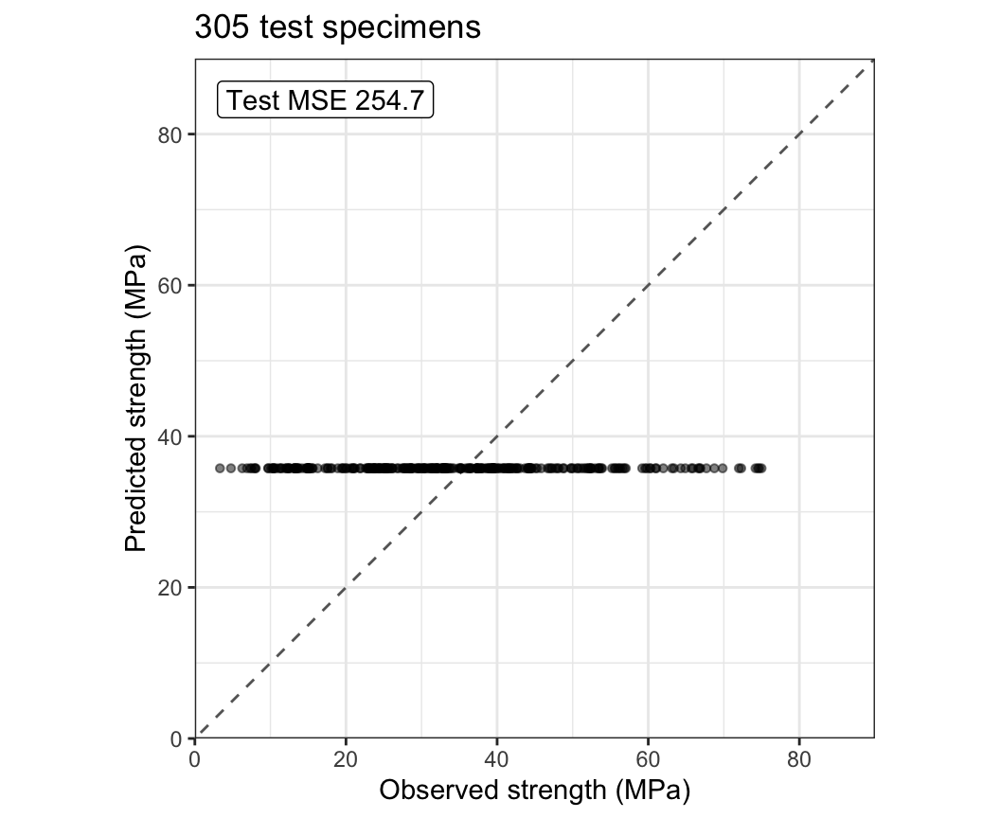

### Stump

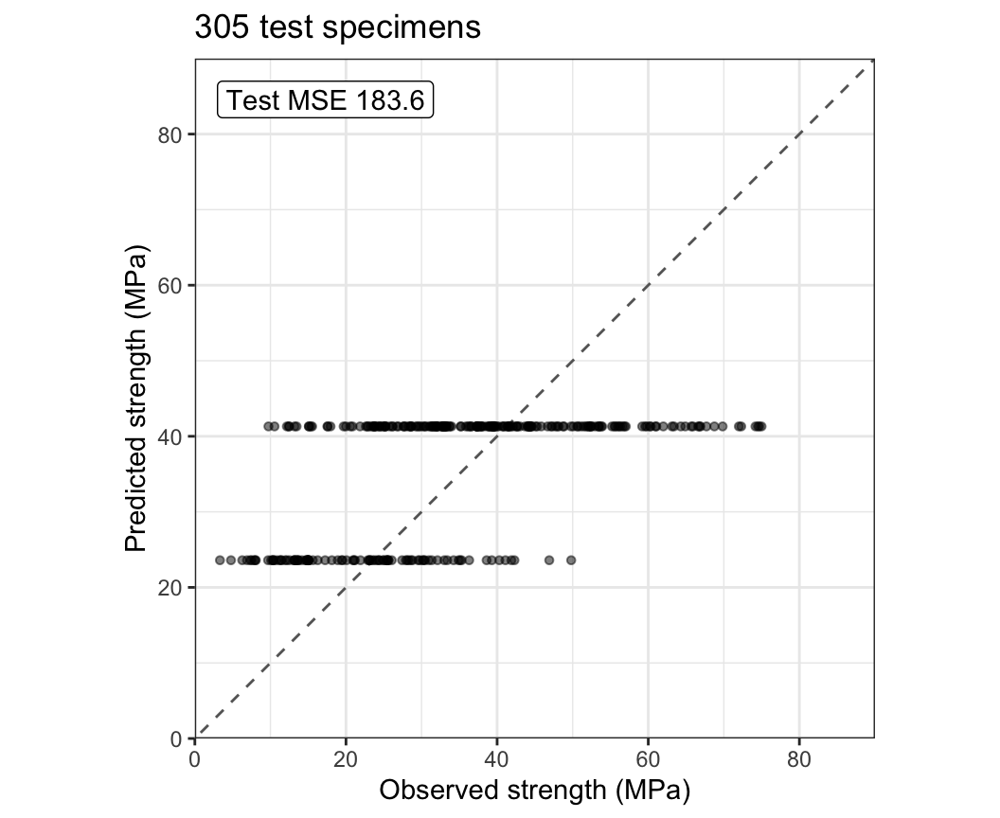

### Default tree

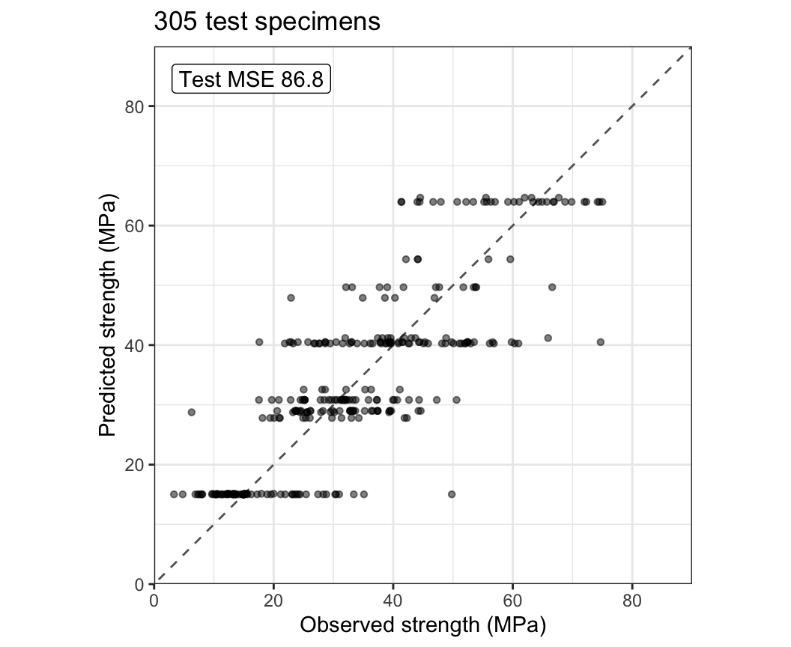

### Random forest

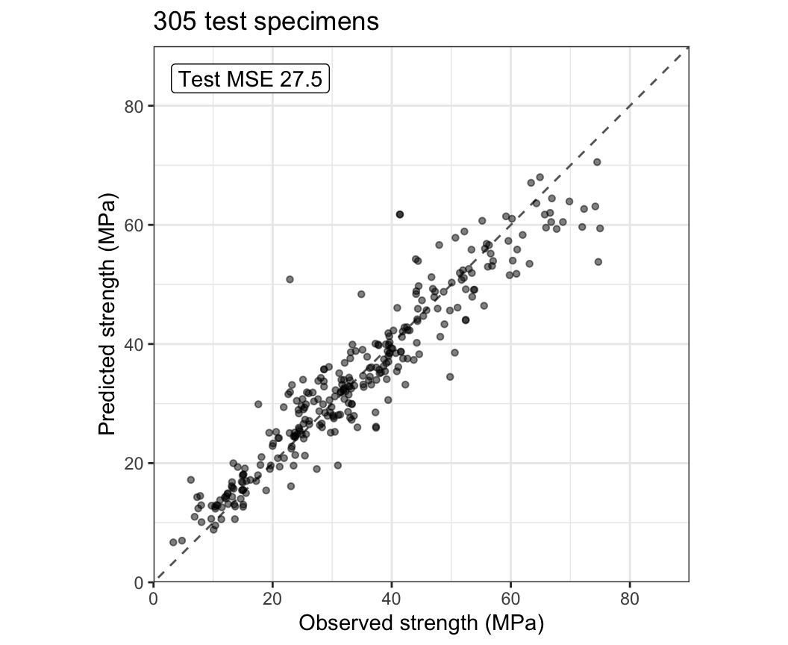

:::

::: notes
The tabs plot the predicted against the observed strength of the 305 test specimens for four fits on all 8 explanatory variables: the mean training strength, a stump (a tree with a single split, so of depth 1), the default tree, and a random forest with m, the number of explanatory variables tried at each split as in the previous lecture, chosen by its out-of-bag (OOB) error. A point on the dashed line is predicted exactly. The mean predicts one value for every specimen, the stump 2, and the default tree 15, one per leaf; each horizontal row of points is one leaf or a few leaves with close predictions. Within a leaf the test strengths have a pooled standard deviation of 9.1 MPa, against 15.9 MPa over all the test specimens. The random forest's predictions follow the dashed line. The test MSEs are 254.7, 183.6, 86.8, and 27.5. The forest here uses m = 5, chosen by its OOB error; bagging (m = p) has test MSE 26.9. These forests are refit here, so their test MSEs, which depend on random draws, differ from those of the previous lecture by up to 0.8. A small tree is a poor fit: it predicts a few values, each the mean of many specimens that differ in strength. Bagging and random forests get past this by averaging large trees, each with low bias and high variance. Boosting instead keeps the trees small and adds them up one at a time, each fit to the part of the strength that the trees before it have not yet explained.
:::

# Algorithm

::: notes
Boosting starts from the prediction 0 for every specimen, so its first residuals are the strengths themselves. It fits a small tree to the residuals, adds a shrunken copy of the tree's predictions to the fit, and recomputes the residuals. This part shows the residuals as trees are added, writes the algorithm out, and fits it with rpart().
:::

## Residuals

::: {.panel-tabset .mid-tabs}

### No trees

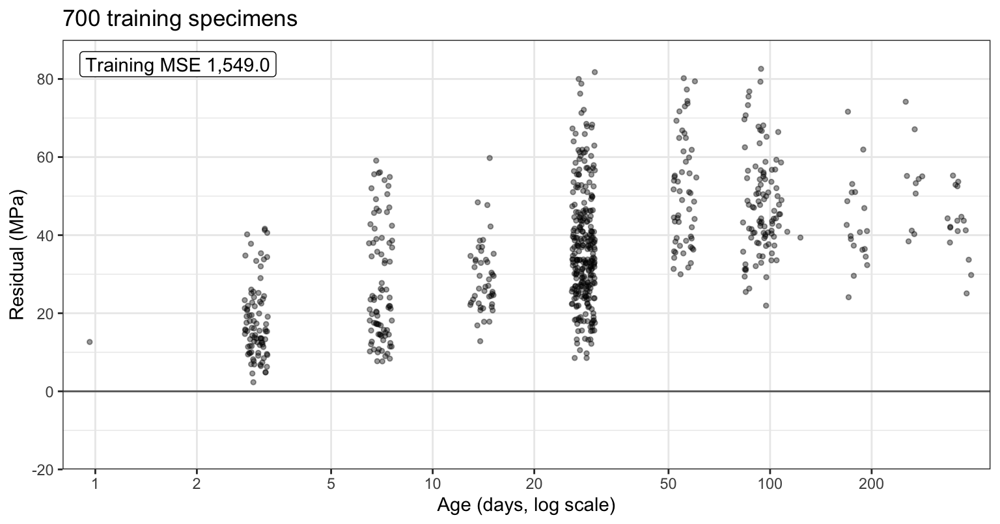

### 1 tree

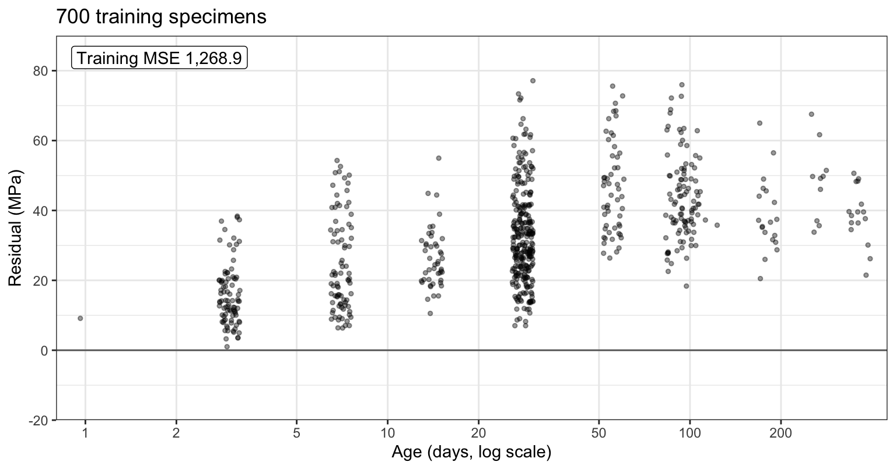

### 10 trees

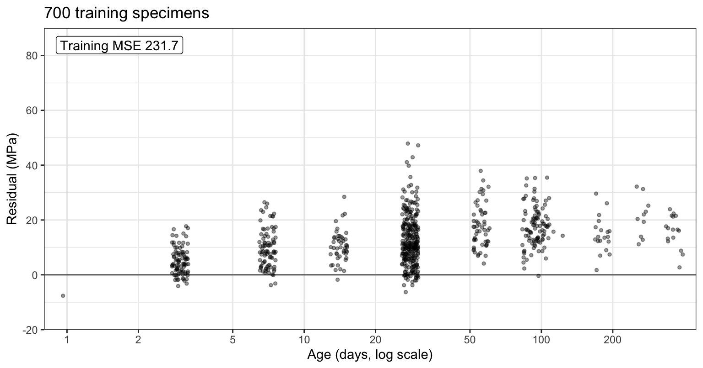

### 100 trees

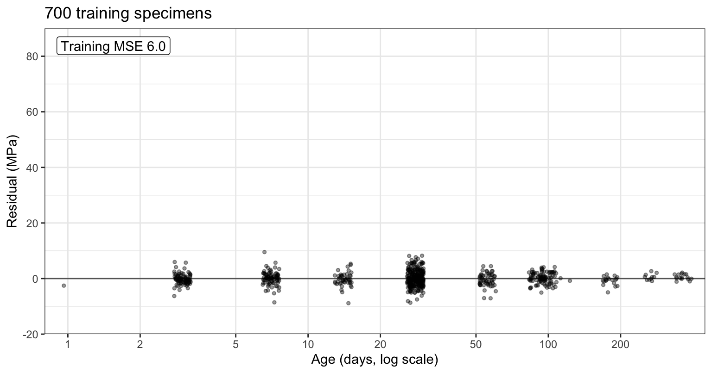

### 1,000 trees

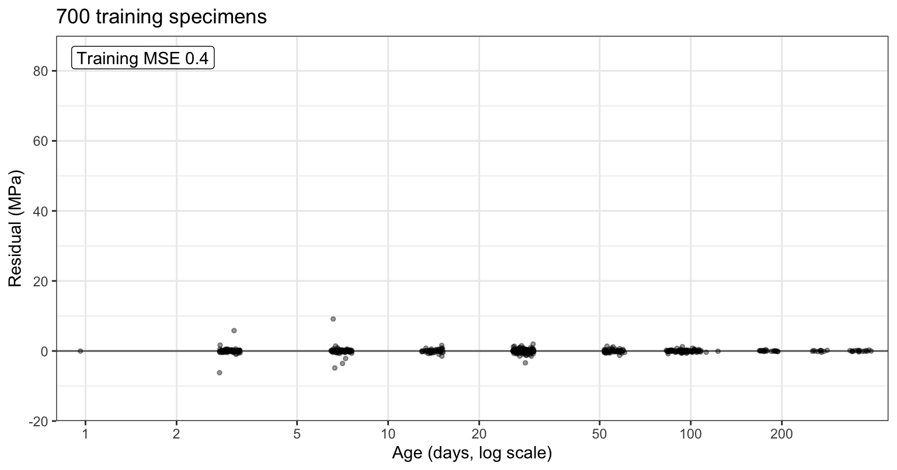

:::

::: notes
The tabs plot the residuals of the training specimens against age: at the start, the strengths, and then after 1, 10, 100, and 1,000 trees of depth 4 (each leaf reached through at most 4 splits), each tree's predictions multiplied by the shrinkage nu = 0.1 before they are added. The first tab is the data: strength rises steeply with age over the first month. The fit after one tree is nu = 0.1 times that tree's predictions, so no residual moves by more than 6.6 MPa, and the training MSE falls from 1,549.0 to 1,268.9, by 18%. A regression tree's predictions for its training data average to the mean of the residuals it is fit to, so after b trees the mean fitted value is 1 - (1 - nu)^b times the mean strength. After 10 trees that factor is 1 - 0.9^10 = 0.651: the mean fitted value is 23.3 MPa, against a mean training strength of 35.8, and the first trees mostly raise the overall level from 0. By 100 trees the rise with age is gone from the residuals (their correlation with log(age) falls from 0.57 to 0.03), and after 1,000 trees the training MSE is 1.2.
:::

## Steps

::: {style="font-size: 0.7em"}
1. Set $\widehat f_0(x) = 0$ and $r_i = y_i$ for $i = 1, \ldots, n$.
2. For $b = 1, \ldots, B$:
    a. fit a tree $\widehat f^b$ of depth $\delta$ to the residuals $r_1, \ldots, r_n$;
    b. add a shrunken copy of it to the fit, $\widehat f_b(x) = \widehat f_{b-1}(x) + \nu\,\widehat f^b(x)$;
    c. update the residuals, $r_i \leftarrow r_i - \nu\,\widehat f^b(x_i)$, so that $r_i = y_i - \widehat f_b(x_i)$.
3. Predict with the boosted model $\widehat f_B(x) = \sum_{b=1}^B \nu\,\widehat f^b(x)$.
:::

::: {.fragment}
::: {style="font-size: 0.6em"}
- $B$ — number of trees, indexed $b$
- $\widehat f^b(x)$ — prediction at $x$ of the $b$th tree
- $\nu$, $0 < \nu \le 1$ — shrinkage (learning rate)
- $\delta$ — depth of each tree; $\delta = 1$ is a stump
- $r_i$ — current residual of observation $i$
:::
:::

::: notes
The chapter's list of steps for boosting with B trees of depth delta and shrinkage nu, with the step 1 "for every x" and "for every training observation" and the step 2a "to the training data, with the residuals as the response" shortened. The tree at step b depends on the trees before it through the residuals, so the trees are grown in sequence. B is the number of trees, indexed b, as in the Random Forests lecture. The superscript of the b-th tree names the tree; it has no star, because the tree is not fit to a bootstrap sample. The residual r_i is not the lasso residual vector r. The shrinkage, or learning rate, nu, with 0 < nu <= 1, is what the textbook writes lambda; in these notes lambda is the ridge and lasso tuning parameter. The depth delta is the largest number of splits on a path from the root to a leaf; delta = 1 is a stump. The textbook limits the number of splits, d; in these notes d is the number of features of the subset selection lectures, and rpart() limits depth, with maxdepth. A tree of depth delta has at most 2^delta leaves. The symbol delta is unrelated to the discriminant functions delta_k(x) of the discriminant analysis lectures and to the interaction estimates delta_j of the Flexible Logistic Regression lecture, which always carry a subscript.
:::

## Boosting from scratch

```r
# Boosting from scratch: B trees of depth 4, with shrinkage nu.
B <- 1000
nu <- 0.1
small <- rpart.control(maxdepth = 4, cp = 0, xval = 0,
                       maxcompete = 0, maxsurrogate = 0)

# Start from the fit 0, so the residuals are the strengths.
x_train <- select(train, -compressive_strength)
r <- y_train
trees <- vector("list", B)

# Fit a tree to the residuals, then subtract nu times its predictions.
for (b in seq_len(B)) {
  data_b <- mutate(x_train, r = r)
  trees[[b]] <- rpart(r ~ ., data = data_b, control = small)
  r <- r - nu * predict(trees[[b]], x_train)
}
```

::: notes
The chunk writes the algorithm out with rpart(): B = 1,000 trees of depth 4 with shrinkage 0.1, the fit of the Residuals tabs, on all 8 explanatory variables of the training specimens. cp = 0 lets the depth limit the tree, but rpart()'s defaults still apply: it does not split a node with fewer than minsplit = 20 training specimens and keeps at least minbucket = 7 in every leaf, so delta is an upper bound on the depth. xval = 0 skips the cross-validation rpart() would otherwise run, and maxcompete = 0 and maxsurrogate = 0 skip the competing and surrogate splits it would otherwise record, which speeds up the loop without changing any tree. The leaves of the first tree hold 11 to 161 training specimens.
:::

## Boosted prediction

```r
# Each tree's predictions for the test specimens, one column per tree;
# the boosted prediction is nu times their sum.
tree_pred <- sapply(trees, predict, newdata = test)
boost_pred <- nu * rowSums(tree_pred)
c(train_mse = mean(r^2), test_mse = mean((y_test - boost_pred)^2))
```

```
train_mse  test_mse 
 1.247399 20.894387 
```

::: notes
The boosted prediction sums the trees' predictions and multiplies by nu. With B = 1,000 trees the training MSE is 1.2 and the test MSE 20.9, against 86.8 for the default tree and 27.5 for the random forest.
:::

# Tuning parameters

::: notes
Boosting has three tuning parameters: the number of trees B, the shrinkage nu, and the depth delta. This part shows how the test MSE changes with each.
:::

## Shrinkage

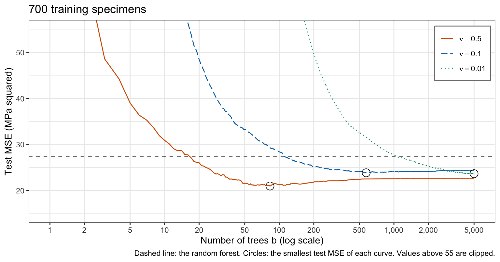{height=560}

::: notes
The figure plots the test MSE of the boosted model after b trees against b, for nu = 0.5, 0.1, and 0.01, each with trees of depth 4, with the random forest's test MSE as a dashed line. The smaller the shrinkage, the more trees the model needs. With nu = 0.5 the test MSE is smallest, 20.2, after 179 trees; with nu = 0.1 it is smallest, 20.6, after 1,504; with nu = 0.01 it is 22.2 after 5,000 trees, and still falling. The shrinkage controls how fast the model learns: each tree corrects only a fraction nu of what it estimates. After 100 trees the mean prediction for the test specimens is 21.7 MPa with nu = 0.01 and 34.1 with nu = 0.1, against a mean test strength of 34.1. As a large lambda does in ridge regression and the lasso, a small nu holds the fit near its starting point, here 0, and more trees let it move further from it. Part of the slow start with nu = 0.01 is the start at 0: after 100 trees, the mean fitted value of the training specimens is 1 - 0.99^100 = 0.634 times the mean training strength, 22.7 MPa. The gbm package starts instead from the mean of the response.
:::

## Tree depth

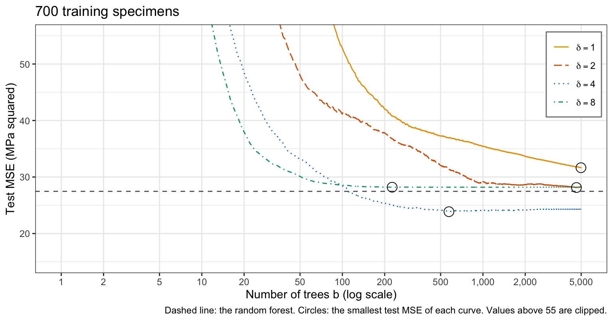{height=560}

::: notes
The figure plots the test MSE against the number of trees for depths 1, 2, 4, and 8, each with nu = 0.1. Deeper trees learn faster. The test MSE is smallest after 305 trees of depth 8 (22.2), 1,504 of depth 4 (20.6), and 4,129 of depth 2 (23.6). The stumps' curve is still falling at 5,000 trees, where it is 32.3, but slowly: the last 1,000 trees lowered it by 0.6. Depth 4 does best, and depth 8 reaches its smallest value early and then rises. The Additive structure section shows what the depth changes in the fitted model: the interactions it can represent.
:::

## Overfitting

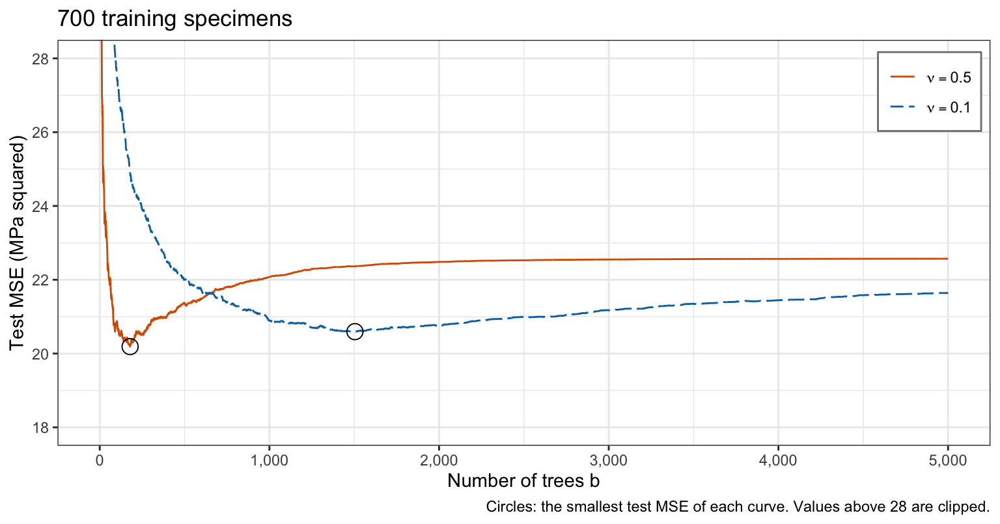{height=560}

::: notes
The figure plots the test MSE for nu = 0.5 and nu = 0.1, at depth 4, against the number of trees on a linear axis, from the same fits as the Shrinkage figure. Both curves reach a smallest value and then rise. With nu = 0.5, the test MSE rises 12% from its smallest value, after 179 trees, to 5,000 trees; with nu = 0.1 it rises 5% from its smallest value, after 1,504 trees. The training MSE with nu = 0.5 falls to 0.41 by 5,000 trees, while its test MSE is 22.6: the late trees fit what is left of the training residuals, which does not carry over to the test specimens. Bagging's test error levels off instead: the bagging forest of the Earlier fits has test MSE between 26.5 and 27.8 from 50 to its 500 trees. Boosting overfits when B is too large; a smaller nu makes the rise slower.
:::

# Choosing $B$

::: notes
B is chosen without the test data by 10-fold cross-validation. This part defines the cross-validation estimate and shows the model it chooses.
:::

## Cross-validation estimate

::: {style="font-size: 0.75em"}
$$\text{CV}_{(10)}(B) = \frac{1}{n}\sum_{\ell=1}^{10}\sum_{i \in \mathcal{F}_\ell}\left[y_i - \widehat f_B^{(-\ell)}(x_i)\right]^2,$$
:::

::: {.fragment}
::: {style="font-size: 0.6em"}
- $\mathcal{F}_\ell$ — training observations in fold $\ell$
- $\widehat f_B^{(-\ell)}$ — boosted model of $B$ trees fit to the observations outside fold $\ell$
:::
:::

::: notes
Split the training observations at random into 10 folds; for each fold l, run boosting on the other nine folds and record the error on fold l after every number of trees. The estimate for B trees is the display. One run of B_max trees per fold gives the estimate for every B <= B_max, because the model of B trees is the first B trees of the longer run. Here B_max = 5,000, with nu = 0.1 and delta = 4. The legend shows on the click because the display uses the fold set and the model fit outside the fold.
:::

## Chosen model

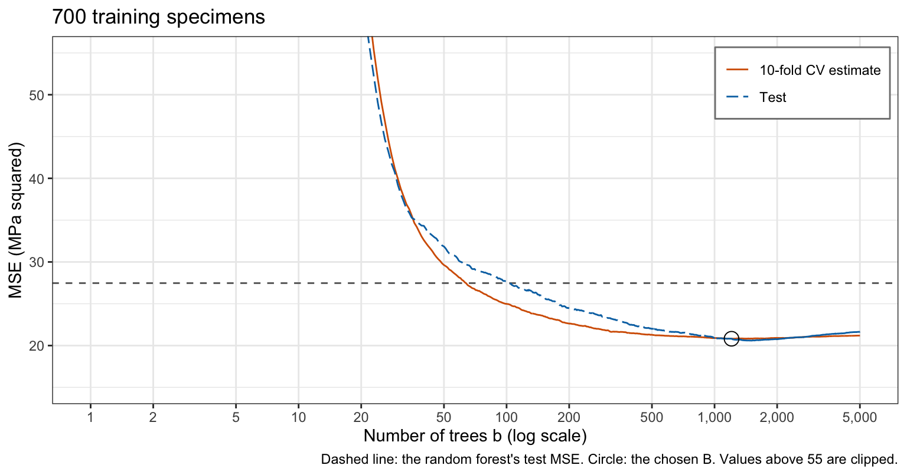{height=560}

::: notes
The figure plots the cross-validation estimate and the test MSE of the model fit to all 700 training specimens against the number of trees. The cross-validation estimate is smallest, 20.8, at B = 1,207. The model of the first 1,207 trees fit to all the training specimens has test MSE 20.8; the smallest test MSE over every number of trees, which cross-validation cannot know, is 20.6, after 1,504 trees. The cross-validation estimate equals the test MSE to one decimal. Both measure predictions for mixes like those tested: 73% of the training specimens share their mix with a training specimen in another fold, and 68% of the test specimens have a mix that some training specimen also has.
:::

# Variable importance

::: notes
The importance of an explanatory variable in a boosted model is read from the trees' splits, as for a forest.
:::

## RSS decrease

::: {style="font-size: 0.75em"}
$$n_1n_2\left(\bar y_1 - \bar y_2\right)^2/\left(n_1 + n_2\right)$$
:::

::: {style="font-size: 0.6em"}
- A split's decrease in RSS
:::

::: {.fragment}
::: {style="font-size: 0.7em"}
- Importance of a variable: its decreases in RSS, summed over the $B$ trees
:::
:::

::: notes
A split's decrease in RSS is the display, as in the Decision Trees lecture, where n_1 and n_2 and the two means are the sizes and means of the two regions of the split; in boosting the RSS is that of the residuals the tree is fit to. The importance of an explanatory variable is the decrease in RSS from all its splits, summed over the B trees; a random forest's IncNodePurity averages the same decrease over its trees. With maxsurrogate = 0, the variable.importance of an rpart() fit is this sum for one tree.
:::

## RSS decrease in R

```r
# Decrease in RSS from each variable's splits, summed over the trees, as
# a share of the total.
decreases <- unlist(map(trees, \(tree) tree$variable.importance))
importance_sum <- tapply(decreases, names(decreases), sum)
round(sort(importance_sum / sum(importance_sum), decreasing = TRUE), 3)
```

```
               age             cement   superplasticizer              water 
             0.355              0.294              0.092              0.091 
blast_furnace_slag     fine_aggregate   coarse_aggregate            fly_ash 
             0.075              0.055              0.021              0.018 
```

::: notes
For the 1,000 trees of the loop of the Fitting subsection, the decrease in RSS from each variable's splits as a share of the total (the figure on the next slide uses the chosen model of 1,207 trees instead).
:::

## Importance by variable

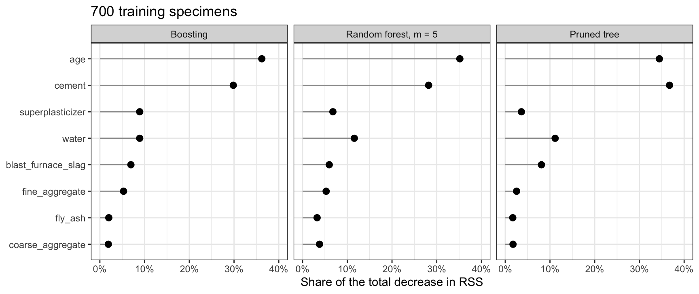{height=500}

::: notes
The figure plots the shares for the boosted model of the chosen 1,207 trees, for the random forest with m = 5, and for the pruned tree of the Decision Trees lecture, the variables in the order of the boosting shares.
:::

## Forest and tree importance

- Importance ranks the variables
- No direction
- No effect size

::: notes
Boosting ranks the variables age, cement, superplasticizer, water, blast_furnace_slag, fine_aggregate, coarse_aggregate, and fly_ash; the random forest ranks them age, cement, water, superplasticizer, blast_furnace_slag, fine_aggregate, coarse_aggregate, and fly_ash; the pruned tree ranks them cement, age, water, blast_furnace_slag, superplasticizer, fine_aggregate, coarse_aggregate, and fly_ash. All three put age and cement in the first two places, with 65% of the boosted model's decrease in RSS, 63% of the forest's, and 71% of the tree's; below them the orders differ. As for a forest, importance ranks the variables and gives no direction or effect size.
:::

# Additive structure

::: notes
Does the effect of cement on strength depend on age? This part asks the question of the raw data, and then of boosted models of stumps and of trees of depth 4.
:::

## Cement and age

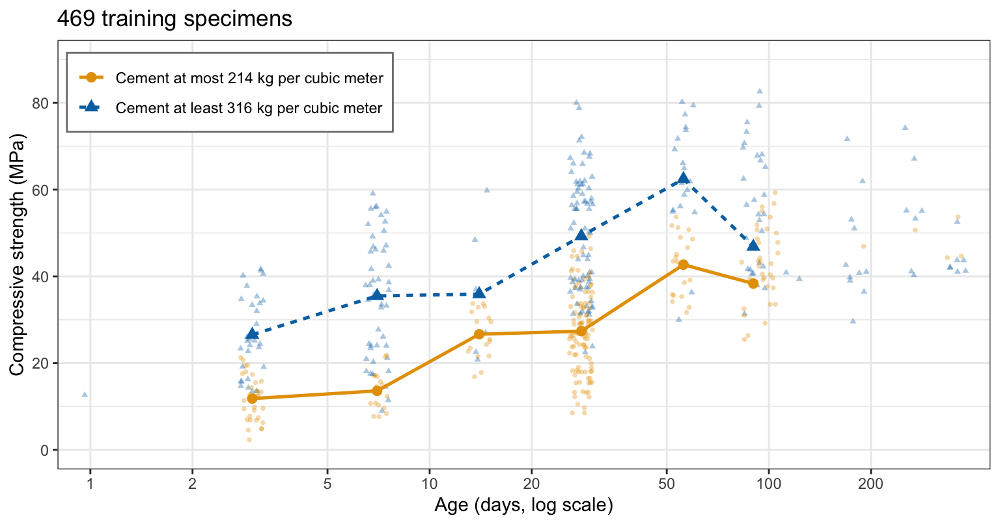{height=560}

::: notes
The figure plots the strength of the training specimens in the lowest and the highest third of cement content against age, with the mean strength of each third at every age with at least 5 specimens in both thirds. The high-cement third is stronger at every such age, by 8.5 MPa at 90 days and by about 22 MPa at 7 and 28 days. The two thirds also differ in other ingredients, chiefly fly ash and blast furnace slag, of which the high-cement third has less, so this raw comparison does not isolate cement; a model can.
:::

## Stumps

::: {style="font-size: 0.75em"}
$$\widehat f_B(x) = \sum_{j=1}^p a_j(x), \qquad a_j(x) = \sum_{b:\, \widehat f^b \text{ splits on } X_j} \nu\,\widehat f^b(x),$$
:::

::: {style="font-size: 0.6em"}
- $a_j(x)$ — sum of the shrunken stumps that split on $X_j$, a function of $x$ only through $X_j$
:::

::: {.fragment}
::: {style="font-size: 0.7em"}
- Additive model: the change in the prediction when $X_j$ changes does not depend on the other variables
:::
:::

::: notes
The figure above asks whether the gap in strength between high- and low-cement mixes changes with age. A boosted model of stumps cannot let it change. A stump depends on one explanatory variable. Collecting the stumps that split on each variable, a boosted model of stumps is a sum of functions, each of which depends on one variable. This is an additive model: the change in the prediction when the value of X_j changes does not depend on the values of the other variables. The function is written a_j(x), not g_j(x_j), because g_j is the PLS simple regression estimate and the naive Bayes log density ratio, and a single subscript on x means an observation.
:::

## Depth and interactions

- Each leaf is reached through at most $\delta$ splits
- Interactions among at most $\delta$ variables

::: notes
A tree of depth delta can split on more than delta explanatory variables in all: the 1,207 trees of depth 4 of the chosen model split on 1 to 8, with median 4. But each leaf is reached through at most delta splits, so the tree's prediction is a sum, over its leaves, of a constant times an indicator that involves at most delta variables. A boosted model of such trees is a sum of such terms, so it can represent interactions among at most delta variables. The title is not a chapter heading: the paragraph sits under the chapter's Stumps subsection.
:::

## Stumps and trees of depth 4

::: {.panel-tabset .mid-tabs}

### Depth 1

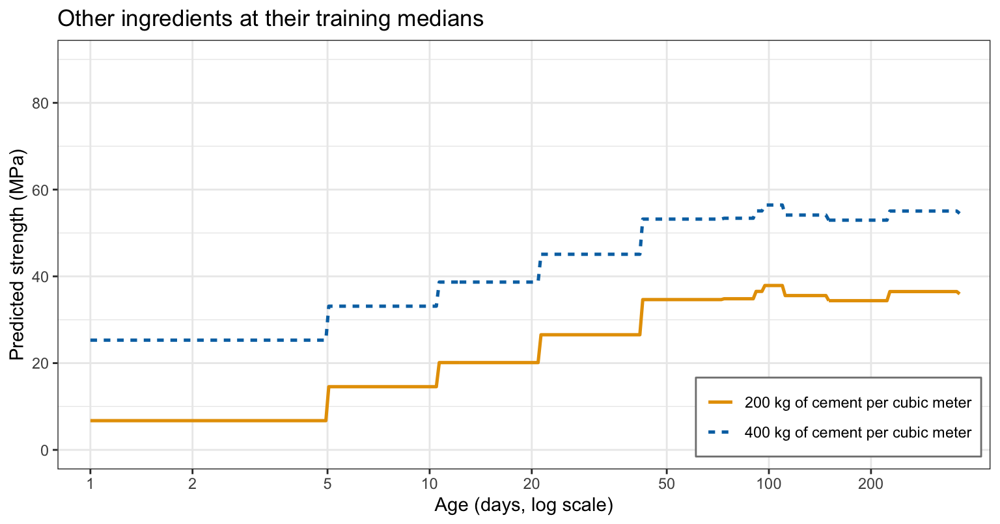

### Depth 4

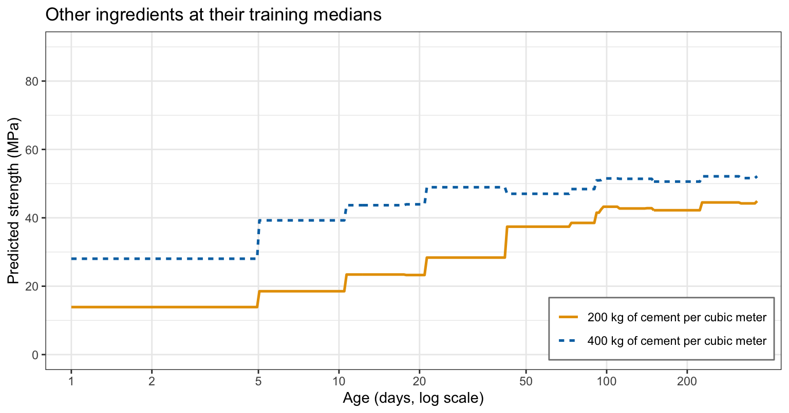

:::

::: notes
The tabs plot the predicted strength against age for mixes with 200 and 400 kg of cement per cubic meter, the other six ingredients at their medians among the training specimens: first for the boosted model of 5,000 stumps with nu = 0.1, then for the chosen model of 1,207 trees of depth 4. For the stumps the two curves are parallel: the extra cement adds 18.6 MPa to the prediction at every age. For the trees of depth 4, the gap runs from 7.3 to 20.7 MPa, depending on age: the effect of cement on strength depends on age, an interaction, as the raw thirds suggested. Whether the interactions matter is a question for the test error. In the Tree depth figure, the stumps' test MSE after 5,000 trees, 32.3 and still falling slowly, is above the smallest test MSE of every depth that allows interactions: 23.6 for depth 2, 20.6 for depth 4, and 22.2 for depth 8. On concrete an additive model leaves out structure that trees of depth 2 or more find.
:::

# Comparison

::: notes
This part compares boosting with bagging and random forests, and with every other fit of the three tree lectures on test error, and lists its limits.
:::

## Bias and variance

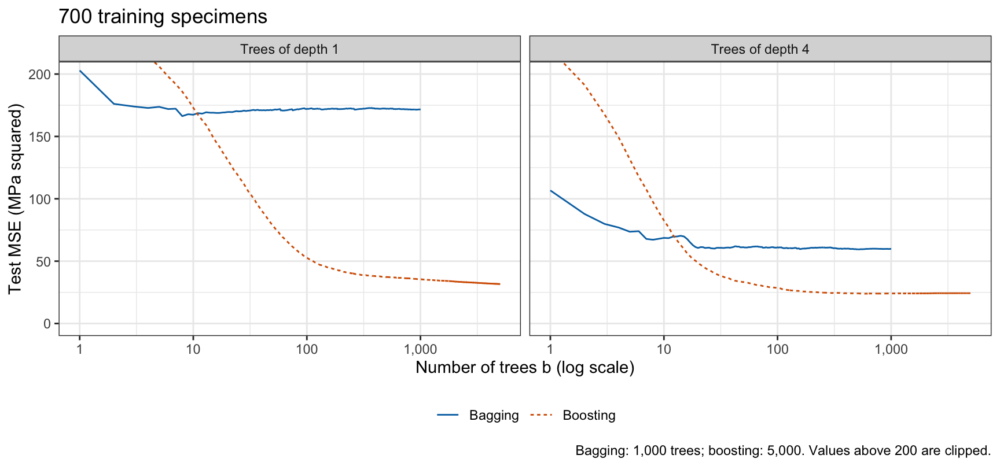{height=540}

::: notes
The figure plots the test MSE against the number of trees for bagging and for boosting (nu = 0.1) with the same small trees, stumps and trees of depth 4. One stump fit to all the training specimens has test MSE 183.6, and one tree of depth 4 91.9. Averaging 1,000 of them over bootstrap samples brings these to 171.7 and 59.9; boosting the same kinds of trees brings them to 32.3 and 21.6 with 5,000 trees. A small tree's error is mostly bias: it cannot follow the curve in age, or the effect of the other ingredients, with a few leaves. Averaging removes variance but leaves the bias of the trees it averages, so bagging needs large trees. Boosting removes bias: each tree is fit to what the trees before it got wrong, so the sum of many small trees can follow a function no single small tree can.
:::

## Test error

::: {.auto-table}
|Method                              |Tuning                                                | Test MSE|
|:-----------------------------------|:-----------------------------------------------------|--------:|
|Least squares                       |none                                                  |    106.4|
|Least squares with log(age)         |none                                                  |     48.5|
|Default tree                        |rpart() stopping rules                                |     86.8|
|Full tree                           |none                                                  |     40.3|
|Pruned tree                         |cp by 10-fold CV                                      |     42.2|
|Bagging, $m = 8$                    |none                                                  |     26.9|
|Random forest, $m = 5$              |$m$ by OOB error                                      |     27.5|
|Boosting, $\nu = 0.1$, $\delta = 4$ |$\nu$ and $\delta$ fixed, $B = 1{,}207$ by 10-fold CV |     20.8|
:::

::: notes
The table collects the test MSE of every fit to all 8 explanatory variables in the three tree lectures, with how each was tuned. Boosting has the smallest test MSE, 20.8, 23% below the best of the other fits, 26.9. Only B was chosen by cross-validation; nu = 0.1 and delta = 4 were fixed in advance, but delta = 4 is also the depth with the smallest test MSE in the Tree depth section, so 20.8 is mildly optimistic. Even taking the best B for each depth, chosen on the test specimens and so flattering to boosting, depths 2, 4, and 8 reach 23.6, 20.6, and 22.2; all are below bagging's 26.9, which used no tuning. Least squares with log(age), which needed a feature built after seeing the curve in age, has 48.5; the tree ensembles find the curve and the interactions without it.
:::

## Limits

- Three tuning parameters: $B$, $\nu$, $\delta$
- $B$ must be chosen: too many trees overfit
- Trees grown in sequence, not in parallel
- No single tree to read: importance rankings only
- Predictions made of steps, constant beyond the largest training value

::: notes
Boosting has three tuning parameters, B, nu, and delta, against a random forest's m and number of trees, and its B must be chosen, since too many trees overfit, while a forest only needs enough trees. Its trees are grown in sequence, each needing the residuals of the one before, so they cannot be grown at the same time as a forest's can, and the cross-validation above refit 5,000 trees in each of 10 folds. With many trees it fits the training data nearly exactly: the training MSE fell to 0.41 with nu = 0.5, while that fit's test MSE never fell below 20.2. Like a forest, it has no single tree to read, only importance rankings, its predictions are made of steps, and it predicts a constant beyond the largest value of an explanatory variable in the training data, since every tree does.
:::

## Conclusion

- Boosting adds small trees, each fit to the residuals of the trees before it
- A smaller $\nu$ needs more trees
- Depth $\delta$ allows interactions among at most $\delta$ variables
- Too many trees overfit: choose $B$ by cross-validation
- Boosting reduces bias; bagging reduces variance
- Importance ranks variables, with no direction or effect size

::: notes
Boosting builds a model from small trees added one after another. It starts from the fit 0, fits a tree of depth delta to the current residuals, adds nu times the tree's predictions to the fit, and updates the residuals, B times. Each tree is fit to what the trees before it got wrong, so the trees depend on one another and are grown in sequence. The shrinkage nu sets how fast the model learns: a smaller nu needs more trees and makes the test error less sensitive to their number. The depth delta sets how complex each tree is: each leaf of a tree of depth delta is reached through at most delta splits, so the boosted model is a sum of terms that each involve at most delta explanatory variables and can represent interactions among at most delta of them. Stumps give an additive model, a sum of functions that each depend on one variable. The number of trees B is chosen by cross-validation, since, unlike bagging, boosting overfits when B is too large. One run of boosting gives the cross-validation estimate for every B up to its length. Bagging and random forests average large trees, each with low bias and high variance, grown independently on bootstrap samples, which reduces variance. Boosting adds small trees, each with high bias, fit to residuals, which reduces bias. The importance of an explanatory variable, the decrease in RSS from its splits summed over the trees, ranks the variables without giving a direction or an effect size, as for a forest.

The next lecture begins support vector machines (ISLR2 Chapter 9), which classify by finding a boundary that separates the classes in the space of the features, with as wide a margin as possible.
:::
