## Today

<!-- derived-from: 09-svm/10-maximal-margin-classifier.qmd @ ac7908e -->

::: {.columns}
::: {.column width="34%"}
- Flea beetles
- Hyperplanes
  - Equation
  - Sides
  - Signed distance
- Separating hyperplanes
  - Class coding
  - Separation condition
  - Non-uniqueness
:::
::: {.column width="33%"}
- Maximal margin
  - Margin
  - Optimization problem
  - Best offset
  - Best direction
  - Fitting
  - Estimates
:::
::: {.column width="33%"}
- Support vectors
  - Identification
  - Refits
- Classification
  - Sign rule
  - Confidence
- Limitations
  - Non-separable classes
  - Sensitivity
:::
:::

::: notes
Distilled from the chapter's five learning objectives: defining a hyperplane and its normal vector, telling the side of a point from the sign of f(x), and the signed distance when the squared betas sum to 1; the coding y = 1 or -1 of two classes, the condition y_i f(x_i) > 0 for a separating hyperplane, and why separable classes have infinitely many; the margin and the maximal margin hyperplane, the optimization problem that defines it and its constraints, and the best offset for a fixed normal vector, midway between the classes; computing the estimates and the margin from an e1071::svm() fit with a linear kernel and a very large cost, identifying the support vectors, and why the fit depends only on them; classifying a new observation by the sign of f-hat and reading its distance as confidence, and the two limitations, no solution when the classes are not separable and sensitivity to a single observation. The shortcut of the rescaled problem, the hard-margin SVM callout (Beyond this course), the collapsed Code callouts and the For example callout are not in the agenda.

This is the first of three lectures on support vector machines. It covers the maximal margin classifier, a classifier for two classes that cuts the space of the explanatory variables in two with a flat boundary, a hyperplane, chosen to be as far as possible from the observations of both classes. The reading is ISLR2 Section 9.1.

Timing: only about 25 of the 50 minutes are available on Mon 2026-11-16, after a variable importance review. The core slides, the agenda and 18 content slides, come to about 28.5 minutes at honest estimates (Signed distance, Optimization problem and Sensitivity 3 each, Estimates 2.5 and Estimates in R 1), so the plan is to compress them by about 3.5 minutes, for example by stating the Signed distance result without deriving it. The optional slides are in the drop order, the first to drop first: Best offset (1.5 minutes), then the Classification part (New beetles, Sign rule and Confidence, 3 minutes), Best direction (1), Refits (1.5), the interpretation of the estimates on Estimates in R (0.5) and Non-separable classes (1.5), 9 minutes in all. Teach the core in the order of the deck and add the optional slides only if time is left. The Sensitivity slide, the last core slide, is the bridge to the next lecture.

Agenda lines to skip when optional slides are dropped, in drop order: Best offset; Classification with Sign rule and Confidence; Best direction; Refits; Non-separable classes. (The interpretation of the estimates on Estimates in R is not an agenda line.)
:::

# Flea beetles

::: notes
Question: two species of flea beetle are very similar. Can two measurements of a beetle's joints separate the species with a straight line, and if so, which line?
:::

## Flea beetles

::: {style="font-size: 0.7em"}
- Class: `Species` (`conc`, `heik`)
- Explanatory variables ($p = 2$):
  - `Jnt1`: first joint
  - `Jnt2`: second joint
:::

::: {style="font-size: 0.7em; margin-top: 1em"}
- Beetles: 36 (18 `conc`, 18 `heik`)
:::

::: notes
Sleuth3::ex1613 records two measurements, in micrometers, of each of 36 beetles from two very similar species of flea beetle (conc and heik); the data come from a 1962 study of discriminant functions in taxonomy by Lubischew. Jnt1 is the measurement of the first joint and Jnt2 of the second. The observations are beetles; each species is a class, and the two explanatory variables are the features. The class is coded y = 1 for heik and y = -1 for conc (the column y), a coding the Class coding slide defines. The chunk counts 18 beetles of each species.
:::

## Flea beetles: plot

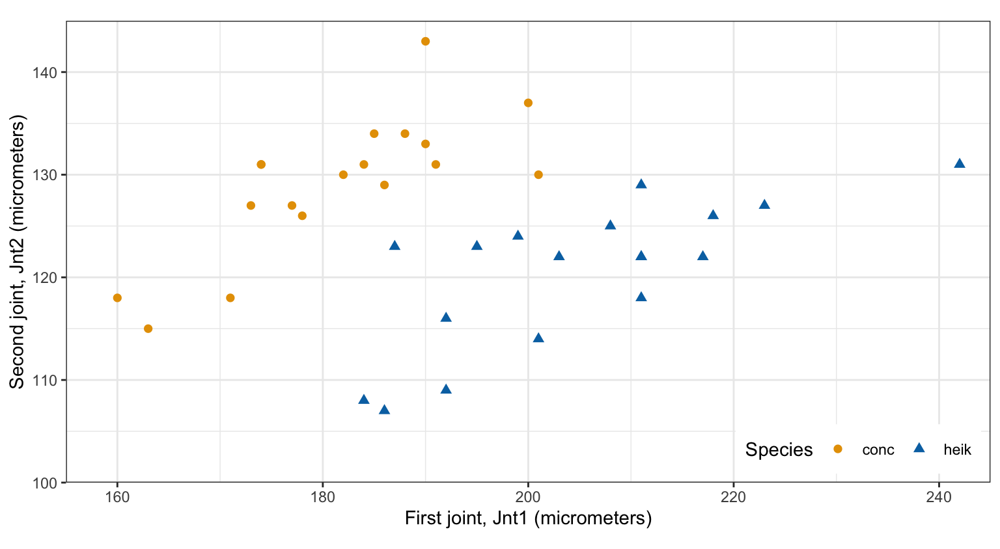{height=560}

::: notes
The conc beetles sit up and to the left, with shorter first joints and longer second joints, and the heik beetles down and to the right. Neither measurement alone separates the species: Jnt1 runs from 160 to 201 micrometers in conc and from 184 to 242 in heik. Together they do, with a narrow gap between the two clouds running from lower left to upper right. The measurements are whole micrometers, and 2 pairs of beetles of the same species share both measurements, so 34 distinct points are visible.
:::

# Hyperplanes

::: notes
This part defines a hyperplane, says which side of it a point is on, and gives the distance from a point to it.
:::

## Equation

::: {style="font-size: 0.8em"}
Hyperplane in $p$ dimensions: the points $X = (X_1, \ldots, X_p)^\top$ with

$$
\beta_0 + \beta_1 X_1 + \beta_2 X_2 + \cdots + \beta_p X_p = 0,
$$
:::

::: {.fragment}
::: {style="font-size: 0.7em"}
- $X_j$ — value of feature $j$, $j = 1, \ldots, p$
- $\beta_0$ — intercept
- $\beta = (\beta_1, \ldots, \beta_p)^\top$, not all zero — normal vector
:::
:::

::: {.fragment}
::: {style="font-size: 0.7em; margin-top: 1em"}
- Dimension $p - 1$: a line when $p = 2$, a plane when $p = 3$
:::
:::

::: notes
A hyperplane in p dimensions is the set of points X that satisfy the equation, where X_j is the value of feature j, beta_0 is the intercept, and beta, not all zero, is the normal vector. It is a flat affine subspace of dimension p - 1: a point when p = 1, a line when p = 2, a plane when p = 3. With the beetles, p = 2, X_1 is Jnt1, X_2 is Jnt2. The normal vector is perpendicular to the hyperplane. If x and x' both lie on it, subtracting their equations gives beta transposed times (x - x') = 0, so beta is orthogonal to every direction within the hyperplane. The next slides draw one line through the beetles, with beta_0 = -70, beta_1 = 1 and beta_2 = -1.
:::

## Sides

::: {style="font-size: 0.8em"}
For any point $x = (x_1, \ldots, x_p)^\top$, write

$$
f(x) = \beta_0 + \beta_1 x_1 + \cdots + \beta_p x_p = \beta_0 + \beta^\top x,
$$
:::

::: {.fragment}
::: {style="font-size: 0.7em"}
- $f(x) = 0$: the hyperplane
- $f(x) > 0$: the side $\beta$ points toward
- $f(x) < 0$: the other side
:::
:::

::: notes
For any point x, write f(x) = beta_0 + beta transposed x, where x_j is the jth coordinate of x. Training observation i, from the next section on, is x_i with jth coordinate x_ij: a single subscript j on a generic point x names a coordinate, and a single subscript i names an observation. The hyperplane is the set where f(x) = 0. It divides the space in two: f(x) > 0 on one side, the side beta points toward, and f(x) < 0 on the other.
:::

## Sides: beetles

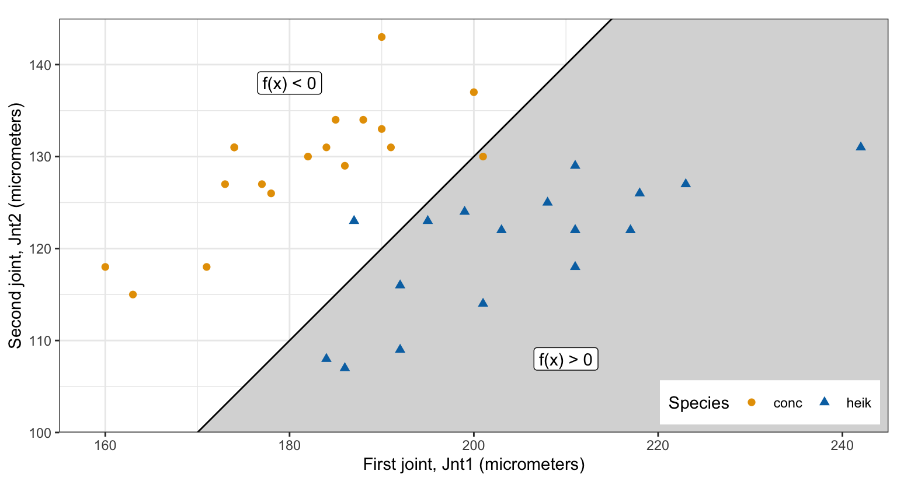{height=520}

::: {style="font-size: 0.7em"}
$\beta_0 = -70$, $\beta_1 = 1$, $\beta_2 = -1$
:::

::: notes
The figure is the chapter's second Hyperplanes tab: the beetles and one line drawn through them, with one side of it shaded. The line has beta_0 = -70, beta_1 = 1 and beta_2 = -1. f is positive in the shaded region below the line, where Jnt1 exceeds Jnt2 by more than 70 micrometers, and negative above it. Beetles of both species lie on both sides of this line.
:::

## Signed distance

::: {style="font-size: 0.8em"}
$$
t = \frac{f(x)}{\|\beta\|} = \frac{\beta_0 + \beta^\top x}{\|\beta\|},
$$
:::

::: {.fragment}
::: {style="font-size: 0.7em"}
- $t$ — signed distance from $x$ to the hyperplane; its sign gives the side
:::
:::

::: {.fragment}
::: {style="font-size: 0.7em; margin-top: 1em"}
- Unit normal vector, $\|\beta\|^2 = \sum_{j=1}^p \beta_j^2 = 1$: $t = f(x)$
:::
:::

::: notes
Let x_0 be the point of the hyperplane closest to x. Then x - x_0 is perpendicular to the hyperplane, so x - x_0 = t beta / ||beta|| for some number t, where ||beta|| is the square root of the sum of the squared betas and |t| is the distance from x to the hyperplane. Because f(x_0) = 0, f(x) = f(x) - f(x_0) = beta transposed (x - x_0) = t beta transposed beta / ||beta|| = t ||beta||, so t = f(x) / ||beta||, where t, whose sign gives the side, is the signed distance from x to the hyperplane. Multiplying beta_0 and beta by the same nonzero number leaves the hyperplane unchanged, so they can always be scaled to ||beta||^2 = 1. With this unit normal vector, t = f(x): f(x) itself is the signed distance.
:::

# Separating hyperplanes

::: notes
The chapter's tabs show the beetles and then three lines drawn through them, each named in the legend by the angle of its normal vector, defined below. This part says what it means for a hyperplane to separate the classes, and shows that when it can, it can in many ways.
:::

## Class coding

::: {style="font-size: 0.8em"}
$$
y_i = \begin{cases} 1 & \text{if observation } i \text{ is in one class,}\\
-1 & \text{if observation } i \text{ is in the other class,}\end{cases}
$$
:::

::: {.fragment}
::: {style="font-size: 0.7em"}
- $i = 1, \ldots, n$ — training observation, with features $x_i = (x_{i1}, \ldots, x_{ip})^\top$
- Beetles: $y_i = 1$ for `heik`, $y_i = -1$ for `conc`; $n = 36$, $p = 2$
:::
:::

::: notes
For two classes, code the class of observation i as in the display, 1 for one class and -1 for the other, where i = 1, ..., n indexes the n training observations, with features x_i = (x_i1, ..., x_ip). This coding is for the geometry, not a response for regression: the sign of y_i says which side of the hyperplane observation i belongs on. Which class gets 1 is arbitrary. For the beetles, y_i = 1 for heik and y_i = -1 for conc (the column y), n = 36, and p = 2.
:::

## Separation condition

::: {style="font-size: 0.8em"}
$$
y_i\left(\beta_0 + \beta_1 x_{i1} + \cdots + \beta_p x_{ip}\right) > 0
\quad \text{for all } i = 1, \ldots, n.
$$
:::

::: {.fragment}
::: {style="font-size: 0.7em"}
- $y_i = 1$ needs $f(x_i) > 0$; $y_i = -1$ needs $f(x_i) < 0$
- Separable: some hyperplane satisfies this
:::
:::

::: notes
A hyperplane separates the classes when every observation with y_i = 1 has f(x_i) > 0 and every observation with y_i = -1 has f(x_i) < 0. With the plus or minus 1 coding the two conditions are one, the display. The classes are separable when some hyperplane satisfies this. A separating hyperplane gives a classifier: assign a point x to the class of the sign of f(x).
:::

## Non-uniqueness

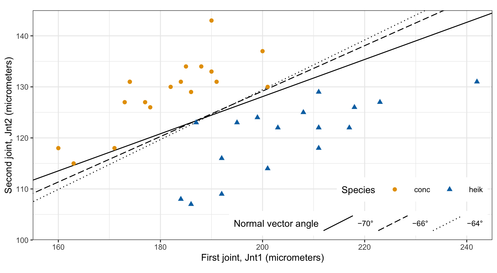{height=520}

::: {style="font-size: 0.7em"}
Legend: direction of $\beta = (\cos\theta, \sin\theta)^\top$, by its angle $\theta$ from the `Jnt1` axis
:::

::: notes
The figure is the chapter's second Separating hyperplanes tab: three lines, each named in the legend by the angle of its normal vector, defined below. Each of the three lines has every heik beetle on one side and every conc beetle on the other. When the classes are separable, a separating hyperplane can be shifted a little, or rotated a little, and still separate them, because each strict inequality y_i f(x_i) > 0 still holds after a small enough change in the betas. So there are infinitely many separating hyperplanes. The legend names the direction of the normal vector beta of each line by its angle theta from the Jnt1 axis, beta = (cos theta, sin theta), in degrees. The three lines have normal vectors at angles -70, -66, and -64 degrees from the Jnt1 axis; every angle between -71.6 and -63.4 degrees gives some separating line through the gap. A classifier needs a rule for picking one.
:::

# Maximal margin

::: notes
This part defines the margin, writes the optimization problem that picks the separating hyperplane with the largest margin, fits it with e1071::svm(), and reads off its estimates.
:::

## Margin

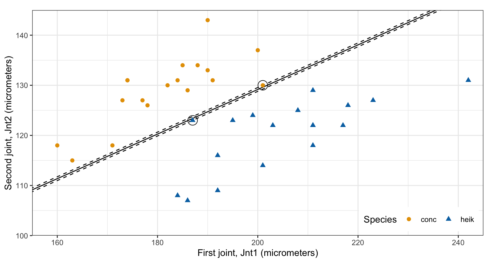{height=520}

::: {style="font-size: 0.7em"}
Margin $= \min_i y_i f(x_i)$, with a unit normal vector
:::

::: notes
The figure is the chapter's second Maximal margin tab: the middle line of the three, the one at -66 degrees, with dashed lines parallel to it through the beetles closest to it. The margin of a separating hyperplane is the smallest distance from it to any training observation. With a unit normal vector, y_i f(x_i) is the distance from x_i to the hyperplane (positive, since the hyperplane separates), so the margin is the minimum over i of y_i f(x_i). The line in the figure, with normal vector at -66 degrees from the Jnt1 axis (the angle of the Non-uniqueness legend), has a margin of 0.35 micrometers, set by the circled beetles (13 and 35); no beetle lies between the dashed lines. The maximal margin hyperplane is the separating hyperplane with the largest margin, and the maximal margin classifier classifies by the side of it a point is on. It is the separating hyperplane farthest from the training observations of both classes, so it has the most room for a new observation to fall near the training observations of its class and still be classified correctly.
:::

## Optimization problem

::: {style="font-size: 0.8em"}
Maximal margin hyperplane: the separating hyperplane with the largest margin

$$
\begin{aligned}
\underset{\beta_0, \beta_1, \ldots, \beta_p, M}{\text{maximize}} \quad & M \\
\text{subject to} \quad & \sum_{j=1}^p \beta_j^2 = 1, \\
& y_i\left(\beta_0 + \beta_1 x_{i1} + \cdots + \beta_p x_{ip}\right) \ge M
\quad \text{for all } i = 1, \ldots, n,
\end{aligned}
$$
:::

::: {.incremental style="font-size: 0.7em"}
- $M$ — margin
- $\sum_j \beta_j^2 = 1$: $\beta_0 + \beta^\top x_i$ is the signed distance from $x_i$ to the hyperplane
- $y_i\left(\beta_0 + \beta^\top x_i\right) \ge M$: observation $i$ on its own class's side, at distance at least $M$
:::

::: notes
The maximal margin hyperplane solves the problem in the display, where M is the margin. The pieces. The constraint that the squared betas sum to 1 makes beta a unit vector, so beta_0 + beta transposed x_i is the signed distance from x_i to the hyperplane. Without it, multiplying beta_0 and every beta_j by 2 would double the left side of the second constraint without moving the hyperplane, and M could be made as large as desired. The constraint y_i (beta_0 + beta transposed x_i) >= M then says that observation i is on its own class's side, at distance at least M. Maximizing M pushes that smallest distance, the margin, as high as it can go. When the classes are separable, the solution has M > 0 and every observation is on the correct side.

If Best offset is dropped, say: for a fixed normal vector beta, the best beta_0 puts the hyperplane midway between the two classes, and the margin is then half the gap between them.
:::

## Best offset

::: {style="font-size: 0.8em"}
Fixed unit normal vector $\beta$:

$$
2M \le \Delta(\beta) = \min_{i: y_i = 1}\beta^\top x_i
- \max_{i: y_i = -1}\beta^\top x_i,
$$
:::

::: {.fragment}
::: {style="font-size: 0.7em"}
- $\Delta(\beta)$ — gap between the classes along $\beta$
:::
:::

::: {.fragment}
::: {style="font-size: 0.8em"}
$$
\beta_0 = -\frac{1}{2}\left(\min_{i: y_i = 1}\beta^\top x_i
+ \max_{i: y_i = -1}\beta^\top x_i\right).
$$

Best hyperplane: midway between the classes, margin $\Delta(\beta)/2$
:::
:::

::: notes
Fix the unit normal vector beta and ask which beta_0 is best. The constraints split by class: beta_0 + beta transposed x_i >= M when y_i = 1, and -beta_0 - beta transposed x_i >= M when y_i = -1. Both hold for all i exactly when M <= beta_0 + the minimum of beta transposed x_i over y_i = 1, and M <= -beta_0 - the maximum of beta transposed x_i over y_i = -1. Adding the two inequalities removes beta_0, giving the first display, where Delta(beta) is the gap between the classes along beta: the distance, measured along beta, between the closest observations of the two classes. Equality holds when the two bounds are equal, at the second display. So for a given normal vector, the best hyperplane sits midway between the classes and its margin is Delta(beta)/2. The classes are separable along beta exactly when Delta(beta) > 0. The three lines of the Non-uniqueness figure were placed this way.
:::

## Best direction

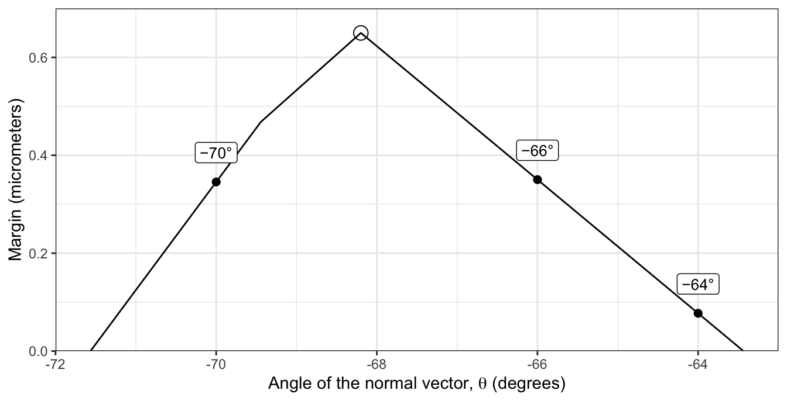{height=440}

::: notes
Recall the gap Delta(beta): the distance, measured along beta, between the closest observations of the two classes, that is, the distance between their closest points projected on the direction beta; the midway hyperplane lies halfway between them, so its margin is Delta(beta)/2. What remains is to choose the direction of beta to make the gap largest. With p = 2, a unit normal vector is beta = (cos theta, sin theta) for an angle theta, so the search is over one number. The figure plots the margin Delta(beta)/2 of the midway hyperplane against theta, for every angle at which the beetles are separable. The margin rises to a single peak, circled, at theta = -68.2 degrees, with margin 0.65 micrometers; the three labeled points are the three lines of the Non-uniqueness figure, at -70, -66, and -64 degrees. With more features the direction cannot be searched on a grid, and the problem is solved as a quadratic program, which e1071::svm() does.
:::

## Fitting

```r
# Maximal margin classifier: linear kernel, a very large cost.
mmc_fit <- svm(Species ~ Jnt1 + Jnt2, data = beetles,
               kernel = "linear", cost = 1e5, scale = FALSE,
               tolerance = 1e-8)
mmc_fit
```

```

Call:
svm(formula = Species ~ Jnt1 + Jnt2, data = beetles, kernel = "linear", 
    cost = 1e+05, tolerance = 1e-08, scale = FALSE)


Parameters:
   SVM-Type:  C-classification 
 SVM-Kernel:  linear 
       cost:  1e+05 

Number of Support Vectors:  3
```

::: notes
e1071::svm() with kernel = "linear" fits a hyperplane in the features. In e1071, cost is a penalty on observations that fall inside the margin or on the wrong side of the hyperplane; a very large cost forbids them, so on separable data the fit is the maximal margin hyperplane. The next lecture explains cost. scale = FALSE keeps both features in micrometers, so the margin is a distance in micrometers; svm() by default standardizes each feature, which changes the distances and so changes which hyperplane has the largest margin. tolerance tightens the solver's stopping rule (its default is 1e-3) so the estimates are accurate to more digits than are printed. The printout gives the settings and the number of support vectors, 3, defined below.

The objects the code slides use: beetles is the data frame of the 36 beetles, with the species coded in the column y (heik = 1, conc = -1) and Specimen the row number; beta_hat and M_hat are computed on the Estimates in R slide, which comes before the Identification slide uses them.

If Best direction is dropped, say: with a few more features the direction of beta cannot be searched on a grid; the problem is solved as a quadratic program, which e1071::svm() does, and with p = 2 the margin plotted against the angle of beta has a single peak, which is what the quadratic program finds.
:::

## Estimates

::: {style="font-size: 0.8em"}
$$
\widehat\beta_0 = \frac{\widehat w_0}{\|\widehat w\|}, \qquad
\widehat\beta = \frac{\widehat w}{\|\widehat w\|}, \qquad
\widehat M = \frac{1}{\|\widehat w\|}.
$$
:::

::: {.fragment}
::: {style="font-size: 0.7em"}
- $w_0 = \beta_0/M$, $w = \beta/M$: rescaled, so $\|w\| = 1/M$ and $y_i\left(w_0 + w^\top x_i\right) \ge 1$
- $\widehat w_0$ is `rho`; $-\widehat w$ is the weighted sum of the support vectors (rows of `SV`, weights `coefs`)
:::
:::

::: notes
svm() does not report the estimates beta-hat_0, ..., beta-hat_p directly. It solves the same problem in a rescaled form. Dividing the unit-norm beta_0 and beta by M, write w_0 = beta_0/M and w = beta/M; then the norm of w is 1/M, and the constraints become y_i (w_0 + w transposed x_i) >= 1. Maximizing M is the same as minimizing the norm of w subject to these constraints, which is the form svm() solves. Undoing the rescaling gives the display. Here w-hat_0 and w-hat are the versions with heik, coded y = 1, on the positive side. svm() works in its own sign, in which its decision values are positive for the class of the first training observation, here conc, so the code checks the sign: it stores the weighted sum of the support vectors (the rows of SV, with weights coefs), which is minus w-hat, and rho, which is w-hat_0. The next slide computes the estimates this way.
:::

## Estimates in R

```r
# w and w0 with heik on the positive side (svm() makes the class of the
# first beetle, conc, positive).
w <- -drop(t(mmc_fit$coefs) %*% mmc_fit$SV)
w0 <- mmc_fit$rho

# Unit-norm estimates and the margin.
norm_w <- sqrt(sum(w^2))
beta_hat <- c(beta0 = w0, w) / norm_w
M_hat <- 1 / norm_w
round(c(beta_hat, M = M_hat), 4)
```

```
  beta0    Jnt1    Jnt2       M 
45.4025  0.3714 -0.9285  0.6499 
```

::: notes
The chunk recovers the unit-norm estimates and the margin from the fit, as on the previous slide. Interpretation of the estimates (skip it if short of time, about half a minute): beta-hat_0 is in micrometers, and beta-hat_1 and beta-hat_2 are micrometers of distance per micrometer of a feature. beta-hat_0 = 45.40 is f-hat at the origin, a beetle with both joints of length 0: the origin lies 45.40 micrometers from the hyperplane on the heik side, far outside the data. beta-hat_1 = 0.37: one more micrometer of first joint increases the beetle's signed distance, f-hat, by 0.37 micrometers. beta-hat_2 = -0.93: one more micrometer of second joint decreases it by 0.93 micrometers. The squares of beta-hat_1 and beta-hat_2 sum to 1, and the normal vector's angle from the Jnt1 axis, -68.2 degrees (beta-hat = (cos theta, sin theta) with theta = -68.2), and the margin M-hat = 0.65 micrometers are those of the peak of the chapter's grid search over angles (the Best direction slide, if taught). Refitting with a cost 100 times larger gives the same estimates to six decimal places.

If the Classification part is dropped, say: a new beetle is classified by the sign of f-hat at its measurements, to heik if positive and to conc if negative, and the absolute value of f-hat is its distance from the hyperplane in micrometers, so the larger it is the more confident the classification; it ranks confidence but is not a probability.
:::

## Fitted hyperplane

::: {.panel-tabset .mid-tabs}

### Maximal margin hyperplane

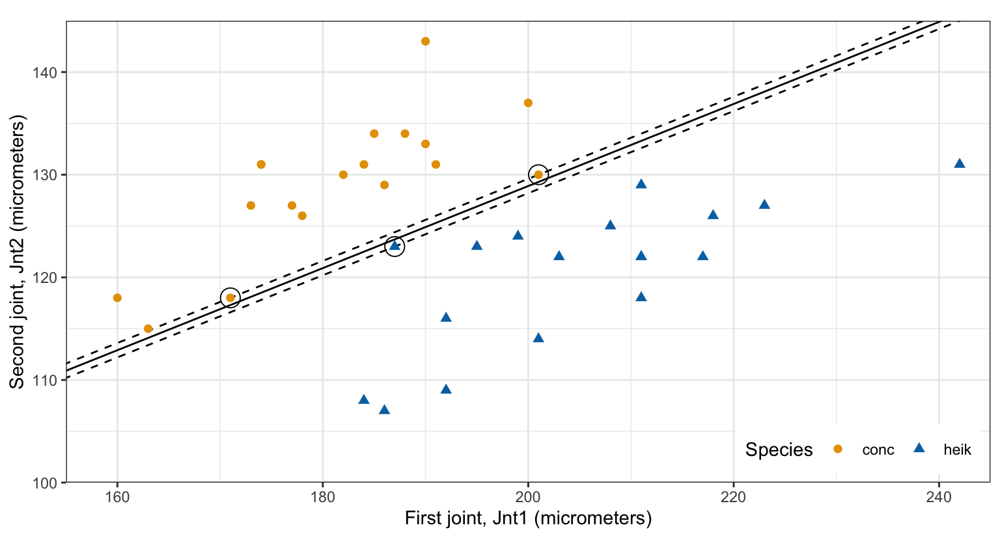

### Gap

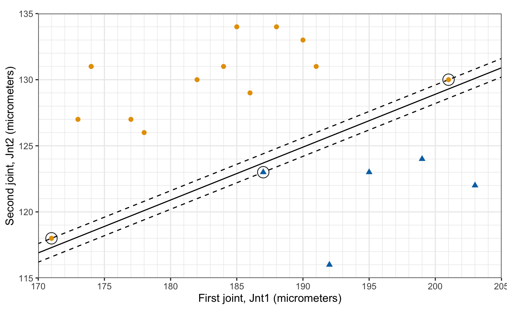

:::

::: notes
The fitted values f-hat(x_i) = beta-hat_0 + beta-hat_1 x_i1 + beta-hat_2 x_i2 are the signed distances of the beetles from the hyperplane. The first tab shows the maximal margin hyperplane (solid), the margins at f-hat(x) = plus or minus M-hat (dashed), and the beetles on the margins circled; the second tab zooms in on the gap. The margin is 0.65 micrometers, less than the 1-micrometer resolution of the measurements: the species are separable, but only just. The next part is about the circled beetles.
:::

# Support vectors

::: notes
The circled beetles of the previous figure are the support vectors. This part identifies them and says what the fitted hyperplane depends on.
:::

## Identification

::: {style="font-size: 0.7em"}
- Support vectors: observations on the margin, $y_i \widehat f(x_i) = \widehat M$
- The fitted hyperplane depends on the training data only through them
:::

```r
# Signed distance of each beetle, and its distance on its own side.
x_beetles <- as.matrix(beetles[c("Jnt1", "Jnt2")])
beetles <- beetles |>
  mutate(f_hat = drop(beta_hat["beta0"] + x_beetles %*% beta_hat[-1]),
         distance = y * f_hat)

# Beetles on the margin: distance M_hat, up to the solver's accuracy.
beetles |>
  filter(distance - M_hat < 1e-6) |>
  select(Specimen, Species, Jnt1, Jnt2, f_hat)
```

```
  Specimen Species Jnt1 Jnt2      f_hat
1        5    conc  171  118 -0.6499337
2       13    conc  201  130 -0.6499337
3       35    heik  187  123  0.6499337
```

::: notes
The support vectors are the training observations on the margin, those with y_i f-hat(x_i) = M-hat. They are vectors in p-dimensional space, and they support the hyperplane in the sense that if any of them moved, the hyperplane would move. For the beetles they are 3 beetles, 5 (conc), 13 (conc), and 35 (heik). The two conc support vectors lie on the dashed line on the conc side and the one heik support vector on the other: the margin cannot grow without one of them crossing it. The fitted hyperplane depends on the training data only through the support vectors. The constraint y_i (beta_0 + beta transposed x_i) >= M of any other observation holds with room to spare at the solution, so deleting it, or moving it anywhere that keeps it outside the margin, leaves the solution unchanged. Deleting a support vector removes a constraint that was holding the margin down, and the solution changes. The Refits slide, optional, shows both; if Refits is dropped, the two sentences before this one are the whole substitute.
:::

## Refits

::: {.auto-table}
|Beetles              | $n$ | $\widehat\beta_0$| $\widehat\beta_1$| $\widehat\beta_2$| $\widehat M$|Support vectors |
|:--------------------|:---:|-------------:|-------------:|-------------:|--------:|:---------------|
|All beetles          | 36  |       45.4025|        0.3714|       -0.9285|   0.6499|5, 13, 35       |
|Without beetle 11    | 35  |       45.4025|        0.3714|       -0.9285|   0.6499|5, 13, 35       |
|Support vectors only |  3  |       45.4025|        0.3714|       -0.9285|   0.6499|5, 13, 35       |
|Without beetle 13    | 35  |        3.4795|        0.5450|       -0.8384|   2.2638|1, 5, 35        |
:::

::: notes
The table refits the maximal margin classifier to four sets of beetles. Deleting beetle 11, the beetle farthest from the hyperplane, or deleting all 33 beetles that are not support vectors, gives the same estimates and margin to the four decimal places shown (and to six). Deleting beetle 13, a support vector, changes the normal vector's angle from -68.2 to -57.0 degrees and the margin from 0.65 to 2.26 micrometers.
:::

# Classification

::: notes
This part classifies two beetles that are not in the data, A and B, with the fitted hyperplane, and reads a distance from it as confidence.
:::

## Classification: new beetles

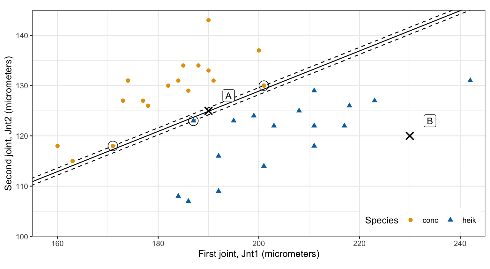{height=560}

::: notes
The figure adds two beetles that are not in the data, A and B, marked by crosses, to the maximal margin hyperplane of the training beetles. A has Jnt1 = 190 and Jnt2 = 125, in the gap between the species; B has Jnt1 = 230 and Jnt2 = 120, among the heik beetles.
:::

## Sign rule

::: {style="font-size: 0.8em"}
New beetle $x^* = (x^*_1, \ldots, x^*_p)^\top$, classified by the sign of

$$
\widehat f(x^*) = \widehat\beta_0 + \widehat\beta_1 x^*_1 + \cdots + \widehat\beta_p x^*_p,
$$
:::

::: {.fragment}
::: {style="font-size: 0.7em"}
- $\widehat f(x^*) > 0$: the class coded $y = 1$
- $\widehat f(x^*) < 0$: the class coded $y = -1$
:::
:::

::: {.fragment}
::: {style="font-size: 0.7em"}
- A: $\widehat f(x^*) = 45.4025 + 0.3714 \times 190 - 0.9285 \times 125 = -0.09$, so `conc`
- B: $\widehat f(x^*) = 19.41$, so `heik`
:::
:::

::: notes
A new observation x* is classified by the sign of f-hat(x*), the display, to the class coded y = 1 if f-hat(x*) > 0 and to the class coded y = -1 if f-hat(x*) < 0. For the beetles, A is classified conc and B heik. predict(mmc_fit, new_beetles), in the chapter, returns the same classes: conc and heik.
:::

## Confidence

::: {style="font-size: 0.7em"}
- $\left|\widehat f(x^*)\right|$ — distance from the new beetle $x^*$ to the hyperplane, in micrometers
- Larger distance, more confident classification
- B: 19.41 micrometers; A: 0.09, less than $\widehat M = 0.65$
- A distance ranks confidence; it is not a probability
:::

::: notes
Because beta-hat has unit length, the absolute value of f-hat(x*) is the distance from x* to the hyperplane in micrometers. The training observations of each class lie on its side, at least M-hat from the hyperplane. A new observation far from it keeps its class under any small tilt or shift of the hyperplane; one near it does not. So the larger the absolute value of f-hat(x*), the more confident the classification. B lies 19.41 micrometers from the hyperplane, well into the heik side. A lies 0.09 micrometers from it, less than the margin of 0.65, inside the gap where no training beetle lies: a slight tilt or shift of the hyperplane would change its class. The distance ranks confidence but is not a probability.
:::

# Limitations

::: notes
The maximal margin classifier has two limitations: it has no solution when the classes are not separable, and it is sensitive to a single observation.
:::

## Non-separable classes

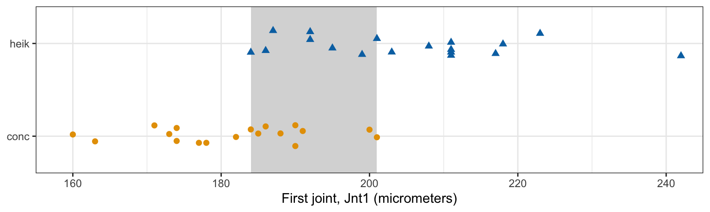{height=290}

::: notes
The figure shows each beetle's first joint alone, by species, with the range of first joints shared by the two species shaded. Points are jittered vertically. With p = 1 a hyperplane is a single point, a cut point on the Jnt1 axis, and it separates the species only if every conc beetle lies below it and every heik beetle above it, or the reverse. The largest conc first joint, 201, exceeds the smallest heik one, 184, and 17 beetles lie in the shaded range between them. No cut point separates the species, so the constraints cannot all hold with M > 0, and no maximal margin hyperplane exists. The same is true of Jnt2 alone, whose ranges overlap from 115 to 131 micrometers. The beetles are separable with both measurements, but in many classification problems the classes overlap whatever features are used. There the maximal margin classifier has no solution.
:::

## Sensitivity

::: {.panel-tabset .mid-tabs}

### All beetles


### Without beetle 13

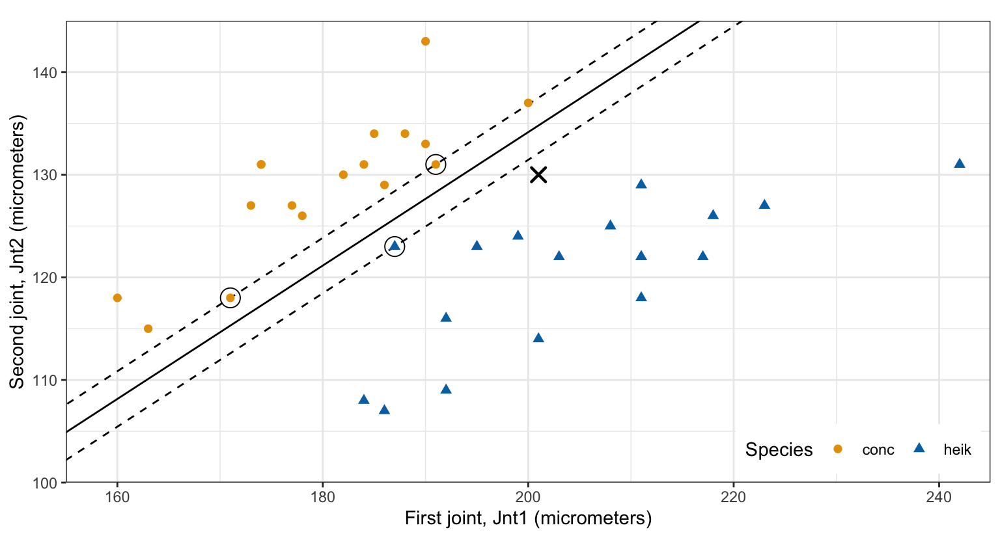

### One added beetle

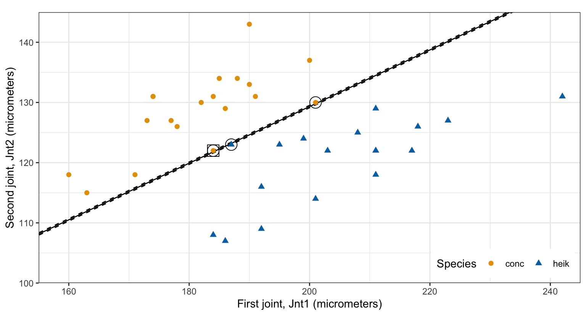

:::

::: notes
If Non-separable classes is dropped, say first: with one feature a hyperplane is a cut point, and it separates the species only if every conc beetle lies below it and every heik beetle above it, or the reverse. Jnt1 alone: the largest conc first joint, 201, exceeds the smallest heik one, 184, and 17 beetles lie between them, so no cut point separates the species. Jnt2 alone: the ranges overlap from 115 to 131 micrometers. So the constraints cannot all hold with M > 0, and no maximal margin hyperplane exists for either measurement alone; in many classification problems the classes overlap whatever features are used, and there the maximal margin classifier has no solution.

The tabs show the fit to all beetles, the fit without support vector 13 (its position marked by a cross), and the fit with one added conc beetle that is not in the data (boxed). Without beetle 13, the hyperplane tilts to an angle of -57.0 degrees, the margin grows from 0.65 to 2.26 micrometers, and beetle 13 itself, a conc beetle, has fitted value 4.02: the refit puts it on the heik side. The added conc beetle, at Jnt1 = 184 and Jnt2 = 122 (boxed), lies in the gap, 0.46 micrometers on the heik side of the original hyperplane. The beetles are still separable with it, and refitting tilts the hyperplane to -64.8 degrees, puts the added beetle on the margin, and shrinks the margin to 0.19 micrometers. The maximal margin hyperplane is set by a few observations, the support vectors, so a change in one observation near the boundary can move it far. A classifier that moves this much with one observation has high variance, and fitting the training observations perfectly can overfit them. The next lecture, the support vector classifier, continues from these tabs: it allows some observations to fall inside the margin or on the wrong side of the hyperplane, so that it exists for overlapping classes and depends less on any single observation.
:::

## Conclusion

- $f(x)$: the side by its sign, the signed distance if $\|\beta\| = 1$
- Separable classes have infinitely many separating hyperplanes
- The maximal margin hyperplane has the largest margin
- The fit depends only on the support vectors
- No solution for overlapping classes; sensitive to single observations
- Next lecture: the support vector classifier

::: notes
A hyperplane in p dimensions is the set where f(x) = beta_0 + beta transposed x = 0. The normal vector beta is perpendicular to it, the sign of f(x) says which side x is on, and when the squared betas sum to 1, f(x) is the signed distance from x to it. Coding two classes as y_i = plus or minus 1 makes y_i f(x_i) > 0 the condition for a hyperplane to separate them. Separable classes have infinitely many separating hyperplanes. The maximal margin hyperplane is the one with the largest margin, the smallest distance to a training observation. It solves the problem of maximizing M subject to the squared betas summing to 1 and y_i (beta_0 + beta transposed x_i) >= M; for a fixed normal vector the best hyperplane is midway between the classes, with margin half the gap between them. e1071::svm() with a linear kernel, scale = FALSE for features in common units, and a very large cost fits it, and the estimates and the margin are recovered from its coefs, SV, and rho. The support vectors are the observations on the margin, and the fitted hyperplane depends only on them. A new observation is classified by the sign of f-hat(x*), and its absolute value measures confidence as a distance. The classifier has two limitations: when the classes overlap no separating hyperplane exists, and when they do not, moving, deleting, or adding one observation near the boundary can move the hyperplane far.

The next lecture covers the support vector classifier, which allows some observations to fall inside the margin or on the wrong side of the hyperplane, so that it exists for overlapping classes and depends less on any single observation.
:::
