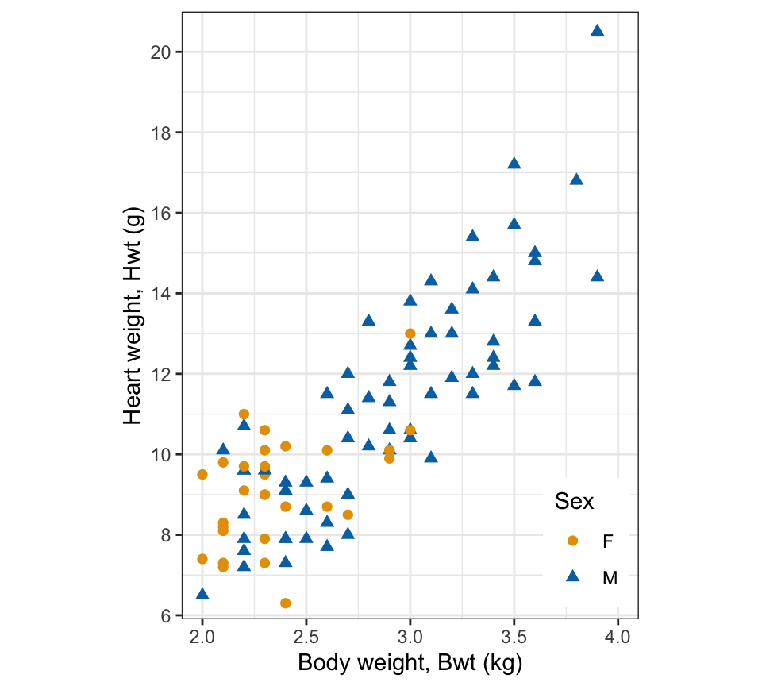
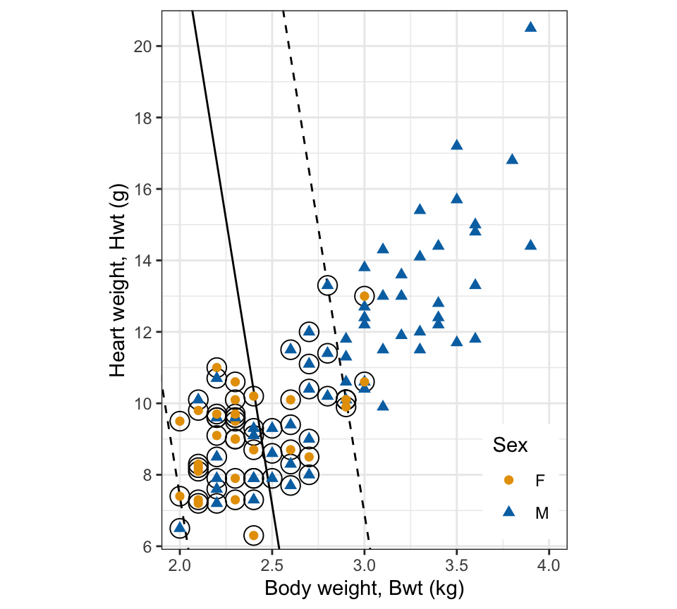
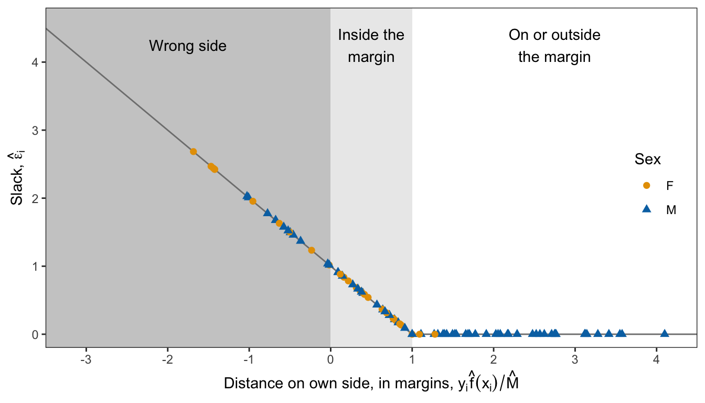
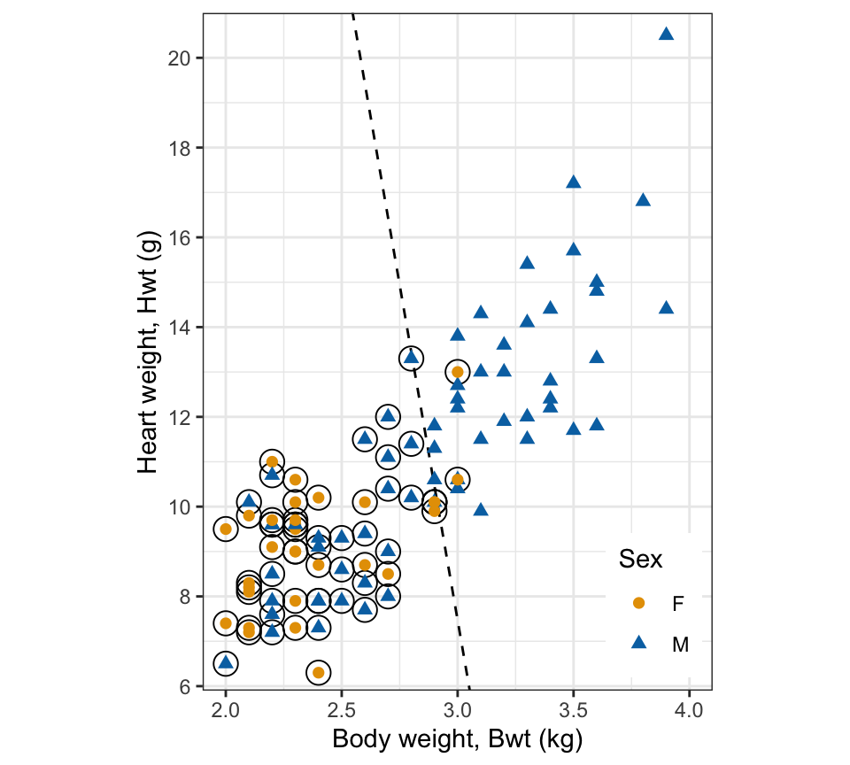
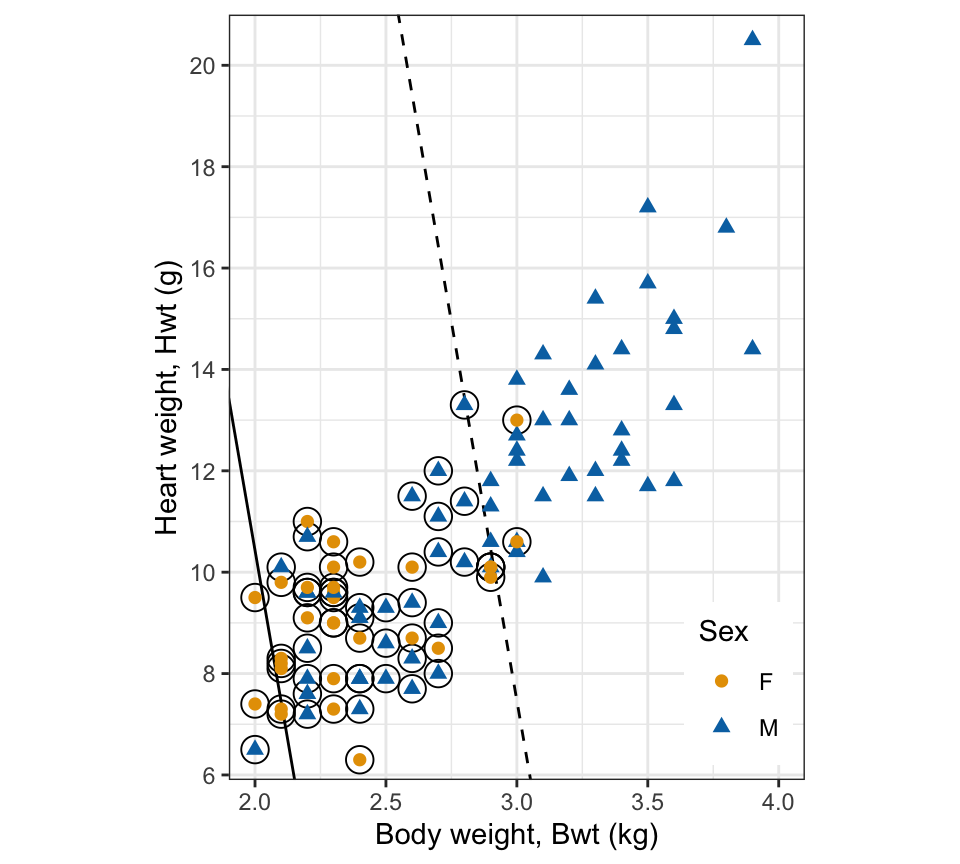
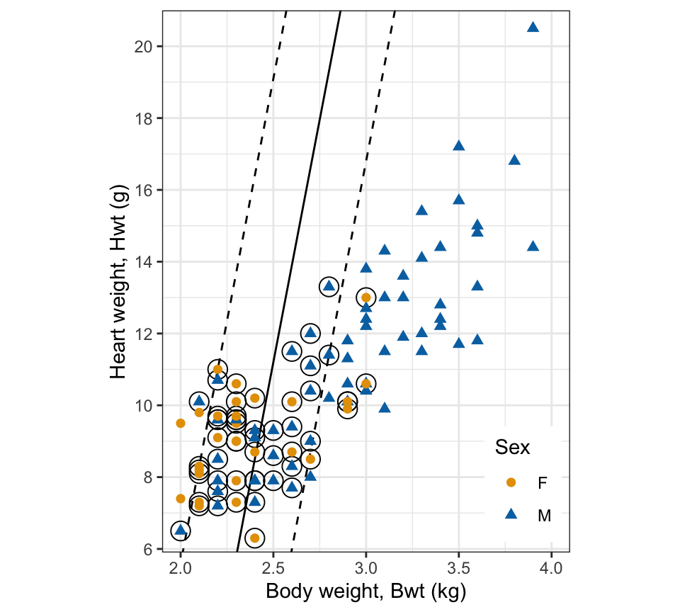
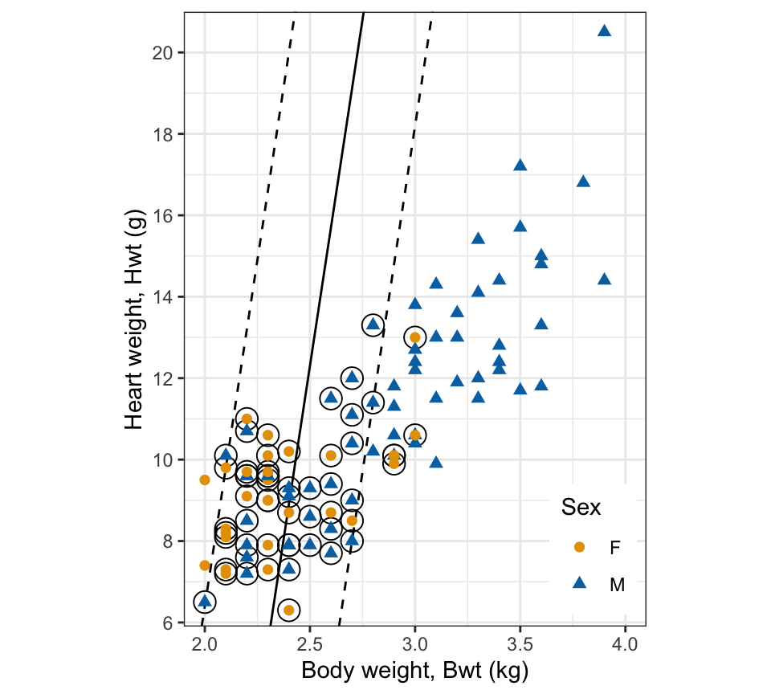
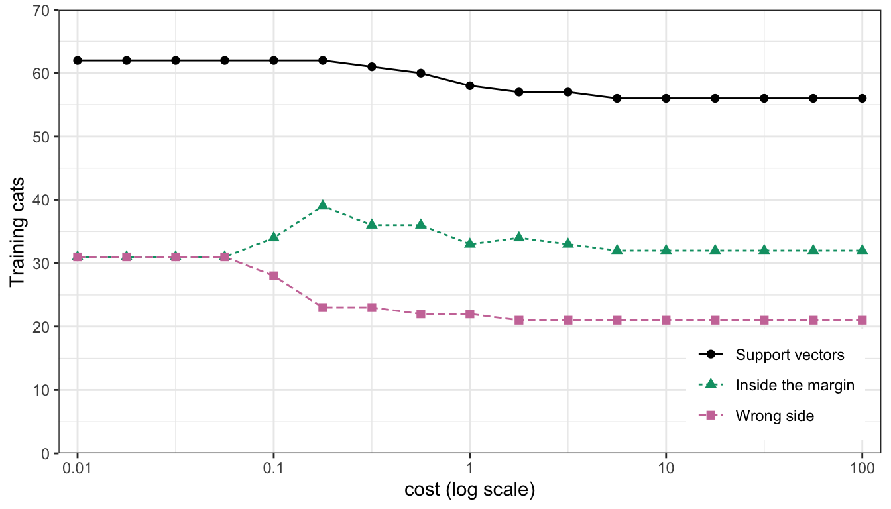
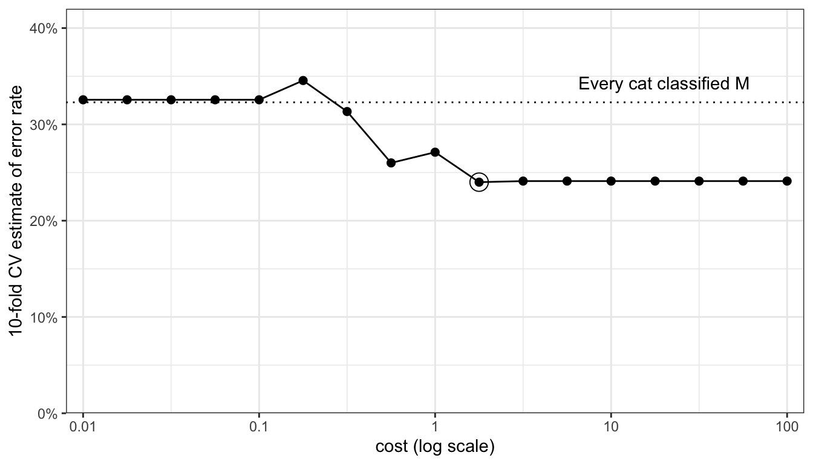
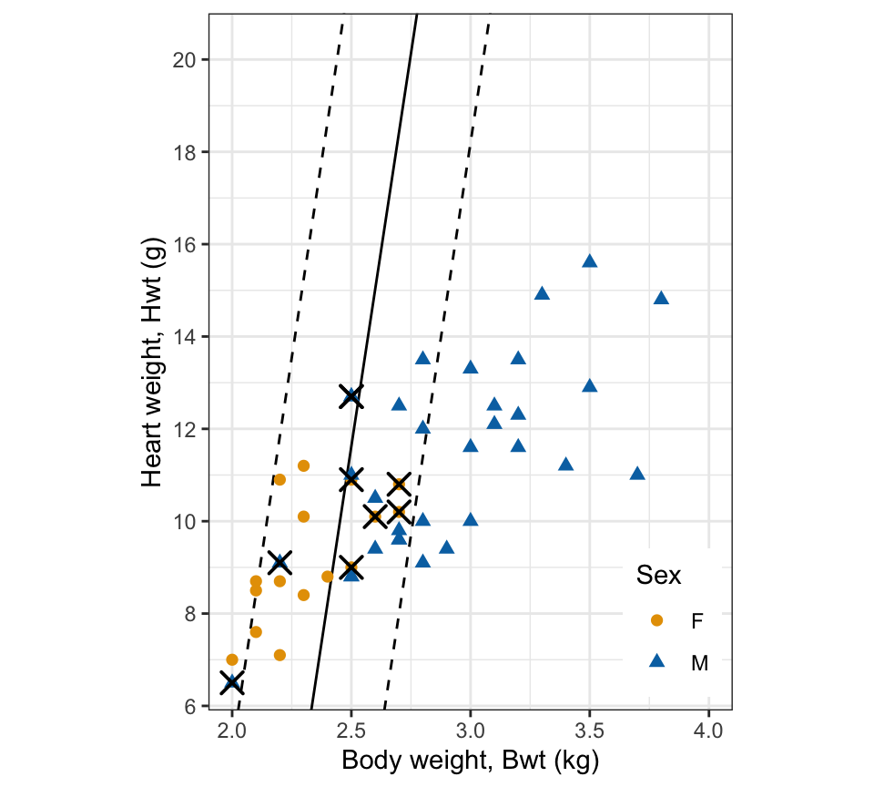

## Today

<!-- derived-from: 09-svm/20-support-vector-classifier.qmd @ uncommitted -->

::: {.columns}
::: {.column width="34%"}
- Cat sex
- Soft margin
  - Overlapping classes
  - Optimization problem
  - Slack variables
:::
::: {.column width="33%"}
- Fitting
  - Penalty form
  - Standardization
  - Estimates
  - Slack estimates
- Budget
  - Bias and variance
  - Cost and budget
:::
::: {.column width="33%"}
- Support vectors
  - Definition
  - Refits
  - Support vector count
- Cross-validation
  - Error rate
  - Curve
- Test error
  - Confusion matrix
:::
:::

::: notes
Distilled from the chapter's five learning objectives: why the maximal margin classifier fails when the classes overlap, the optimization problem of the support vector classifier with slack variables epsilon_i and a budget C, and each of its constraints; classifying a training observation as outside the margin, inside the margin, or on the wrong side of the hyperplane from its slack, identifying the support vectors, and why the fitted hyperplane depends only on them; how the budget C sets the width of the margin and the number of support vectors, so trades bias against variance, and that C = 0 gives the maximal margin classifier; the penalty form that e1071::svm() solves, with tuning parameter cost, which solves the budget problem for a budget that never grows as cost grows, and why the features are standardized before a margin is measured; choosing cost by 10-fold cross-validation with e1071::tune(), and evaluating the chosen classifier by its test error rate and confusion matrix. The collapsed Code callouts, the cross-validation formula, the Sign rule, the sensitivity and specificity, and the Fit tab of the chapter's Slack estimates are not in the deck.

This is the second of three lectures on support vector machines. It covers the support vector classifier, which keeps the flat boundary of the maximal margin classifier but lets some training observations fall inside the margin or on the wrong side of the hyperplane. The reading is ISLR2 Section 9.2.

Timing: one 50-minute period on Wed 2026-11-18, the first minutes of which may go to finishing the maximal margin material from Monday. The core slides, the agenda and 19 content slides, come to 42.5 minutes, with no slack: the seven transitions are counted as zero minutes, so the core fills 50 minutes. The four optional slides add 7 minutes, 49.5 in all. They are in the drop order, the first to drop first: Support vector count (1.5 minutes), Refits (1.5), Penalty form (2) and Estimates (2). Teach the core in the order of the deck and add the optional slides only if time is left; if time is short even without them, drop Standardization: fits (2 minutes) first. Agenda lines to skip when a slide is dropped: Support vector count under Support vectors; Refits under Support vectors; Penalty form under Fitting; Estimates under Fitting. Standardization: fits has no agenda line. The next lecture covers support vector machines, which replace the flat boundary with a curved one by means of kernels.
:::

# Cat sex

::: notes
Question: can a cat's body weight and heart weight tell its sex, and if the two sexes overlap, which straight line should do the telling?
:::

## Cat sex

::: {style="font-size: 0.7em"}
- Class: `Sex` (`M`: $y = 1$, `F`: $y = -1$)
- Explanatory variables ($p = 2$):
  - `Bwt`: body weight (kg)
  - `Hwt`: heart weight (g)
:::

::: {style="font-size: 0.7em; margin-top: 1em"}
- Training cats: 96 (31 `F`, 65 `M`)
- Test cats: 48
:::

::: notes
MASS::cats records the sex, body weight in kilograms (Bwt), and heart weight in grams (Hwt) of 144 adult domestic cats used in experiments with the heart drug digitalis (published by R. A. Fisher in 1947). The observations are cats; each sex is a class, and the two explanatory variables are the features. As in the previous lecture, the class is coded y_i = 1 for M, the second level of the factor, and y_i = -1 for F. The cats are split at random into training cats and test cats, two thirds for training: 96 training cats and 48 test cats. The test cats are used only at the end of the lecture. The training cats hold 31 females and 65 males. In the code, train is the 96 training cats and test the 48 test cats.
:::

## Cat sex: plot

{height=560}

::: notes
The males are heavier on average, 2.90 kg against 2.38 kg, with heavier hearts, 11.3 g against 9.2 g, and heart weight rises with body weight in both sexes. Every female weighs at most 3.0 kg, while males run from 2.0 kg up, so the heavier cats are all male and the 71 cats between 2.0 and 3.0 kg are a mixture of the two sexes, with no line between them. The axes are drawn so that one standard deviation of each measurement among the training cats, 0.50 kg for body weight and 2.59 g for heart weight, has the same length; the Standardization slide explains why.
:::

# Soft margin

::: notes
This part says why the maximal margin classifier fails for the cats, writes the optimization problem of the support vector classifier, and says what each observation's slack means.
:::

## Overlapping classes

::: {style="font-size: 0.7em"}
- Not separable: in 3 places a female and a male cat share both measurements
:::

::: {.fragment}
::: {style="font-size: 0.7em"}
- Maximal margin constraints cannot all hold with $M > 0$:
:::

::: {style="font-size: 0.8em"}
$$
y_i\left(\beta_0 + \beta^\top x_i\right) \ge M
$$
:::
:::

::: notes
The maximal margin classifier of the previous lecture exists only when a hyperplane separates the classes, and when it exists, one observation near the boundary can move it far. The training cats in the figure are not separable: in 3 places a female and a male cat share both measurements, and no hyperplane can put one point on both of its sides. The constraints y_i (beta_0 + beta transposed x_i) >= M of the maximal margin problem cannot all hold with M > 0.
:::

## Optimization problem

::: {style="font-size: 0.7em"}
Support vector classifier, constraints for all $i = 1, \ldots, n$:

$$
\begin{aligned}
\underset{\beta_0, \beta_1, \ldots, \beta_p, \epsilon_1, \ldots, \epsilon_n,
M}{\text{maximize}} \quad & M \\
\text{subject to} \quad & \sum_{j=1}^p \beta_j^2 = 1, \\
& y_i\left(\beta_0 + \beta_1 x_{i1} + \cdots + \beta_p x_{ip}\right) \ge
M(1 - \epsilon_i), \\
& \epsilon_i \ge 0, \quad \sum_{i=1}^n \epsilon_i \le C,
\end{aligned}
$$
:::

::: {.incremental style="font-size: 0.7em"}
- $\epsilon_i$ — slack variable: violation of the margin, in units of $M$
- $C \ge 0$ — budget: bounds the total slack
- $\sum_j \beta_j^2 = 1$: $f(x_i) = \beta_0 + \beta^\top x_i$ is the signed distance to the hyperplane
- $y_i f(x_i) \ge M(1 - \epsilon_i)$: distance on own side at least $M(1 - \epsilon_i)$; $\epsilon_i = 0$ is the maximal margin constraint
:::

::: notes
The support vector classifier, also called the soft margin classifier, allows each observation to violate the margin by an amount it pays for out of a fixed budget. It solves the problem in the display, where the constraints hold for all i = 1, ..., n. The symbol epsilon_i is the slack variable of observation i, the amount by which it may violate the margin, measured in units of the margin M (it is not the error term epsilon of regression), and C >= 0 is the budget, a tuning parameter that bounds the total slack. The pieces. As before, the squared betas summing to 1 makes f(x_i) = beta_0 + beta transposed x_i the signed distance from x_i to the hyperplane, so y_i f(x_i) is that distance, positive on observation i's own side and negative on the other. The second constraint asks observation i to be at distance at least M(1 - epsilon_i) on its own side. With epsilon_i = 0 it is the maximal margin constraint; a positive epsilon_i relaxes it. The budget stops the slack from growing without limit. Without it, every epsilon_i could be made large and M could be as large as desired.
:::

## Slack variables

::: {style="font-size: 0.7em"}
With $f(x_i) = \beta_0 + \beta^\top x_i$:
:::

::: {.incremental style="font-size: 0.7em"}
- $\epsilon_i = 0$: $y_i f(x_i) \ge M$, on the correct side and on or outside the margin
- $0 < \epsilon_i \le 1$: $0 \le y_i f(x_i) < M$, inside the margin on the correct side (on the hyperplane when $\epsilon_i = 1$)
- $\epsilon_i > 1$: $y_i f(x_i) < 0$, on the wrong side of the hyperplane, misclassified
- At most $C$ training observations are misclassified
:::

::: notes
At the solution, each epsilon_i is no larger than its constraint needs, since a smaller epsilon_i leaves more of the budget for the others. So epsilon_i says where observation i lies, in the three cases of the list. Every misclassified training observation uses more than 1 of the budget, so at most C training observations are misclassified. The cats' slacks are estimated on the Slack estimates slide, once the classifier is fit.
:::

# Fitting

::: notes
This part fits the support vector classifier to the training cats with e1071::svm(), says what cost is and why the features are standardized, and reads the fit's estimates and slacks.
:::

## Fitting

```r
# Support vector classifier: linear kernel, standardized features.
svc_fit <- svm(Sex ~ Bwt + Hwt, data = train, kernel = "linear",
               cost = 1, tolerance = 1e-8)
svc_fit
```

```

Call:
svm(formula = Sex ~ Bwt + Hwt, data = train, kernel = "linear", cost = 1, 
    tolerance = 1e-08)


Parameters:
   SVM-Type:  C-classification 
 SVM-Kernel:  linear 
       cost:  1 

Number of Support Vectors:  58
```

::: notes
The support vector classifier of the training cats in the figure is fit by svm() with kernel = "linear". cost = 1 is a starting value, chosen by cross-validation later. svm() standardizes the features by default, for the reason given on the Standardization slide. As in the previous lecture, tolerance tightens the solver's stopping rule so that the estimates are accurate to more digits than are printed. The printout gives the settings and the number of support vectors, 58, defined below. If the Penalty form slide is dropped, say: software solves the problem in a rescaled form, and svm() replaces the budget with a price on slack. It minimizes one half of the squared norm of w plus cost times the sum of the slacks, subject to the rescaled constraints, where cost > 0 is its tuning parameter, the price of one unit of slack. The cost is not the budget C, and it works in the opposite direction. A large cost makes slack expensive, so the fit buys a narrow margin with few violations, which is a small budget; a small cost makes slack cheap, which is a large budget. The Cost and budget slide gives the exact relation: a larger cost gives a budget no larger and a margin no wider.
:::

## Penalty form

::: {style="font-size: 0.8em"}
`e1071::svm()` solves

$$
\underset{w_0, w, \epsilon_1, \ldots, \epsilon_n}{\text{minimize}} \quad
\tfrac{1}{2}\|w\|^2 + \texttt{cost}\sum_{i=1}^n \epsilon_i
\quad \text{subject to} \quad
y_i\left(w_0 + w^\top x_i\right) \ge 1 - \epsilon_i, \quad \epsilon_i \ge 0,
$$
:::

::: {.fragment}
::: {style="font-size: 0.7em"}
- $w_0 = \beta_0/M$, $w = \beta/M$, so $\|w\| = 1/M$
- $\epsilon_i$ — slack variable of observation $i$, as before
- `cost` $> 0$ — price of one unit of slack
- Large `cost`: slack is expensive, a small budget
- Small `cost`: slack is cheap, a large budget
:::
:::

::: notes
Software solves the problem in a rescaled form, as for the maximal margin classifier. Dividing the second constraint by M and writing w_0 = beta_0/M and w = beta/M, so that the norm of w is 1/M, it becomes y_i (w_0 + w transposed x_i) >= 1 - epsilon_i, with the same slack epsilon_i. Maximizing M is minimizing the norm of w, so the budget problem is: minimize one half of the squared norm of w subject to these constraints and the sum of the slacks being at most C. e1071::svm() replaces the budget with a price on slack. It solves the problem in the display, where cost > 0 is its tuning parameter, the price of one unit of slack. (The libsvm documentation behind e1071 writes the slack as xi_i; it is the same quantity as epsilon_i.) The cost is not the budget C, and it works in the opposite direction. A large cost makes slack expensive, so the fit buys a narrow margin with few violations, which is a small budget; a small cost makes slack cheap, which is a large budget. The Cost and budget slide gives the exact relation: a larger cost gives a budget no larger and a margin no wider.
:::

## Standardization

::: {style="font-size: 0.7em"}
- Margin: a distance, adding the features' squared differences in their own units
- Penalty: depends on the units too, so the same `cost` is a different budget
:::

::: {.fragment}
::: {style="font-size: 0.7em"}
- Standardize each feature, as `svm()` does by default (`scale = TRUE`):
:::

::: {style="font-size: 0.8em"}
$$
\tilde x_{ij} = \frac{x_{ij} - \bar x_j}{s_j},
$$
:::
:::

::: {.fragment}
::: {style="font-size: 0.7em"}
- $\bar x_j$ — mean of feature $j$ among the training observations
- $s_j$ — its standard deviation
- $\tilde x_{ij}$ — observation $i$'s value of feature $j$, in standard deviations from that mean
:::
:::

::: notes
The margin is a Euclidean distance between points x and x', the square root of the sum over j of (x_j - x'_j) squared, where x_j is the jth coordinate of x (a single subscript j on a generic point names a coordinate, and a single subscript i names an observation). It adds the squared differences of the features in their own units. With body weight in kilograms and heart weight in grams, a difference of 1 g in heart weight counts as much as a difference of 1 kg in body weight, although 1 g is 0.39 standard deviations of heart weight and 1 kg is 1.99 of body weight. The penalty depends on the units too. Recording feature j in units a times smaller multiplies its values by a, so the same hyperplane needs w_j/a in place of w_j, and its part of the squared norm of w changes from w_j squared to w_j squared over a squared. The trade between the squared norm of w and the slack therefore changes with the units, and the same cost is a different budget. Standardizing removes the units. Each feature is replaced by the display, where x-bar_j is the mean of feature j among the training observations, s_j is its standard deviation (divisor n - 1, as sd() computes), and x-tilde_ij is observation i's value of feature j in standard deviations from that mean. A change of units, x_ij to a x_ij for a > 0, leaves x-tilde_ij unchanged, so the fit no longer depends on the units: refitting the standardized classifier with body weight in grams gives the same hyperplane. svm() does this by default (scale = TRUE): it standardizes each feature with the training observations' means and standard deviations, stores them in the fit's x.scale, and applies the same ones to any new observation passed to predict(). The previous lecture set scale = FALSE because both beetle measurements were in micrometers, where a distance in micrometers means something. The cats' measurements are in different units, so the fits in this lecture standardize. If the Standardization: fits slide is dropped, say: the same cost = 1 gives a different hyperplane unscaled, with the measurements as recorded (scale = FALSE), than standardized; per standard deviation of each measurement the unit normal vector is (0.99, 0.16) unscaled and (0.99, -0.15) standardized, a turn of 17.8 degrees, and their training error rates are 24.0% and 22.9%.
:::

## Standardization: fits

::: {.panel-tabset .mid-tabs}

### Unscaled



### Standardized


:::

::: notes
The tabs show two fits with cost = 1: unscaled, with the measurements as recorded (scale = FALSE), and standardized (the fit above). Each has its hyperplane (solid), its margins (dashed), and its support vectors (circled). The axes are drawn so that one standard deviation of each measurement has the same length. Per standard deviation of each measurement, the unit normal vector of the unscaled fit is (0.99, 0.16) and that of the standardized fit (0.99, -0.15): both are mostly body weight, and they differ in the sign of the heart weight part, a turn of 17.8 degrees. Their training error rates are 24.0% and 22.9%, and the budgets they use, the sum of the estimated slacks, are 56.15 and 54.55. The standardized fit's margins lie 0.64 standard deviations from its hyperplane, a distance in the picture. The unscaled fit's margins lie 0.97 standard deviations from its hyperplane in the picture, but the margin svm() maximizes for it, 1 over the norm of w-hat, 0.49, is a distance in kilograms and grams together.
:::

## Estimates

```r
# w and w0 with M on the positive side.
w_hat <- svc_w(svc_fit)

# Unit-norm estimates on the standardized scale, and the margin.
norm_w <- sqrt(sum(w_hat$w^2))
beta_hat <- c(beta0 = w_hat$w0, w_hat$w) / norm_w
M_hat <- 1 / norm_w
round(c(beta_hat, M = M_hat), 4)
```

```
  beta0     Bwt     Hwt       M 
 0.5519  0.9887 -0.1502  0.6426 
```

::: notes
svc_w() is a helper the chapter defines in a collapsed Code callout: it reads w_0 and w from the fit's coefs, SV and rho and fixes the sign so that M is on the positive side. Undoing the rescaling gives the estimates on the standardized scale: beta-hat_0 = w-hat_0 over the norm of w-hat, beta-hat = w-hat over the norm of w-hat, and M-hat = 1 over the norm of w-hat, with w-hat and w-hat_0 read from the fit's coefs, SV, and rho as in the previous lecture (here SV holds the support vectors' standardized features). svm()'s decision values are positive for the class of its first training observation, which here is M, so the class coded y = 1. The fitted value f-hat(x) = beta-hat_0 + beta-hat_1 x-tilde_1 + beta-hat_2 x-tilde_2 is the signed distance from x to the hyperplane in the standardized features, in standard deviations, with x-tilde_1 and x-tilde_2 the standardized body and heart weights. beta-hat_0 = 0.55 is f-hat at x-tilde = 0, a cat of average body and heart weight among the training cats: it lies 0.55 standard deviations from the hyperplane on the M side. beta-hat_1 = 0.99: one standard deviation more body weight (0.50 kg) moves a cat 0.99 standard deviations toward the M side. beta-hat_2 = -0.15: one standard deviation more heart weight (2.59 g) moves it 0.15 standard deviations toward the F side. Body weight carries most of the classification; among cats of the same body weight, a heavier heart points slightly toward female. The margin is M-hat = 0.64 standard deviations.
:::

## Slack estimates

::: {.columns}
::: {.column width="72%"}
{height=480}
:::
::: {.column width="28%"}
::: {style="font-size: 0.55em; margin-top: 3em"}
$$
\widehat\epsilon_i = \max\left(0,\ 1 - \frac{y_i \widehat f(x_i)}{\widehat M}\right),
$$

- $\widehat f(x)$ — fitted value
- $\widehat M$ — margin
:::
:::
:::

::: notes
Each epsilon-hat_i is the smallest slack its constraint allows, the display, where y_i f-hat(x_i) over M-hat is observation i's distance from the hyperplane on its own side, in margins. The figure plots each training cat's slack against that distance, with the three kinds of observation shaded; f-hat is the fitted value, the signed distance from x to the hyperplane, and M-hat the margin, as in the previous lecture (on the standardized scale, M-hat = 0.64 standard deviations). If the Estimates slide is dropped, say: the unit-norm estimates are read from the svm() fit as in the previous lecture, beta-hat = w-hat over its norm and M-hat = 1 over the norm of w-hat, and the margin is 0.64 standard deviations. Of the 96 training cats, 41 are on or outside the margin (3 of them exactly on it) with epsilon-hat_i = 0, 33 are inside the margin on the correct side, and 22 are on the wrong side of the hyperplane, so the training error rate is 22.9%. The slacks lie on the line epsilon-hat_i = 1 - y_i f-hat(x_i) over M-hat to the left of 1 and at 0 to its right. They add to 54.55, the budget this fit uses. The cats in the shaded wrong-side band, with a negative distance, are both males and females; on the Support vectors figure they are the lighter males, left of the solid line, and the heavier females, right of it.
:::

# Budget

::: notes
This part fits the support vector classifier at four values of cost, reads the budget as the tuning parameter that trades bias against variance, and relates cost to the budget.
:::

## Budget

::: {.panel-tabset .mid-tabs}

### `cost` = 0.01



### `cost` = 0.1



### `cost` = 1


### `cost` = 10



:::

::: notes
The tabs show support vector classifiers fit with four values of cost, from small to large, each with its hyperplane, margins, and support vectors circled; the chapter's first tab, the training cats alone, is not repeated. With cost = 0.01 slack is so cheap that the margin is 17.7 standard deviations. The hyperplane and the margin on the F side lie off the plot to the left; only the margin on the M side (dashed) is in view. Every training cat is classified M, the more common sex, so every female is on the wrong side, and the 62 support vectors are the cats left of the dashed line. As cost grows the margin narrows and the hyperplane turns to separate light from heavy cats, but it changes little from cost = 1 to 10.
:::

## Bias and variance

::: {.incremental style="font-size: 0.7em"}
- $C = 0$: the maximal margin classifier, which exists only for separable classes
- Small $C$: narrow margin, few support vectors, low bias, high variance
- Large $C$: wide margin, many support vectors, low variance, more bias
:::

::: notes
The budget C is the classifier's tuning parameter. C = 0 allows no slack, and the problem is the maximal margin problem: the support vector classifier with C = 0 is the maximal margin classifier, and it exists only for separable classes. A small C allows little slack, so the margin is narrow, few observations are on or inside it, and the hyperplane is set by those few. It follows the training observations near the boundary closely: low bias, high variance. A large C allows much slack, so the margin is wide, many observations are inside it, and the hyperplane is set by all of them, each with a small part. It moves little when one observation changes: low variance, but more bias. Read against the tabs, a small cost is a large budget, so the cost = 0.01 tab is the wide margin and the cost = 10 tab the narrow one. If the Support vector count slide is dropped, say: the number of support vectors falls from 62 at cost = 0.01 to 56 at cost = 100, as the margin narrows from 17.7 to 0.57 standard deviations.
:::

## Cost and budget

::: {style="font-size: 0.7em"}
- Larger `cost`: budget $C$ no larger, margin $\widehat M$ no wider
- `cost` $\ne C$: the $C$ a `cost` gives depends on the data
- `cost` $\to \infty$ on separable data: the maximal margin classifier
:::

::: {.fragment}
::: {.auto-table}
| `cost`| $\sum_i\widehat\epsilon_i$| $\widehat M$| Support vectors| Inside the margin| Wrong side| Training error rate|
|------:|----------------------:|--------:|---------------:|-----------------:|----------:|-------------------:|
|   0.01|                  61.68|    17.68|              62|                31|         31|               0.323|
|   0.10|                  58.80|     1.77|              62|                34|         28|               0.292|
|   1.00|                  54.55|     0.64|              58|                33|         22|               0.229|
|  10.00|                  54.41|     0.57|              56|                32|         21|               0.219|
:::
:::

::: notes
The statement is the first bullet: svm()'s penalty form solves the budget problem, for a budget set by cost, and the budget is a weakly monotone function of cost, a larger cost corresponding to a budget no larger, and it can be constant on a plateau (the cats have one, from cost = 5.62 on). The proof stays in the chapter; here it is for the instructor. Let (w-hat_0, w-hat, epsilon-hat) solve the penalty problem at some cost, and let C be the sum of the epsilon-hat_i. Any (w_0, w, epsilon) that satisfies the budget problem's constraints with this C also satisfies the penalty problem's, so one half of the squared norm of w plus cost times the sum of the epsilon_i is at least one half of the squared norm of w-hat plus cost times C; so one half of the squared norm of w is at least one half of the squared norm of w-hat plus cost times (C minus the sum of the epsilon_i), which is at least one half of the squared norm of w-hat, because the sum of the epsilon_i is at most C. No point within the budget has a smaller norm of w, so w-hat solves the budget problem with budget C equal to the sum of the epsilon-hat_i. The budget does not grow as cost grows. Write N for one half of the squared norm of w-hat and S for the sum of the epsilon-hat_i for the solution at cost = a, and N' and S' for the solution at cost = b > a. Each solution is at least as good as the other at its own cost: N + aS <= N' + aS' and N' + bS' <= N + bS. Adding the two gives aS + bS' <= aS' + bS, that is, (b - a)(S' - S) <= 0, so S' <= S: the larger cost uses no more budget. Then the first inequality gives N <= N': the larger cost has a margin 1 over the norm of w-hat no wider. The cost and C are not equal, and the C that a cost gives depends on the data. As cost grows without bound on separable data, the budget falls to 0 and the fit becomes the maximal margin classifier, which is why the previous lecture used a very large cost. The table is for the four fits in the tabs: the budget used, the sum of the epsilon-hat_i, and the margin M-hat fall as cost grows. The budget stays above the number of misclassified training cats, as it must.
:::

# Support vectors

::: notes
This part defines the support vectors of the support vector classifier and says what the fitted hyperplane depends on.
:::

## Support vectors

{height=560}

::: notes
The figure is the fit with cost = 1 again (the cost = 1 tab of Budget), with its support vectors circled.
:::

## Definition

::: {.incremental style="font-size: 0.7em"}
- Support vectors: $y_i\widehat f(x_i) \le \widehat M$, on the margin, inside it, or on the wrong side of the hyperplane
- Wider than the previous lecture's: the observations on the margin only, the case with no slack
- Circled cats: 58 of the 96
- The fitted hyperplane depends only on them
:::

::: notes
The support vectors of the support vector classifier are the training observations on the margin, inside it, or on the wrong side of the hyperplane: those with y_i f-hat(x_i) <= M-hat. This is wider than the previous lecture's definition, the observations on the margin only, which is the case with no slack. They are the circled cats, 58 of the 96: the 3 on the margin, with epsilon-hat_i = 0, and all 55 with epsilon-hat_i > 0. The fitted hyperplane depends on the training data only through the support vectors. An observation outside the margin has epsilon-hat_i = 0 and its constraint holds with room to spare, so deleting it, or moving it anywhere outside the margin, leaves the fit unchanged. If the Refits slide is dropped, say: refitting the standardized problem to the 58 support vectors alone, with the training cats' means and standard deviations, gives the same estimates to six decimal places; and the difference from the maximal margin classifier is how many support vectors there are. There, a handful of observations on the margin set the hyperplane; here every observation inside the margin or on the wrong side does, and a wider margin holds more of them.
:::

## Refits

::: {.incremental style="font-size: 0.7em"}
- Delete an observation outside the margin, or move it anywhere outside: the fit is unchanged
- Refit to the 58 support vectors alone: the same estimates, to six decimal places
- Maximal margin: a handful of support vectors; here, every observation inside the margin or on the wrong side
:::

::: notes
The fitted hyperplane depends on the training data only through the support vectors. An observation outside the margin has epsilon-hat_i = 0 and its constraint holds with room to spare. Suppose deleting it allowed a better solution. Moving from the current solution a short way toward that better one keeps the deleted observation's constraint satisfied (it held strictly), keeps every other constraint satisfied (each defines a convex set that contains both ends), and lowers the objective (which is convex). That point would then beat the current solution of the full problem, which is impossible. So deleting an observation outside the margin, or moving it anywhere outside the margin, leaves the fit unchanged. Refitting the standardized problem to the 58 support vectors alone, with the training cats' means and standard deviations, gives the same estimates to six decimal places. The difference from the maximal margin classifier is how many support vectors there are. There, a handful of observations on the margin set the hyperplane; here every observation inside the margin or on the wrong side does, and a wider margin holds more of them.
:::

## Support vector count

{height=480}

::: notes
The figure counts the support vectors, and the two kinds with positive slack, for fits over a grid of cost values. The number of support vectors falls from 62 at cost = 0.01 to 56 at cost = 100, as the margin narrows from 17.7 to 0.57 standard deviations. Because the sexes overlap so much, more than half of the training cats are support vectors at every cost, including the 21 or more misclassified training cats of every fit on the grid. From cost = 5.62 on, the fit no longer changes: its budget used, 54.41, is the smallest total slack that any hyperplane leaves these training cats, so a larger cost cannot reduce it. The three counts are flat from cost = 5.62 on: 56 support vectors, 32 inside the margin and 21 on the wrong side.
:::

# Cross-validation

::: notes
The budget, and so cost, is chosen by cross-validation, as in the resampling lectures, from the training cats alone; the test cats stay aside.
:::

## Error rate

```r
# 10-fold cross-validation over the grid of cost values.
cv_fit <- tune(svm, Sex ~ Bwt + Hwt, data = train, kernel = "linear",
               ranges = list(cost = cost_grid))
head(cv_fit$performances, 3)
cv_fit$best.parameters
```

```
        cost     error dispersion
1 0.01000000 0.3255556  0.1478747
2 0.01778279 0.3255556  0.1478747
3 0.03162278 0.3255556  0.1478747
```

```
       cost
10 1.778279
```

::: notes
With the training cats split at random into k = 10 folds F_1, ..., F_10 of sizes n_l, the estimate for a given cost is CV_(10)(cost), the average over the folds of Err_l, where Err_l is the error rate on fold l of the support vector classifier fit with that cost to the training cats outside fold l. e1071::tune() averages the fold error rates with equal weights, so with folds of different sizes it differs slightly from the size-weighted average of the resampling lectures. Each fit inside tune() standardizes with its own training folds' means and standard deviations, so the standardization is part of the fit being cross-validated. tune() takes the fitting function, the model, any further arguments for it, and a list of values of the tuning parameter, here cost_grid, the grid of cost values the chapter defines in a collapsed Code callout, 10^seq(-2, 2, by = 0.25): 4 values per factor of 10 from 0.01 to 100. Its folds are random, which the seed set at the top of the chapter makes reproducible. The fits inside it keep svm()'s default tolerance; with the tighter one, the solver stops at its iteration limit on some folds. The performances table has one row per cost: error is CV_(10)(cost), by default the misclassification rate, and dispersion the standard deviation of the 10 fold error rates. best.parameters is the cost with the smallest error (the smallest such cost if several tie), and best.model is the support vector classifier refit with it to all the training cats.
:::

## Curve

{height=480}

::: notes
For small cost, the estimate is close to the error rate of classifying every training cat M (dotted): the margin is so wide that the classifier fit to each set of training folds puts nearly every cat on the M side. The estimate is not monotone in cost (it rises to 34.6% at cost = 0.18); it is smallest, 24.0%, at cost = 1.78 (circled), after which it is nearly flat. A linear boundary in two features has only three estimates, so even the narrowest margin on this grid varies little from one set of training folds to another, and the curve does not rise again at large cost. The fold error rates at the chosen cost have standard deviation 16.0%, so differences of a few percentage points along the curve are within the noise of the estimate.
:::

# Test error

::: notes
This part evaluates the chosen classifier on the test cats, which played no part in fitting or in choosing cost.
:::

## Test error

{height=560}

::: notes
The figure shows the 48 test cats and the support vector classifier chosen by cross-validation, refit to all the training cats, with its hyperplane and margins; crosses mark the test cats it misclassifies. A new observation x* is classified by the sign of f-hat(x*), as for the maximal margin classifier: to M if f-hat(x*) > 0 and to F if f-hat(x*) < 0. predict() standardizes x* with the training cats' means and standard deviations first.
:::

## Confusion matrix

```
     Predicted
Truth  F  M
    F 11  5
    M  4 28
```

::: {style="font-size: 0.7em; margin-top: 1em"}
- Positive class: `M`
:::

::: {.fragment}
::: {style="font-size: 0.7em"}
- Test error rate: $(FP + FN)/n = (5 + 4)/48 = 0.188$
- Classifying every test cat `M`: 33.3%
:::
:::

::: notes
With M, the class coded y = 1, as the positive class, the confusion matrix of the test cats is the printout, with the truth in the rows and the predictions in the columns. The test error rate is (FP + FN)/n = (5 + 4)/48 = 0.188, against 33.3% for classifying every test cat M. The sensitivity, the proportion of male cats classified male, is 87.5%, and the specificity, the proportion of female cats classified female, is 68.8%. The training error rate of the same fit is 21.9% and its cross-validation estimate 24.0%; the test cats played no part in fitting or in choosing cost, so the test error rate is the honest estimate, if a noisy one from 48 cats. The misclassified test cats lie where the training cats of the two sexes overlapped: the lighter males and the heavier females.
:::

## Conclusion

- Overlapping classes need slack, bounded by a budget $C$
- At most $C$ training observations are misclassified
- The fit depends only on the support vectors
- Small budget: low bias, high variance; large budget: the reverse
- Larger `cost`: budget no larger, margin no wider; features standardized
- `cost` by cross-validation; judged by the test error rate

::: notes
When the classes overlap, no hyperplane separates them and the maximal margin classifier does not exist. The support vector classifier gives each observation a slack variable epsilon_i >= 0, requires y_i (beta_0 + beta transposed x_i) >= M(1 - epsilon_i) with the squared betas summing to 1, and maximizes the margin M subject to a budget, the sum of the epsilon_i being at most C. An observation with epsilon_i = 0 is on the correct side, on or outside the margin; one with 0 < epsilon_i <= 1 is inside the margin on the correct side; one with epsilon_i > 1 is on the wrong side of the hyperplane, so at most C training observations are misclassified. The support vectors are the observations on or inside the margin or on the wrong side, and the fitted hyperplane depends only on them. The budget is the tuning parameter: C = 0 gives the maximal margin classifier, a small C a narrow margin with few support vectors (low bias, high variance), and a large C a wide margin with many (low variance, more bias). A new observation is classified by the sign of f-hat(x*). e1071::svm() solves the equivalent penalty form, minimizing one half of the squared norm of w plus cost times the sum of the epsilon_i; a larger cost gives a budget no larger and a margin no wider, so cost and C move in opposite directions. Because a margin is a distance, svm() standardizes the features by default, which makes the fit independent of their units. e1071::tune() chooses cost by 10-fold cross-validation of the error rate, and the chosen classifier is judged by its test error rate and confusion matrix.

The next lecture covers support vector machines, which replace the flat boundary with a curved one by means of kernels, tune cost together with a kernel's own parameter, extend to more than two classes, and compare the support vector classifier's loss with that of logistic regression.
:::
