## Today

<!-- derived-from: 09-svm/30-support-vector-machines.qmd @ uncommitted -->

::: {.columns}
::: {.column width="32%"}
- Sacramento homes
- Enlarged feature space
  - Polynomial features
  - Feature count
:::
::: {.column width="28%"}
- Kernels
  - Inner products
  - Kernel functions
  - Polynomial kernel
  - Radial kernel
  - Fitting
- Tuning
  - Grid
  - Test error
:::
::: {.column width="40%"}
- More than two classes
  - One versus one and one versus all
  - Pairwise voting
- Hinge and logistic loss
  - Loss plus penalty
  - Logistic loss
  - Comparison
:::
:::

::: notes
Distilled from the chapter's six learning objectives: how a support vector classifier fit to polynomial features gives a curved boundary in the explanatory variables, and how fast the number of such features grows with the number of explanatory variables and the degree; that the classifier classifies a new observation through its inner products with the support vectors alone, the support vector machine as that classifier with a kernel K(x, x_i), and the linear, polynomial and radial kernels; the derivation that the polynomial kernel of degree 2 is the inner product of an enlarged set of features, and why the radial kernel is local and how its gamma trades bias against variance; choosing cost and gamma by 10-fold cross-validation over a two-dimensional grid with e1071::tune(), and evaluating the chosen support vector machine against the linear support vector classifier by test error rate and confusion matrix; the one-versus-one and one-versus-all approaches to more than two classes, and how svm() classifies by one-versus-one voting; and the hinge-loss-plus-penalty form of the support vector classifier and its comparison with the logistic regression loss. The agenda is in the order of the deck, which follows the chapter, and names every part and subsection the deck spends slides on, the optional ones included: if Feature count is dropped, skip that agenda line, and if Comparison is dropped, skip that line (Polynomial features: fit has no agenda line). The collapsed Code callouts and the Beyond this course callout are not in the deck; the chapter's three differences between the classifiers and the pairwise voting call and vote count are in the speaker notes only (of Logistic loss and of Pairwise voting).

This is the last of three lectures on support vector machines. The previous two fit a flat boundary, a hyperplane, with a margin that the support vector classifier lets observations violate at a price cost. This lecture curves the boundary. The reading is ISLR2 Sections 9.3 to 9.5.

Timing: one 50-minute period on Fri 2026-11-20. The core slides, the agenda and 21 content slides, come to about 45 minutes. The three optional slides add 4.5 minutes, 49.5 in all. They are in the drop order, the first to drop first: Comparison (2 minutes), Feature count (1) and Polynomial features: fit (1.5). Teach the core in the order of the deck and add the optional slides only if time is left; each slide's notes say what to say if it is dropped. The next lecture begins unsupervised learning with clustering.
:::

# Sacramento homes

::: notes
Question: within the Sacramento metropolitan area, can a home's location alone tell whether it is in the city of Sacramento or in one of the cities around it?
:::

## Sacramento homes

::: {style="font-size: 0.7em"}
- Class: `place`, the city (`Sacramento`: $y = 1$, `Other`: $y = -1$)
- Explanatory variables ($p = 2$):
  - `longitude` (degrees)
  - `latitude` (degrees)
:::

::: {style="font-size: 0.7em; margin-top: 1em"}
- Training homes: 621 (327 `Other`, 294 `Sacramento`)
- Test homes: 311
:::

::: notes
modeldata::Sacramento records 932 home sales reported in the Sacramento area over five days in May 2008, with each home's city and its location as longitude and latitude in degrees. The observations are homes. The class is the city, coded y_i = 1 for Sacramento, the second level of the factor, and y_i = -1 for Other, any of the 36 other cities. The two explanatory variables are longitude and latitude. Two thirds of the homes, chosen at random, are the training homes, 621 of them (327 in Other cities and 294 in Sacramento), and the rest, 311, are the test homes, used only to evaluate the chosen classifiers.
:::

## Sacramento homes: plot

{height=560}

::: notes
The training homes in the city of Sacramento form a block in the west of the area. Homes in other cities lie north, east and south of that block, and a few lie west of it. No straight line puts the Sacramento homes on one side and the others on the other: any line through the block leaves other cities on both sides. The axes are drawn so that one standard deviation of each coordinate among the training homes, s_longitude = 0.1367 and s_latitude = 0.1375 degrees, has the same length, since svm() standardizes both. A degree of longitude here is about 87 km and a degree of latitude about 111 km, so the figure is wider than a map.
:::

# Enlarged feature space

::: notes
The tabs fit support vector classifiers to polynomial features of the two coordinates, of degree 1 (the coordinates themselves), 2 and 3. The next slide says what such a fit is, and Feature count, which is optional, says what it costs (if Feature count is dropped, skip that clause).
:::

## Enlarged feature space

::: {.panel-tabset .fig-tabs}

### Degree 1

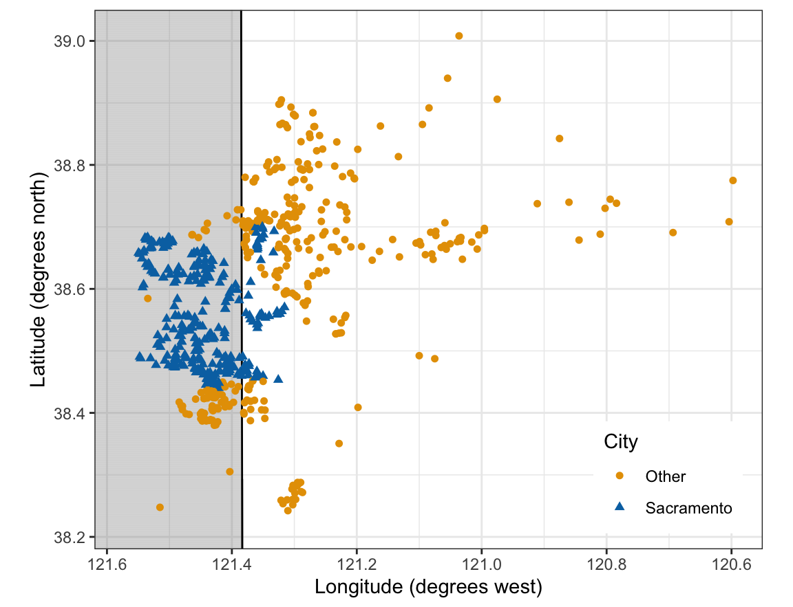

### Degree 2

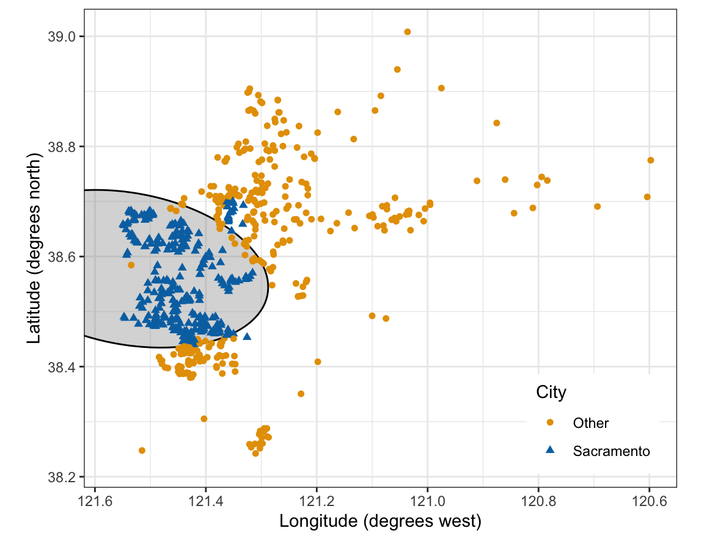

### Degree 3

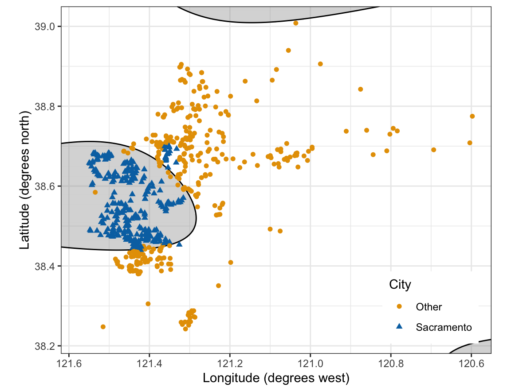

:::

::: notes
The tabs show support vector classifiers fit to polynomial features of the two coordinates, of degree 1 (the coordinates themselves), 2 and 3; the chapter's first tab, the training homes alone, is not repeated. Each shades the region classified Sacramento and draws the boundary f-hat(x) = 0. The degree-1 boundary is a line. The degree-2 fit's boundary is an ellipse around the city's block. Degree 3 adds the four cubic features, and the boundary becomes a cubic curve, which also gives Sacramento two regions at the edge of the plot, far from any home. This is the feature engineering of the regression lectures, with a hyperplane in place of least squares. The training error rates of the three fits, all with cost = 1, are 20.1%, 6.6% and 6.3%.
:::

## Polynomial features

::: {style="font-size: 0.7em"}
Support vector classifier on the degree-2 features:
:::

::: {style="font-size: 0.8em"}
$$
\widehat w_0 + \widehat w_1X_1 + \widehat w_2X_2 + \widehat w_3X_1^2 + \widehat w_4X_1X_2
+ \widehat w_5X_2^2 = 0
$$
:::

::: {.incremental style="font-size: 0.7em"}
- $X_1, X_2$ — standardized longitude and latitude
- $\widehat w_j$ — rescaled estimates, one per feature
- A hyperplane in five dimensions, a conic section in $X_1$ and $X_2$
:::

::: notes
The support vector classifier draws a hyperplane in whatever features it is given. Given the standardized longitude and latitude X_1 and X_2 alone, it draws a line (degree 1). Given the degree-2 features X_1, X_2, X_1^2, X_1 X_2, X_2^2, it draws the hyperplane in the display, in five dimensions, where the w-hat_j are the rescaled estimates of the previous lecture's penalty form, one per feature. In general, all the monomials of degree at most d in p explanatory variables, without the constant, are q = the binomial coefficient p + d choose d, minus 1, features, and q = 5 here (p is the number of explanatory variables only, not of features). If Feature count is dropped, add: q grows fast with p; with p = 10 explanatory variables, degree 3 already gives q = 285 features and degree 5 gives q = 3,002; each must be computed for every observation and enter every inner product the solver computes, and the boundary is still limited to polynomials of the chosen degree. Read as an equation in X_1 and X_2, the hyperplane is a conic section: an ellipse, a parabola or a hyperbola. The degree-2 fit's boundary, in the tab, is an ellipse around the city's block.
:::

## Polynomial features: fit

```r
# Support vector classifier on the degree-2 features of z1 and z2.
svc_quad <- svm(place ~ poly(z1, z2, degree = 2, raw = TRUE),
                data = train, kernel = "linear", cost = 1)

# Training error rate.
mean(predict(svc_quad, train) != train$place)
```

```
[1] 0.06602254
```

::: notes
z1 and z2 are the standardized longitude and latitude, X_1 and X_2 (standardized with the training homes' means and standard deviations; the chapter defines them in a collapsed Code callout), and train is the 621 training homes. poly() with raw = TRUE builds the five degree-2 features from z1 and z2, and svm() with a linear kernel fits the hyperplane; svm() standardizes each of the five features again, so the w-hat_j are per standard deviation of each feature. The training error rate, 0.066, is the degree-2 fit's 6.6% in the tab.
:::

## Feature count

::: {style="font-size: 0.7em"}
Monomials of degree at most $d$ in $p$ explanatory variables, without the constant:
:::

::: {style="font-size: 0.8em"}
$$
q = \binom{p + d}{d} - 1
$$
:::

::: {.incremental style="font-size: 0.7em"}
- $q$ — number of features
- $p = 2$: $q = 5$ for $d = 2$, $q = 9$ for $d = 3$
- $p = 10$: $q = 285$ for $d = 3$, $q = 3{,}002$ for $d = 5$
:::

::: notes
The number of features q, the binomial coefficient p + d choose d, minus 1 (p is the number of explanatory variables only), is 5 for p = 2 and d = 2 and 9 for d = 3. It grows fast with p: with p = 10 explanatory variables, degree 3 already gives q = 285 features and degree 5 gives q = 3,002. Each must be computed for every observation and enter every inner product the solver computes, and the boundary is still limited to polynomials of the chosen degree.
:::

# Kernels

::: notes
The data are the training homes of the first figure. The question is how to get a curved boundary like those in the tabs without listing the enlarged features.
:::

## Inner products

::: {style="font-size: 0.8em"}
$$
\widehat f(x) = \widehat w_0 + \sum_{i \in \mathcal{S}} \widehat\alpha_i \langle x, x_i\rangle,
$$
:::

::: {.incremental style="font-size: 0.7em"}
- $\mathcal{S}$ — set of support vectors
- $\widehat\alpha_i$ — weight of support vector $i$, positive for $y_i = 1$, negative for $y_i = -1$
- $\widehat w_0$ — rescaled intercept
- $\langle x_i, x_{i'}\rangle = \sum_{j=1}^p x_{ij}x_{i'j}$ — inner product of two observations
:::

::: notes
Write the inner product of two observations as in the last item, with x_i the p standardized explanatory variables that svm() uses (on enlarged features the sum runs over the q features instead; here and in the kernels below it runs over the p explanatory variables). The support vector classifier's fitted normal vector is a weighted sum of the support vectors, w-hat equal to the sum over the support vectors of alpha-hat_i x_i (the form svm() stores, coefs times SV, in the previous lectures). Therefore a new observation x is classified by the display. The set S is the set of support vectors; alpha-hat_i is the weight of support vector i, positive for y_i = 1 and negative for y_i = -1 (svm()'s coefs, in its sign), zero for every other observation; and w-hat_0 is the rescaled intercept (ISLR2 writes beta_0, which here is the unit-norm intercept). So classifying a new observation needs only its inner products with the support vectors. The weights can also be computed from the inner products of the training observations alone; that is not derived here and is not assessed.
:::

## Kernel functions

::: {style="font-size: 0.7em"}
Support vector machine: the support vector classifier with a kernel
:::

::: {style="font-size: 0.8em"}
$$
f(x) = w_0 + \sum_{i \in \mathcal{S}} \alpha_i K(x, x_i).
$$
:::

::: {.incremental style="font-size: 0.7em"}
- $K(x_i, x_{i'})$ — kernel: a function of two observations that replaces the inner product
:::

::: notes
A kernel K(x_i, x_i') is a function of two observations that replaces the inner product. The support vector machine is the support vector classifier with a kernel, the display, with the symbols of the previous slide, without hats. The next slide gives three kernels.
:::

## Kernel functions: three kernels

::: {style="font-size: 0.7em"}
Linear (the inner product):
:::

::: {style="font-size: 0.8em"}
$$
K(x_i, x_{i'}) = \sum_{j=1}^p x_{ij}x_{i'j}
$$
:::

::: {.fragment}
::: {style="font-size: 0.7em"}
Polynomial of degree $d$, a positive integer:
:::

::: {style="font-size: 0.8em"}
$$
K(x_i, x_{i'}) = \left(1 + \sum_{j=1}^p x_{ij}x_{i'j}\right)^d.
$$
:::
:::

::: {.fragment}
::: {style="font-size: 0.7em"}
Radial, with $\gamma > 0$:
:::

::: {style="font-size: 0.8em"}
$$
K(x_i, x_{i'}) = \exp\left(-\gamma\sum_{j=1}^p (x_{ij} - x_{i'j})^2\right).
$$
:::
:::

::: notes
Three kernels, where x_ij is the value of explanatory variable j of observation i (standardized) and p is the number of explanatory variables. The linear kernel is the inner product, which gives back the support vector classifier. The polynomial kernel of degree d, a positive integer, is the display with the 1 added to the inner product and the sum raised to the power d. The radial kernel, with gamma > 0, is the exponential of minus gamma times the squared distance between the two observations. The next two slides take the polynomial and the radial kernels in turn.
:::

## Polynomial kernel

::: {style="font-size: 0.7em"}
$p = 2$ and $d = 2$, expanding the square:
:::

::: {style="font-size: 0.8em"}
$$
\begin{aligned}
\left(1 + x_{i1}x_{i'1} + x_{i2}x_{i'2}\right)^2
&= 1 + 2x_{i1}x_{i'1} + 2x_{i2}x_{i'2} + x_{i1}^2x_{i'1}^2
+ 2x_{i1}x_{i2}x_{i'1}x_{i'2} + x_{i2}^2x_{i'2}^2 \\
&= \langle h(x_i), h(x_{i'})\rangle,
\end{aligned}
$$
:::

::: {.fragment}
::: {style="font-size: 0.7em"}
where
:::

::: {style="font-size: 0.8em"}
$$
h(x_i) = \left(1,\ \sqrt2 x_{i1},\ \sqrt2 x_{i2},\ x_{i1}^2,\
\sqrt2 x_{i1}x_{i2},\ x_{i2}^2\right)^\top
$$
:::

::: {style="font-size: 0.7em"}
- $h(x_i)$ — degree-2 features of observation $i$, up to constant multiples
:::
:::

::: notes
The polynomial kernel is an inner product of enlarged features, computed without listing them. With p = 2 and d = 2, expanding the square gives the first line of the display, and that is the inner product of h(x_i) and h(x_i'), where h(x_i) is the vector of degree-2 features of observation i, up to constant multiples. Its constant 1 adds the same amount to every inner product, and is absorbed by w-hat_0. A support vector machine with this kernel is the support vector classifier on those features, with a boundary that is a conic section. Computing the kernel takes one inner product over the p explanatory variables and one power, whatever the number of features, q = the binomial coefficient p + d choose d, minus 1. This derivation is an assessed result: the learning objective says derive.
:::

## Radial kernel

::: {style="font-size: 0.8em"}
$$
\widehat f\left(x^*\right) = \widehat w_0 + \sum_{i \in \mathcal{S}}\widehat\alpha_i K\left(x^*, x_i\right)
$$
:::

::: {.incremental style="font-size: 0.7em"}
- $x^*$ — new observation; $x_i$ — support vector $i$
- Radial kernel: 1 when $x = x_i$, falling toward 0 as $x$ moves away: local
- $K = 0.01$ at distance $\sqrt{\log(100)/\gamma}$ standard deviations
- Large $\gamma$: small influence; small $\gamma$: wide influence
:::

::: notes
The radial kernel is 1 when x = x_i and falls toward 0 as x moves away from x_i. In the display, a support vector far from a new observation x* contributes almost nothing, so x* is classified by the support vectors near it: the radial kernel is local. Gamma sets how near. K falls to 0.01 at distance the square root of log(100) over gamma, in standard deviations, so a large gamma makes each support vector's influence small in extent and a small gamma makes it wide. The radial kernel is also an inner product of enlarged features, but of infinitely many, so no explicit enlargement could reproduce it.
:::

## Radial kernel: $\gamma$, cost = 10

::: {.panel-tabset .fig-tabs}

### $\gamma$ = 0.1

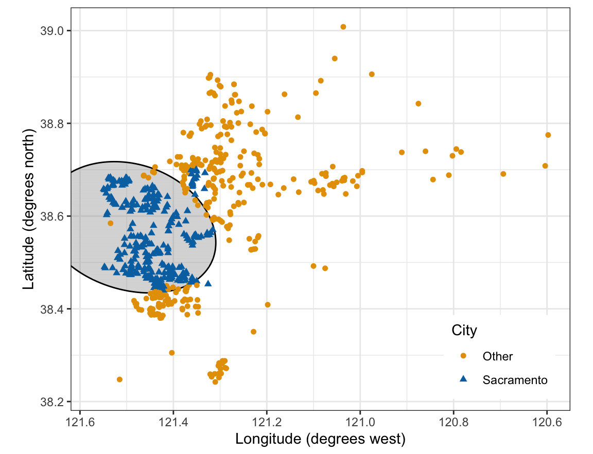

### $\gamma$ = 1

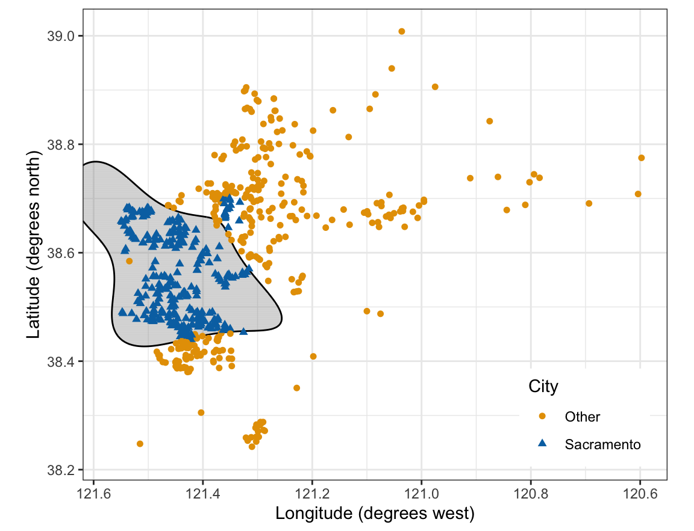

### $\gamma$ = 100

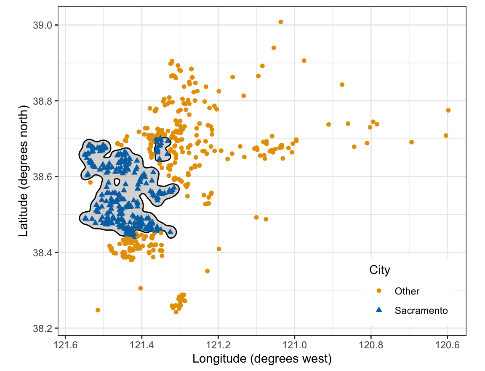

### $\gamma$ = 1000

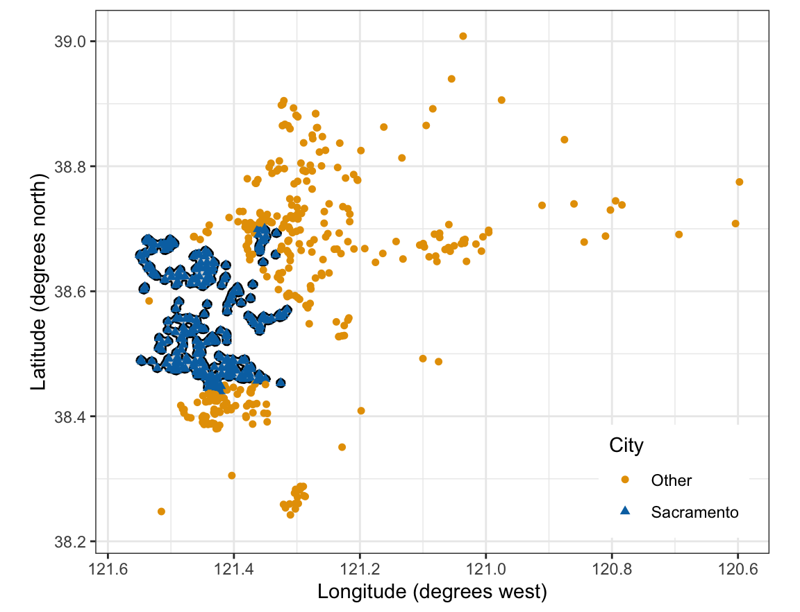

:::

::: notes
The tabs show four support vector machines with the radial kernel, all with the cost that cross-validation chooses below, cost = 10, at four values of gamma. At gamma = 0.1 each support vector's influence reaches 6.8 standard deviations, about the width of the whole area, and the boundary is a smooth oval: low variance, more bias. As gamma grows, the boundary follows the city's block more closely, and the training error rate falls from 6.3% to 0.0%. At gamma = 1000 the influence reaches only 0.07 standard deviations: the region classified Sacramento breaks into small islands around the training homes, 581 of the 621 training homes are support vectors, and a new home between the islands is too far from every support vector for any to count, so f-hat there is w-hat_0 and the home gets the class its sign gives, Other. That is low bias and high variance. Gamma = 100 with cost = 10, the pair cross-validation chooses below, already has training error rate 0.0% with 350 support vectors: it sits at the edge of that overfitting regime.
:::

## Fitting

```r
# Support vector machine: radial kernel, standardized features.
svm_fit <- svm(place ~ longitude + latitude, data = train,
               kernel = "radial", cost = 1, gamma = 1)
svm_fit
```

```

Call:
svm(formula = place ~ longitude + latitude, data = train, kernel = "radial", 
    cost = 1, gamma = 1)


Parameters:
   SVM-Type:  C-classification 
 SVM-Kernel:  radial 
       cost:  1 

Number of Support Vectors:  147
```

::: notes
svm() with kernel = "radial" fits the support vector machine with the radial kernel; gamma is the kernel's gamma (in e1071, as in libsvm). As in the previous lecture, svm() standardizes the features by default, so the kernel's distances are in standard deviations. The fitted object holds the support vectors SV (standardized), their weights alpha-hat_i as coefs, and minus w-hat_0 as rho, in svm()'s sign, positive here for Sacramento, the class of the first training home. Summing coefs times the radial kernel over the 147 support vectors, minus rho, reproduces svm()'s decision values for the test homes (the chapter checks this in a collapsed Code callout).
:::

# Tuning

::: notes
The radial kernel has two tuning parameters, cost and gamma, chosen together by 10-fold cross-validation over a grid of pairs from the training homes alone. The chosen support vector machine is then evaluated on the test homes, which played no part in fitting or in choosing the pair.
:::

## Grid

```r
# 10-fold cross-validation over a grid of cost and gamma.
cv_svm <- tune(svm, place ~ longitude + latitude, data = train,
               kernel = "radial",
               ranges = list(cost = 10^(-1:3), gamma = 10^(-2:3)))
cv_svm$best.parameters
```

```
   cost gamma
23   10   100
```

::: notes
The radial kernel has two tuning parameters, cost and gamma, chosen together by 10-fold cross-validation over a grid of pairs. The estimate for each pair is CV_(10)(cost, gamma), the equal-weight mean of the fold error rates as in the previous lecture. tune() takes a list of values for each, and fits every pair: here 5 values of cost and 6 of gamma, one per factor of 10. best.parameters is the pair with the smallest estimate, cost = 10 and gamma = 100.
:::

## Grid: CV estimates

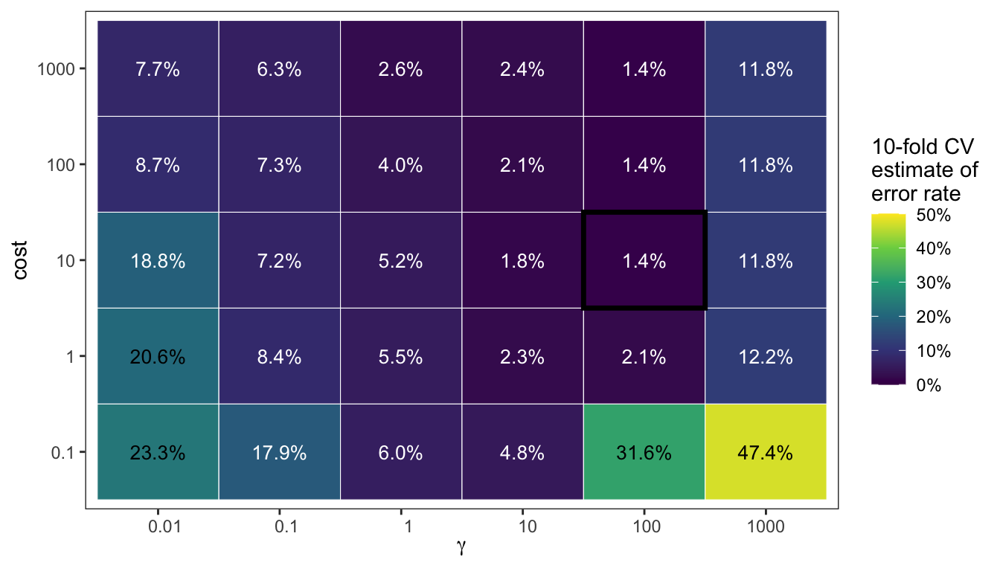{height=480}

::: notes
The figure shows the 10-fold cross-validation estimate for each pair, with the chosen pair outlined. The smallest estimate, 1.4%, is at cost = 10 and gamma = 100 (3 pairs share it, and tune() takes the first, the smallest cost among them). The corners show the two ways to go wrong. Small gamma (left): each support vector's influence is wide and the boundary nearly linear, too rigid for the city's block; at the smallest cost and gamma the estimate is 23.3%, within a few percentage points of the linear support vector classifier's smallest estimate, 20.3%. Large gamma (right): each training home makes its own island, the fit overfits, and the estimate rises to at least 11.8% at gamma = 1000, whatever cost; with the smallest cost as well, the estimate, 47.4%, is close to the error rate of classifying every home Other, 47.3%. At every gamma, cost = 1000 has a smaller estimate than cost = 0.1 (the estimate is not monotone in cost in between): a larger cost lets the fit bend further at the price of a narrower margin. The gain is largest where cost = 0.1 fails badly: the estimate falls from 31.6% to 1.4% at gamma = 100 and from 47.4% to 11.8% at gamma = 1000, against 23.3% to 7.7% at gamma = 0.01. The fold error rates at the chosen pair have standard deviation 1.6%, so neighboring cells within a percentage point or so of the smallest are not distinguishable.
:::

## Test error

::: {.panel-tabset .fig-tabs}

### Linear

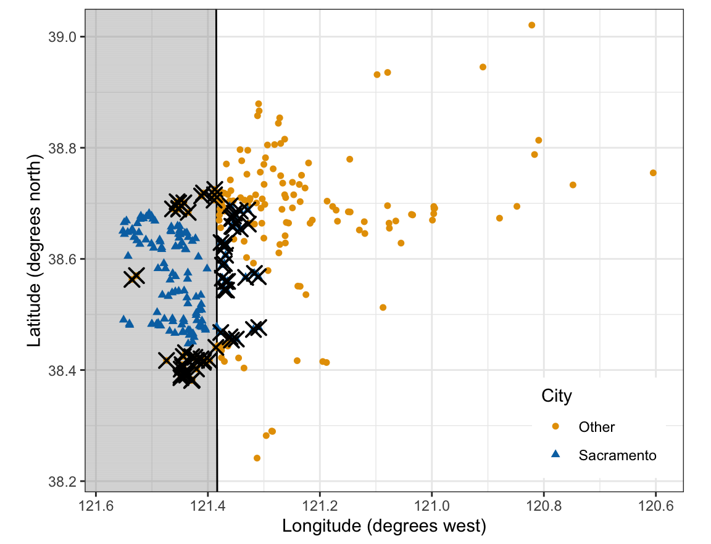

### Radial

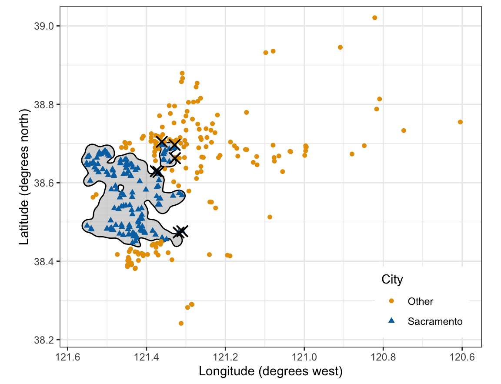

:::

::: notes
The linear support vector classifier is tuned as in the previous lecture, with tune() over cost from 0.01 to 100, two values per factor of 10. Its estimate, 20.3%, ties at every cost from 0.32 to 100, up to floating-point rounding, and tune() reports the first exact minimum, cost = 1. The tabs show the test homes with the boundaries of that linear support vector classifier and of the support vector machine chosen above, each refit to all the training homes; crosses mark the test homes each misclassifies. The linear boundary is nearly a north-south line: it misclassifies the homes of other cities west of it, north and south of the city's block, and the Sacramento homes east of it. The radial boundary encloses the block, and its few errors lie at the city's edge.
:::

## Test error: confusion matrices

```
$radial
            Predicted
Truth        Other Sacramento
  Other        165          2
  Sacramento     5        139

$linear
            Predicted
Truth        Other Sacramento
  Other        129         38
  Sacramento    32        112
```

::: {style="font-size: 0.7em; margin-top: 1em"}
- Test error rate: radial 2.3%, linear 22.5%
- Classifying every test home `Other`: 46.3%
:::

::: notes
With Sacramento as the positive class, the confusion matrices of the test homes are the printouts, with the truth in the rows and the predictions in the columns. The support vector machine misclassifies 2.3% of the 311 test homes and the linear support vector classifier 22.5%, against 46.3% for classifying every test home Other.
:::

# More than two classes

::: notes
The figure shows the training homes in three classes: the city of Sacramento, the city of Elk Grove, and every other city.
:::

## More than two classes

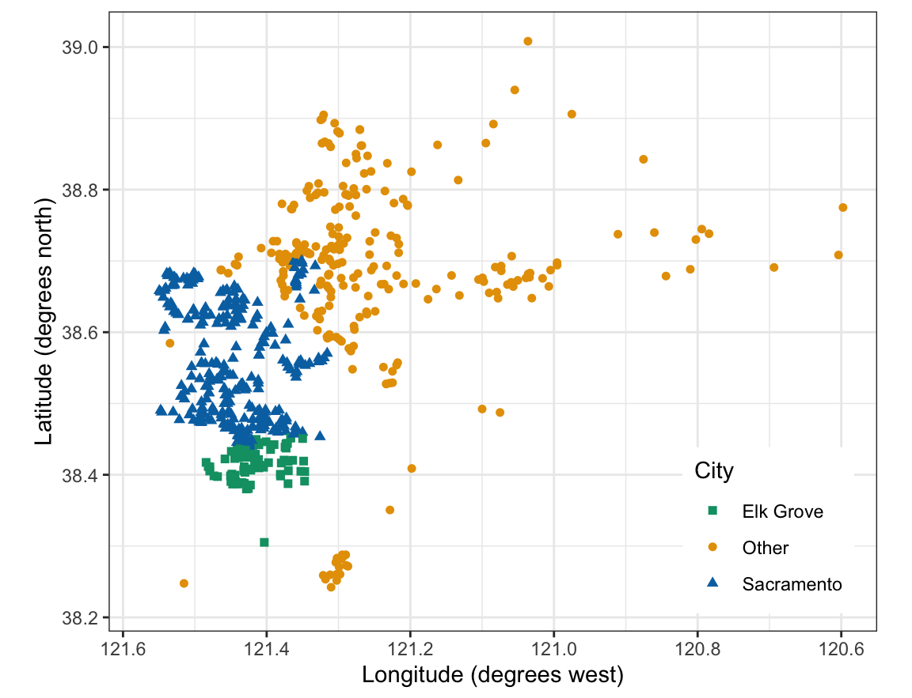{height=560}

::: notes
All three classes appear: Elk Grove's homes (squares) form a cluster south of Sacramento's (triangles), inside the region the two-class fits gave to Other (circles).
:::

## One versus one and one versus all

::: {style="font-size: 0.7em"}
$K$ classes, $K > 2$:
:::

::: {.incremental style="font-size: 0.7em"}
- One versus one: a classifier for each of the $\binom{K}{2}$ pairs of classes; the most votes wins
- One versus all: $K$ classifiers, class $k$ against all the others; the class with the largest $\widehat{f}_k\left(x^*\right)$
:::

::: notes
With K classes, K > 2 (K without arguments is the number of classes, as in the classification lectures; the kernel always carries its two arguments). One-versus-one fits a two-class support vector machine to each of the K choose 2 pairs of classes, using only the training observations of those two classes. A new observation gets one vote from each pair's classifier, for the class on whose side it falls, and is assigned to the class with the most votes. One-versus-all fits K two-class support vector machines, class k coded 1 against all the others coded -1, and assigns a new observation to the class k whose f-hat_k(x*) is largest. Learning objective 5 is assessed: describe both, and explain how svm() classifies by one-versus-one voting (the next slide).
:::

## Pairwise voting

::: {style="font-size: 0.7em"}
- `svm()`: one versus one whenever the class has more than two levels
- Confusion matrix of the test homes, three classes: `Elk Grove`, `Other`, `Sacramento`
:::

::: {style="margin-top: 1em"}
```
            Predicted
Truth        Elk Grove Other Sacramento
  Elk Grove         34     0          0
  Other              0   131          2
  Sacramento         0     5        139
```
:::

::: {style="font-size: 0.7em; margin-top: 1em"}
- Test error rate: 2.3%
:::

::: notes
svm() uses one-versus-one whenever the class factor has more than two levels; nothing in the call changes. The fit uses the cost and gamma chosen for two classes: svm(three ~ longitude + latitude, data = train, kernel = "radial", cost = 10, gamma = 100), which fits the 3 pairs (the chapter shows this call and its decision values; there is no slide for it). Each column of decision values is one pair's classifier, named first/second: a positive value is a vote for the first class, a negative one for the second. The third test home gets 2 votes for Other, 1 for Sacramento and 0 for Elk Grove, so it is classified Other. Counting the votes for each test home gives predict()'s class for all 311 of them, with no ties. The printout is the confusion matrix of the test homes in the three classes, truth in the rows. The three-class fit misclassifies 2.3% of the test homes.
:::

# Hinge and logistic loss

::: notes
The data are the training homes of the first figure, in two classes, and the classifier is the linear support vector classifier of the Test error section.
:::

## Loss plus penalty

::: {style="font-size: 0.7em"}
Support vector classifier, without slack variables:
:::

::: {style="font-size: 0.8em"}
$$
\underset{w_0, w}{\text{minimize}} \quad
\sum_{i=1}^n \max\left[0, 1 - y_i f(x_i)\right] + \lambda\sum_{j=1}^p w_j^2,
\qquad \lambda = \frac{1}{2\,\texttt{cost}},
$$
:::

::: {.incremental style="font-size: 0.7em"}
- $f(x_i) = w_0 + w^\top x_i$ — fit, with $w = (w_1, \ldots, w_p)^\top$
- $y_i = \pm 1$ — class of observation $i$; $n$ observations, $p$ explanatory variables
- $\max\left[0, 1 - y_if(x_i)\right]$ — hinge loss of observation $i$
- $\lambda \ge 0$ — ridge penalty's tuning parameter
:::

::: notes
The support vector classifier can be written without slack variables. In the previous lecture's penalty form, minimizing one half of the squared norm of w plus cost times the sum of the slacks, subject to y_i f(x_i) >= 1 - epsilon_i and epsilon_i >= 0, with f(x) = w_0 + w transposed x, each slack at the solution is the smallest its two constraints allow, epsilon_i = max[0, 1 - y_i f(x_i)]. Substituting and dividing by cost gives the display. This is ISLR2's form, with its beta in place of w. It is a loss plus a penalty, like ridge regression: a large cost is a small lambda. This derivation is an assessed result: the learning objective says derive.
:::

## Logistic loss

::: {.columns}
::: {.column width="70%"}
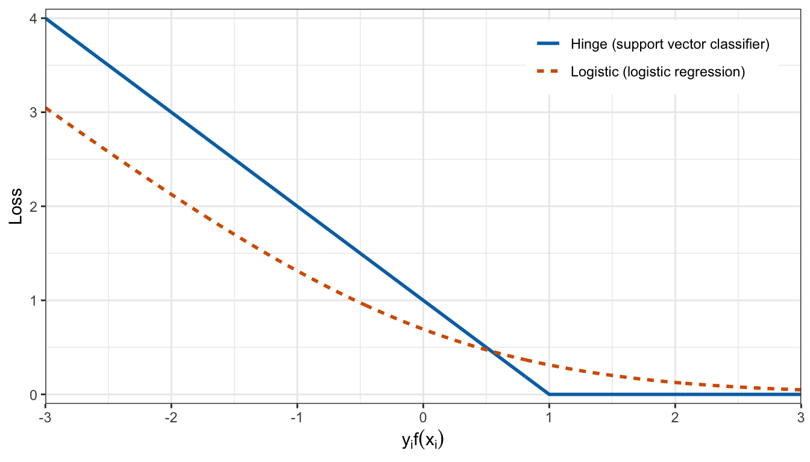{height=480}
:::
::: {.column width="30%"}
::: {style="font-size: 0.8em; margin-top: 3em"}
Logistic regression, negative log-likelihood:

$$
\sum_{i=1}^n \log\left(1 + e^{-y_i f(x_i)}\right).
$$
:::
:::
:::

::: notes
Logistic regression with f(x) equal to the log of the ratio of Pr(Y = 1 given x) to Pr(Y = -1 given x) gives Pr(Y = 1 given x) = 1/(1 + e^(-f(x))) and Pr(Y = -1 given x) = 1/(1 + e^(f(x))), so with the plus or minus one coding the probability of the observed class is 1/(1 + e^(-y_i f(x_i))) and the negative log-likelihood is the display. Adding lambda times the sum of the squared w_j gives ridge-penalized logistic regression. The two classifiers differ only in the loss, a function of y_i f(x_i). The figure plots the two losses against y_i f(x_i). The two losses have the same shape: large and nearly linear for a misclassified observation, y_i f(x_i) < 0, and small for one well on its own side. The hinge loss is exactly 0 from y_i f(x_i) = 1 on, so an observation on or outside the margin contributes nothing, and the fit depends only on the support vectors. The logistic loss is positive for every observation, so every observation contributes, the far ones a little. Three differences between the classifiers follow. Logistic regression estimates a probability Pr(Y = 1 given x); the support vector classifier gives only a side and a distance, f-hat(x), with no probability. When the classes are well separated, the support vector classifier's boundary is set by the observations near it only, while logistic regression's estimates are pulled by all of them (and, with perfect separation and no penalty, do not exist). Kernels apply to logistic regression too, but there every training observation gets a nonzero weight, while the support vector machine's sum runs over the support vectors only. If Comparison is dropped, say: the logistic regression's test error rate on these homes, 22.2%, is about the same as the linear support vector classifier's, 22.5%, and the two classify 99.0% of the test homes the same way; they differ here in both the loss and the penalty, so the comparison does not isolate the loss; the logistic regression gives each test home a probability, which the support vector classifier does not.
:::

## Comparison

```r
# Logistic regression on longitude and latitude, classified at 0.5.
logistic_fit <- glm(place ~ longitude + latitude, data = train,
                    family = binomial)
p_test <- predict(logistic_fit, test, type = "response")
logistic_class <- if_else(p_test > 0.5, "Sacramento", "Other")
mean(logistic_class != test$place)
```

```
[1] 0.221865
```

::: {style="font-size: 0.7em; margin-top: 1em"}
- Logistic regression test error rate: 22.2%; linear support vector classifier: 22.5%
- The two classify 99.0% of the test homes the same way
- Logistic regression gives each test home a probability; the support vector classifier does not
:::

::: notes
Logistic regression on the two coordinates, without a penalty, and the linear support vector classifier chosen above, on the same training homes. On these data the logistic regression's test error rate, 22.2%, is about the same as that of the linear support vector classifier with cost = 1, 22.5%, and the two classify 99.0% of the test homes the same way. They differ here in both the loss and the penalty, so the comparison does not isolate the loss. The 331 training homes on or outside the support vector classifier's margin have zero hinge loss and the other 290 positive hinge loss; those 290 and the 2 homes exactly on the margin are its 292 support vectors, which set its fit. The logistic regression gives each test home a probability, which the support vector classifier does not.
:::

## Conclusion

- Polynomial features curve the boundary, but they are too many
- A new observation is classified through inner products with the support vectors
- A kernel replaces the inner product: linear, polynomial, radial
- The radial kernel is local; $\gamma$ trades bias against variance
- `cost` and $\gamma$ by cross-validation; judged by the test error rate
- Hinge loss is zero outside the margin; logistic loss never is

::: notes
The support vector classifier fit to polynomial features of the explanatory variables draws a hyperplane in the enlarged feature space, which is a curved boundary in the explanatory variables, but the number of features grows quickly with the number of explanatory variables and the degree. The fitted classifier classifies a new observation through its inner products with the support vectors alone. The support vector machine replaces the inner product with a kernel K(x, x_i): the linear kernel gives back the support vector classifier, the polynomial kernel of degree d is an inner product of polynomial features computed without listing them, and the radial kernel is local, classifying a new observation by the support vectors near it. The radial kernel's gamma trades bias against variance: a small gamma gives a nearly linear boundary, a large one a boundary that wraps each training observation and overfits. cost and gamma are chosen together by cross-validation over a two-dimensional grid with e1071::tune(), and the chosen fit is evaluated by its test error rate and confusion matrix against the linear support vector classifier. With more than two classes, svm() fits one classifier per pair of classes and classifies by vote (one versus one); one versus all fits one classifier per class against the rest. The support vector classifier minimizes the hinge loss plus a ridge penalty, lambda = 1/(2 cost). The hinge loss is zero for observations on or outside the margin, so only the support vectors matter; logistic regression's loss is positive for every observation and yields probabilities, which the support vector machine does not.

The next lecture begins unsupervised learning with clustering (ISLR2 Chapter 12).
:::
